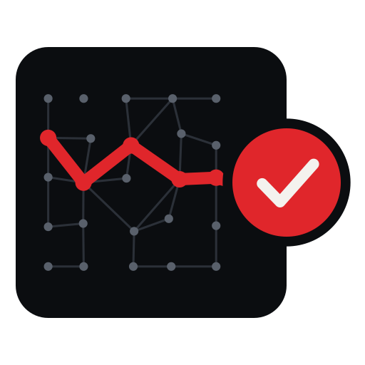

# De la caja negra a la evidencia

<p align="center">
  <picture>
    <source media="(prefers-color-scheme: dark)" srcset="assets/icon-b-dark.svg">
    
  </picture>
</p>

[English](README.md) · **Español**

**Modernizar COBOL más allá de la traducción: agentes de IA, patrones de arquitectura, transacciones y oráculos verificables.**

José María Flores Zazo · [jmfloreszazo.com](https://jmfloreszazo.com) · Edición v2026.10.29

> [!IMPORTANT]
> La IA puede investigar, proponer y construir. Aceptar el resultado exige contratos, oráculos independientes y una autoridad explícita. Una modernización 1:1 puede ser un puente, pero nunca deberíamos confundir el puente con la ciudad a la que queremos llegar.

Un libro abierto y un laboratorio ejecutable sobre cómo modernizar sistemas COBOL sin apostar el negocio a una equivalencia que no sabemos demostrar: qué conservar, qué patrón sustituye cada garantía del mainframe, cómo usar agentes de IA sin regalarles autoridad y cómo acercarse a la capacidad de un mainframe en Azure o en infraestructura propia. Está en abierto porque un libro que defiende la evidencia no puede pedir que se le crea por fe.

**Corte de fuentes: 2 de noviembre de 2026.** `main` incluye avances brownfield posteriores a la prepublicación. Los PDF publicados congelan sus respectivos tags; no representan automáticamente el manuscrito actual.

## Leer

[Prepublicación de investigación v2026.10.31-rc1 — prototipo histórico + TODM, experimental](docs/releases/v2026.10.31-rc1.md) · [Descargar PDF en español e inglés](https://github.com/jmfloreszazo/de-la-caja-negra-a-la-evidencia/releases/tag/v2026.10.29) · [Ruta rápida: siete capítulos](docs/READING_PATH.es.md) · [Ediciones PDF y proceso de publicación](docs/PDF.md).

| | Capítulo a capítulo | El libro entero en una página |
|---|---|---|
| Español (original) | [book/es](book/es/README.md) | [book/es.md](book/es.md) |
| English | [book/en](book/en/README.md) | [book/en.md](book/en.md) |

37 capítulos numerados más el capítulo 25 bis y el complementario de descomposición en siete partes, epílogo, siete anexos y 41 diagramas por idioma (C4, UML de secuencia, estados y clases, ER, gitGraph), escritos en Mermaid y publicados como imágenes con el estilo visual del libro. Las dos ediciones tienen exactamente la misma estructura y la CI falla si se separan.

## Idiomas: libro frente a código

**El libro siempre se mantiene completo en español e inglés. Todos los proyectos ejecutables y sus README, código, comentarios, pruebas, logs y CI están exclusivamente en inglés.** Incluso los fragmentos de código incluidos en la edición española permanecen en inglés. [Política de idiomas](docs/LANGUAGE_POLICY.md).

## Ruta rápida y evidencia

[**Capítulo 25 bis: infraestructura local, Azure y latencia de oficinas bancarias**](book/es/parte-5-capacidad/25a-infraestructura-mainframe-local-azure-y-redes-bancarias.md) · [Evidencia E1a/E1b con JSON de CI](evidence/runs/README.es.md) · [Protocolo WAN E3](docs/NETWORK_PROTOCOL.es.md).

[**Matriz de evidencia verificable**](docs/EVIDENCE.es.md): CI real, E1 y E2 parcialmente verificados, incrementos brownfield ejecutados y E3/E4 pendientes.

¿Quieres recorrer el argumento sin leer todos los capítulos de forma lineal? Sigue la [ruta de siete capítulos](docs/READING_PATH.es.md). El [registro editorial y de evidencias](docs/EDITORIAL_REVIEW.es.md) distingue lo comprobado de lo todavía hipotético.

La [CI del laboratorio](https://github.com/jmfloreszazo/de-la-caja-negra-a-la-evidencia/actions/runs/40900252152) ya ha ejecutado las pruebas offline, nativas y Podman en runners Linux. Esto no acredita todas las plataformas ni la aceptación global de E1–E4. La PR #5 ya está fusionada. E1 PostgreSQL/SQL Server y E2 Orleans tienen evidencias sintéticas parciales; E3/E4 siguen sin ejecución completa. El [roadmap actual](ROADMAP.es.md) y la [matriz de evidencia](docs/EVIDENCE.es.md) separan los resultados históricos, los incrementos brownfield y los gates pendientes.

## Ejecutar el laboratorio

```bash
cd lab
python3 tools/verify_offline.py        # Python-only anchor, independent policy, and accounting oracle
bash scripts/run-podman.sh --auto      # Full COBOL, .NET 10, gate, and transfer checks offline
```

El laboratorio está en inglés. La guía en español es el [anexo A del libro](book/es/anexos/anexo-a-un-laboratorio-que-pueda-contradecirnos.md).

## Estructura del repositorio

```text
README.md · README.es.md      bilingual repository entrypoints
ROADMAP.md · ROADMAP.es.md    bilingual open roadmaps
book/
  es/  en/                    chapter-by-chapter source books
  es.md  en.md                single-page generated books (scripts/build.py)
  figures/                    diagram sources and rendered artwork
lab/                          GnuCOBOL · .NET 10 · SQLite · Python · Podman
scripts/                      build.py · check.py · render_figures.py · setup_github.sh
assets/                       brand mark, covers, and social preview
docs/LAUNCH.md                release preparation instructions
.github/                      templates, CODEOWNERS, and workflows
```

El resto de documentos del proyecto (guía de colaboración, gobernanza, código de conducta) está en inglés, para que cualquiera pueda participar.

## Reproducirlo todo

```bash
python3 scripts/build.py          # Regenerate both single-page books
python3 scripts/check.py          # Check links, ES/EN sync, and generated files
npx markdownlint-cli2 "**/*.md"   # Validate Markdown style
python3 scripts/render_figures.py # Render diagrams (npm i -g @mermaid-js/mermaid-cli)
python3 lab/tools/verify_offline.py
```

## Colaborar

La guía es [CONTRIBUTING.md](CONTRIBUTING.md) (en inglés): caminos por perfil, una primera contribución en 15 minutos y las reglas que mantienen sincronizados los dos idiomas. Las preguntas van a [Discussions](../../discussions), en español o en inglés, y el trabajo abierto está en la [hoja de ruta](ROADMAP.es.md).

1. **Evidencia antes que opinión.** Una afirmación trae fuente, experimento o la palabra «propuesta».
2. **Lo que no sabemos también se escribe.** Un `INCONCLUSIVE` honesto vale más que un `PASS` inventado.
3. **Pasos pequeños y reversibles.** Una idea por pull request, en los dos idiomas.
4. **Nadie aprueba su propio oráculo.** Los contratos y el gate del laboratorio tienen revisores obligatorios.

## Estado de aceptación E2

La [campaña E2 acotada está cerrada](docs/E2_CLOSEOUT.es.md), pero **E2 no tiene un PASS científico global**. Para obtenerlo haría falta una nueva campaña con recursos distribuidos reales y un contrato aprobado: [protocolo completo E2 Full PASS (ES)](docs/E2_FULL_PASS_PROTOCOL.es.md) · [EN](docs/E2_FULL_PASS_PROTOCOL.md). Requiere probar X00–X08, incluir fallos físicos y SQL HA, registrar métricas crudas y obtener auditoría independiente. **No se reactiva E2 como tarea activa.**

## Autoridad del origen en una migración brownfield

El [protocolo de fencing y aceptación CAP-005/007](docs/BROWNFIELD_SOURCE_FENCE.es.md) ([EN](docs/BROWNFIELD_SOURCE_FENCE.md)) y el [inventario bloqueante](lab/brownfield/owner_readiness/README.md) especifican qué rutas de escritura del legacy y efectos externos deben estar demostrados antes de cualquier corte. La herramienta solo valida estructura, **no** comprueba el fencing en CICS/IMS/Db2 ni concede aprobación TODM G2/G6.

## W01: journal transaccional del origen, en entorno sintético

El [laboratorio de journal incremental](lab/brownfield/w01_feed/README.md) y la investigación [ES](docs/research/w01-source-journal.es.md) / [EN](docs/research/w01-source-journal.en.md) prueban secuencia confirmada en origen, captura MVCC, replay, rechazo de huecos/corrupción y cursor atómico en dos PostgreSQL. **No** es CDC productivo, fencing de mainframe, lectura linealizable ni aceptación bancaria. La proyección anterior se mantiene independiente.

## W01: seguridad de lectura impuesta por PostgreSQL

La investigación [ES](docs/research/w01-reader-identity.es.md) / [EN](docs/research/w01-reader-identity.en.md) distingue una transacción SQL `READ ONLY` de una **identidad SQL con permisos exclusivamente de lectura**. Los controles negativos rechazan escrituras al origen, credenciales privilegiadas y destinos de reset no autorizados. No equivale al fencing del mainframe real.

## W01: proyección PostgreSQL de lectura de saldos

El [laboratorio acotado W01](lab/brownfield/w01_projection/README.md) y la investigación [ES](docs/research/w01-projection.es.md) / [EN](docs/research/w01-projection.en.md) estudian la proyección no autoritativa con watermark atómico, fallback al origen y rechazo de datos obsoletos o corruptos. No se afirma CDC, linealizabilidad, saldo disponible, aprobación bancaria ni fencing real.

## Oleadas funcionales de modernización brownfield

Los protocolos [ES](docs/research/mainframe-extraction-waves.es.md) / [EN](docs/research/mainframe-extraction-waves.en.md) y el [oráculo de oleadas](lab/decomposition/wave_gate.py) conectan capacidades del negocio con decisiones de extracción refutables sin parser COBOL. Las 30 capacidades continúan siendo hipótesis y ninguna candidata queda autorizada para producción.

## Más del autor

El libro se apoya en este trabajo:

- [TODM — Test Oracle-Driven Methodology](https://github.com/jmfloreszazo/TODM) — la metodología detrás de los oráculos y gates del libro
- [Más allá del hype: ver un vídeo en YouTube está muy bien, pero la realidad es otra](https://jmfloreszazo.com/mas-alla-del-hype-ver-un-video-en-youtube-esta-muy-bien-pero-la-realidad-es-otra/) — REA, agentes e ingeniería inversa con evidencia
- [De Leviatán al Autopilot](https://jmfloreszazo.com/de-leviatan-al-autopilot/) — gobernar agentes autónomos: autoridad frente a capacidad
- [Agentes al vuelo frente a un harness gobernado](https://jmfloreszazo.com/agentes-al-vuelo-frente-a-un-harness-gobernado/) — detección de defectos, QA, QC y el coste de medir
- [Del modelo que responde al agente que trabaja: Agent Harness y CodeAct con C#](https://jmfloreszazo.com/del-modelo-que-responde-al-agente-que-trabaja-agent-harness-y-codeact-con-c/) — un harness gobernado en C# y .NET 10
- [Auditar agentes de Copilot en VS Code: git es la única versión que importa](https://jmfloreszazo.com/auditar-agentes-de-copilot-en-vs-code-git-es-la-unica-version-que-importa-y-auditar-no-es-lo-mismo-que-prevenir/) — auditar no es lo mismo que prevenir
- [Agent Host Protocol (AHP): por qué el host, y no tu editor, es el dueño del estado de la sesión](https://jmfloreszazo.com/agent-host-protocol-ahp-por-que-el-host-y-no-tu-editor-es-el-dueno-del-estado-de-la-sesion/) — quién es dueño del estado de la sesión
- [MCP, A2A y AHP: tres protocolos y por qué tu agente debería vivir en un contenedor](https://jmfloreszazo.com/mcp-a2a-y-ahp-tres-protocolos-y-por-que-tu-agente-deberia-vivir-en-un-contenedor/) — tres protocolos, tres capas
- [Benchmark: dos Hosted Agents, mismo Foundry, .NET 10 LTS vs Python 3.12](https://jmfloreszazo.com/benchmark-dos-hosted-agents-mismo-foundry-net-10-lts-vs-python-3-12/) — un benchmark que solo cambia una cosa

## Licencia y cita

Texto y diagramas: CC BY-SA 4.0 · Código: MIT · Ver [LICENSE.md](LICENSE.md). Para citar, [CITATION.cff](CITATION.cff).
