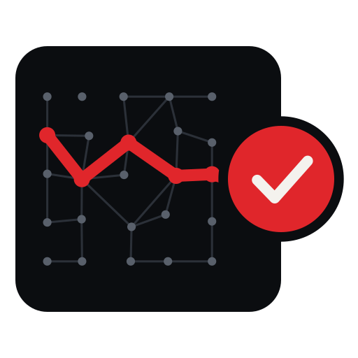

# From Black Box to Evidence

<p align="center">
  <picture>
    <source media="(prefers-color-scheme: dark)" srcset="assets/icon-b-dark.svg">
    
  </picture>
</p>

**English** · [Español](README.es.md)

**Modernizing COBOL beyond translation: AI agents, architecture patterns, transactions and verifiable oracles.**

> **Research/book edition closed on 5 November 2026.** [Final bilingual closeout and experiment verdicts](docs/FINAL_CLOSEOUT.md) · [Archival release notes](docs/releases/v2026.11.05.md). The new release tag identifies the final research snapshot; the book still bears its historical first-edition cover identifier. E1/E2 are partially verified. **Status after closeout (8 November 2026):** E3 and E4 were executed as *bounded single-VM demonstrations on Azure* — an exploratory open-loop ledger trial and an isolated replay of one real model response — recorded in [`evidence/runs/azure-e1-e4-2026-11-08.json`](evidence/runs/azure-e1-e4-2026-11-08.json) and validated by the [TODM adapter](evidence/runs/todm-azure-2026-11-08.json). They remain **not accepted** as E3/E4 acceptance studies: no approved capacity contract, no mainframe comparison, no comparative agent population, release `BLOCK`.

José María Flores Zazo · [jmfloreszazo.com](https://jmfloreszazo.com) · Edition v2026.10.29

> [!IMPORTANT]
> AI can investigate, propose and build. Accepting the result requires contracts, independent oracles and explicit authority. A 1:1 modernization can be a bridge, but we should never mistake the bridge for the city we want to reach.

An open book and a runnable lab on how to modernize COBOL systems without betting the business on an equivalence we cannot demonstrate: what to preserve, which pattern replaces each mainframe guarantee, how to use AI agents without handing them authority and how to approach mainframe capacity on Azure or on your own infrastructure. It is open because a book that argues for evidence cannot ask to be believed on faith.

**Published research snapshot: 5 November 2026.** The archival release includes both PDFs and both single-page Markdown editions. Published assets freeze their tag; later source corrections do not change those assets.

## Current local additions

The [project map](docs/PROJECT_STRUCTURE.md) separates editable book sources,
executable labs, observed evidence and generated deliverables. The current
working edition adds [TODM tools, models and ADRs](book/en/part-3-oracles/10a-todm-toolbox-models-and-adrs.md),
[actual Azure CLI captures](evidence/runs/azure-cli-2026-11-08/capture.json),
[Azure E1–E4 demonstrations](evidence/runs/azure-e1-e4-2026-11-08.json), and a
[final cross-language annex](book/en/annexes/annex-h-beyond-cobol.md).
These additions do not change historical release assets or grant production
acceptance. Model tools implement bounded JSON profiles, not complete BPMN/DMN engines.

## Read

[Download Spanish and English PDFs — archival v2026.11.05](https://github.com/jmfloreszazo/de-la-caja-negra-a-la-evidencia/releases/tag/v2026.11.05) · [Historical research preview v2026.10.31-rc1](docs/releases/v2026.10.31-rc1.md) · [Fast reading path: seven chapters](docs/READING_PATH.md) · [PDF editions and release process](docs/PDF.md).

| | Chapter by chapter | Whole book on one page |
|---|---|---|
| English | [book/en](book/en/README.md) | [book/en.md](book/en.md) |
| Español (original) | [book/es](book/es/README.md) | [book/es.md](book/es.md) |

37 numbered chapters plus the companion chapters 7 bis, 10 bis, 21 bis and 25 bis in seven parts, an epilogue, eight annexes (A–H) and 48 diagrams per language (C4, UML sequence, state and class, ER, flowchart, gitGraph), drawn in Mermaid and published as images in the book's visual style. Both editions have exactly the same structure, and CI fails if they drift apart; the [diagram catalog](book/en/diagrams.md) is the inventory the PDF build checks against.

## Languages: book versus code

**The book is always published in Spanish and English. All executable projects and their README files, code, comments, tests, logs and CI are in English only.** Code listings also stay in English in both editions. [Language policy](docs/LANGUAGE_POLICY.md) · [contribution and agent rules](AGENTS.md).

## Run the lab

```bash
cd lab
python3 tools/verify_offline.py        # Python only: anchor, independent policy, accounting oracle
bash scripts/run-podman.sh --auto      # everything: COBOL, .NET 10, gate and transfers, no network
```

Real COBOL compiled with GnuCOBOL, a .NET 10 candidate, an Oracle Gate that returns PASS, FAIL or INCONCLUSIVE and a transfer service under races, duplicates, crashes and lock waits. Details in [lab/README.md](lab/README.md).

## Repository layout

```text
README.md · README.es.md      this page, in English and Spanish
ROADMAP.md · ROADMAP.es.md    open work, in English and Spanish
book/
  es/  en/                    the book chapter by chapter (source of truth)
  es.md  en.md                the whole book on one page (generated by scripts/build.py)
  figures/                    diagram sources (src/) and images in the book's visual style
lab/                          GnuCOBOL · .NET 10 · SQLite · Python · Podman
scripts/
  build.py                    regenerates book/es.md and book/en.md
  check.py                    links, Spanish/English sync and generated files up to date
  render_figures.py           renders the diagrams as images with the book's theme
  setup_github.sh             labels, Discussions, milestone and seed issues in one command
assets/                       logo, symbol, covers and social preview
docs/LAUNCH.md                maintainer guide for the first publication
.github/                      issue and PR templates, CODEOWNERS, workflows
```

## Reproduce by scope

Start from the repository root with Python 3.12 or later and Git. On Windows, use `python` if `python3` is not available. Preserve canonical checkout bytes with the [checkout-integrity instructions](CONTRIBUTING.md#checkout-integrity); a clean status alone does not detect CRLF conversion in older clones.

**Book structure and preserved evidence (no compiler, container or cloud):**

```bash
git rev-parse HEAD
git status --short
python3 --version
python3 scripts/check_language_policy.py
python3 scripts/check.py
python3 scripts/check_evidence.py
python3 lab/tools/verify_offline.py
```

Expected results are `LANGUAGE POLICY: PASS`, `CHECK: PASS`, `EVIDENCE CHECK: PASS` and `VERIFY: PASS`. Record each command and exit code; stop on failure. These checks audit committed material and historical SQLite results. They do **not** execute COBOL/.NET or validate remote CI runs.

| To reproduce | Procedure | Boundary |
|---|---|---|
| Single-page books | `python3 scripts/build.py`, then `python3 scripts/check.py` | Regenerates both languages from chapter sources |
| Markdown and diagram rendering | Node.js 22; `npx --yes markdownlint-cli2@0.22.0 "**/*.md"`; Mermaid CLI 11.12.0 and `python3 scripts/render_figures.py --check` | Syntax/render checks; use [the contribution guide](CONTRIBUTING.md#diagram-rules) for intentional image updates |
| PDF editions | [PDF build instructions](docs/PDF.md) | Linux dependencies and fonts required; no release or byte-identical build implied |
| Fresh COBOL/.NET/SQLite walkthrough | [Host reproduction protocol](lab/docs/HOST_REPRODUCTION.md) | Records a named host, image, raw results and independent audit; Podman required |
| Extended SQL, Orleans and channel labs | [Evidence matrix](docs/EVIDENCE.md) and linked project runbooks | Separate dependencies and acceptance scopes; not included in the walkthrough |

Keep the commit, tool versions, raw logs, failures and independent oracle with every new run. E1/E2 are partially verified; E3/E4 are not completed acceptance studies. Neither a source check nor a local smoke test proves Azure or mainframe performance.

## Contribute

Start with [CONTRIBUTING.md](CONTRIBUTING.md): paths by profile, a first contribution in 15 minutes and the rules that keep both languages in sync. Questions go to [Discussions](../../discussions), open work to the [roadmap](ROADMAP.md), decisions follow [GOVERNANCE.md](GOVERNANCE.md) and the [code of conduct](CODE_OF_CONDUCT.md) applies everywhere.

1. **Evidence before opinion.** A claim brings a source, an experiment or the word "proposal".
2. **What we do not know is written down too.** An honest `INCONCLUSIVE` beats an invented `PASS`.
3. **Small, reversible steps.** One idea per pull request, in both languages.
4. **Nobody approves their own oracle.** The lab's contracts and gate have mandatory reviewers.

## Evidence status

[**Chapter 25 bis: on-premises, Azure and banking-branch WAN latency**](book/en/part-5-capacity/25a-mainframe-on-prem-azure-and-banking-network-infrastructure.md) · [E1a/E1b CI evidence JSON](evidence/runs/README.md) · [E3 WAN protocol](docs/NETWORK_PROTOCOL.md).

[**Verifiable evidence matrix**](docs/EVIDENCE.md): real CI, partially verified E1/E2, executed brownfield slices, and E3/E4 executed only as bounded Azure demonstrations (not accepted experiments).

**Brownfield source authority:** the [incumbent fencing/owner acceptance protocol](docs/BROWNFIELD_SOURCE_FENCE.md) ([ES](docs/BROWNFIELD_SOURCE_FENCE.es.md)) and [fail-closed structural intake](lab/brownfield/owner_readiness/README.md) identify which real source-side writer and external effects must be evidenced before any CAP-005/007 bank cutover. This is **not real incumbent fencing** or TODM G2/G6 approval.

**E2 acceptance boundary:** [closed bounded campaign](docs/E2_CLOSEOUT.md) ≠ global PASS. [What an actual distributed E2 scientific PASS requires](docs/E2_FULL_PASS_PROTOCOL.md) ([ES](docs/E2_FULL_PASS_PROTOCOL.es.md)): approved SLOs, independent physical domains, natural lifecycle/recovery, SQL failover and raw independent X00–X08 evidence. The new external campaign is **not active**.

**Verified in GitHub Actions:** [Book](https://github.com/jmfloreszazo/de-la-caja-negra-a-la-evidencia/actions/runs/40900252122), [Lab (offline, native, Podman)](https://github.com/jmfloreszazo/de-la-caja-negra-a-la-evidencia/actions/runs/40900252152), and [bilingual PDFs](https://github.com/jmfloreszazo/de-la-caja-negra-a-la-evidencia/actions/runs/40900252098).

**Not yet established:** complete E1 acceptance (E1a/E1b have only the documented partial CI evidence), E2–E4 experimental acceptance, compilation of all *Illustrative* listings, native-level English editorial review, or cross-platform reproductions beyond hosted Linux runners. M1/M2 are local experimental observations, not E3. See [editorial and evidence register](docs/EDITORIAL_REVIEW.md).

## Source-native CDC assessment and owner acceptance (#58)

The paired research [EN](docs/research/source-native-capture-assessment.en.md) / [ES](docs/research/source-native-capture-assessment.es.md) and [English-only discovery gate](lab/brownfield/source_capture/README.md) distinguish Db2 for z/OS logging, CICS VSAM, VSAM non-RLS batch, IMS online/DL-I batch, IBM i journaling, and **unverified** Fujitsu/other mechanisms. These are documentation-backed **candidate paths**, not installed CDC or bank acceptance. Seven owner paths begin UNKNOWN and TODM G2/G6 remain INCONCLUSIVE/BLOCK.

## Vendor-specific runtime contracts (#17/#18/#28)

[ES research](docs/research/vendor-runtime-contracts.es.md) / [EN](docs/research/vendor-runtime-contracts.en.md) and Chapters 1/13 distinguish IBM Z/z/OS, Db2 for z/OS, IBM i, ClearPath MCP, OS 2200 and historically documented Fujitsu GS21. The [11-row contract/discovery catalog](research/vendor-runtime-contracts/catalog.json) cites ten primary vendor references and specifies replacement gaps and negative oracles. NEC ACOS and Bull GCOS stay **unknown**, never assumed equivalent. Its 25 automated cases validate **metadata only**, not native vendor execution or bank approval.

## Concurrent recovery while an original TCP response is held (#30)

The [EN held-ACK protocol](docs/research/channel-held-ack.en.md) ([ES](docs/research/channel-held-ack.es.md)) tests **eight real HTTP clients** simultaneously replaying one original ID while an earlier .NET 10/PostgreSQL COMMIT response is held in a local TCP proxy. The ninth changed-amount request must be refused; independent SQL must show one effect before releasing the old ACK. This remains a **single-host, synthetic financial owner** test, not inter-host networking or a bank certification.

## Real local TCP interruption around native .NET 10 / PostgreSQL (#30)

The [EN protocol](docs/research/channel-loopback-transport.en.md) ([ES](docs/research/channel-loopback-transport.es.md)) adds three **actual loopback TCP reset/timeout interventions** around the existing .NET 10 and two disposable PostgreSQL stores. An independent original SQL report checker compares committed operation, paired postings/outbox and same-ID recovery. **Not a real inter-host WAN partition, bank device or issuer certification.**

## Per-hop channel failures and late writer replies (#30)

The [EN hop-failure contract](docs/research/channel-hop-failures.en.md) ([ES](docs/research/channel-hop-failures.es.md)) adds seven fictional ATM↔switch↔core scenarios and forty prepared adversarial controls for source decision, lost replies, UNKNOWN cash and quarantine after writer-epoch change. This is logical trace evaluation **not real network injection**, issuer or device attestation, or authorization to post money.

## Channel advice/reversal uncertainty (#30)

The [EN](docs/research/channel-late-advice.en.md) / [ES](docs/research/channel-late-advice.es.md) chapter follow-up provides an independent offline *fictional* checker for duplicated/late ATM advice, partial cash versus reversal, missing physical journal and denied stand-in without issuer delegation. The additive [English lab](lab/channels/README.md) is **not** ISO 8583 certified or bank-authoritative; existing .NET 10 and PostgreSQL experimental evidence is preserved.

## W01 source-owned transactional journal (synthetic)

The [source journal lab](lab/brownfield/w01_feed/README.md), [EN](docs/research/w01-source-journal.en.md) / [ES](docs/research/w01-source-journal.es.md) method tests a source-owned committed sequence, MVCC snapshot cut, replay, gap/hash rejection and target cursor atomicity in two PostgreSQL containers. This is **not** production CDC, an incumbent source fence, a linearizable read or bank acceptance. The prior W01 full-snapshot prototype is preserved separately.

## W01 source access-control hardening

The [ES](docs/research/w01-reader-identity.es.md) / [EN](docs/research/w01-reader-identity.en.md) note distinguishes an SQL `READ ONLY` transaction from a **database-enforced SELECT-only identity**. New negative controls deny source financial writes to the reader, reject privileged source DSNs and preflight both disposable reset targets. This is a synthetic permission proof, not a real mainframe source fence.

## W01: PostgreSQL balance read projection

The [bounded W01 PostgreSQL laboratory](lab/brownfield/w01_projection/README.md) and [EN](docs/research/w01-projection.en.md) / [ES](docs/research/w01-projection.es.md) research test a nonauthoritative balance snapshot with an atomic watermark, independent source fallback and refusal of stale/corrupt data. No CDC, linearizability, spendable balance, bank approval or source fencing is claimed.

## Functional-first brownfield extraction waves

The [ES](docs/research/mainframe-extraction-waves.es.md) / [EN](docs/research/mainframe-extraction-waves.en.md) research pair and [wave gate](lab/decomposition/wave_gate.py) connect functional capabilities to falsifiable extraction decisions without a COBOL parser. All 30 capability definitions remain hypotheses and no candidate is approved for deployment.

## Related work by the author

The book builds on this work (articles in Spanish):

- [TODM — Test Oracle-Driven Methodology](https://github.com/jmfloreszazo/TODM) — the methodology behind the book's oracles and gates
- [Más allá del hype: ver un vídeo en YouTube está muy bien, pero la realidad es otra](https://jmfloreszazo.com/mas-alla-del-hype-ver-un-video-en-youtube-esta-muy-bien-pero-la-realidad-es-otra/) — REA, agents and reverse engineering with evidence
- [De Leviatán al Autopilot](https://jmfloreszazo.com/de-leviatan-al-autopilot/) — governing autonomous agents: authority versus capability
- [Agentes al vuelo frente a un harness gobernado](https://jmfloreszazo.com/agentes-al-vuelo-frente-a-un-harness-gobernado/) — defect detection, QA, QC and the cost of measuring
- [Del modelo que responde al agente que trabaja: Agent Harness y CodeAct con C#](https://jmfloreszazo.com/del-modelo-que-responde-al-agente-que-trabaja-agent-harness-y-codeact-con-c/) — a governed harness in C# and .NET 10
- [Auditar agentes de Copilot en VS Code: git es la única versión que importa](https://jmfloreszazo.com/auditar-agentes-de-copilot-en-vs-code-git-es-la-unica-version-que-importa-y-auditar-no-es-lo-mismo-que-prevenir/) — auditing is not preventing
- [Agent Host Protocol (AHP): por qué el host, y no tu editor, es el dueño del estado de la sesión](https://jmfloreszazo.com/agent-host-protocol-ahp-por-que-el-host-y-no-tu-editor-es-el-dueno-del-estado-de-la-sesion/) — who owns the session state
- [MCP, A2A y AHP: tres protocolos y por qué tu agente debería vivir en un contenedor](https://jmfloreszazo.com/mcp-a2a-y-ahp-tres-protocolos-y-por-que-tu-agente-deberia-vivir-en-un-contenedor/) — three protocols, three layers
- [Benchmark: dos Hosted Agents, mismo Foundry, .NET 10 LTS vs Python 3.12](https://jmfloreszazo.com/benchmark-dos-hosted-agents-mismo-foundry-net-10-lts-vs-python-3-12/) — a benchmark that changes one thing only

## License and citation

Text and diagrams: CC BY-SA 4.0 · Code: MIT · See [LICENSE.md](LICENSE.md). Cite with [CITATION.cff](CITATION.cff).
