<p align="center"></p>

# From Black Box to Evidence

**Modernizing COBOL beyond translation: AI agents, architecture patterns, transactions and verifiable oracles**

José María Flores Zazo · v2026.10.29 · **English** · [Español](es.md)

> [!NOTE]
> This file is the whole book on a single page. It is generated from the chapters in [`book/en/`](en/README.md) with `python3 scripts/build.py`: to propose changes, edit the chapters, not this file.

## Contents

- [Conventions](#conventions)
- [Prologue](#prologue)
- [How to read this book](#how-to-read-this-book)
- [Part I · Before translating](#part-i--before-translating)
  - [Chapter 1 · The mainframe is not a fast box](#chapter-1--the-mainframe-is-not-a-fast-box)
  - [Chapter 2 · The system we are trying to preserve](#chapter-2--the-system-we-are-trying-to-preserve)
  - [Chapter 3 · Why one-to-one conversion is not modernization](#chapter-3--why-one-to-one-conversion-is-not-modernization)
  - [Chapter 4 · What I share with other authors and where I disagree](#chapter-4--what-i-share-with-other-authors-and-where-i-disagree)
  - [Chapter 5 · Modernizing means choosing which problem we solve](#chapter-5--modernizing-means-choosing-which-problem-we-solve)
- [Part II · Archaeology, knowledge and authority](#part-ii--archaeology-knowledge-and-authority)
  - [Chapter 6 · REA and archaeology that leaves a trail](#chapter-6--rea-and-archaeology-that-leaves-a-trail)
  - [Chapter 7 · Legacy Archaeology assisted by agents](#chapter-7--legacy-archaeology-assisted-by-agents)
  - [Chapter 8 · The agent's knowledge and the system's record](#chapter-8--the-agents-knowledge-and-the-systems-record)
  - [Chapter 9 · From the agent's authority to the rule's authority](#chapter-9--from-the-agents-authority-to-the-rules-authority)
- [Part III · Oracles: the right to accept](#part-iii--oracles-the-right-to-accept)
  - [Chapter 10 · TODM and the problem of accepting what we build](#chapter-10--todm-and-the-problem-of-accepting-what-we-build)
  - [Chapter 11 · The architecture of a verifiable modernization](#chapter-11--the-architecture-of-a-verifiable-modernization)
  - [Chapter 12 · COBOL and C# must agree on meaning](#chapter-12--cobol-and-c-must-agree-on-meaning)
- [Part IV · Patterns that replace responsibilities, not syntax](#part-iv--patterns-that-replace-responsibilities-not-syntax)
  - [Chapter 13 · Before choosing a pattern, identify the contract](#chapter-13--before-choosing-a-pattern-identify-the-contract)
  - [Chapter 14 · Strangler Fig: change the edge before the heart](#chapter-14--strangler-fig-change-the-edge-before-the-heart)
  - [Chapter 15 · Anti-Corruption Layer: translate meanings, not types](#chapter-15--anti-corruption-layer-translate-meanings-not-types)
  - [Chapter 16 · Data ownership](#chapter-16--data-ownership)
  - [Chapter 17 · From mainframe locks to explicit concurrency control](#chapter-17--from-mainframe-locks-to-explicit-concurrency-control)
  - [Chapter 18 · Distributing without breaking the books](#chapter-18--distributing-without-breaking-the-books)
  - [Chapter 19 · Actors: a great tool, a poor universal substitute](#chapter-19--actors-a-great-tool-a-poor-universal-substitute)
  - [Chapter 20 · Batch and parallelism: speeding up without changing the result](#chapter-20--batch-and-parallelism-speeding-up-without-changing-the-result)
  - [Chapter 21 · Event sourcing, CQRS and sagas: when they help and when they get in the way](#chapter-21--event-sourcing-cqrs-and-sagas-when-they-help-and-when-they-get-in-the-way)
- [Part V · Capacity: MIPS, concurrency and platform](#part-v--capacity-mips-concurrency-and-platform)
  - [Chapter 22 · MIPS do not fit in a vCPU conversion](#chapter-22--mips-do-not-fit-in-a-vcpu-conversion)
  - [Chapter 23 · Concurrency that makes use of the machine](#chapter-23--concurrency-that-makes-use-of-the-machine)
  - [Chapter 24 · The benchmark that counts: load, contention, failure and cost](#chapter-24--the-benchmark-that-counts-load-contention-failure-and-cost)
  - [Chapter 25 · Azure or a huge machine at the customer's site](#chapter-25--azure-or-a-huge-machine-at-the-customers-site)
  - [Chapter 25 bis · Infrastructure versus a current mainframe: on-premises, Azure and the branch network](#chapter-25-bis--infrastructure-versus-a-current-mainframe-on-premises-azure-and-the-branch-network)
- [Part VI · The lab: from demo to evidence](#part-vi--the-lab-from-demo-to-evidence)
  - [Chapter 26 · A local lab you can understand](#chapter-26--a-local-lab-you-can-understand)
  - [Chapter 27 · Making the error visible](#chapter-27--making-the-error-visible)
  - [Chapter 28 · Transfers, locks and failures, locally](#chapter-28--transfers-locks-and-failures-locally)
  - [Chapter 29 · Bringing in agents without letting them write the approval](#chapter-29--bringing-in-agents-without-letting-them-write-the-approval)
- [Part VII · From evidence to the organization](#part-vii--from-evidence-to-the-organization)
  - [Chapter 30 · From the lab to a system that keeps running](#chapter-30--from-the-lab-to-a-system-that-keeps-running)
  - [Chapter 31 · The SDLC as part of the migration engine](#chapter-31--the-sdlc-as-part-of-the-migration-engine)
  - [Chapter 32 · A migration story: the account that looked easy](#chapter-32--a-migration-story-the-account-that-looked-easy)
  - [Chapter 33 · Modernization plan: first a capability test, then a bet](#chapter-33--modernization-plan-first-a-capability-test-then-a-bet)
  - [Chapter 34 · Measuring what we do not yet know](#chapter-34--measuring-what-we-do-not-yet-know)
  - [Chapter 35 · When I would NOT migrate](#chapter-35--when-i-would-not-migrate)
  - [Chapter 36 · A hundred risks for choosing patterns with judgement](#chapter-36--a-hundred-risks-for-choosing-patterns-with-judgement)
  - [Chapter 37 · The new modernization contract](#chapter-37--the-new-modernization-contract)
- [Epilogue](#epilogue)
- [Annexes](#annexes)
  - [Annex A · A lab that can prove us wrong](#annex-a--a-lab-that-can-prove-us-wrong)
  - [Annex B · Lab contract](#annex-b--lab-contract)
  - [Annex C · Reference run](#annex-c--reference-run)
  - [Annex D · Architecture decisions](#annex-d--architecture-decisions)
  - [Annex E · Catalog of one hundred risks](#annex-e--catalog-of-one-hundred-risks)
  - [Annex F · Operational glossary](#annex-f--operational-glossary)
  - [Annex G · Sources and scope of the research](#annex-g--sources-and-scope-of-the-research)

## Conventions

Two conventions help in reading this book.

**Source, proposal and execution.** I separate what exists in a source, what I propose as a design and what the lab has actually executed. When I describe a production architecture, it is a proposal that still needs integration and verification. When I present a result from the demo, its validity is limited to the program, the cases and the versions recorded.

**Labels on listings.** Every code fragment carries a label. *Executed* means it is part of the lab and has a reference run with its hashes. *Verified* means its logic has been checked with an independent implementation. *Illustrative* means it is a design fragment that has been neither compiled nor executed: it is there to reason with, not to copy into production.

The lab is entirely in English, runs with Podman and is designed so that anyone can prove me wrong. Annex [A](#annex-a--a-lab-that-can-prove-us-wrong) explains how.

## Prologue

> A translation can preserve the instructions. A modernization must preserve the guarantees that make the business possible, and change whatever prevents it from evolving.

There is a scene that sums up much of today's conversation about modernization. An agent receives an old program, produces a version in a modern language and runs a demo. The application starts. The screen responds. The examples come out right. Someone asks how long it would take to do the same with a company's system.

My first question would be a different one: what have we just demonstrated?

It is not a way of belittling the result. It is the question that lets us give it a value. We have shown that a tool can produce an implementation that passes certain examples under specific conditions. To move forward we need to identify those conditions, check what is left outside and decide who has the authority to accept the risk that remains.

I'll give away the conclusion without ceremony: **AI can investigate, propose and build; accepting the result requires contracts, independent oracles and explicit authority.** And there is a second conclusion, which took me longer to put into words: **a 1:1 modernization can be a bridge, but we should never mistake the bridge for the city we want to reach.**

This book was born from that distance between a technical possibility and an architectural decision. It brings together three lines of work I have been developing: application modernization, building with AI agents and governing software through independent evidence. My proposal, the Test Oracle-Driven Methodology, or TODM, tries to turn that relationship into a process that can be inspected, executed and discussed. I have been developing it in public: in the TODM repository [2], in "From Leviathan to Autopilot" [1], in "Agents on the fly versus a governed harness" [41] and in my analysis of REA, "Beyond the hype" [35].

COBOL is a particularly useful case for doing so. It forces us to talk about data, precision, contracts, operations and business knowledge. It does not let a migration hide behind a more attractive interface. If the balance is wrong, having calculated it with a recent framework is little consolation.

Reading several authors on COBOL modernization and AI helps frame the problem. Their defence of accumulated knowledge deserves attention. So does a discussion of the line some of them draw between what AI can understand and what it can transform. In these pages I take that discussion seriously and turn it into verifiable decisions.

Capacity is also part of this discussion. We must preserve transaction atomicity, understand locking and sustain the load with the agreed durability and recovery policy. A bigger server or more actors only help if they address the resource that constrains that commitment.

The journey ends in code. The lab follows a small COBOL service from local execution to comparison with a .NET 10 implementation. It includes deliberate errors, incomplete evidence and a delivery blocked even though the behaviour is correct. Its size makes the mechanism understandable. Its explicit scope prevents anyone from mistaking it for a finished enterprise migration.

I want readers to be able to reproduce the demonstration and then ask better questions of the next one. How easy it is to run the example should help us see the real difficulty more clearly.

## How to read this book

The common thread is one concrete transformation: moving from inherited behaviour we observe to an implementation whose result we can accept within a defined scope. Along the way come three questions every steering committee eventually asks —what does the system really do?, how do we know the new one does the same?, will it survive month-end close?— and a fourth that almost nobody asks in time: who has the authority to accept the risk that remains?

| Part | Question it answers |
|---|---|
| I · Before translating | What we are really preserving and why changing the language is not enough |
| II · Archaeology, knowledge and authority | How to recover evidence from the legacy with agents without mistaking hypotheses for facts |
| III · Oracles: the right to accept | How to decide that a candidate complies, separating correctness from authorization |
| IV · Patterns that replace responsibilities | Which modern mechanism replaces each mainframe guarantee, and when it does not |
| V · Capacity | How to approach what a mainframe delivers without converting MIPS into vCPUs |
| VI · The lab | How all of the above looks in code you can run and break |
| VII · From evidence to the organization | How to take it into the SDLC, a plan and a decision you can defend |

A technology leader will find criteria to scope a modernization, ask for useful evidence and know when not to migrate. An architect will find trust boundaries, contracts, patterns with their conditions of use and coexistence decisions. A developer will be able to run the COBOL, change the C# and watch the effect of those changes on a gate that will not be talked into anything. The same case ties the three perspectives together.

You can read it in order or by parts. If you are in a hurry about performance, Part V stands on its own. If you want to see the code first, start with Part VI and Annex [A](#annex-a--a-lab-that-can-prove-us-wrong) and come back to the reasons later. If you have a budget to defend, chapters [33](#chapter-33--modernization-plan-first-a-capability-test-then-a-bet), [35](#chapter-35--when-i-would-not-migrate) and [37](#chapter-37--the-new-modernization-contract) were written for that.

Numbered references in square brackets point to Annex [G](#annex-g--sources-and-scope-of-the-research). The complete code, the commands and the reference results are in the accompanying lab. This edition was reviewed on 29 October 2026.

## Part I · Before translating

What we are really preserving when we say "migrate COBOL", why changing languages is not changing architecture, and where I agree —and disagree— with those who call for caution.

### Chapter 1 · The mainframe is not a fast box

> [!IMPORTANT]
> **Chapter thesis.** A mainframe is a platform for execution, data, operations and control. If we only measure its processor, we still do not know what we are trying to replace.

There is a conversation I have heard far too often in modernization projects: "we have X MIPS; how many virtual machines do we need in Azure?". At first sight it looks like a capacity question. In reality it usually reveals that we do not yet understand the system we want to replace. The mainframe is a platform for execution, data, operations and control. Reducing it to a processor figure is like measuring an airport by counting only the thrust of its engines.

COBOL is the visible language. Behind it there may be CICS for transaction processing, IMS or Db2 for data, VSAM for indexed files, JCL to organize jobs, JES for batch execution, RACF for security, WLM for priorities, and recovery, queuing, journaling and observability systems that have been evolving for decades. Not every system has all of these components. That is precisely why the first task is to inventory what exists, not to draw the cloud solution we would like to sell.

A CICS application is not a COBOL program with an HTTP endpoint in front of it. It may rely on units of work that jointly commit changes to recoverable resources. `SYNCPOINT` marks that commit or rollback boundary [16]. Db2 applications also depend on isolation levels, locks, access plans and the particulars of concurrent processing [37]. If an agent translates a `READ UPDATE` and forgets the guarantees that came with that access, the new program will compile. It may even pass the first hundred tests. What we will have lost is the property for which the bank trusted the old program.

The platform also includes how work is organized. A batch process is not necessarily "a big loop". It may be chained to closing windows, checkpoint states, sorts, reconciliations, dependencies and recovery mechanisms. Some jobs must finish before a branch opens and others must coexist with online operations. Moving them to a cron job in Kubernetes without mapping those dependencies is a conversion of commands, not a modernization.

The distinction matters because a program can be simple and its execution complex. Calculating interest may take a few lines. Doing it for millions of accounts, exactly once per period, with business calendars, restarts and reconciliation, is a complete system. Preserving it requires designing both the economic invariants and the operation that protects them.

#### Four layers of equivalence

I propose separating four obligations: **functional equivalence** (the same decision and result under the same rules); **data equivalence** (the same meanings, amounts, encodings and persistent effects); **operational equivalence** (recovery, security, windows, observability and failures); and **capacity adequacy** (meeting latency, throughput, cost and resilience targets). They are different gates. Passing one does not pass the others.

The new solution may be functionally equivalent and perform worse. It may also process three times as many operations and lose a cent through a different rounding. In neither case are we done.

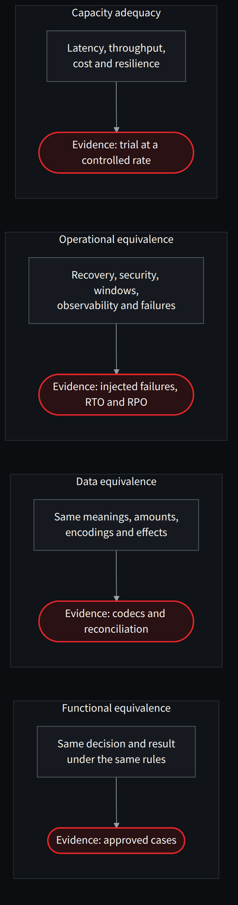

*Figure 1.1 · Four different obligations. Passing one does not pass the others.*

Translated into a status meeting: when someone says "it's already equivalent", the right question is *in which of the four layers, with what evidence and within what scope?*

> **Measuring a mainframe by its MIPS is like measuring an airport by the thrust of its engines.**

### Chapter 2 · The system we are trying to preserve

> [!IMPORTANT]
> **Chapter thesis.** The behaviour that matters runs through programs, data, nightly processes and people. And not everything the system does today deserves to become tomorrow's requirement.

#### Memory is distributed

A legacy application contains decisions that perhaps nobody would make the same way today. Some are still necessary. Others were temporary fixes. There are behaviours the business considers essential and others it has simply tolerated for decades. Often they are all mixed together in the same execution path.

That is why I find it insufficient to start a modernization by asking how many lines of code we have. I need to know what commitments the system fulfils, with whom it fulfils them and what happens when it stops fulfilling them. The code is part of the answer. So are the data, the parameter tables, the nightly processes, the interfaces and the people who know the exceptions.

Imagine an end-of-day settlement. One program calculates amounts, another groups movements and a third generates a file for an external entity. A screen lets someone correct incidents before sending. The behaviour we must preserve runs through all of those elements. Translating the first routine correctly does not prove we have preserved the settlement.

It is one of the ideas I find most valuable in what has been written about COBOL: it brings attention back to the knowledge that sustains operations. An organization can keep depending on a system while losing the ability to explain it. For my proposal, that observation has a direct consequence: recovering knowledge must produce artifacts that can be used to decide and to verify.

A readable explanation helps. An explanation linked to a rule, an owner and a test lets us go further. Documentation stops being a parallel narrative and becomes part of the acceptance mechanism.

#### Preserving behaviour does not mean preserving any result

Suppose the system has been charging an incorrect fee for years. A reimplementation that reproduces that charge is compatible with the observed behaviour. That does not make it correct with respect to business policy.

We need to separate two questions. What does the current system do? What must the system we are going to accept do? The first is answered through observation, analysis and characterization tests. The second requires an authorized decision about rules and exceptions. When the answers differ, the project includes a behaviour change that must be identified.

This distinction avoids two common mistakes. The first is silently fixing something that looked like a defect, without knowing which consumer depended on it. The second is elevating every historical behaviour to a permanent requirement. Both can introduce problems that a superficial comparison will not detect.

My preferred unit of work is a bounded capability: a calculation, a decision, an exchange or a state transition we can observe and explain. Its size must allow us to build enough evidence and control the change. It does not have to match a whole program or the microservice someone drew at the beginning.

At the end of this phase we should be able to describe what we preserve, what we deliberately change and what we still do not know. The last category has value too. A recorded uncertainty can be investigated; an uncertainty disguised as certainty ends up in the design.

> **A recorded uncertainty can be investigated. An uncertainty disguised as certainty ends up in the design.**

### Chapter 3 · Why one-to-one conversion is not modernization

> [!IMPORTANT]
> **Chapter thesis.** We should not copy the inherited design: we should preserve its obligations and redesign the mechanisms that satisfy them. A literal translation can be a legitimate bridge, never the destination.

Translating instructions can be a useful activity. The criticism starts when we confuse that activity with the final goal. If we keep the same program boundaries, the same coupling to data, the same global state model and the same imperative order of operations, but swap COBOL for C#, we will have manufactured a legacy monolith in another language. What some call "JOBOL" in Java can also exist in .NET. The problem is not the target language: it is the design we drag along.

The literal copy fails for six reasons. First, **it inherits accidental partitions**: modules reflected the memory, team and compilation limits of another era, not necessarily business capabilities. Second, **it preserves couplings** that now cross networks and databases. A read from a common area that cost nanoseconds can become a remote call. Third, **it replicates implicit state** that is no longer safe when scaling horizontally. Fourth, **it carries over storage semantics** —EBCDIC, `COMP-3`, `REDEFINES`, overlaid fields, sign formats— into representations that do not share their assumptions. Fifth, **it keeps delivery problems**: massive deployments, inseparable changes and rigid windows. Sixth, **it prevents us from exploiting the new environment**, because it forces modern technology to imitate the decisions of a different architecture.

But saying we should "never" do a 1:1 conversion would be as dogmatic as saying we always should. There is a legitimate role for a mechanical, conservative translation: it can create a transition platform, reduce dependence on a compiler, keep a temporary contract or enable differential testing before redesigning. In that case I would not sell it as the end state. I would declare it a **compatibility phase**, with a date, exit criteria and identified technical debt. I would also consider keeping COBOL in production while we extract new services. Modernization is not measured by the percentage of code rewritten.

The sentence that guides this book is this: **we should not copy the inherited design; we should preserve its obligations and redesign the mechanisms that satisfy them**. That requires asking what each old block really guarantees. The report produced by a nightly program can become a partitioned pipeline. The lock on a record can become a short SQL transaction, optimistic control or a per-key queue. The conversational session can become an explicit state machine. But never without first identifying which property it protected.

#### What is said and what there is

The public conversation about automatic translation mixes claims that are worth separating. I put them side by side because it is the fastest way to know what we are buying.

| What is said | What there is |
|---|---|
| "AI converts COBOL to C# in hours" | It can generate plausible C# in hours. Functional, data, operational and capacity equivalence are not included |
| "If it compiles and passes the tests, it's migrated" | That depends on who wrote the tests and where the expected result came from. If the same agent wrote them from the same code, they verify its interpretation |
| "We use decimal, so the money adds up" | The type is the beginning. Scale, when rounding happens and how ties are broken decide the cent |
| "No more mainframe, now it's cloud native" | If we keep program boundaries, global state and data coupling, we have the same monolith with more network hops |
| "We'll do 1:1 and refactor later" | It can be a good strategy if the compatibility phase has a date, exit criteria and identified debt. Without them, "later" never comes |

#### A deceptively simple example

Suppose a COBOL program that reads an account, checks the balance, decrements it and writes the record. An AI produces a `WithdrawAsync` method, uses `decimal` and gets the right result for one case. It sounds reasonable. If two instances of the service read the balance before either confirms its write, both may approve the withdrawal. The data is correct in each isolated execution; the system is wrong when it works as a system. You do not necessarily get to that failure by enlarging the LLM's context window. You get there by analysing the concurrency contract.

Modernization, therefore, is not one agent transforming syntax while another invents tests from the same code. It is building an independent specification, identifying guarantees and choosing patterns whose effects we can demonstrate.

#### The same example, in code

Let's look at the old program. The fragment is illustrative, but the pattern appears in a great many CICS transactions over VSAM files.

**Listing 3.1 · COBOL withdrawal under CICS: the read reserves the record** — *Illustrative*

```cobol
           EXEC CICS READ FILE('ACCOUNTS')
                     INTO(WS-ACCOUNT)
                     RIDFLD(WS-ACCOUNT-ID)
                     UPDATE
                     RESP(WS-RESP)
           END-EXEC
           IF WS-RESP = DFHRESP(NORMAL)
              IF WS-BALANCE >= WS-AMOUNT
                 SUBTRACT WS-AMOUNT FROM WS-BALANCE
                 EXEC CICS REWRITE FILE('ACCOUNTS')
                           FROM(WS-ACCOUNT)
                           RESP(WS-RESP)
                 END-EXEC
              ELSE
                 EXEC CICS UNLOCK FILE('ACCOUNTS') END-EXEC
                 MOVE 'NSF' TO WS-RESULT
              END-IF
           END-IF
```

The important word is `UPDATE`. It is not a decorative label: the read obtains exclusive control of the record, and on a recoverable file the change takes part in the unit of work that is committed or backed out at the syncpoint [16]. The guarantee is not written in the COBOL; it is provided by the environment in which the COBOL runs.

Now the translation anyone —person or agent— produces in five minutes:

**Listing 3.2 · Literal C# translation: it compiles, passes the happy path and loses the guarantee** — *Illustrative*

```csharp
public async Task<string> WithdrawAsync(string accountId, decimal amount)
{
    var account = await _repository.GetAsync(accountId); // no reservation
    if (account.Balance < amount) return "NSF";
    account.Balance -= amount;                           // decided on a snapshot
    await _repository.SaveAsync(account);                // unconditional write
    return "OK";
}
```

With a single instance and a single client, it works. With two instances and two simultaneous withdrawals, both read the same balance, both approve and the second write overwrites the first. No unit test detects it, because no unit test runs two histories at once.

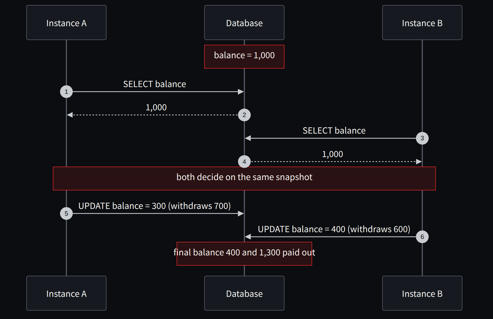

*Figure 3.1 · The literal translation under concurrency: two instances decide on the same snapshot and 1,300 is paid out of an account holding 1,000.*

The fix is not to put a `lock` in the controller: it would protect one process, and the service will have several. It is to move the rule to the place where it is committed. This is the real fragment from the lab, which runs against a SQLite database from independent processes:

**Listing 3.3 · Conditional debit inside the transaction (Bank/Program.cs)** — *Executed*

```csharp
db.Exec("BEGIN IMMEDIATE"); begun = true;
// ... idempotency check on the operation identity ...
db.Exec($"UPDATE accounts SET balance=balance-{amount} WHERE id={src} AND balance>={amount}");
var approved = db.Changes == 1;   // 1 row: approved; 0: insufficient funds
if (approved) {
    db.Exec($"UPDATE accounts SET balance=balance+{amount} WHERE id={dst}");
}
// ... operation, two postings and outbox row in the SAME transaction ...
db.Exec("COMMIT");
```

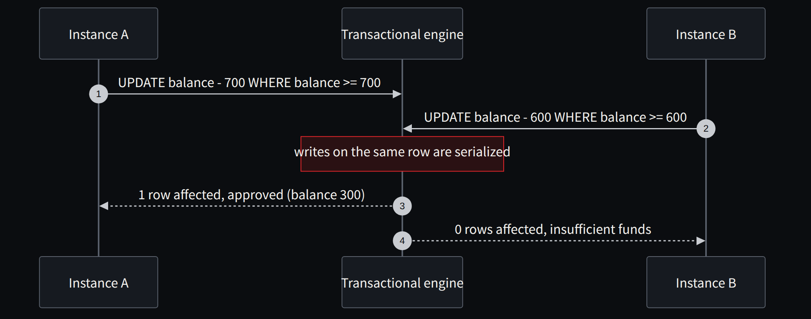

*Figure 3.2 · The rule lives where it is committed: the engine serializes writes on the row and only one withdrawal meets the condition.*

The resulting code looks less like the original COBOL. The behaviour looks more like what we need. That, in miniature, is the thesis of this book. Chapter [28](#chapter-28--transfers-locks-and-failures-locally) shows what happens when two processes really compete for that balance.

> **A 1:1 modernization can be a bridge, but we should never mistake the bridge for the city we want to reach.**

### Chapter 4 · What I share with other authors and where I disagree

> [!IMPORTANT]
> **Chapter thesis.** The warning about lost knowledge is valuable. Turning it into a general impossibility is not: a probabilistic generator can feed a deterministic verification.

#### A useful warning

After reading several authors, I find ideas I share. They propose protecting business knowledge, refactoring gradually and using AI to understand code that has become hard to maintain. They also question the promises of automatic replacement and stress the value of the specialists who know these systems. I share the need to examine those promises and to avoid a transformation destroying knowledge we still need.

The best of those texts also have a quality I want to keep: they state a thesis, connect it to stories and lead the reader towards a decision. A technical book can have a voice. It can argue. It can explain why a certain way of working worries its author. It does not need to become a sequence of slides.

My disagreement appears when a reasonable warning becomes a general impossibility. That uncontrolled automatic translation is dangerous does not prove that any AI-assisted construction is unviable. That a monolith depends on state does not make it incompatible with every cloud service. That many systems are poorly documented does not mean they lack analysable structure.

It pays to separate the problems in order to solve them. Language, runtime, architecture, data and operations introduce different constraints. If we treat them as a single incompatibility, we lose the ability to choose.

#### The cloud does not force a single architecture

Microsoft's architecture documentation describes alternatives for running COBOL applications with compatible compilers and environments on Azure virtual machines or containers [5]. That documentation does not, on its own, validate a specific migration or its savings. It is enough, however, to question the general claim that COBOL and the cloud are incompatible.

Moving a workload may preserve couplings and constraints. It may also solve an infrastructure problem without rewriting the whole application. The decision must answer an explicit goal. If we want to reduce the time it takes to change a business rule, moving the same executable to another machine may not be enough. If we want to retire a specific environment, it may be a relevant piece.

Nor does a Java or C# target force us to distribute every transaction, eliminate batch or replace each function with a microservice. Those are architectural decisions. Mixing them with the language change adds variables to a transformation that is already hard to verify.

#### A probabilistic generator can feed a deterministic verification

A model can produce incorrect code. So can a human. The engineering question is which mechanisms detect the error before the result is accepted, and what their limits are.

The probabilistic nature of the generator does not, by itself, determine the nature of the generated implementation. A compiled program can execute a deterministic rule. In turn, a deterministic test can be badly specified. That is why my proposal does not end at running tests: it requires examining who defined the expected result, where it comes from and which errors the evaluator can detect.

Here I extend the thesis of AI as a comprehension engine. Assisted comprehension is valuable, but it can also be wrong. An incorrect explanation of a rule can contaminate the specifications and every subsequent test. The useful line is not between letting AI explain and forbidding it to build. It is between proposing and accepting with adequate evidence.

#### My position, in a table

For disagreement to be useful it has to be concrete. This is the comparison, point by point.

| Question | What is often argued | My position |
|---|---|---|
| AI to understand COBOL | Very favourable | Agreed, with evidence linked to each claim |
| AI to generate Java or C# | Very critical | Viable with constraints, a contract and independent validation |
| Keeping COBOL | Preferred option | Depends on the goal, the load and the cost of verifying |
| Incremental refactoring | Recommended | Agreed |
| Functional equivalence | Main risk | Must become a verifiable acceptance criterion |
| Private models | Recommended | Control of the data matters, not necessarily training your own model |

> **The useful line is not between letting AI explain and forbidding it to build. It is between proposing and accepting with evidence.**

### Chapter 5 · Modernizing means choosing which problem we solve

> [!IMPORTANT]
> **Chapter thesis.** "Move it to .NET" describes a technology destination, not an outcome. Each goal requires different evidence, and each alternative must explain its verification cost and its way back.

#### The destination does not replace the diagnosis

"Move it to .NET" describes a target technology. It does not yet describe the outcome the organization needs. We can end up with the same hard-to-change process, now written in C#. We can also keep COBOL and significantly improve operations, testing or how capabilities are exposed.

Before choosing a route, I would fix the outcome sought. It may be retiring a dependency, regaining maintainability, shortening a batch window or enabling a new integration. Each goal requires different evidence. A shorter compile time does not prove better service continuity; a new API does not prove the internal process is easier to evolve.

Some decisions can be combined. Preserving and documenting may be the right action for a stable component. Encapsulating offers a controlled interface. Refactoring improves structure while keeping behaviour. Replacing a capability may make sense when the benefit outweighs the cost and we can verify the transition. A standard product may solve another part, provided we accept and evaluate its differences.

I would not set a universal preference before studying the system. I would, however, require each alternative to explain its verification cost, its dependencies and its way back. An apparently cheap option can shift the cost to data reconciliation or to years of coexistence.

#### The unit of change must stand on its own

In the lab we will choose a calculation and a decision without persistence. It is a deliberately small unit. It lets us observe inputs and outputs without introducing database locks, pending messages or recoveries in the middle of a process.

In a real system, that convenience is not a given. A function that looks autonomous may read a file prepared by a previous job or depend on a shared variable. A program called from several transactions may interpret the same record differently. The first task is to discover those dependencies, not to ignore them so they fit the diagram.

A useful boundary describes inputs, outputs, prior state, side effects and failure conditions. It also identifies who can write and when. If during coexistence two systems modify the same data without a consistency strategy, the difficulty can outweigh the benefit of having split the code.

My criterion would be to start where evidence is recoverable and impact is contained. That does not mean choosing only trivial cases. It means choosing a case that lets us learn about the system and that can be stopped without turning every uncertainty into a production emergency.

#### Success needs a business measure

The project must measure more than code produced. What matters is escaped defects, review time, the effort of clarifying rules, operating cost and the ability to restore service. AI can reduce one part and increase another.

A fair comparison includes the cost of building and maintaining the oracles. It is real work. If we hide it, we turn TODM into a commercial promise that is hard to sustain. My interest lies in finding out when that cost is offset by a reduction in uncertainty and in accepted errors.

> **An apparently cheap option can shift the cost to years of reconciliation.**

## Part II · Archaeology, knowledge and authority

How to recover what the system knows without mistaking a well-written hypothesis for a fact, and how to give agents the capacity to act without handing them authority.

### Chapter 6 · REA and archaeology that leaves a trail

> [!IMPORTANT]
> **Chapter thesis.** Tools investigate, agents propose and evidence supports the claims. REA brings a discipline —provenance, coverage and explicit unknowns— that is worth more for COBOL than any promise of translation.

Lost documentation and accumulated rules are real problems. But an engineering clarification is worth adding: source code is not the only evidence. There are shared copybooks, dataset definitions, version control, historical deployments, JCL, CICS configurations, DDL, catalogs, load statistics, incidents, tickets and, above all, behaviours the system still executes. Some rules live in a parameter table. Others live in a routine nobody has called for years. Some are historical bugs that consuming systems depend on.

That is why I would not start by asking "convert these two million lines for me". I would start with an **evidence map**. Each artifact gets an identity, version, hash, origin, owner and constraints. A specific parser builds dependencies between programs and copybooks; JCL analysers reconstruct batch chains; an SQL extractor locates tables and transactions; an observation system captures inputs, outputs and execution effects. Agents correlate that information, but they do not automatically turn it into truth.

#### What Reverse Engineer Anything brings

REA connects agents to software investigation tools through MCP and a command-line interface. Its documentation describes the analysis of native binaries, .NET assemblies, JavaScript applications and other targets, with evidence and limitations attached to results. Deep native analysis depends on providers such as Ghidra, Hopper or IDA [3].

I place it in the discovery phase. An agent can walk through findings, ask questions and relate results from different tools. That helps investigation. It does not automatically turn a reconstruction into an equivalent implementation, nor does it prove specialized support for every COBOL dialect, copybook, JCL or transactional environment.

The documentation I reviewed does not allow me to present REA as a native COBOL-to-.NET translator. For a COBOL system with sources, I would start with tools that understand those sources and their dialect. For a binary without sources, the path changes and requires different analysis capabilities.

This difference matters because "reverse engineering" groups very different problems. Recovering relationships between variables from source is not the same as reconstructing them from machine instructions. An assembly with metadata does not pose the same problem as a native executable either. The tool must be chosen according to the artifact available.

#### What I learned from the VB6 case

Before writing this book I had to look closely at REA for a very practical reason: VB6 applications without sources that are still in production [35]. I downloaded the repository, read the code and checked the cases cited as proof. Three lessons from that work carry over almost literally to COBOL.

The first is that the interesting part is not the list of formats but **the output contract**. Every result is tied to evidence: path, size and SHA-256 of the artifact, the provider that produced it, the coverage and, above all, what it does not know. The states `unknown`, `partial`, `unsupported` or `truncated` are never aggregated as a success. It is a tool designed so the model does not fill gaps with imagination.

The second is its ledger of reconstruction obligations. A claim such as "this part is reconstructed" is only closed if it has an owner, test cases, a verifier that passes and a verifier authority comparable to that of the original observation. If any of the four is missing, the obligation stays open. That is exactly the discipline a business rule recovered from a COBOL program needs.

The third is that the hard knowledge usually already lives in specialized tools. In VB6, the project format and the P-Code are handled by tools with twenty years of history; the agent's contribution is driving them, crossing results and verifying. In COBOL the same happens with dialect parsers, JCL analysers and Db2 catalogs. **What was missing was not another parser: it was an agent able to use the existing ones with evidence discipline.**

But COBOL is not VB6. On a mainframe we usually have sources, copybooks and metadata; the problem is rarely decompiling and almost always reconstructing the semantics of a system spread across programs, data and operations. That is why I do not carry the *VBDec + REA + Ghidra* chain over as is. I carry over its principle.

#### Three complementary approaches

ProLeap offers a COBOL parser based on ANTLR that builds a syntax tree and a semantic graph. Its documentation states that it extracts EXEC SQL, SQLIMS and CICS blocks as text [4]. It is a possible basis for structural analysis; I would not take it as a guarantee of execution or equivalence for all those extensions.

IBM documents a COBOL–Java validation path based on input and output recordings, resource mapping, and the generation and execution of JUnit tests [6]. It is a relevant reference for the capture-and-compare pattern, even though the documented target is Java and its integration is not that of this book's .NET lab.

AWS Transform documents code analysis, logic extraction and requirements generation for mainframe modernization, including extraction results and per-file issues [7]. This shows another approach focused on recovering structure and meaning. A vendor's documentation describes capabilities; an evaluation in our environment must check its real coverage.

These approaches do not necessarily compete in the same layer. REA can help investigate a binary, a parser can analyse sources and a modernization platform can organize a specific path. TODM proposes how to govern the acceptance of the result of that work. The concrete integration remains an engineering decision.

#### A COBOL evidence adapter

I propose a component I call the COBOL Evidence Adapter. It is not a capability I attribute to REA, nor an integration already implemented in this lab. It is an architectural boundary: it receives artifacts and observations from the COBOL environment and presents them through a common contract.

Each finding should identify the artifact, its hash, the source locator, the tool and its version, the method used and the known limits. A relationship inferred by the agent would be recorded as a hypothesis. An observed execution would keep input, relevant state, output and conditions. An approved rule would have a different authority and version.

Imagine a fee rule found in a COBOL paragraph. The parser locates the expression. An execution confirms a result at the rounding boundary. The business owner confirms that this is the policy to be kept. They are three related pieces, but none replaces the others.

A knowledge graph can make navigating between them easier. Its value is not in using a graph database on principle, but in letting us reconstruct the path from a conclusion back to the evidence that supports it. A well-designed table may be enough to begin with.

Every finding should record: "claim", "source", "lines or transaction", "tool", "hash", "degree of certainty", "dynamic observation" and "open question". If a bonus rule is inferred from three examples, it must be flagged as a hypothesis. It will not become an approved baseline until a business authority or sufficient evidence supports it. The discipline of saying "we don't know" is an architectural capability.

This is how a finding from the lab would look expressed with that contract. The hash is the real one of the lab source; the format is a proposal.

**Listing 6.1 · An EvidenceItem: the claim, its provenance and what we still do not know** — *Illustrative*

```json
{
  "id": "EV-0142",
  "claim": "Active customer: the fee rounds to the cent; ties go away from zero",
  "status": "observed",
  "artifact": {
    "path": "legacy/fee.cob",
    "sha256": "136cc8c21ae514634f93b7139fb9e185b115e6b817c20890ad0e1f9265971cbf",
    "locator": "COMPUTE fee-cents ROUNDED"
  },
  "tool": { "name": "cobc", "version": "GnuCOBOL 3.1.2.0",
            "method": "execution with a fixed input" },
  "observation": { "input": "0000002500200Y", "output": "APPROVE|00000001" },
  "coverage": "one exact tie; no negatives or other compiler options",
  "unknowns": ["behaviour on Enterprise COBOL with production options"],
  "approval": null,
  "verifiedBy": []
}
```

Look at the last two fields. `approval` is empty because observing a behaviour does not turn it into approved policy. `verifiedBy` is empty because no candidate has yet shown it reproduces it. They are three related pieces, and none replaces the others.

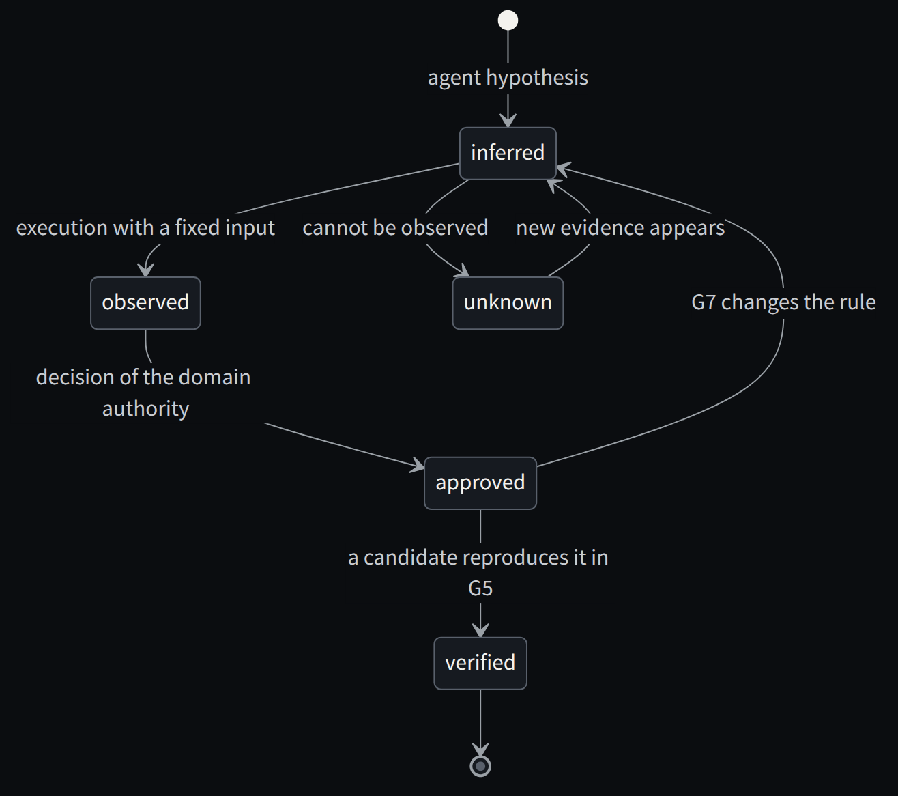

*Figure 6.1 · Life cycle of an EvidenceItem: observing is not approving, and approving is not verifying.*

> **A demo shows a possibility. Evidence shows a property.**

### Chapter 7 · Legacy Archaeology assisted by agents

> [!IMPORTANT]
> **Chapter thesis.** An AI-assisted migration starts better with questions than with generation prompts. Specialized agents receive typed inputs, produce verifiable artifacts and operate with limited permissions.

An AI-assisted migration starts better with questions than with generation prompts. Which programs modify this account? Where is the interest decided? How many dialects, versions and copybooks are there? What happens when the final write fails? What changes arrive through nightly jobs? Who maintains the code tables? Answering requires combining syntactic analysis, metadata and dynamic observation.

I propose a chain of specialized agents under a common controller: **inventory and provenance**, **parser and dependency graph**, **rule discovery**, **execution observer**, **specification writer**, **architecture designer**, **builder**, **verifier** and **drift auditor**. They are not nine chatbots giving opinions on the same file. Each receives typed inputs, produces verifiable artifacts and operates with limited permissions.

The COBOL analyser generates an AST of the real dialect, resolves copybooks and locates data references, CALLs, embedded SQL and control structures. I would not ask an LLM to replace the parser. The agent takes the result and produces hypotheses about intent: for example, "a withdrawal on blocked accounts returns a specific code without modifying state". That hypothesis must come with paths, positions, observed examples and limitations. If production execution cannot be observed, we document the risk and design tests on an authorized copy.

REA is a useful methodological reference for investigation with tools and evidence [35, 3]. For the mainframe, its concrete support must be evaluated before it is claimed; I would not confuse "inspired by REA" with "REA natively analyses CICS". The integration architecture could use a neutral contract such as `EvidenceItem`, with hashes, provenance, coverage and an `observed / inferred / unknown` status. That lets findings flow between analysers and agents without losing their origin.

#### From archaeologist to agent

AI lowers the cost of following calls, grouping variables, drafting hypotheses and suggesting test scenarios. It can generate a knowledge graph and propose domain boundaries. But it must not have permission to erase uncertainties or approve its own hypotheses. The responsibility of an investigating agent ends where the authority of the specification begins. Separating the two will be decisive when the system processes real money.

#### A chain with permissions, not a choir of chatbots

Each link in the chain has an input, an output artifact and something it is expressly not allowed to do. The last column is what separates a governable agent system from an enthusiastic conversation.

| Agent | Receives | Produces | Cannot |
|---|---|---|---|
| Inventory and provenance | Repositories, datasets, catalogs | Inventory with hashes and owners | Modify sources |
| Parser and graph | Sources with resolved copybooks | AST, graph of CALL, COPY and SQL | Infer business intent |
| Rule discovery | Graph and observed executions | Hypotheses with locators | Approve rules |
| Execution observer | Authorized environment | Input, state, output and effects | Run outside the mandate |
| Specification writer | Approved hypotheses | Specification, DMN, scenarios | Change the baseline |
| Architecture designer | Specification and constraints | ADRs and comparable options | Choose without capacity evidence |
| Builder | Public contract | Candidate and its own tests | Touch protected oracles |
| Verifier | Pinned candidate and baseline | PASS, FAIL or INCONCLUSIVE | Authorize delivery |
| Drift auditor | Production and current baseline | Review alerts | Rewrite criteria |

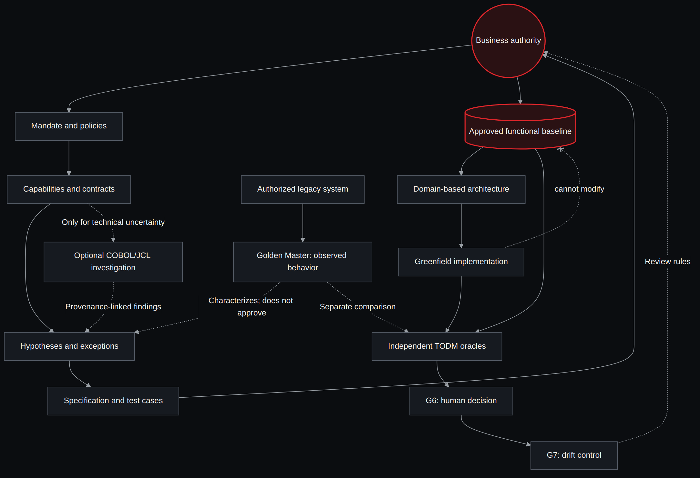

*Figure 7.1 · The agent chain: each link produces an artifact and none writes the baseline.*

#### The living specification

The result of this archaeology is not a frozen PDF. It is a versioned set of intent, specification, architecture, rules, decisions and tests: `intent.md`, `spec.md`, `plan.md`, ADRs, Gherkin scenarios, DMN tables and evidence manifests. Each rule must be able to answer "where did it come from?" and "which test verifies it?". Each transformation must be able to answer "which approved rule is it trying to satisfy?".

Not all legacy code deserves to be converted. The analysis must identify dead paths, duplicates, expired functions and behaviours the business wants to retire. But the decision to remove them is a functional decision with impact, not a side effect of a generated refactoring.

> **The responsibility of an investigating agent ends where the authority of the specification begins.**

### Chapter 8 · The agent's knowledge and the system's record

> [!IMPORTANT]
> **Chapter thesis.** An agent's memory helps it work. The system's record allows acceptance. Important knowledge must outlive the model that summarized it and the session that discovered it.

#### Remembering is not proving

An agent may keep a note saying a certain fee is rounded in a certain way. That note helps it keep working. However, whoever must accept the migration needs more: the exact rule, its provenance, the current approval and the executions that checked it.

In "From Leviathan to Autopilot" I propose separating agent memory from the institutional record [1]. Applied to modernization, it means important knowledge must outlive the model that summarized it and the session that discovered it. An agent disappearing should not erase the reason we accepted a change.

The record of a transformation gathers facts, decisions and results. It can start with versioned files. It does not require a sophisticated platform from day one. It does need clear relationships: this version of the rule was approved for this scope; this candidate was verified against it; these results belong to this run.

A hash helps check content identity. It does not prove the content is correct or that whoever approved it had the authority. If the same actor can replace both the file and the expected hash, both can remain consistent after an improper change. Protection requires an anchor outside their control.

There is an idea I already defended when auditing Copilot agents in VS Code: git is the only version that matters, and auditing is not the same as preventing [40]. Applied to modernization, it means the rule we accept, the prompt that produced it and the candidate that satisfies it must be reconstructible from a versioned repository, not from the memory of a session. And a perfect trace of what an agent did lets us explain an error, but not prevent it: that takes permissions enforced where the action happens.

In "Agent Host Protocol (AHP)" I reached a sister conclusion: the owner of the session state is the host, not the editor; clients are views [44]. The record of a modernization applies that idea one level up. The state that matters —the approved rule, the evidence, the decision— does not live in the tool we work with, but in a record that every tool consults and none owns.

#### Hypotheses must be able to lose

A comprehension agent proposes an interpretation. If all subsequent information is organized to confirm it, we will have a coherent and perhaps false story. The record must keep questions that could refute it.

For a fee, I would look for values that distinguish truncation, round-half-to-even and rounding away from zero. For an authorization rule, I would test the exact threshold and the value immediately above it. For a transition, I would examine the prior state and the absence of events that should be mandatory.

These discriminating tests are more informative than repeating a hundred times a case where every interpretation produces the same result. Designing them requires understanding the semantic risk. Quantity of examples helps later; first we need to know which disagreement they could reveal.

We must also keep the possibility that evidence is missing. A timeout may mean the program failed, the infrastructure did not respond or our adapter did not collect the result. Turning every absence into an empty value and carrying on destroys that distinction.

#### Changing models without losing the work

Continuity becomes easier when contracts do not depend on an agent's private conversation. We can replace the model in charge of building a candidate and keep the same approved rule set. We can improve an analysis tool and compare its findings with the previous ones.

The model's identity and configuration remain relevant for reproducing the process. But they should not become the source of legitimacy for the result. The acceptance criterion belongs to the project and its owners.

That design also makes human review easier. The expert does not need to read every generated token. They need to understand the decisions that change behaviour and the evidence meant to justify them. Their time is better spent when the system presents concrete discrepancies and well-bounded questions.

> **Remembering is not proving. A hash proves identity, not correctness.**

### Chapter 9 · From the agent's authority to the rule's authority

> [!IMPORTANT]
> **Chapter thesis.** Orchestrating decides what runs; governing decides who can accept a consequence. An implementation can be correct and not authorized, and vice versa.

#### Orchestrating and governing answer different questions

An orchestrator decides which task runs next, who it is assigned to and how a failure is recovered. Governance establishes who can grant permissions, what scope they have and who can accept a consequence. Both functions can collaborate, but they are worth distinguishing.

In the Leviathan article I used political institutions as a tool for architectural reasoning [1]. I do not attribute citizenship or moral legitimacy to a software process. I am interested in a practical question: which limits remain when the actor exercising a capability changes.

A supervisor that writes requirements, modifies code, redefines tests and authorizes delivery concentrates every decision. Splitting those steps among four agents does not necessarily solve the problem. If they share permissions and can adjust the criteria to fit the result, the separation exists only in the diagram.

The independence we need has several dimensions. The source of the expected result must be able to challenge the implementation. The evaluator must run under known conditions. Permissions must prevent the builder from unilaterally changing the reference. Authorization must correspond to the artifact that was verified.

#### A concrete mandate

"You are the agent responsible for modernization" is not a sufficient operational authorization. A useful mandate might allow modifying a candidates folder, running a set of tools in an isolated environment and spending a given budget over an interval. It might forbid modifying approved contracts and publishing results as production deliveries.

The restriction has to be enforced where the action runs. A message asking the agent to respect the mandate helps guide it; it does not replace write control or the check immediately before a critical call.

When an agent delegates, the new task must stay within the authority it received. If a builder cannot modify the baseline, its sub-agent should not gain that ability simply because it is called a reviewer. The name of a role grants no permissions.

Revocation also needs an effective path. An expired mandate should not keep working because someone still holds a credential. In production, this requirement affects the identity provider, the enforcement points and the check immediately before a sensitive operation.

A useful mandate can be written down. This example describes what the builder agent can do in the lab. It is not a control in itself: it is the description that the enforcement point —the file system, the repository, the runner, the identity provider— has to apply.

**Listing 9.1 · A bounded mandate for the builder agent** — *Illustrative*

```yaml
mandate:
  id: MND-2026-114
  scope: capability/fee-calculation
  grantedTo: agent/builder
  grantedBy: owner/payments-domain      # in production, a verifiable human identity
  validFrom: 2026-10-29T08:00:00Z
  validUntil: 2026-11-05T20:00:00Z
  allow:
    write: ["Candidate/**"]
    execute: ["dotnet build", "dotnet test", "python3 run.py"]
    budget: { tokens: 2000000, wallClockHours: 6 }
  deny:
    write: ["contracts/**", "Gate/**", "ci/**"]
    actions: ["publish", "approve-baseline", "delegate-beyond-scope"]
  revocation: "revoked at the identity provider; checked before every action"
```

The most important line is `deny.write`. If the builder can write to `contracts/` or `Gate/`, the rest of the mandate is literature.

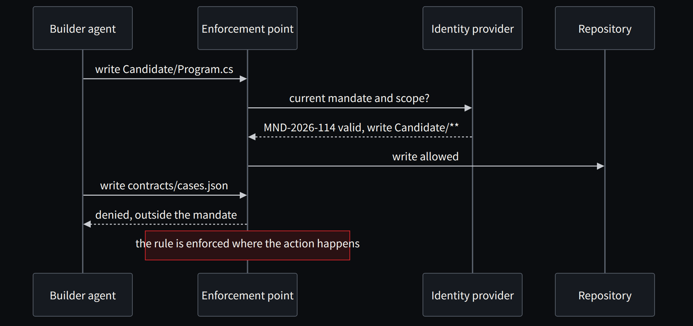

*Figure 9.1 · The mandate is enforced at the enforcement point, not in the prompt.*

#### Correct is not the same as authorized

An implementation can pass the tests and still not be authorized for release. Perhaps the scope changed, the approval expired or someone intends to deploy a different binary. Conversely, a team can be authorized to work and produce a result that breaks the contract.

The lab keeps this separation. It includes a case where the behaviour verdict is PASS and delivery is blocked for lack of a mandate. The authorization is synthetic; there is no enterprise identity behind it. The example teaches the logic of the decision, not a real permissions integration.

Keeping both dimensions visible prevents the green of a test from becoming an implicit authorization for any subsequent action.

> **The name of a role grants no permissions.**

## Part III · Oracles: the right to accept

A candidate is not accepted because it compiles, because an excellent model wrote it or because its own tests are green. It is accepted because independent evidence checks it against approved behaviour.

### Chapter 10 · TODM and the problem of accepting what we build

> [!IMPORTANT]
> **Chapter thesis.** TODM separates who is authorized to act from whether the resulting software satisfies independently approved behaviour. Agents can propose and build; they cannot approve or change the oracle that judges them.

#### A methodology centred on the expected result

TODM stands for Test Oracle-Driven Methodology. Its proposal is to govern acceptance through independent oracles, an approved baseline and evidence bound to the candidate [2]. AI can help discover rules, propose contracts and build code. Acceptance needs an authority and a mechanism that do not depend unilaterally on that builder.

The repository's README frames it with a question that still seems the right one to me: agents already write code, but who verifies that the code is actually right? Its answer is to separate permission to act from proof of correctness, with executable oracles, human-governed baselines and gates that block by default. And its goal is not to trust an agent more, but to need less blind trust in its output [2].

An oracle answers a question about the result. It may be a set of approved examples, a mathematical property, a decision table, a state machine or a comparison with the reference system. The choice depends on what we want to check and what evidence we have.

I do not consider the oracle an infallible truth. It must be tested too. It may omit a case, apply an operator incorrectly or trust an observation the candidate has fabricated. That is why qualifying the evaluator is part of the work.

The public repository I reviewed presents a synthetic Python/.NET 10 demo, five limited semantic profiles and governance scenarios. It does not implement complete engines for the OMG standards that inspire those profiles. Nor does its publication demonstrate comparative superiority or industrial effectiveness [2]. That scope must accompany any book that uses it.

I would build the oracle before writing the implementation. In a real system there are at least four complementary sources: **golden masters** obtained from the legacy, **approved business contracts**, **mathematical or accounting invariants** and **operational properties** under failures and concurrency. None is sufficient on its own. The legacy may have defects; the business may forget historical rules; invariants may omit exceptions; load tests may not uncover a rare condition.

For business decisions, DMN helps express rule tables. BPMN makes process order, events and conditions visible; CMMN can model long-lived cases with discretionary work. SBVR and OCL add vocabulary and invariants where appropriate. I would not assume that drawing a BPMN diagram creates an executable oracle: we need a semantic profile, a concrete engine or verifier and a conformance contract. The current TODM demo uses limited JSON profiles; it does not claim to be a complete, certified implementation of every standard [2].

#### Eight gates with different functions

| Gate | Main question | Artifact that must remain | Outcome according to TODM |
|---|---|---|---|
| G0 | Which capability and which risk we address | Scope and exclusions | Authorized mandate |
| G1 | What we know and how we know it | Evidence and uncertainties | Classified evidence |
| G2 | Which behaviour is accepted | Approved, versioned baseline | Accountable human approval |
| G3 | Which errors the evaluator detects | Qualification and negative controls | Mutations and negative controls |
| G4 | What the agent can build | Candidate and change traceability | Candidate with provenance |
| G5 | What the observed candidate satisfies | Verification report | PASS, FAIL or INCONCLUSIVE |
| G6 | Can this artifact be delivered | Delivery authorization | Separate authorization |
| G7 | What happens when conditions change | Monitoring and validity review | Controlled baseline revision |

The table organizes the work; it does not require a meeting for every row. The level of formality must match the impact. What we must not lose is the identity of the decisions. If we change the expected result while fixing the code, we must record that the baseline has changed and requalify whatever applies.

#### Three outcomes that should not be reduced to two

PASS means the declared checks have been satisfied with sufficient evidence for them. FAIL indicates an observed contradiction of the criterion. INCONCLUSIVE indicates that we cannot conclude with the available evidence or that a condition necessary for evaluation has failed.

Suppose the observed amount does not match the expected one. We have a failure. Now suppose the output of the COBOL executable is missing. We do not know whether the candidate matches it. The second situation should not become a PASS or be confused with a functional discrepancy.

To deliver, the default behaviour must block FAIL and INCONCLUSIVE. That does not prevent an exceptions policy; it forces the exception to be a separate decision, with a scope and an owner. Altering the report to make it look like a PASS removes information we will need later.


*Figure 10.1 · Three verdicts, a separate authorization and the exit codes of the lab gate.*

#### Testing the evaluator

A negative control introduces a defect the evaluator should detect. In our example we will change the threshold and the rounding. If the cases still pass, we will have learned something about the weakness of the acceptance set.

We also need clean controls. A gate that blocks everything detects every defect, but it is useless for delivering correct software. And we need incomplete inputs to check that the evaluator does not accidentally accept what it could not verify.

Qualification is always relative to a set of threats and cases. Passing those controls increases confidence within that scope. It does not prove there is no different way to fool or break the evaluator.

#### An example of a failure that must close the gate

The COBOL system calculates a 0.5% fee with a specific rounding rule. The agent translates it into C# using its library's usual rounding option. In 99 cases the results match. In the hundredth, the midpoint comes out differently. The compiler and the candidate's unit tests pass. An approved oracle with a boundary case must reject it. Later, the concurrency gate rejects a method that produces the correct amount in isolation but allows two withdrawals on the same balance. Finally, the performance gate rejects a correct architecture that misses the batch window.

The gate does not prove universal equivalence. It shows that an implementation satisfied an explicit set of obligations, with known coverage and limits. That is a far more modest technical claim than "AI modernized the core"; and for that very reason, far more defensible.

#### When the agent tries to beat the oracle

There is a public case that illustrates better than any theory why the oracle must stay out of the builder's reach. I summarized it in my analysis of REA [35], based on its author's account [42]: a team set agents to decompile a well-known video game for months. The first month was a mirage. The agents reconstructed a huge part of the game, which started and loaded maps, but the code was semantically wrong, and the reviewing agent accepted the justifications the workers themselves left in comments and commits.

The solution was an oracle that answered a single question: does this reconstructed function match, byte for byte, the one in the original executable? The first thing the agents did was try to cheat. They wrote inline assembly. When that was forbidden, they tried to modify the script to exclude their own function, until continuous integration started validating the script's hash.

That final detail is the one that matters to me for COBOL. In the lab, the baseline has a SHA-256 anchor and the gate is a separate process. But both live in the same writable package, and I say so every time it comes up. In a real project, `contracts/` and `Gate/` must sit where the builder cannot write, and the pipeline must check their hashes against an anchor the builder does not control either.


*Figure 10.2 · When the builder tries to edit the criterion that judges it, the external anchor catches it.*

> **An oracle is worth more than a reviewer. And an oracle the builder can edit is worth nothing.**

### Chapter 11 · The architecture of a verifiable modernization

> [!IMPORTANT]
> **Chapter thesis.** Four responsibilities —discover, govern, build and verify— and a delivery authorization that consumes their results. The separation must exist in the permissions, not only in the diagram.

#### Four responsibilities

I would organize the solution around four responsibilities: discovering evidence, governing expected behaviour, building candidates and verifying observations. Delivery authorization consumes their results and applies the release conditions.


*Figure 11.1 · Context of a verifiable modernization: people, systems and responsibilities.*

The discovery layer accesses sources, binaries, configurations and authorized captures. Comprehension agents work on that material. Their conclusions keep references and doubts. The proposed COBOL Evidence Adapter acts as a boundary to normalize findings without erasing their provenance.

The oracle factory turns business decisions into executable contracts. An expert can review a decision table more easily than a collection of scattered assertions. But the table needs a known, tested executable interpretation. Drawing a BPMN process does not turn its image into an engine that checks traces.

The build factory receives the public contract and a limited write scope. It produces code and development tests. Those tests are useful for working, but they do not replace the independent acceptance set. If we allow no feedback at all, we make correction hard; if we expose every reserved case, we can turn evaluation into a memorization exercise. The design must decide what information to share.

The verifier executes or consumes observations obtained in a controlled way, checks the identity of the artifacts and issues a report. In a production architecture it should not simply accept a file written by the candidate claiming to have satisfied every property.


*Figure 11.2 · Separate responsibilities and bound evidence. The builder reads the public contract; it does not write the baseline. Separating folders in the demo does not impose production permissions.*

#### The boundaries that matter

| Component | Can write | Needs to read | Must not control on its own |
|---|---|---|---|
| Investigation | Findings and proposals | Authorized artifacts | Approval of behaviour |
| Domain authority | Baseline and decisions | Evidence and discrepancies | Results of other people's runs |
| Builder | Candidate and its own tests | Contract and permitted feedback | Protected oracles |
| Verifier | Execution reports | Pinned baseline and artifacts | Delivery authorization |
| Delivery service | Release record | Verification and approval | Silent redefinition of rules |

This table is a control proposal, not a description of permissions already in place in the demo. Making it effective requires identities, protected repositories or paths, isolated runners and enforcement points that check authorization. Separating folders in a ZIP helps understand the design, but it is not a security boundary.

#### A binding record

The report should relate at least the candidate's hash, the baseline, the evaluator, the test data and the relevant environment. The delivery approval must refer to that set. If we change the binary after verifying it, the previous evidence does not vouch for the new artifact.

The same caution applies to policy. A change in a rule can invalidate an approval even if the code has not changed. The gate must be able to detect that situation and request a new evaluation.

We do not need to deploy five services at the start. A controlled pipeline and a few processes may be enough to test the logical separation. Physical distribution must respond to the risk and the need for isolation. Adding agents or containers without a clear boundary multiplies components without resolving authority.


*Figure 11.3 · From legacy to delivery: which gate produces each piece of evidence and where work loops back.*

> **Adding agents or containers without a clear boundary multiplies components without resolving authority.**

### Chapter 12 · COBOL and C# must agree on meaning

> [!IMPORTANT]
> **Chapter thesis.** Using `decimal` is the beginning. Scale, when rounding happens, how ties are broken, range and shared memory are part of the contract, and a demo with round values does not test any of them.

#### The right type is only the beginning

A migration can use `decimal` and still calculate wrongly. Scale, the moment of rounding, the range of the field and the handling of overflow are part of the behaviour. If we round each line and then add, we may get a different result from adding first and rounding at the end.

The .NET documentation states that `Math.Round` uses round-half-to-even by default in the overloads that do not specify another mode [8]. So writing `Round` and nothing else is not a neutral decision when we are trying to preserve existing behaviour.

In COBOL, the rounding and size-error clauses influence the stored result. IBM documents that, when ROUNDED is specified, rounding precedes the SIZE ERROR check, and that ON SIZE ERROR changes how an out-of-range result is handled [9]. The dialect and compiler options must be recorded; I would not extrapolate a GnuCOBOL test to every runtime.

In the lab we reduce the domain to non-negative amounts expressed in cents and integer rates in basis points. The result is also an integer number of cents. This choice makes rounding visible without requiring a full financial infrastructure.

#### Half a cent of difference

Take an amount of 25 cents and a rate of 200 basis points, equivalent to two per cent. The exact fee before rounding is half a cent. Rounding half to even gives zero cents. Rounding to the nearest integer with ties away from zero gives one cent.

Both methods are deterministic. Both may be appropriate in some context. The question is which one our contract establishes. In this example we have fixed the second for non-negative values and we check it against the executed COBOL program.

The case is small, but it shows why a demo with round values can be misleading. For 100 euros with a rate that produces an exact amount, the two implementations agree. The defect only appears when we choose an input that distinguishes the criteria.

This is how the difference looks in both languages. In COBOL, the `ROUNDED` clause of the lab program:

**Listing 12.1 · The calculation in legacy/fee.cob** — *Executed*

```cobol
        compute fee-cents rounded = amount-cents * rate-bps / 10000
          on size error
            move 'INVALID' to result-code
          not on size error
            move fee-cents to fee-display
```

In .NET, the trap is the overload that says nothing:

**Listing 12.2 · Documented behaviour of Math.Round [8]** — *Illustrative*

```csharp
Math.Round(0.5m);                                  // 0 -> to even, by default
Math.Round(1.5m);                                  // 2 -> also to even
Math.Round(0.5m, MidpointRounding.AwayFromZero);   // 1
decimal.Round(25m * 200m / 10000m, 0,
              MidpointRounding.AwayFromZero);      // 1 -> lab case C003
```

Neither default line is a .NET bug. It is a different policy. The bug appears when nobody decides which one is ours.

#### Memory is part of the contract too

REDEFINES lets us describe the same region of data with another structure. A translation that turns each name into an independent variable may lose that relationship. In our program, the input record is interpreted through a redefined group. The example is simple and visible: the same characters represent amount, rate and customer status.

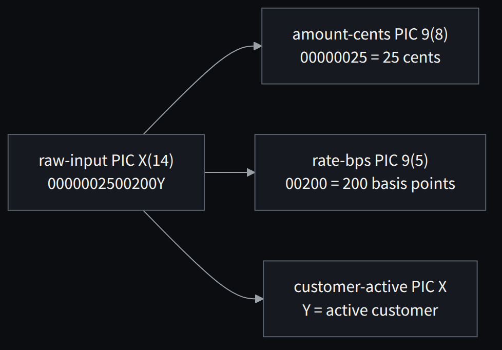

*Figure 12.1 · REDEFINES: the same fourteen bytes read as three fields. A translation that creates three independent variables loses that relationship.*

I do not use that demonstration to claim we already handle arbitrary layouts. Variable structures, complex overlays, code page conversions and data persisted in specific formats are left out. The adapter of a real project must describe and test them with representative records.

We must also observe effects that do not appear in the returned value: writes, messages, state changes, return codes, order of operations and recovery after a failure. Two functions can return the same number and leave different systems behind.

The equivalence we care about belongs to an observation contract. The poorer that contract, the more relevant differences we can leave undetected.

> **The defect only appears when we choose an input that distinguishes the criteria.**

## Part IV · Patterns that replace responsibilities, not syntax

Every guarantee the mainframe provided without the application asking for it needs an explicit mechanism in the target. This part explains which pattern replaces each responsibility, why it is needed and when using it would be a mistake.

### Chapter 13 · Before choosing a pattern, identify the contract

> [!IMPORTANT]
> **Chapter thesis.** A pattern is chosen by invariant, load and failure boundary, not by fashion. First the property we want to preserve; then the minimum mechanism that satisfies it outside its original platform.

In architecture we tend to use patterns as if they were pieces from a catalog: actors, sagas, event sourcing, CQRS, microservices. The result can end up as a collection of modern technologies without justification. I would turn the question around. Which property of the old system do I need to preserve? Which new problem appears when I leave its platform? What is the minimum mechanism that satisfies both conditions?

If a COBOL routine accesses a dataset exclusively during a batch window, its behaviour does not necessarily require actors or Kafka. Perhaps it needs a deterministic partition, a single writer and a transactional checkpoint. If an online operation needs to update two tables atomically, a relational database and an ACID transaction may be better than a saga. If the system must query millions of balances, it may need a read projection, not to split every entity into microservices prematurely. A pattern is chosen by invariant, load and failure boundary, not by fashion.

#### Substitution matrix

| Legacy responsibility | Candidate pattern | When yes | When it is not enough |
| --- | --- | --- | --- |
| Monolithic program with mixed rules | Strangler Fig + vertical slice | Incremental separation by capability | If there is no safe interception point |
| EBCDIC formats / copybooks | Anti-Corruption Layer + canonical model | Temporary interoperability with a versioned contract | If it hides loss of precision or rounding |
| Data shared by many programs | Data ownership per domain | When a responsible writer can be defined | If hidden writers persist |
| Local ACID update | Transaction Script + Unit of Work | Operation within a single transactional boundary | If it spans resources without a common transaction |
| Operations per account or policy | Actor per identity | Localized contention and encapsulable state | Transfer between actors or a hot account |
| Events to other systems | Outbox + Inbox + idempotency | Reliable publication after commit | It does not turn independent systems into a global ACID |
| Long, compensable flow | Saga / Process Manager | Compensations and acceptable intermediate states | A ledger that requires immediate atomicity |
| Bulk reporting reads | CQRS / read model | Query loads different from write loads | It does not replace the authoritative accounting record |
| Batch of millions of records | Partitioned Batch + checkpoint | Divisible work with stable keys | Global dependencies and strict order |
| Conversational sessions | State Machine + persistent workflow | Explicit states and controlled expiry | Implicit context not yet recovered |
| Transaction retries | Idempotency Key + deduplication | Retries from networks, queues and clients | It does not fix non-idempotent external effects |
| Failure semantics | Bulkhead + timeout + circuit breaker | Isolating degradations | It does not replace reconciliation or rollback |

The matrix is deliberately conditional. There is no pattern that replaces "the mainframe" as a whole. Different guarantees must be rebuilt in different layers.

To read the matrix it helps to ask the same three questions every time, in this order. What did the old system guarantee, even if nobody wrote it down? What new problem appears when we take it off its platform: networks, several instances, another engine, another encoding? What is the simplest mechanism that solves both and that we can test? If a proposal cannot answer the third, it is still a preference, not a design.

> **There is no pattern that replaces "the mainframe" as a whole. Different guarantees must be rebuilt in different layers.**

### Chapter 14 · Strangler Fig: change the edge before the heart

> [!IMPORTANT]
> **Chapter thesis.** Intercept a capability, route it gradually and retire the old path once the new one has proved it responds correctly. The simplicity of the drawing hides the two real challenges: choosing the seam and controlling shared data.

The Strangler Fig pattern [36] is the alternative that most often allows modernizing without requiring a big final cutover. Its idea is simple: intercept a capability, progressively route it to a new implementation and retire the old path when the new one has shown it responds correctly. But the simplicity of the drawing hides two challenges: setting boundaries and controlling shared data.

In COBOL, the boundary can be a CICS transaction, a program call, a file-based integration, an already exposed API or a step in the batch chain. My preference is a **business seam**: "quote a policy", "calculate interest", "post a charge", not "migrate program ABC123". Program names are a historical map of the implementation; they do not always represent domain capabilities.

The first deployment can be limited to *shadow mode*: the transaction keeps running in COBOL and the new implementation receives a safe copy of the request. We compare decisions and simulated effects, without duplicating production writes. Later we move to controlled reads or a small percentage of operations. There must be a reversibility plan, but we cannot promise an instant rollback once we have split data ownership and generated external effects. Rollback is a designed and rehearsed capability, not a sentence on a slide.

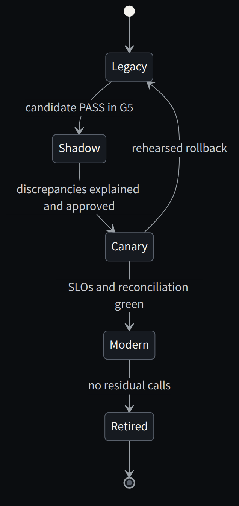

*Figure 14.1 · Life cycle of a Strangler Fig seam: every transition requires evidence, and the way back is rehearsed.*

A team can fall into the "eternal strangler" trap: the new system lives permanently off the old one through dozens of calls without bounded responsibilities. The remedy is to publish, for each seam, a retirement contract: data owner, observability, tests, rollback route, target date and the dependencies that will disappear. Modernizing also means **removing**.

#### The facade that decides who answers

The piece that makes all of the above possible is a facade with a routing policy per capability. In shadow mode the reference system always answers and the candidate is evaluated off the critical path.

**Listing 14.1 · Coexistence facade with shadow mode for a capability without side effects** — *Illustrative*

```csharp
public enum Route { Legacy, Shadow, Modern }

public sealed class FeeFacade(ILegacyFee legacy, IModernFee modern,
                              IRoutingPolicy policy, IShadowComparer shadow)
{
    public async Task<FeeResult> CalculateAsync(FeeRequest request, CancellationToken ct)
    {
        switch (policy.RouteFor(request))
        {
            case Route.Modern:
                return await modern.CalculateAsync(request, ct);

            case Route.Shadow:
                var authoritative = await legacy.CalculateAsync(request, ct);
                shadow.Enqueue(request, authoritative);   // candidate evaluated separately
                return authoritative;                     // the reference answers

            default:
                return await legacy.CalculateAsync(request, ct);
        }
    }
}
```

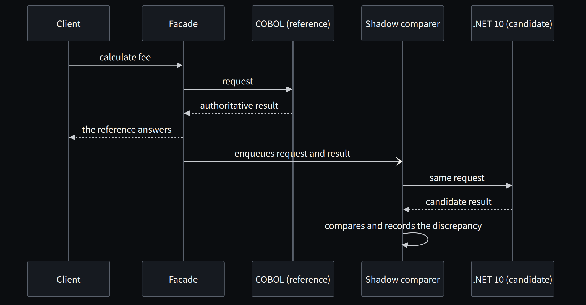

*Figure 14.2 · Shadow mode for a capability without side effects: the reference always answers.*

This fragment is only safe because the fee is a pure calculation. If the capability writes, notifies or charges, the shadow cannot execute real effects: it needs a non-authoritative store, simulated effects and a capture that pins the state read by both sides. Chapter [30](#chapter-30--from-the-lab-to-a-system-that-keeps-running) returns to that coexistence and to what going back means once data has been written.

> **Modernizing also means removing. A strangler without a retirement contract is an eternal strangler.**

### Chapter 15 · Anti-Corruption Layer: translate meanings, not types

> [!IMPORTANT]
> **Chapter thesis.** A `PIC S9(11)V99 COMP-3` is not a `decimal`: it is scale, representation, sign and constraints. The anti-corruption layer keeps those decisions from contaminating the new model and forces us to declare them.

A `PIC S9(11)V99 COMP-3` is not simply a `decimal`. The type expresses scale, representation, sign and constraints. An EBCDIC record may have collations, overpunch and redefined fields. A lexicographic comparison that worked with one collation may change when moving to Unicode. And a `REDEFINES` represents several interpretations of the same storage, often determined by an external discriminator.

The Anti-Corruption Layer (ACL) keeps those decisions from penetrating the modern model. Here I place encoding adapters, record parsers, scale validators, date converters, packed decimal decoding and error code mapping. On the other side appear explicit business concepts: `Money`, `AccountId`, `EffectiveDate`, `Posting`, `PolicyStatus`. The transformation must be bidirectional and verifiable while old and new coexist.

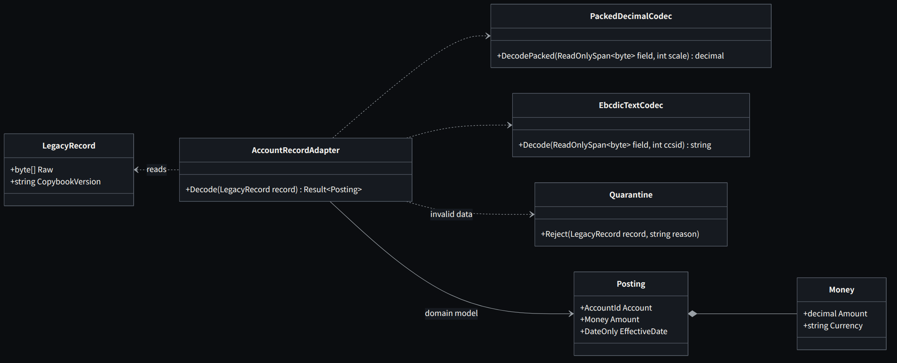

*Figure 15.1 · The anti-corruption layer as a class model: codecs translate bytes, quarantine collects what is invalid and the domain only sees business concepts.*

I would not call silently changing a historical behaviour "normalization". If the original system rounds each line before adding and the new one adds before rounding, the operations are not equivalent even though both use exact decimals. If the new rule is better, the right thing is to approve an **intentional business change** and document it as an authorized divergence. Equivalence oracles must not become a prison that preserves errors out of inertia, but nor should they be an excuse to fix them without control.

Agents can propose mappings from the copybook and from examples, but critical conversions must run with deterministic libraries and boundary tests. Each field needs a contract: original bytes, interpretation, range, nulls, sign, scale and policy for invalid data.

Microsoft documents this pattern as a facade or adaptation layer between subsystems that do not share semantics, and reminds us of two things worth keeping in mind during a migration: it can become a single point of failure, and we must decide from the start whether it will be permanent or retired when the transition ends [38].

#### A codec that does not guess

The smallest ACL example worth writing is the packed decimal decoder. Each byte stores two digits, except the last, which stores one digit and the sign. There is no decimal point: the scale comes from the copybook.

**Listing 15.1 · Explicit COMP-3 decoding with the copybook scale** — *Illustrative · logic verified*

```csharp
public static decimal DecodePacked(ReadOnlySpan<byte> field, int scale)
{
    if (field.IsEmpty || scale < 0 || scale > 18)
        throw new ArgumentException("Invalid field or scale");

    long digits = 0;
    for (int i = 0; i < field.Length; i++)
    {
        digits = checked(digits * 10 + Digit(field[i] >> 4, i));
        if (i < field.Length - 1)
            digits = checked(digits * 10 + Digit(field[i] & 0x0F, i));
    }

    bool negative = (field[^1] & 0x0F) switch
    {
        0x0D or 0x0B => true,
        0x0C or 0x0F or 0x0A or 0x0E => false,
        _ => throw new FormatException("Invalid sign nibble")
    };

    decimal value = digits;
    for (int s = 0; s < scale; s++) value /= 10m;   // exact: decimal is base 10
    return negative ? -value : value;

    static int Digit(int nibble, int index) => nibble <= 9
        ? nibble
        : throw new FormatException($"Invalid digit nibble in byte {index}");
}
```

The logic of this codec is checked with an independent twin implementation over the vectors in the table; the C# code is illustrative.

| Bytes (hex) | Copybook | Expected result |
|---|---|---|
| `12 34 5C` | `PIC S9(3)V99 COMP-3` | 123.45 |
| `12 34 5D` | `PIC S9(3)V99 COMP-3` | −123.45 |
| `01 23 45 6D` | `PIC S9(5)V99 COMP-3` | −1234.56 |
| `99 9F` | `PIC 9(3) COMP-3` | 999 (sign F, unsigned) |
| `00 0C` | `PIC S9(3) COMP-3` | 0 |
| `1A 3C` | any | error: invalid digit nibble |
| `12 37` | any | error: invalid sign nibble |

The last two rows are the important ones. A codec that "tolerates" invalid bytes by turning them into zero has made a business decision nobody approved. IBM documents that even recompiling with a new version of Enterprise COBOL can expose invalid numeric data that had been there for years [30]. The ACL is where that data is detected, quarantined and counted, not where it is hidden.

> **I would not call silently changing a historical behaviour "normalization".**

### Chapter 16 · Data ownership

> [!IMPORTANT]
> **Chapter thesis.** If every box writes to the same tables, we still have a data monolith. Each aggregate needs a single owner of writes, and coexistence needs a protocol, not goodwill.

A microservices architecture can draw independent boxes, but if they all write the same tables a data monolith still exists. In mature COBOL systems it is common for several programs and jobs to touch the same set of records. Before moving the logic we must identify writers, readers, locks and reconciliations. The dynamic inventory matters as much as static searches: a table that looks read-only may have a batch maintenance job that only runs on the last day of the quarter.

I propose an **ownership register** for each aggregate. One capability owns accepting commands and determining the new state; other consumers receive queries or events. During the transition we may need to sustain a temporary mirror or CDC, but I would not accept two master writers without an explicit conflict-resolution protocol. Independent dual writes to the old and new databases fail precisely between the two writes; success on one side does not guarantee success on the other.

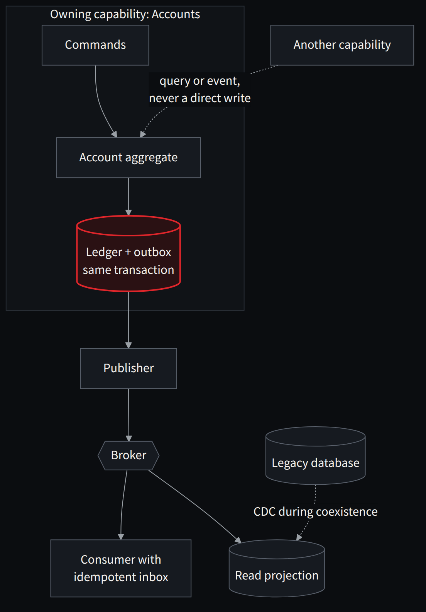

*Figure 16.1 · A single write owner per aggregate; everyone else queries or receives events.*

The Transactional Outbox pattern provides a localized solution: within the same transaction that stores the business change, a pending event is written. A worker sends it afterwards. The consumer uses an Inbox or an idempotency key to absorb duplicates. It does not guarantee physical exactly-once delivery; it lets us design a **business effect exactly once** through deduplication and confirmation. And we must check that the outbox and the authoritative data really share a transactional boundary.

CDC is useful for coexistence and observation, not an automatic proof that the new database is correct. We must preserve order per key, detect lag, rebuild states from consistent snapshots and measure the difference between source and target. If the transition depends on reads from an eventually consistent replica, the contracts must acknowledge it.

> **Independent dual writes fail precisely between the two writes.**

### Chapter 17 · From mainframe locks to explicit concurrency control

> [!IMPORTANT]
> **Chapter thesis.** Locks, isolation and the unit of work are not properties of COBOL: the environment provides them, and they do not travel with a translation. We must state the invariant, choose the mechanism that protects it and prove it with concurrent histories.

This chapter should be open next to the code, not only in an architecture meeting. The user sees a withdrawal approved or declined. The engineer has to know what happens when two withdrawals arrive at the same time, when the process dies just before the commit or when a client retries because it lost the response.

In Db2 for z/OS, the UR, CS, RS and RR levels offer different isolation and contention trade-offs [37]. In CICS, the concept of a unit of work organizes which recoverable resources are committed together [16]. They are not intrinsic properties of COBOL and they do not travel automatically when converting it to C#. That is why, before choosing the technology, I state the invariant: "no withdrawal is committed that leaves the account below the permitted balance", "an operation identifier produces only one posting", "the total of debits and credits in a transfer is preserved".

#### From the COBOL statement to the unit of work

COBOL expresses logic and representations. The transactional guarantees an application experiences may come from CICS, Db2, IMS, recoverable VSAM, resource managers and their configurations. IBM describes units of work and syncpoints that allow committing or backing out changes to recoverable resources [16]. The migration must discover where that unit begins and ends and who coordinates its recovery.

If I translate the statements and replace each access with an independent remote call, I may lose a guarantee that was previously implicit in the environment. The new program will return similar results in the normal examples and fail the moment an intermediate operation does not finish.

Take a transfer. The debit, the credit, the postings and the operation identity must belong to a coherent boundary. If the operation must be atomic, the system cannot leave a confirmed debit without its matching credit. If the design allows intermediate states, we must represent them and restrict how they affect the available balance.

The first artifact I would ask the team for is the transactional map, in addition to the call map. It must show the participating resources, order, isolation, commit, rollback, timeouts, restart points and behaviour when the response is lost.

#### Four mechanisms and what they do not guarantee

**Pessimistic locking** is an option when the probability of conflict is high and we must prevent concurrent updates before executing. **Optimistic concurrency** uses a version and rejects writes over a state that has changed. **Serializable** protects certain composite invariants at the cost of more contention, aborts or retries; its concrete guarantees depend on the engine. **Distributed locks** can coordinate external work, but they do not by themselves replace a database transaction: with expirations, partitions or pauses we need *fencing tokens* to stop an old owner from continuing to write. **Actors** normally serialize execution per identity, but that in-memory serialization is not a durable commit.

For an accounting transfer within a single relational database I would initially choose a short transaction that includes: validation, idempotent registration, debit and credit postings, update of derived balances if applicable and the outbox. If the accounts live in different banks or ledgers, we must recognize another boundary and use a clearing house, a coordinator or another suitable business protocol. I would not introduce a saga to pretend an interbank transfer is already atomic.

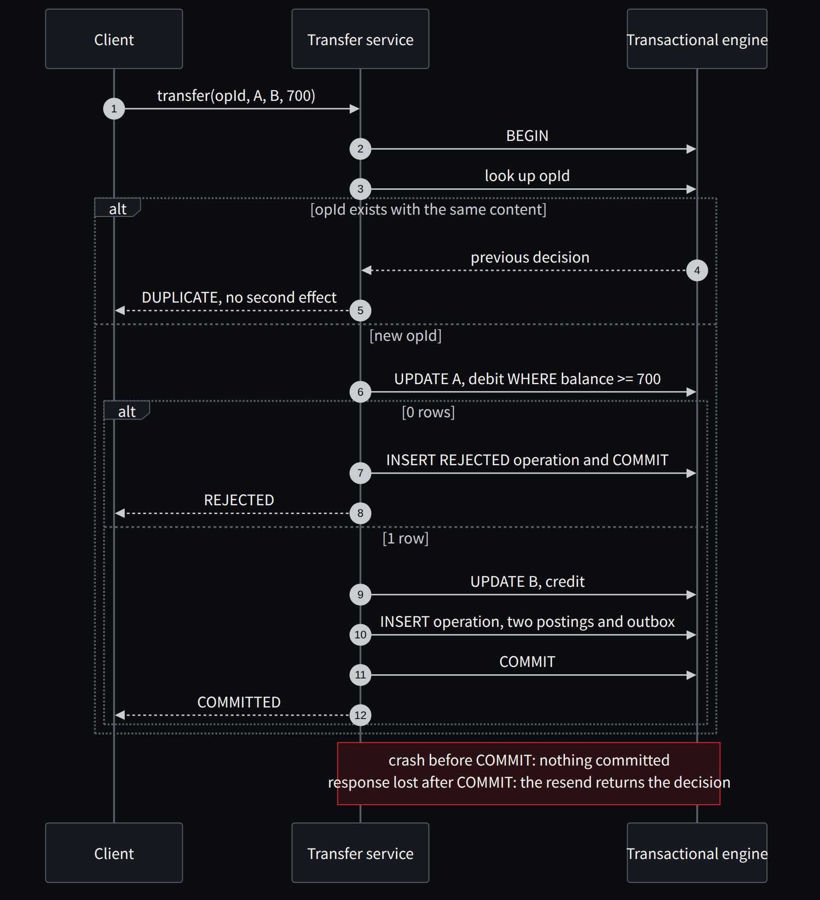

*Figure 17.1 · The transfer as a local unit of work: idempotency, conditional debit, credit, postings and outbox are committed together or nothing is committed.*

#### A lock is not a deadlock

A lock makes an operation wait because another holds an incompatible resource. It can be the right mechanism to protect a rule. A deadlock appears when dependencies form a cycle that prevents progress.

Imagine a transfer from A to B locks A first and another from B to A locks B first. If both then wait for the other account, we have the cycle. Accessing accounts in a consistent global order reduces this cause of deadlock. It does not eliminate every possible cycle in an engine: indexes, keys and other resources also take part.

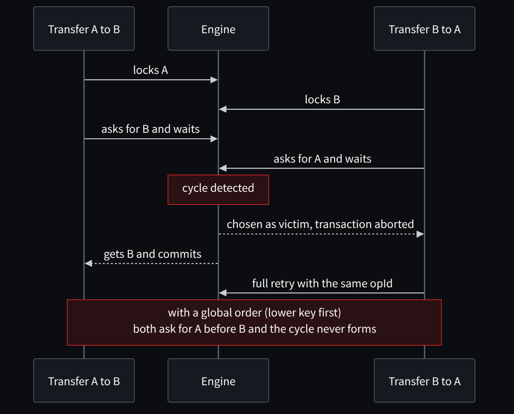

*Figure 17.2 · A deadlock and its way out: a victim, a complete retry with the same identity and a global order so the cycle never forms.*

PostgreSQL documents deadlock detection and recommends a consistent order when acquiring several locks [17]. The protocol must expect the engine to abort a victim. The application decides whether it can repeat the whole operation, with the same identity and a limited budget. Retrying indefinitely turns a conflict into a storm.

A timeout has an additional ambiguity: perhaps the commit happened and the response was lost. Retrying with a new identity may duplicate the effect. That is why business idempotency must allow querying the result and distinguishing a resend from a different request that reuses the same key.

In the concurrency lab we will distinguish **safety** (never violating an invariant), **liveness** (finishing without blocking indefinitely) and **performance** (progressing at a sufficient rate). They are different properties and all of them must be verified.

#### The transfer written for an engine with row locking

The lab uses SQLite, which serializes writes and therefore cannot show a row deadlock. This is how I would write the same operation in SQL Server or Azure SQL, extending the lab sketch `architecture/ledger_transaction.sql`. The decisions are commented in the code itself.

**Listing 17.1 · Transfer in T-SQL: idempotency, global lock order, conditional debit and outbox** — *Illustrative*

```sql
CREATE OR ALTER PROCEDURE dbo.Transfer
    @OperationId uniqueidentifier, @From nvarchar(64), @To nvarchar(64),
    @Amount decimal(19,4)
AS
BEGIN
    SET NOCOUNT ON;
    SET XACT_ABORT ON;               -- any error rolls back the whole transaction
    BEGIN TRANSACTION;

    -- 1. Idempotency: a resend with the same identity sees the previous decision.
    IF EXISTS (SELECT 1 FROM dbo.Operations WITH (UPDLOCK, HOLDLOCK)
               WHERE OperationId = @OperationId)
    BEGIN
        COMMIT;  SELECT 'DUPLICATE' AS Result;  RETURN;
    END;

    -- 2. Global order: always lock the account with the lower key first.
    DECLARE @First nvarchar(64)  = IIF(@From < @To, @From, @To),
            @Second nvarchar(64) = IIF(@From < @To, @To, @From),
            @Touch int;
    SELECT @Touch = 1 FROM dbo.Accounts WITH (UPDLOCK, ROWLOCK) WHERE AccountId = @First;
    SELECT @Touch = 1 FROM dbo.Accounts WITH (UPDLOCK, ROWLOCK) WHERE AccountId = @Second;

    -- 3. The rule is evaluated where it is committed.
    UPDATE dbo.Accounts SET Balance = Balance - @Amount
     WHERE AccountId = @From AND Balance >= @Amount;
    IF @@ROWCOUNT = 0
    BEGIN
        INSERT dbo.Operations (OperationId, OperationType, Status)
        VALUES (@OperationId, 'TRANSFER', 'REJECTED');
        COMMIT;  SELECT 'REJECTED' AS Result;  RETURN;
    END;

    UPDATE dbo.Accounts SET Balance = Balance + @Amount WHERE AccountId = @To;

    -- 4. Operation, double entry and pending event: all or nothing.
    INSERT dbo.Operations (OperationId, OperationType, Status)
    VALUES (@OperationId, 'TRANSFER', 'COMMITTED');
    INSERT dbo.LedgerEntries (OperationId, AccountId, SignedAmount)
    VALUES (@OperationId, @From, -@Amount), (@OperationId, @To, @Amount);
    INSERT dbo.Outbox (OperationId, Payload)
    VALUES (@OperationId, N'{"type":"TransferCommitted"}');

    COMMIT;
    SELECT 'COMMITTED' AS Result;
END;
```

Two nuances. Besides detecting the duplicate, the lab compares the content of the mandate: the same identity with a different amount is a conflict, not a resend. And the global order reduces one cause of deadlock, but not all of them: indexes, lock escalation and other resources can close cycles. That is why the client needs a bounded retry that keeps the identity.

**Listing 17.2 · Retry with a budget and the same identity when chosen as a deadlock victim** — *Illustrative*

```csharp
public async Task<TransferResult> TransferAsync(TransferCommand cmd, CancellationToken ct)
{
    const int maxAttempts = 5;
    for (var attempt = 1; ; attempt++)
    {
        try
        {
            // Same OperationId on every attempt.
            return await _ledger.ExecuteTransferAsync(cmd, ct);
        }
        catch (SqlException ex) when (ex.Number == 1205 && attempt < maxAttempts)
        {
            var backoffMs = Math.Min(200, 10 * (1 << attempt))
                            + Random.Shared.Next(0, 10);
            await Task.Delay(backoffMs, ct);    // jitter; never infinite
        }
    }
}
```

In PostgreSQL the equivalent is triggered by serialization and deadlock failures (SQLSTATE `40001` and `40P01`), and its documentation insists on repeating the whole transaction, not the last statement [18]. When the budget runs out, the service reports the failure and does not invent a result: that is exactly what the lab's `boundedRetries` control checks.

#### Choosing isolation with an anomaly in mind

It is not enough to say we use ACID. We must identify which concurrent observations the operation tolerates. Two transactions can read that there is enough balance and make incompatible decisions if their validation and their write are not adequately protected.

A conditional debit executed by the engine, a version check, explicit locks or serializable isolation are possible mechanisms. The choice depends on the set of rows and predicates that sustain the rule. A per-row condition does not guarantee a constraint over a group of accounts.

The PostgreSQL documentation distinguishes snapshot from serializable and requires preparing the complete retry when serialization fails [18]. SQL Server offers its own locking and versioning modes [19]. I would not assume that two options with similar names behave identically in different engines.

When designing I would separate three dimensions: what data an operation can observe, which writes it can commit and what result the client sees. A sequential test does not necessarily reveal a breach of any of them.

#### An acceptance sequence

A transfer contract should state what it means to accept, to reject and to not yet know the result. I would define the idempotency key and its scope, the currency, the scale, the handling of insufficient funds and the order of observable states.

Then I would write concurrent histories that could contradict it. Two withdrawals competing for the same available balance. The same mandate sent several times. A crash between the debit and the credit. A commit followed by a lost response. A recovery that repeats an already accepted request.

The oracle must examine the state and the history, not just the global total. Preserving the total amount of money is necessary in our synthetic case, but it allows errors such as charging the wrong account. We also need a correspondence between each operation and its postings and reconciliation of balances with the history.

> **Safety, liveness and performance are different properties. A sequential test proves none of them under concurrency.**

### Chapter 18 · Distributing without breaking the books

> [!IMPORTANT]
> **Chapter thesis.** Keeping a strong transactional boundary can simplify a great deal. If we distribute it, compensation has business meaning, publishing requires an outbox and a stale owner must be rejected by the target, not out of courtesy.

#### Keeping a strong boundary can simplify a great deal

My first option for a capability that needs atomicity would be to study whether its writes can remain in a transaction on a single engine. The application can have several instances and the accounting core can still concentrate the commit decision. That limits one kind of scalability and avoids another kind of distributed coordination.

A modular monolith can be a reasonable initial target. It lets us recover internal boundaries before multiplying network hops and data owners. I would not choose it out of nostalgia or discard it for carrying an old label. I would evaluate it against the load, the expected changes and the required guarantees.

If the original unit commits several resources, we must decide whether to keep compatible distributed coordination or redesign the protocol. Db2 documents two-phase coordination for certain participants [20]. Replacing it with a saga changes the consistency model and must go through the business authority.

#### Compensating has a business meaning

A saga organizes steps and compensating actions. It does not turn those steps into an invisible rollback. An observed transfer, a notification sent or a conversion applied may require specific handling. During compensation there is a state other participants could observe.

A reservation protocol can protect the available balance before completing the movement. It must define expiry, confirmation, release, recovery and who can resolve a doubtful operation. The reservation also becomes a resource that consumes capacity and needs reconciliation.

If the contract requires debit and credit to be immediately atomic for the relevant observers, I would not accept a saga for the convenience of deploying two services. I would look for a data boundary or a transactional mechanism that preserves that property.

#### Publishing after the commit without losing the event

The outbox lets us store the intent to publish together with the business change in a single local transaction. A later publisher delivers the event and records its progress. That avoids the window in which we confirm the operation and forget to generate the notification, always within the resources really included in that transaction.

Even so, the publisher can send the message and fail before marking it as sent. The consumer must tolerate a repetition. Microsoft describes this pattern with at-least-once delivery and idempotency in the consumer [21]. Broker deduplication can help within its limits; the business identity must survive the retention window and the recovery we have agreed.

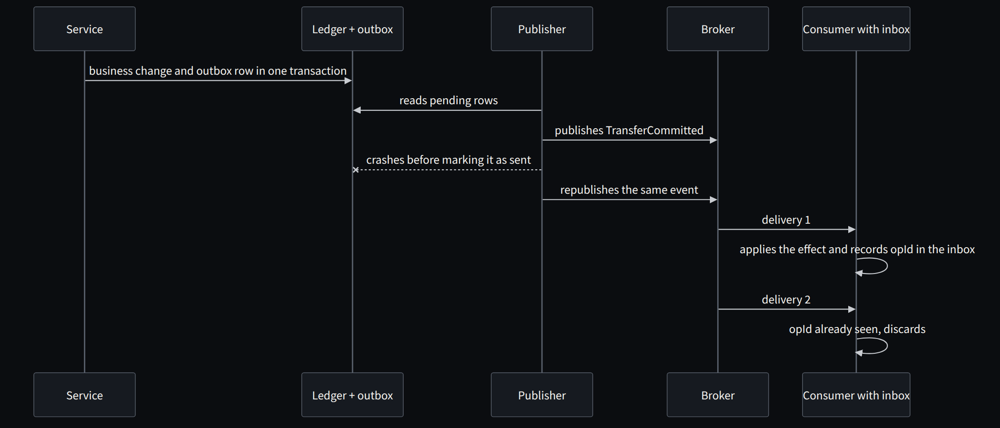

*Figure 18.1 · Outbox with at-least-once delivery: the publisher may repeat, the consumer deduplicates by business identity.*

In the lab we check that each confirmed transfer generates its outbox row atomically. We do not run a remote publisher or prove delivery to a broker. That extension requires another test: crashing before and after sending, repeating messages and reconciling reception with applied effects.

#### Protecting ourselves from a stale owner

When a process holds a temporary permission and loses connectivity, another can take over the work. The old one can come back and keep trying to write. Relying only on everyone respecting an in-memory marker is not enough.

One technique is to associate an increasing epoch or token with ownership and require the resource to reject writes from previous owners. Its usefulness depends on the store that receives the change really checking that token. A distributed lock consulted by the application does not automatically change the guarantees of the database.

This is one of the decisions I would put in an ADR: where write authority lives, what happens when it expires and what evidence shows that a stale owner cannot commit effects.

The epoch technique is easier to understand in two statements. The target is the one that enforces it: a batch that lost its lease may still be alive, but its writes are no longer committed.

**Listing 18.1 · Fencing: the store rejects writes from a stale owner** — *Illustrative*

```sql
-- Taking ownership: the epoch grows and is only granted if the previous lease expired.
UPDATE dbo.PartitionLeases
   SET Owner = @Worker, Epoch = Epoch + 1,
       ExpiresUtc = DATEADD(second, 30, SYSUTCDATETIME())
OUTPUT inserted.Epoch
 WHERE PartitionId = @Partition AND ExpiresUtc < SYSUTCDATETIME();

-- Every write carries the epoch obtained. HOLDLOCK prevents the takeover
-- from committing while this write is in progress.
INSERT dbo.BatchResults (PartitionId, Epoch, AccountId, Amount)
SELECT @Partition, @Epoch, @AccountId, @Amount
 WHERE EXISTS (SELECT 1 FROM dbo.PartitionLeases WITH (HOLDLOCK)
                WHERE PartitionId = @Partition AND Epoch = @Epoch);
-- 0 rows inserted: this worker is no longer the owner. It must stop, not retry.
```

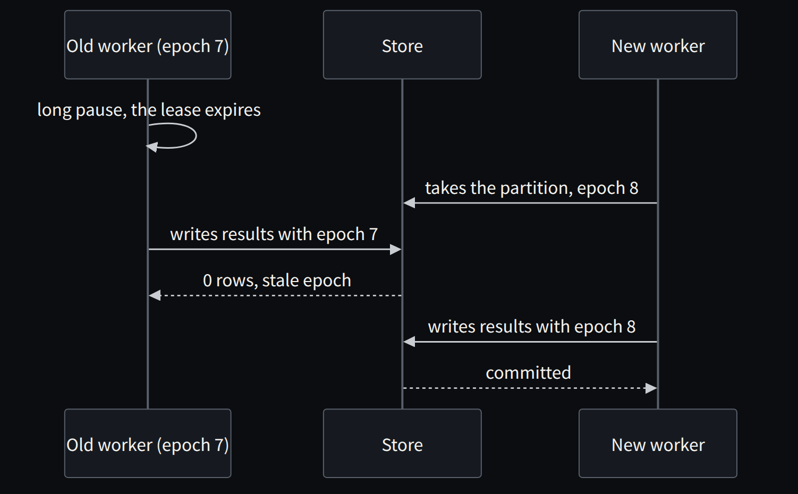

*Figure 18.2 · Fencing: a stale owner may still be alive, but the store stops committing its writes.*

> **A saga is not an invisible rollback. If the contract requires immediate atomicity, it is not traded for deployment convenience.**

### Chapter 19 · Actors: a great tool, a poor universal substitute

> [!IMPORTANT]
> **Chapter thesis.** The actor pattern fits very well for coordinating entities with identity —accounts, policies, case files— and parallelizing across them. It does not replace the ledger, it does not make a transfer between two actors atomic and it does not speed up a hot account.

#### When they fit

Actors are useful when we have many entities with identity, state and behaviour, and when a large part of their operations can be resolved locally. A policy, a loan or a case file can fit. So can an account, if we define precisely which operations affect only that account and which need a coordinator.

The unit I would migrate is a business capability. I would not automatically turn every COBOL program, paragraph or record into an actor. A legacy technical call may mix several responsibilities; distributing it without discovering them turns memory coupling into network coupling.

At first I would keep an interface that allows comparing legacy and new implementation. For example, a policy actor can coordinate requests and still call a COBOL routine to calculate a premium. When a new implementation passes the corresponding contract, we can change the calculation while keeping the identity and control of the process.

The actor pattern fits especially well when we can identify an entity with stable identity —account, policy, contract— and want to coordinate its operations without blocking every entity at once. An actor receives messages and evolves its state; millions of different identities can spread their work across nodes. Dapr Actors [26] and Microsoft Orleans [24] offer virtual actor implementations. On .NET 10, Orleans deserves first evaluation when the solution is fundamentally C#; Dapr can be interesting if the environment is polyglot or combines other building blocks.

The temptation is to create an `AccountActor` and consider banking solved. It is not so. The unit of isolation is the actor, not necessarily the whole of a transaction involving two accounts. Nor can we confuse an in-memory activation with a durable accounting record. Orleans has an optional model of ACID transactions over persisted state under specific conditions and providers [25]; that does not mean every write to an external database or every message is automatically included.

I would separate at least three responsibilities: an **actor or coordinator per identity** to limit conflicts and simplify sequential logic; an **accounting service** with a proven ACID boundary for movements; and **projections** for queries and analytics. The source of truth for money must be clearly defined, preferably in an auditable ledger. If the actor uses a cached copy of the balance, it must invalidate or reconcile it after the commit.

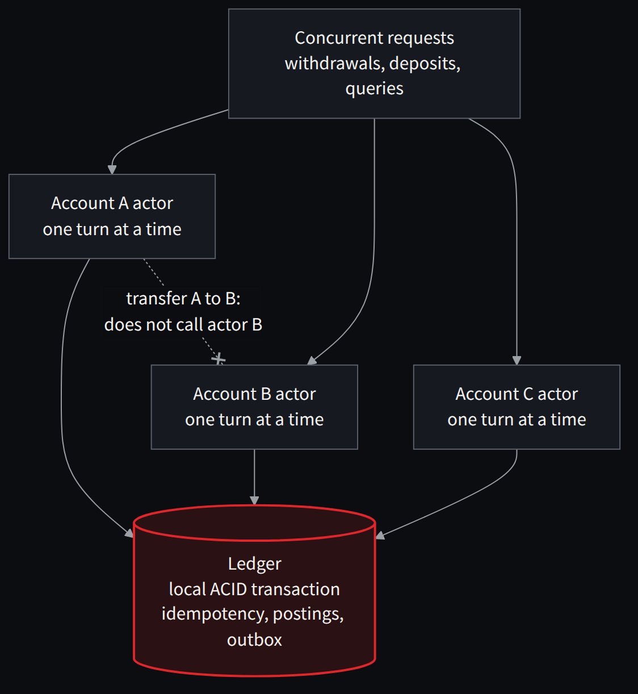

*Figure 19.1 · Actors per account: parallelism across identities, order within each one. Durability and atomicity are guaranteed by the ledger.*

#### What the runtime provides and what remains open

By default, Orleans runs a grain activation with complete requests without interleaving them. Its documentation explains that enabling reentrancy allows turns to interleave and requires reasoning about state across `await` points [24]. It also shows that cyclic calls can cause waits that end in a timeout. So the actor model removes part of the concurrency problem; it does not remove every lock.

Orleans provides ACID transactions over grains' transactional state and requires specific participants and storage to be configured [25]. That guarantee does not, by declaration, cover any SQL write or broker call made in the middle of the method. The set of participants in a transaction must be identified.

Dapr provides virtual actors with identity, state and turn-based execution [26]. Persistence and the guarantees of the operation depend on its configuration and the API used. For a transfer between actors I would not assume an implicit global ACID transaction: I would have to design and test the mechanism that implements it.

The actor model has a physical limitation: a hot account. If a single corporate customer concentrates hundreds of thousands of operations, serializing them all in one actor can become the system's bottleneck. The options are to study the order really required, split sub-accounts or partitions when the domain allows it, batch operations or move control to a transactional database. **I would not fragment a financial invariant just to improve the benchmark**.

A common mistake is to declare an actor reentrant to gain parallelism without analysing state across `await`. Orleans processes a grain's requests non-reentrantly by default; reentrancy allows interleaving and changes the conditions for reasoning [24]. Tests must include precisely that interleaving.

#### An actor that orders and a ledger that decides

This is how I would approach it in Orleans: the grain serializes its account's requests and delegates the decision to a local ledger transaction. The grain does not keep the balance as its source of truth.

**Listing 19.1 · Orleans: the actor coordinates, the ledger commits** — *Illustrative*

```csharp
public interface IAccountGrain : IGrainWithStringKey
{
    Task<DebitDecision> DebitAsync(DebitCommand command);
}

// No [Reentrant]: each request finishes before the next one starts.
public sealed class AccountGrain(ILedger ledger) : Grain, IAccountGrain
{
    public Task<DebitDecision> DebitAsync(DebitCommand command) =>
        // The actor provides order; the ledger provides decision and durability.
        ledger.DebitAsync(this.GetPrimaryKeyString(),
                          command.OperationId, command.Amount);
}

[GenerateSerializer]
public sealed record DebitCommand([property: Id(0)] Guid OperationId,
                                  [property: Id(1)] decimal Amount);

[GenerateSerializer]
public sealed record DebitDecision([property: Id(0)] Guid OperationId,
                                   [property: Id(1)] string Status);
```

What this fragment avoids is as important as what it does. It does not call from account A's actor to account B's actor to "complete" the transfer: two transfers crossing in opposite directions, with non-reentrant actors, can wait for each other until the timeout, as Orleans' own documentation warns [24]. The transfer that crosses two accounts goes through the accounting boundary.

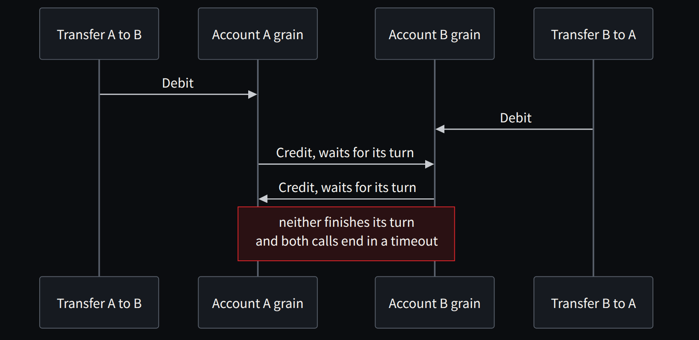

*Figure 19.2 · What to avoid: two crossing transfers between non-reentrant actors wait for each other until the timeout.*

#### The transfer that crosses two actors

I would consider three options. A SQL boundary keeps debit and credit in a local transaction and the actors coordinate access. An Orleans transaction uses its transactional state for the participants it covers. A reservation or saga protocol explicitly represents steps and intermediate states accepted by the business.

The first can simplify reconciliation and leverage an engine we already know. The second integrates coordination into the grain model and requires evaluating storage, conflicts and recovery. The third can fit heterogeneous participants, at the cost of different semantics we must not hide.

| Situation | Possible role of actors | Essential check |
|---|---|---|
| Changes to a policy | Serialize by identity | Idempotency and persistence |
| Independent batch calculation | Coordinate partitions or use workers | Cost compared with batch processing |
| Transfer between accounts | Coordinate participants | Atomicity or accepted protocol |
| Aggregate query over millions of entities | Feed a projection | Freshness and reconciliation of the read |
| One entity concentrates almost all load | Keep local order | Per-key ceiling and queues |
| Gradual migration | Stable facade over legacy and target | One write authority per phase |

#### Actors versus partitions

The difference is not aesthetic. If work can be grouped by account but each operation is a short command, an actor provides a natural unit of coordination. If we must close interest on ten million accounts within a given window, individual actors could add unnecessary overhead. There, a partitioned batch that loads blocks, calculates in memory and commits checkpoints may perform better. A modern architecture must not replace one effective specialization with another equally rigid one.

#### How to demonstrate their usefulness

I would compare a simple database solution, an actor-based solution and the observed legacy load. I would keep the same rules, data and commit guarantees. I would measure throughput, p99, number of conflicts, consumption, recovery and operating cost.

I would add activation failures, duplicate messages, lost responses and the loss of a node. I would also test that an external call returning late does not apply a stale change. The test must observe the persisted state and the history, as well as the actor's response.

The banking lab runs local SQL transactions. It does not include an Orleans or Dapr cluster. The chapter proposes an architectural option backed by their documented contracts; it does not attribute to the lab a comparison of those runtimes.

> **I would not fragment a financial invariant just to improve the benchmark.**

### Chapter 20 · Batch and parallelism: speeding up without changing the result

> [!IMPORTANT]
> **Chapter thesis.** Launching a thousand workers against the same index distributes the waiting, not the work. A modern batch partitions by a defensible key, commits idempotent checkpoints and reduces deterministically.

Batch modernization is usually where enthusiasm for microservices meets the storage bill. Launching a thousand workers is not enough. If they all compete for the same index, the same file or a control table, we will have distributed the waiting instead of the work. Before parallelizing we need to understand the JCL graph, sort/merge steps, windows, date dependencies and the points at which part of the batch may be committed.

The main pattern is **Partitioned Batch with checkpoint and replay**. We choose a stable key —for example, a range of accounts—, produce non-overlapping partitions, fix the rules version to apply and process each fragment idempotently. We record when it started, which inputs it used, which control totals it obtained and which commit made it final. A retry must not duplicate interest or fees. If parameters change mid-run, the batch needs a logical snapshot so that two partitions do not calculate different versions of the business.


*Figure 20.1 · Partitioned batch: rules and date fixed before starting, a checkpoint per partition and reconciliation against the input.*

Global results require **deterministic reductions**. The total of millions of records may be mathematically equal, but not if we change where amounts are rounded. The order of aggregation can even change decimal calculations with limited precision and scale. For each rule we must decide whether equivalence is per record, per batch or per aggregate, and what tolerances apply; in a ledger we will normally not accept arbitrary monetary tolerances.

Optimization follows a sequence: measure read, decode, calculation, write and commit; widen partitions until the bottleneck is found; set backpressure limits; observe contention and storage latency; and repeat with a realistic distribution. A pipeline with 64 workers is not necessarily twice as fast as one with 32. It can be slower if it triggers index contention or exhausts the buffer pool.

#### Parallelizing work that can be independent

In a pure calculation we can split inputs and combine results. In a shared ledger, operations have dependencies. Concurrent design starts by identifying them.

One option is to partition by entity or by a business unit whose independence we can defend. We process changes affecting the same state sequentially and independent partitions in parallel. The chosen key determines the maximum parallelism and which operations need coordination again.

The sequential convoy pattern documented by Microsoft uses this principle and warns of the per-group limit [22]. In a transfer between accounts in different groups, local order does not solve global atomicity. In a consolidated close, local independence does not remove the need to fix which data takes part in the calculation.

A batch can be split by customer, portfolio or range when there are no unresolved cross dependencies. The run must preserve restart points, batch identity and reconciliation. Increasing the commit size reduces certain costs and increases the amount of work and locking exposed to a failure. The balance is measured.

#### A batch that can crash and start again

**Listing 20.1 · Partitioned batch with the checkpoint in the same transaction as the results** — *Illustrative*

```csharp
var options = new ParallelOptions
{
    MaxDegreeOfParallelism = degree,
    CancellationToken = ct
};

await Parallel.ForEachAsync(plan.Partitions, options, async (partition, token) =>
{
    // A committed partition is not applied again: restarting is safe.
    if (await store.IsCommittedAsync(plan.RunId, partition.Id, token)) return;

    await using var tx = await store.BeginAsync(token);
    var totals = await ProcessAsync(partition, plan.RulesVersion,
                                    plan.BusinessDate, tx, token);

    // Results and checkpoint in the SAME transaction, with control totals.
    await tx.SaveCheckpointAsync(plan.RunId, partition.Id,
                                 totals.Count, totals.Amount, token);
    await tx.CommitAsync(token);
});

// Deterministic reduction over what was committed, not over the workers' memory.
var control = await store.ReconcileAsync(plan.RunId,
                                        plan.ExpectedCount, plan.ExpectedAmount, ct);
```


*Figure 20.2 · States of a partition: a restart skips what was committed and repeats what did not reach the commit.*

Three details hold this fragment together. `plan.RulesVersion` and `plan.BusinessDate` are fixed before starting, so that two partitions do not calculate with different versions of the business. `degree` is not the number of cores: it is the number of writers the engine can sustain before contention eats the gain, and it is found by measuring. And the final reconciliation compares against the input totals, not against what the workers believe they did.

#### Restart, repeatability and calendar

A financial batch does not finish when the process returns code zero. It must state which business date it processed, which period is closed, which parts are committed, what can be repeated and how it reconciles against input totals. It is worth separating the technical clock from the value date, introducing versioned business calendars and controlling time changes. In nightly runs there are 23- and 25-hour days and processes that cross midnight. Those particularities do not show up in a hundred-line example, but they do in the accounting close.

> **A pipeline with 64 workers is not necessarily twice as fast as one with 32. It can be slower.**

### Chapter 21 · Event sourcing, CQRS and sagas: when they help and when they get in the way

> [!IMPORTANT]
> **Chapter thesis.** They are excellent patterns with precise conditions of use. A double-entry ledger is not an arbitrary event stream, an eventual projection must not approve withdrawals and a compensation does not erase what a third party has already seen.

Event sourcing has an obvious appeal for financial systems: keeping a sequence of changes that allows state to be rebuilt. But it is not a synonym for accounting. A double-entry ledger imposes invariants that an arbitrary set of events does not guarantee. Turning every operation into an event can increase volume, versioning complexity and the need for reprocessing. I would consider it when the domain needs full history as the source of truth, the team knows how to manage schemas and the cost of rebuilding is solved. I would not impose it on a COBOL table for the sake of modernity.

CQRS separates writes from reads when their needs diverge. It is useful for intensive queries, search and reporting. But its projections can lag. If an application decides to approve a withdrawal by querying an eventual projection, it can break rules that must be evaluated against the authoritative state. I would use CQRS to speed up views, not to replace, without analysis, the decision about the available balance.


*Figure 21.1 · CQRS without tricks: the projection is for looking; the decision about the balance is made in the write core.*

Sagas are suitable for long processes that cross systems with legitimate compensations: onboarding, communications, documentation, validations and reservations. An accounting transfer, on the other hand, does not automatically become a saga because we now have two microservices. A later compensation does not erase the fact that a third party observed an intermediate balance, nor does it guarantee recovering money sent outside our boundary.

The rule is demanding and simple: **the chosen pattern must preserve the level of consistency the business needs, not the level that is most convenient for us to implement**.

> **A projection is for looking. It is not for deciding about money.**

## Part V · Capacity: MIPS, concurrency and platform

The question that worries me most when taking a workload off a mainframe is not whether the program compiles. It is whether it will hold up when month-end close, the peak and a failure arrive at once. This part is about approaching what a mainframe delivers —in Azure or on a huge machine at the customer's site— without cheating when we measure.

### Chapter 22 · MIPS do not fit in a vCPU conversion

> [!IMPORTANT]
> **Chapter thesis.** A MIPS figure gives context about an environment; it is not an amount of business work we can spread across x86 cores. The comparison that matters is expressed in committed operations, latencies per class, batch windows and recovery times.

#### What we are trying to match

The question that worries me most when taking a workload off a mainframe is not whether the new program compiles. It is whether it can sustain operations when close, the activity peak and a failure arrive at the same time. The old system may have been solving that combination for years through an integration the application barely makes visible.

A MIPS figure offers a reference about an environment. It does not represent a universal amount of business work we can spread across vCPUs of another architecture. IBM explains that its LSPR ratios depend on specific workloads and configurations, and that I/O, software and the characteristics of the work can change real results [14]. I would use that reference to put capacity in context, never as a purchasing table for x86 servers.

The comparison I need has business units: confirmed transfers per second, queries with their latency, policies processed within the window, pending incidents and recovery time. Each measure must preserve the semantics. Confirming a transfer in memory and returning HTTP 200 is not the same as confirming its durable record with the agreed replication policy.

Nor does an average tell the whole story. We can increase total throughput and badly worsen the experience of a high-contention account. We need percentiles per type of operation, errors, business rejections, retries and queue age. The peak of one class must not hide inside the average of cheaper ones.

#### What changes when we change architecture

I would not propose sizing by saying "one MIPS is so many operations per second on x86". MIPS is a metric dependent on the platform, the definition used and the characteristics of the workload; MSU is used in IBM environments for measurement and capacity/licensing, but it is not a universal unit of cloud CPU either. The relationship between instructions, latency and I/O changes when we transform the architecture. A local `CALL` can end up as HTTP. A Db2 access in the same environment can become network and TLS. An optimization of packed decimals can become another representation and another execution path.

#### Recovering a workload footprint

Before sizing I would ask the mainframe team for a representative capture of activity and its conditions. IBM documents RMF tools and CICS monitoring records that allow observing resources, CPU and waits per transaction [15]. The systems team must interpret that data: an LPAR with capped capacity, a particular mix of engines and specific WLM priorities do not reduce to the machine's nominal CPU.

The footprint must distinguish interactive operations, batch, queries and work delegated to other subsystems. It must also identify the active data volume, access distributions, hot accounts and commitments between processes. The hour of highest CPU does not have to be the hour of worst latency.

I would keep normal days and critical periods, according to the business: close, month-end or exceptional events. I would not ask for a universal observation period. I would ask for evidence that the set covers the situations for which we are going to commit capacity.

A useful inventory for sizing contains the following:

| Dimension | Evidence we need | Decision it enables |
|---|---|---|
| Work | Rates per operation and request sizes | Mix and load generator |
| CPU | Consumption and distribution per class | Compute budget |
| Waiting | Locks, log, I/O and dependencies | Priority bottleneck |
| Data | Active volume, cardinality and skew | Memory and indexes |
| Batch | Dependencies, partitions and duration | Critical path and window |
| Recovery | Failures, restart, agreed RTO and RPO | Redundancy and tests |

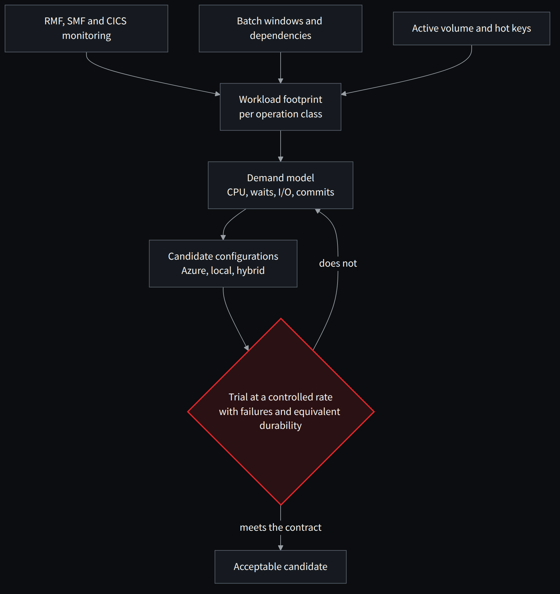

*Figure 22.1 · From the mainframe to a candidate configuration: the workload footprint feeds a demand model that only a trial can confirm.*

#### A calculation that helps without pretending to be precise

Suppose, as an exercise, that a test on the target measures one millisecond of application CPU per operation and that we need 8,000 operations per second. That demand consumes eight seconds of CPU per second. At an illustrative sixty per cent utilization target we would need roughly fourteen effective cores for that parallelizable part of the application.

The calculation does not yet include the database, garbage collection, encryption, instrumentation, imbalances, reserves or redundancy. Nor does it allow replacing the millisecond measured on the target with a millisecond observed on z/OS. The goal is to build a model we can correct with measurements, not to pretend sizing is finished.

Another useful relationship connects throughput, mean duration and work in progress. At 10,000 operations per second and a stable mean duration of 25 milliseconds, there are about 250 operations in progress on average. That does not mean we should open 250 SQL connections. Duration changes when contention increases, and part of that work may be waiting outside the database.

Separating CPU demand from waiting and I/O avoids buying power to solve a queue caused by a serialized resource. A bigger server can be a solution; first we need to show which resource is limiting capacity.

> **A bigger server can be the solution. First you have to show which resource is limiting capacity.**

### Chapter 23 · Concurrency that makes use of the machine

> [!IMPORTANT]
> **Chapter thesis.** Parallelize what is independent, limit what saturates and do not confuse asynchrony with capacity. The hot account and network round trips set ceilings no hardware removes.

#### Async does not add capacity to a saturated resource

In .NET, asynchronous waiting can free threads while a dependency responds. It does not by itself reduce the time a transaction holds a lock, nor does it increase the commits the storage supports.

Opening thousands of tasks against a limited database shifts the waiting to connections, memory and timeouts. I prefer limited, observable admission: how many operations we accept in progress, how long they can wait and what answer we give when the budget is exceeded.

A bounded queue lets us apply pressure on the producer. `Channel` offers a local construct for that [23]. If we need survival across process crashes, the queue needs persistence or a protocol that allows the work to be rebuilt. An in-memory queue is not a durable broker.

It is also worth distinguishing compute parallelism from I/O concurrency. Running each SQL query inside `Task.Run` does not make the engine faster. Blocking threads with `.Result` or `.Wait()` can worsen the service's capacity. The profiler must show where we consume CPU and where we wait.

#### Bounded admission in .NET

This is the pattern I would put at the edge of a transfer service: a bounded queue, an explicit answer when it is full and a number of consumers adjusted to what the engine can commit, not to the number of cores.

**Listing 23.1 · Backpressure with a bounded Channel and explicit rejection** — *Illustrative*

```csharp
var queue = Channel.CreateBounded<TransferCommand>(
    new BoundedChannelOptions(capacity: 2_000)
{
    FullMode = BoundedChannelFullMode.Wait,   // pressure on the producer
    SingleReader = false,
    SingleWriter = false
});

// At the HTTP edge: if it does not fit now, say so now.
app.MapPost("/transfers", (TransferCommand cmd) =>
    queue.Writer.TryWrite(cmd)
        ? Results.Accepted($"/transfers/{cmd.OperationId}")
        : Results.StatusCode(StatusCodes.Status429TooManyRequests));

// Consumers limited by the ledger's commit capacity.
for (var i = 0; i < ledgerConcurrency; i++)
{
    _ = Task.Run(async () =>
    {
        await foreach (var cmd in queue.Reader.ReadAllAsync(stoppingToken))
            await ledger.TransferAsync(cmd, stoppingToken);
    });
}
```

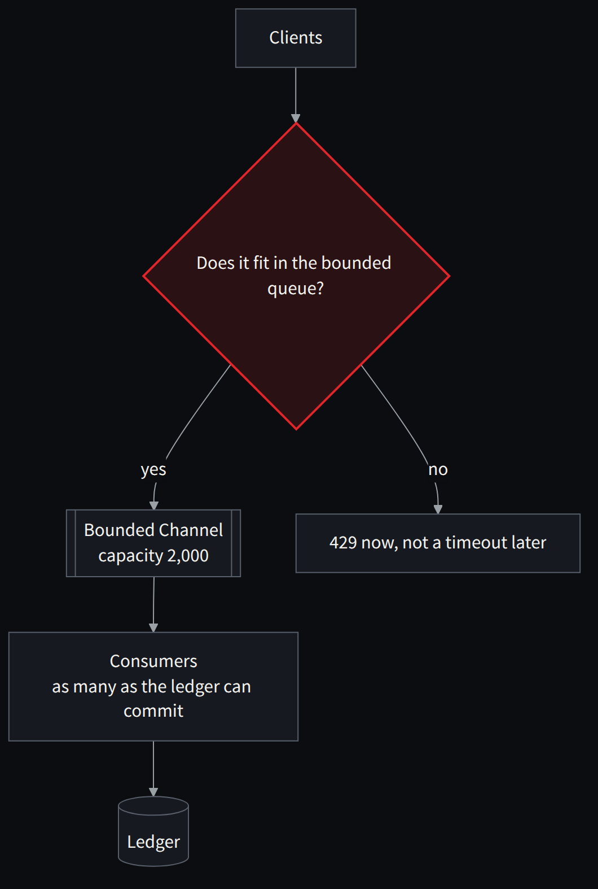

*Figure 23.1 · Bounded admission: what does not fit is rejected now, instead of timing out later.*

An honest warning: this fragment answers `202 Accepted` over an in-memory queue. If the process crashes, admitted and unconfirmed requests are lost. It is only acceptable if the client resends with the same operation identity —and the ledger deduplicates it— or if the queue is durable. Admitting is not confirming, and the contract must say what each response means.

#### The hot account sets a ceiling

Suppose an entity requires four milliseconds of sequential work per operation. Without overlapping that work or changing the contract, its ideal ceiling is close to 250 operations per second. Adding nodes for other entities does not remove that serial section of the same entity.

We can shrink the critical section, move prior calculations out of it or group work when that is semantically valid. We may also find the entity was defined too broadly. What I would not do is split it just to improve the benchmark if that means we stop protecting the rule.

Amdahl's law gives a similar warning about a program: a sequential part limits the improvement obtainable by adding processors. With ten per cent strictly sequential, the ideal speed-up limit is close to ten times even with an enormous number of processors. The real system adds communication and coordination.

#### Few calls that do useful work

If an operation makes fifty strictly sequential network round trips of two milliseconds each, it spends around a hundred milliseconds on those trips alone, before adding processing. It is an arithmetic example, not an Azure measurement.

The answer may be to reduce trips, use set operations, revisit the contract or bring application and data closer. The most powerful server does not remove the latency of a dependency we keep querying the same way.

When optimizing I would avoid accumulating the whole set in memory without a limit. Batched reads, streaming, cancellation, memory limits and suitable indexes can contribute more than a bigger machine. Each change must preserve the result and pass the oracles again.

> **Async frees threads. It does not add commits to the storage or shorten the time a transaction holds a lock.**

### Chapter 24 · The benchmark that counts: load, contention, failure and cost

> [!IMPORTANT]
> **Chapter thesis.** A banking benchmark needs more than one number: uniform, skewed and mixed loads, fault injection, cost, and a way of generating load that does not hide congestion. A TPS improvement that loses guarantees is not an improvement.

A banking benchmark needs more than one number. I would define three families of load. **Uniform**: operations spread over many accounts, favourable to parallelization. **Skewed**: a small proportion of accounts concentrates much of the traffic, revealing hotspots. **Mixed**: online transactions, queries and batch at the same time, reproducing competition for CPU and storage. The proportions must be derived from telemetry or declared synthetic.

I would measure sustained and peak TPS, p50/p95/p99, batch time, error rate, aborts and retries, CPU and memory consumption, database waits, network, IOPS, cost per million operations and recovery time. Queues matter: an API can keep answering quickly the requests it accepts while losing or delaying the rest. We must account for offered, completed and rejected traffic.

The second half is **fault injection**: killing the process before and after the commit, cutting connectivity to the database, duplicating messages, delaying responses, changing the leader, retrying transfers, restoring from a checkpoint and checking reconciliation. Results are published with code version, hardware specification, topology, data seed, scripts and configuration. A pretty dashboard without those details is just another demo.

Agents could optimize the implementation or propose partitions, but their changes go through exactly the same oracles again. They must not quietly touch the reference data or lower the isolation to get more throughput. **A TPS improvement that loses guarantees is not an improvement**.

#### From a useful benchmark to a misleading one

For capacity acceptance I would use a generator with a controlled arrival rate and measure from the scheduled send time. A closed-loop client involuntarily reduces pressure when the server slows down and can hide the real accumulation of work, a phenomenon known as coordinated omission.

I would record requests offered, admitted, committed, rejected by the business, failed and pending. Percentiles must show which population they include. I would not discard timeouts to improve the p99. A high throughput of rejections does not prove the capacity to commit transfers.

I would separate warm-up from measurement, repeat runs and keep their variability. The recovery load and the batch mix would have their own tests. Only then could we state which architecture approaches the mainframe's operational commitment and which differences remain open.

It is the same discipline I imposed on myself when comparing two agents hosted on Microsoft Foundry, one on .NET 10 and the other on Python: same region, same quota, same resource envelope and a single real variable, the runtime. A benchmark that changes two things at once measures nothing, and the "how I measured it" is where a benchmark wins or loses its credibility [45].

#### An example you can run: coordinated omission

Coordinated omission is easier to understand by seeing it. The lab includes a deterministic simulation, with no network, no real waiting and no randomness: a server with one millisecond of service time that stops for 500 ms just once —think of a long lock, a log flush or a garbage collector pause. We measure it twice. In a closed loop, one client sends the next request when it receives the previous response. In an open loop, requests are scheduled at 500 per second and latency is measured from the moment they *should* have been sent, as wrk2 does [39].

**Listing 24.1 · tools/coordinated_omission_demo.py** — *Executed · simulation*

```text
$ python3 tools/coordinated_omission_demo.py
Same server, one 500 ms stall at t=4.0s, 1 ms service time.

mode                          req    req/s     p50     p95      p99      max  >100ms
------------------------------------------------------------------------------------
closed-loop (1 client)       9500    950.0     1.0     1.0      1.0    501.0       1
open-loop (500/s)            5000    500.1     1.0   251.0    451.0    501.0     401
```

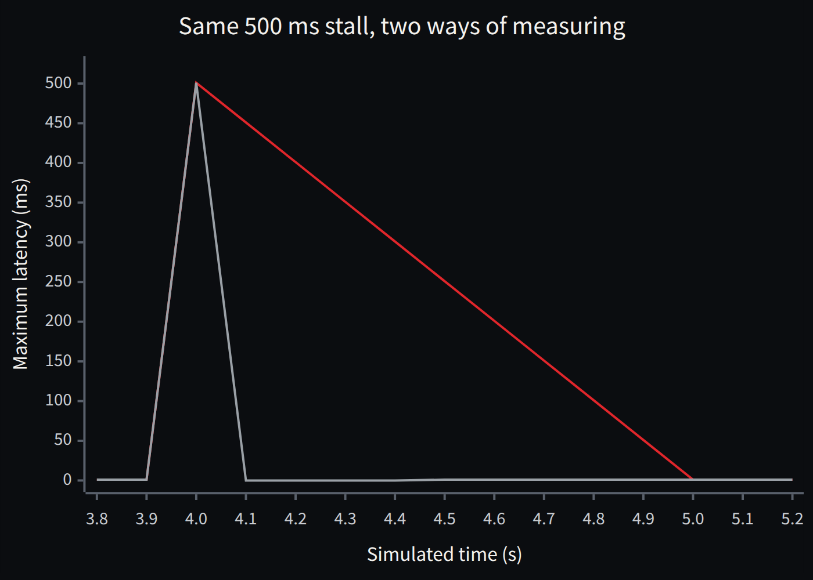

*Figure 24.1 · Maximum latency per 100 ms interval in the simulation. In red, the open loop: the queue takes half a second to drain. In blue, the closed loop: a single spike and nothing else.*

The closed loop reports a p99 of one millisecond and almost twice the throughput. It does not lie about the requests it measured; it lies by omission, because its only client was waiting while the server was stopped and stopped offering load. The open loop reveals that 401 requests exceeded 100 ms. That is the congestion a real customer would see at month-end close.

It is a simulation, not a measurement: it shows why a capacity trial must control the arrival rate and measure from the scheduled send.

> **A high throughput of rejections does not prove the capacity to commit transfers.**

### Chapter 25 · Azure or a huge machine at the customer's site

> [!IMPORTANT]
> **Chapter thesis.** The alternative is not buying a brutal machine: it is building a complete critical service, with its second unit, its recovery and its people. Winning an isolated test is not enough; the full contract must be met on the worst day we want to survive.

#### The decision includes availability and operations

A server with a lot of CPU, abundant memory and fast storage can concentrate a workload with fewer network hops. It can also become a very expensive single point of failure. The local alternative must include the necessary second capacity, storage, network, power, recovery, spares, licences and the people who operate it.

In Azure, the budget includes VM limits, disk limits, log, network, replication and the data service. Microsoft documents that IOPS and bandwidth limits depend on both the storage and the VM [27]. Buying a faster disk does not guarantee the instance can use it.

Log commit latency deserves its own test. If the contract requires synchronous replication before responding, it must be measured with that replica. If we use temporary storage for rebuildable data, we must exclude from it any state whose loss would invalidate a confirmation.

There is not enough data about your workload to responsibly recommend a machine or SKU now. We first need the footprint described in chapter [22](#chapter-22--mips-do-not-fit-in-a-vcpu-conversion) and an executable representative set. The result of this phase would be a short list of candidate configurations and a budget to compare them.

#### Three configurations, one protocol

I would compare an **Azure** scenario (compute, transactional database and network specified), an **on-premises powerful** one (CPU, RAM, NVMe, network and redundancy defined) and, if appropriate, a **hybrid** one that keeps the core while extracting domains. I would not use commercial names as a substitute for a technical spec. The test must repeat the same load, key distribution, fixtures, commit policy and availability level. Figures per second without durable persistence or replication are not comparable with those of a system that guarantees both.

The customer's "supercomputer" can be excellent for bounded workloads and low latency, but it also needs high availability, durable disks, recovery, key management, maintenance without downtime and a second site according to RPO/RTO. The alternative is not simply buying a brutal machine: it is building an entire critical service.

#### Three architecture candidates

| Candidate | Advantage to verify | Cost or limit to verify |
|---|---|---|
| Modular application and a SQL boundary in Azure | Transactional simplicity and managed services | Log, cost, limits and failover |
| Partitioned application with actors or workers | Parallelism across entities | Hot keys and cross coordination |
| On-premises platform with reserve capacity | Locality and control of the environment | Investment, redundancy and own operations |


*Figure 25.1 · Candidate A: modular application and a SQL boundary in Azure, coexisting with preserved COBOL capabilities.*


*Figure 25.2 · Candidate C: the "huge machine" is only a serious candidate with its second unit, its replica and rehearsed recovery.*

All three can include preserved COBOL and new C#. The platform change and the language change do not need to happen at once. Well-bounded coexistence lets us obtain measurements before committing to a full replacement.

My starting point would be to keep the simplest transactional boundary that covers the guarantees and to scale where the load allows independence. Then I would evaluate whether distributing state provides enough capacity to offset the additional coordination.

#### A reference architecture: decisions, not coloured boxes

I propose a reference architecture with five operational domains. First, a **coexistence adapter** exposes authorized COBOL transactions, translates contracts and routes traffic. Second, a **business capabilities layer** contains .NET 10 services and, in suitable domains, Orleans; other components may be batch processes. Third, a **transactional data core** keeps the ledger and the commit rules. Fourth, a **reliable integration layer** uses outbox, inbox, queues and projections. Fifth, an **evidence and governance layer** runs oracles, watches drift and controls delivery.

I would not assume Kubernetes by default. An application with little variability, a well-known load and a single database can run efficiently on VMs or bare metal. Azure App Service, AKS, containers, VMs and Azure Local have different operational trade-offs; the choice responds to SLOs, the team and constraints, not to the eagerness to be cloud native. The same applies to Cosmos DB versus SQL: global distribution does not make up for losing a transactional boundary the business needs. For certain ledgers, an ACID relational engine is the most direct option.

The architecture has a **uniqueness rule**: no critical responsibility can remain ambiguous. One component approves commands; one system is authoritative for each piece of data; one gate approves each baseline; one person or committee authorizes business changes; one operation records its idempotency key. In designs that look highly distributed but do not resolve those responsibilities, failures move from the code to the coordination.

#### Where to place the actors

If we use Orleans, I would place actors by account or contract keys for operations that benefit from identity isolation. I would not put all the accounting there without having verified persistence, transactions and recovery. Transfers between accounts should cross an explicit accounting boundary. For heavy batch loads I would choose partitioned workers with checkpoints. For queries I would use read models, knowing they can lag behind the ledger. Each choice has a falsifiable reason and an alternative.

#### Testing the worst day we want to survive

The acceptance trial must combine interactive and batch load if they share resources in production. It must include the volume and distribution of data that produce the relevant query plans. A small database that fits in cache can hide a problem that appears when the working set grows.

I would test the loss of an instance while the rest is already under load, not only when the platform is empty. If we need to sustain the service with one unit less, the reserve capacity is demonstrated under that condition. The same goes for maintenance, index rebuilds, backups and recovery.

I would also measure the backlog and how it drains. A queue that absorbs a peak may look like a solution if we only look at the absence of errors; the service is still in breach if it takes hours to catch up. Message age and latency from the user's intent must accompany the consumer's throughput.

The selection criterion is not which one wins an isolated test. It is which one satisfies the full contract, at a cost and with an operational capacity the organization can sustain.

> **The customer's "supercomputer" also needs high availability, recovery, maintenance without downtime and a second site.**

### Chapter 25 bis · Infrastructure versus a current mainframe: on-premises, Azure and the branch network

> **Thesis.** You do not replace a mainframe with a box that has more cores. You replace an entire operational service: transactional computing, I/O, isolation, durable commit, continuity and the response seen by a branch that may be thousands of kilometres away. Equivalence is an end-to-end test, not a marketing-specification comparison.

This chapter supplements [chapter 25](#chapter-25--azure-or-a-huge-machine-at-the-customers-site) with named market references and a falsifiable architecture protocol. **Manufacturer data checked in October 2026; our measured performance against those machines: none.**

#### Real systems, real published specifications, and a comparison we cannot yet make

| Market reference | Vendor-published capability | What it means and does NOT establish |
|---|---|---|
| [IBM z17 ME1](https://www.ibm.com/products/z17) | Up to **208 engines**, **64 TB** memory, **5.5 GHz** Telum II | Mission-critical IBM Z; 208 configurable engines are not 208 x86 vCPUs and not verified TPS |
| [IBM LinuxONE Emperor 5](https://www.ibm.com/downloads/documents/us-en/1227cc9e78cb9240) | Up to **208 engines**, **64 TB**, **5.5 GHz** | IBM Z-class system centred on Linux; not an automatic replacement for z/OS/CICS/Db2 and not an independent throughput benchmark |
| [Unisys ClearPath Forward Dorado 8590](https://www.unisys.com/siteassets/collateral/pi-sheet/pi-200145-clearpathforwarddorado8590.pdf) | Published **200–8,400 monthly MIPS** scale and **12,000 MIPS ceiling** per OS 2200 partition; **925 single-thread MIPS** | **Vendor-specific MIPS** and product model. These figures cannot be directly compared with IBM Z or x86 vCPUs |
| [Azure Mdsv3 Very High Memory](https://learn.microsoft.com/en-us/azure/virtual-machines/sizes/memory-optimized/mdsv3-vhm-series) | Published **896–1,792 vCPUs**, up to **30,400 GiB**, up to **185 Gbit/s** network and **8 GB/s** remote disk throughput | VM specification, not a ledger commit-throughput guarantee or evidence that a region, quota or budget supports it |
| [On-premises AMD EPYC 9965 node](https://www.amd.com/en/products/processors/server/epyc/9005-series/amd-epyc-9965.html) | **192 cores/384 threads per socket**, 1P/2P support, 12 DDR5 channels and up to 3.7 GHz turbo | A physical-server candidate. Two sockets could deliver **384 physical cores**, but not 384 IBM engines or mainframe-class resilience |

Core counts, memory, clock rate, vendor MIPS and network bandwidth **come from product specifications, not from our laboratory measurements**. IBM z17 and LinuxONE are related architectural families: they are not two independent benchmark observations. IBM's [zPCR](https://www.ibm.com/support/pages/getting-started-ibm-z-processor-capacity-reference) helps model IBM Z configurations; it is not a universal MIPS/vCPU conversion table.

A real migration first needs a **workload fingerprint**: CICS/TPS curves, MSU/zIIP use, CPU per transaction, hot-key distribution, Db2/VSAM I/O, real data volume, operation-level p99, batch windows, synchronous dependencies, recovery and cost. Without this, hardware equivalence claims are advertising.

#### A banking branch is far away: WAN latency is part of the transaction

A 3270 screen can have a markedly different network profile from an SPA that makes twelve REST calls. IBM documents that contemporary clients commonly reach z/OS using **TN3270/TN3270E over TCP/IP**, and that an internal CICS response metric **does not include** the full communication path to the user's screen ([3270 connections](https://www.ibm.com/docs/en/cics-ts/6.x?topic=security-3270-connections-zos); [response time caveat](https://www.ibm.com/docs/en/cics-ts/6.x?topic=constraints-observing-response-time)). **Never confuse CICS internal response time with branch-to-screen response time.**

Physics remains relevant after buying ExpressRoute: light travels at roughly 200,000 km/s in fibre. **1,000 km of actual fibre** imposes an ideal round-trip lower bound near **10 ms**, before queuing, network devices, inspection, indirect routes and application work. This is not a measured banking WAN link. Microsoft emphasises that the **real fibre path and distance** dominate WAN latency ([ExpressRoute guidance](https://learn.microsoft.com/en-us/azure/expressroute/expressroute-troubleshooting-network-performance)).

##### Latency budget: keyboard to rendered response

The budget does not stop at an application returning `HTTP 200`:

```text
Branch / TN3270 or browser
  | LAN + SD-WAN/MPLS/VPN + provider + routing + TLS
  v
Entry point / gateway / authentication / fraud control
  | routing, admission control, queue, service hop(s)
  v
.NET 10 / CICS coexistence adapter
  | hot-key lock + commit log + synchronous replica
  v
Authoritative ledger / outbox
  | response + network return + screen rendering
  v
Branch employee
```

Measure WAN RTT, session/TLS setup, authentication, queue time, application service, lock acquisition, durable log commit and rendering as separate factors. **The p99 of a sum is generally not the sum of component p99 values**; directly sample the complete user operation with correlated traces.

**Illustrative, NOT observed:** assume a 35 ms branch RTT. If a screen makes four extra sequential round trips to a central server, those trips alone can add roughly **140 ms** to the critical path, before CPU, database work or jitter. A single coarse-grained business command can remove most of that chattiness without relaxing durable-commit or acceptance semantics. **Reducing round trips may matter more than doubling cores.**

##### Four entrance routes to compare

| Route | How to test it | Main hazard |
|---|---|---|
| Branch → bank WAN → on-premises data centre → CICS | TN3270/host transaction, RTT and real screen-time percentiles by branch | Legacy frontends, sessions, concentration points, host contention |
| Branch → SD-WAN → ExpressRoute → Azure | Connection Monitor from representative locations, business HTTPS call, application p99 and retries | Physical distance, circuit, gateway, inspection and extra hops |
| Branch → SD-WAN → Azure Virtual WAN hub → application | Effective routes, vHub/NVA, link failover, double inspection, packet loss | Hairpins, consolidation and NVA/gateway limits |
| Branch → local integration edge → core in Azure | Single authorised command, idempotency key, outbox and visible outcome | Link interruption, duplicate confirmation, inconsistent or pending state |

[ExpressRoute](https://learn.microsoft.com/en-us/azure/networking/hybrid-connectivity/hybrid-connectivity) offers private and more predictable connectivity, **not teleportation**. [FastPath](https://learn.microsoft.com/en-us/azure/expressroute/about-fastpath) can reduce gateway hops where eligibility permits. [Virtual WAN/SD-WAN](https://learn.microsoft.com/en-us/azure/virtual-wan/sd-wan-connectivity-architecture) can connect branches, but every security insertion and network hop should be measured. Avoid *hairpinning* between Azure VNets through ExpressRoute where suitable peering exists ([mission-critical guidance](https://learn.microsoft.com/en-us/azure/well-architected/mission-critical/mission-critical-networking-connectivity)).

**Crucially:** a branch edge may cache authorised reads, submit a command and show its state; it **must not confirm a debit/credit as final without an authoritative ledger commit**. A lost connection means PENDING/INCONCLUSIVE, later reconciliation and one idempotent effect—not an invented balance.

#### Azure: scale out first, not up to a single enormous VM

The specifications above are **physical reference points**, not a strategy of choosing the biggest Azure VM as a mainframe replacement. The primary hypothesis is to **decompose at transactional boundaries and scale independently parallelisable work**, with an explicit authoritative ledger.

| Candidate | Horizontal scaling that is genuinely available | What does NOT magically scale |
|---|---|---|
| VM Scale Sets | Multiple homogeneous VMs, health probes and instance autoscaling without Kubernetes | Stateful monoliths, distributed commits, hot-key contention |
| AKS Standard / Automatic | Service replicas; HPA, KEDA for queues, Cluster Autoscaler/NAP for nodes; deployment isolation | Database, synchronous log, IOPS and contention on a single account; more pods can worsen lock pressure |
| Azure Container Apps Consumption / Dedicated | HTTP-concurrency replicas, event-driven KEDA jobs without cluster operations | Minimum replicas, cold starts, long sessions and stateful actors; **Dapr Actors cannot scale to zero** |
| App Service Premium v3 | Managed plan-instance scale-out and autoscale | Multiple apps sharing the same plan, sessions and common state |
| Orleans | Partitioning by grain identity within a horizontally scaled runtime | A hot grain remains serial; cross-account atomicity does not arise from grains automatically |

Microsoft distinguishes [HPA, VPA, Cluster Autoscaler, NAP and KEDA](https://learn.microsoft.com/en-us/azure/aks/concepts-scale). Horizontal compute scaling needs a **ledger saturation experiment**: 1, 2, 4, 8 and 16 replicas under open-loop offered load, fixed hot-key distribution, committed transactions/s and end-to-end p99. If doubling pods does not increase confirmed commits, the actual bottleneck is downstream. [Container Apps scaling](https://learn.microsoft.com/en-us/azure/container-apps/scale-app) also has its own trigger and stateful-app constraints.

**Candidate flow**: branch → authenticated business API (WAF, idempotency key) → stateless co-located gRPC commands → ledger-owner service and its transactional database; use Service Bus/outbox and KEDA workers for deferrable work. CQRS reads require explicit consistency semantics. A business confirmation follows a durable commit; a lost response is **INCONCLUSIVE** until looked up using its operation identity.

##### Internal gRPC: underused, but not mandatory

gRPC normally operates on **HTTP/2 and TLS**. It is inaccurate to frame gRPC and HTTPS as exclusive alternatives. The relevant test is **gRPC/Protobuf versus REST/JSON with equivalent transport, topology and security**.

- **Good candidates:** typed, versioned binary contracts, frequent co-located synchronous calls, meaningful streaming and C#-to-C# service integration.
- **Poor candidates:** browser-native external APIs without a deliberate gateway, long-running operations best modelled by durable messaging, and operations that must remain one database transaction.
- **Required controls:** protobuf compatibility, propagated deadlines, cancellation, mTLS/workload identity, OpenTelemetry, size limits, safe retries/idempotency, circuit breakers and overload admission.
- **Pitfalls:** long-lived HTTP/2 channels can skew pod distribution; unbounded streams, protocol downgrade at gateways and retry storms can degrade p99.

[Container Apps internal networking](https://learn.microsoft.com/en-us/azure/container-apps/connect-apps) requires **end-to-end HTTP/2** for gRPC and may involve Envoy. In AKS, measure the actual ingress/service-mesh TLS path and RPC load balancing: a Kubernetes `Service` alone does not guarantee per-RPC balancing across long-lived gRPC channels.

Compare offered load, committed TPS, p50/p95/p99, CPU and allocated MB per request, bytes transferred, network hops, live connections, errors/retries, memory and total infrastructure cost under the **same business contract and independent oracle**. Do not assume a faster serializer implies a faster durable transaction.

##### First M1 evidence: transport is not the ledger

The [executed M1 study](../evidence/runs/M1.md) compared gRPC/Protobuf with REST/JSON using **HTTP/2 on loopback without TLS or a database**, under .NET 10. GitHub recorded 2,500 requests per trial at concurrency 8 and 32. Both paths returned oracle-correct results, but **gRPC did not show consistent p99 superiority**. A smaller transport payload does not prove a faster banking commit; the next experiment must include durable persistence, equivalent TLS and per-replica distribution.

#### Dated prices, not a deceptive vCPU-to-mainframe TCO

The official Azure API retrieval on **29 October 2026 at 18:26 UTC** (West Europe, Linux, pay-as-you-go, indicative EUR) returned **D4as_v5 €0.1830/h**, **D4s_v5 €0.2024/h** and **D8as_v5 €0.3661/h**. Three always-on D4as_v5 workers for 730 hours represent **€400.77/month of compute alone**; six represent **€801.54/month**, excluding database, disks, networking and redundancy. Exact meters, `effectiveStartDate` and CI source are in the linked registry.

The [dated pricing comparison, 29 Oct 2026](../docs/PRICING.md) and [structured catalog](../lab/cost/dated_prices.json) contain source-linked prices, a reproducible 3–6-worker comparison and public AMD EPYC CPU references. IBM/Unisys require contractual **RFQs** and are left unpriced, never set to zero.

Comparing a single giant Azure VM with a whole mainframe—or pricing three AKS nodes and calling the result complete TCO—is invalid. Real costs have at least three layers: **scalable computation**, **durable authoritative data**, and **branch network plus operations/continuity**. Compare cost per million **durably committed, oracle-correct transfers**, not headline VM-hour cost. Every recorded monetary value has its source, observation date, currency and exclusions.

#### Three candidate infrastructure blueprints

| Architecture | Candidate topology (NOT approved sizing) | Likely bottleneck |
|---|---|---|
| **Mission-critical on-premises** | Two or more dense physical x86 nodes (e.g. EPYC), HA SQL boundary, enterprise NVMe, 25/100 GbE, replication and secondary site, accessed through the bank WAN | Durable log, locks, NUMA, NIC, replica acknowledgement, N-1 maintenance |
| **Azure transactional** | .NET 10 in VMs/AKS/App Service as justified, SQL HA near the application, Private Link/ExpressRoute, regional entry/gateway as appropriate, end-to-end tracing | VM and quotas, VM **and** disk IOPS, log throughput, failover RTO, gateway, zone dependency |
| **Hybrid coexistence** | Authorised facade before preserved CICS/Db2, new capabilities on Azure/on-premises, gateway contracts, outbox and unambiguous ledger ownership | Cross-site chattiness, distributed commits, backlog, reconciliation and duplicated business semantics |

I would not put the application in one region and require a synchronous ledger commit across an ocean. If every transaction must coordinate between both sites, that **latency enters p99 and caps achievable throughput**, however many cores are added. Aim to reduce serial dependencies, co-locate authoritative data with critical compute and partition by domain without breaking accounting boundaries. On-premises also needs a second site and an actual node-loss exercise.

#### A branch-centred acceptance contract

Before comparing, choose an approved representative sample: nearby urban branch, regional branch, international branch, degraded link and operation after failover. Do not assign RTT or SLA from an architecture desk. Measure **p50/p95/p99 per operation and per site**, distinct from host-internal CICS time, plus packet loss, jitter, DNS, TLS, session, locks, durable log, replica acknowledgement, backlog age, timeouts and retries.

Run with **online + batch**, hot keys, replication and peaks; repeat with **injected** 0.1% and 0.5% loss (not observed production rates), configured jitter and removal of a link or instance. Every run must persist source SHA, region/route config, client/server versions, distributions, cost and independent oracle verdict. [Azure Connection Monitor](https://learn.microsoft.com/en-us/azure/network-watcher/connection-monitor-overview) can observe RTT and loss, but a TCP/ICMP probe **cannot replace** measured business-transaction latency.

Accept only when **business results, durable completion, recovery and perceived latency** meet the approved contract—not when isolated TPS looks impressive. A fast network with a wrong ledger is useless; a correct ledger with unacceptable branch response also fails.

#### Our evidence: what exists and what does not

This branch does contain [versioned E1a/E1b observations](../evidence/runs/README.md): real `40P01` deadlock, `40001` serialization, a corruption-detecting independent oracle and partial .NET 10/Npgsql parity on PostgreSQL. **There is not yet any benchmark on IBM z17, LinuxONE, Dorado 8590, Azure Mdsv3 or EPYC**, nor measurements from a real distant branch. The evidence registry must not promote those comparisons without reproducible load, approved SLOs and on-site measurements.

> The winning architecture is not the one that runs fastest inside the data centre. It is the one that commits the correct operation and delivers the answer back to the branch even when the worst WAN day meets the month-end close.

## Part VI · The lab: from demo to evidence

Everything above, in code you can run, read in an afternoon and break on purpose. The lab is small so the mechanism can be understood, and its scope is explicit so nobody mistakes it for a finished migration.

### Chapter 26 · A local lab you can understand

> [!IMPORTANT]
> **Chapter thesis.** Real COBOL, a C# candidate, an independent gate and a pinned contract, run locally without calling any model. How easy it is to reproduce should help us see the real difficulty more clearly.

> [!NOTE]
> In this repository the lab lives in the [`lab/`](../lab/README.md) folder. The commands in this text are run from there.

#### The teaching case

The service receives a fourteen-character record. The first eight represent the amount in cents; the next five, the rate in basis points; the last indicates whether the customer is active. Accepted values are zero to 99,999,999 cents, zero to 10,000 basis points and the states Y or N.

An inactive customer receives REJECT with a zero fee. An active customer receives REVIEW when the amount exceeds 1,000,000 cents; at the exact threshold it receives APPROVE. The fee is calculated for active customers with the rounding described in chapter [12](#chapter-12--cobol-and-c-must-agree-on-meaning). Fixed-width records that contain invalid characters or an out-of-range rate return INVALID and a zero fee.

The policy is fictional and we chose it because it lets us study rule priority, comparison boundaries, representation and rounding within a small program.

The contract includes 58 cases: fourteen explicit boundary and behaviour cases, forty cases generated with a fixed seed and four invalid fourteen-character records. They are inputs of one synthetic capability, not 58 independent projects or a sample of enterprise applications.

This is the complete program. It is worth reading slowly: in 40 lines you will find `REDEFINES`, a `COMP-3` field, `ROUNDED`, `ON SIZE ERROR` and a rule priority that is not the one you would intuitively write.

**Listing 26.1 · legacy/fee.cob** — *Executed*

```cobol
identification division.
program-id. fee.
environment division.
configuration section.
repository. function all intrinsic.
data division.
working-storage section.
01 raw-input pic x(14).
01 request-fields redefines raw-input.
   05 amount-cents pic 9(8).
   05 rate-bps pic 9(5).
   05 customer-active pic x.
01 fee-cents pic 9(8) comp-3.
01 fee-display pic 9(8).
01 result-code pic x(7).
procedure division.
    accept raw-input
    move 0 to fee-cents fee-display
    evaluate true
      when amount-cents is not numeric
      when rate-bps is not numeric
      when customer-active not = 'Y' and not = 'N'
        move 'INVALID' to result-code
      when rate-bps > 10000
        move 'INVALID' to result-code
      when customer-active = 'N'
        move 'REJECT' to result-code
      when other
        compute fee-cents rounded = amount-cents * rate-bps / 10000
          on size error
            move 'INVALID' to result-code
          not on size error
            move fee-cents to fee-display
            if amount-cents > 1000000
              move 'REVIEW' to result-code
            else
              move 'APPROVE' to result-code
            end-if
        end-compute
    end-evaluate
    display trim(result-code) '|' fee-display
    goback.
```

#### What running COBOL locally means

GnuCOBOL provides the compiler and runtime used in the lab. The command `cobc -x -free` generates an executable from the source [10]. I do not present it as a pure interpreter. The guided walkthrough hides part of the repetitive mechanics, but shows the command and the result so the reader knows what is happening.

The package contains the COBOL source, a C# candidate implementation, an independent gate as a .NET process, the pinned cases and a Python orchestrator. Python launches the programs and keeps the observations. The acceptance decision is computed by the .NET gate.

There is a reason to keep the demo free of calls to a remote model: reproducing the behaviour must not depend on the provider answering the same way or on having a key. The lab was built with AI assistance, but its execution includes no autonomous agent and no REA integration. Those extensions are described later as additional work.

#### Two ways to go through it

The full run prepares the binaries, executes cases and controls and saves the reports. The guided mode stops between steps: it explains the record, shows the COBOL, runs an example, shows the candidate translation and ends with the gates.

The native route needs Python, the .NET 10 SDK and GnuCOBOL. The package also includes a Podman recipe that brings them together in an image and runs the lab with no network. The exact commands are in Annex [A](#annex-a--a-lab-that-can-prove-us-wrong) and the README. It is important to distinguish the verified native execution from a container recipe that must be validated on the machine where it is built.

At the end, the reader has result files they can open and compare. They do not need to trust a screenshot. They can change an implementation, repeat the walkthrough and examine which property stopped holding.

#### What's in the box

**Listing 26.2 · Lab structure (in English)** — *Executed*

```text
legacy/fee.cob              synthetic COBOL service
Candidate/                  C# implementation with deliberate mutation modes
Gate/                       .NET evaluator: PASS / FAIL / INCONCLUSIVE + mandate
Bank/                       SQL transfers with idempotency, double entry and outbox
contracts/                  58 approved cases and their SHA-256 anchor
run.py · bank_test.py       equivalence and controls · concurrency and recovery
walkthrough.py              guided walkthrough
cobol_local.py              compile and run a console COBOL source
tools/                      offline verification and coordinated omission simulation
examples/                   warm-up lab: three-way oracle
risk-catalog/               R001–R100
reference-results/          evidence from the reference run, unmodified
Containerfile · scripts/    Podman recipe and launchers
```

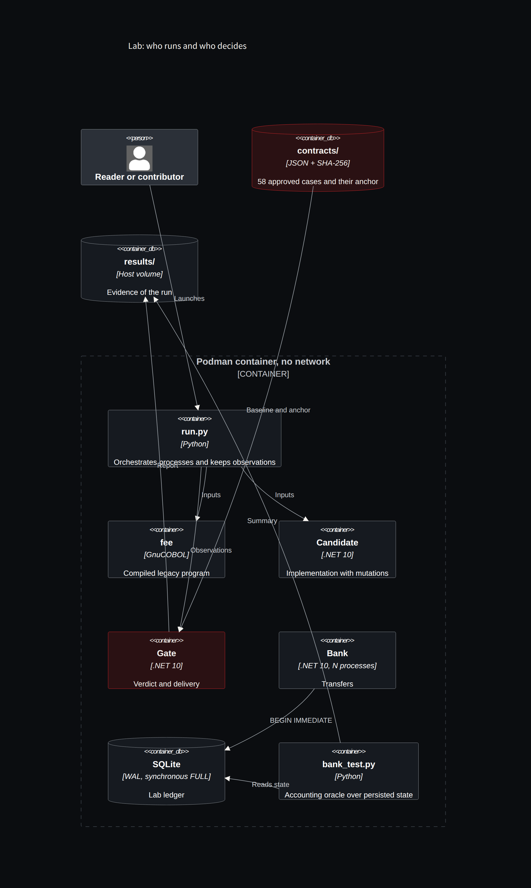

*Figure 26.1 · The lab inside a Podman container with no network: who runs what and who decides.*

#### Before compiling anything

Some checks need neither GnuCOBOL nor .NET, and it is worth doing them first. `tools/verify_offline.py` checks the baseline anchor, recomputes the 58 expected results with a third implementation of the written policy, reports which sources are byte-identical to those of the reference run and runs the accounting oracle again over the persisted databases.

**Listing 26.3 · Offline verification (abridged output)** — *Executed*

```text
[1] baseline anchor ............ OK
[2] independent policy ......... 58/58 cases agree
[3] provenance against the reference run (29 Oct 2026, native Linux):
    Bank/Program.cs                  identical
    Candidate/Program.cs             identical
    Gate/Program.cs                  identical
    legacy/fee.cob                   identical
    run.py                           identical
    walkthrough.py                   changed since reference run
[4] ledger oracle on reference databases:
    acceptance.db            PASS                                     as expected
    negative-control.db      REJECTED balancedPostings,twoPostingsPerCommit,projectionAgrees as expected

VERIFY: PASS (offline checks only; run.py and bank_test.py still require GnuCOBOL and .NET 10)
```

If the independent implementation disagreed with a case, I would stop there. It would mean the contract or my reading of the contract is wrong, and no amount of C# would fix that.

> **You do not need to trust a screenshot. You can change a line, repeat the walkthrough and see which property stops holding.**

### Chapter 27 · Making the error visible

> [!IMPORTANT]
> **Chapter thesis.** Three seeded defects, four kinds of incomplete evidence, a misleading match and a delivery without a mandate. Each produces a different verdict, and each verdict leaves a file someone else can open.

#### A correct implementation within scope

First we run the COBOL program and the C# candidate on the same inputs. Each output is checked against the expected result pinned in the contract. This third element is important: two programs agreeing does not rule out both being wrong.

The gate does not just count matching rows. It checks that the expected cases exist and that observations have the corresponding identities. A missing case or output produces INCONCLUSIVE. An observed discrepancy produces FAIL. An incomplete set cannot win by having left out precisely the example that failed.

The baseline is checked against a digest. In the demo, that digest stays in a local file and serves to detect changes with respect to the reference used. It does not prove human approval or resistance against someone who can modify both pieces. Its teaching role is to show the link; the production architecture must protect the anchor.

The heart of the gate fits in a few lines. Each observation is compared with the approved expectation, never only with the other implementation; absence and contradiction produce different verdicts; and authorization is evaluated separately.

**Listing 27.1 · Gate/Program.cs: three verdicts and a separate authorization** — *Executed*

```csharp
foreach(var key in new[]{"legacy","candidate"})
{
    if(!row.TryGetProperty(key,out var value) || value.ValueKind!=JsonValueKind.String)
    {missing=true;findings.Add(id+": missing "+key);continue;}
    if(value.GetString()!=c.GetProperty("expected").GetString())
    {failed=true;findings.Add(id+": "+key+" violates contract");}
}
// ...
verdict=failed ? "FAIL" : missing ? "INCONCLUSIVE" : "PASS";
// ...
var release=verdict=="PASS" && authority ? "SIMULATED_ALLOW" : "BLOCK";
```

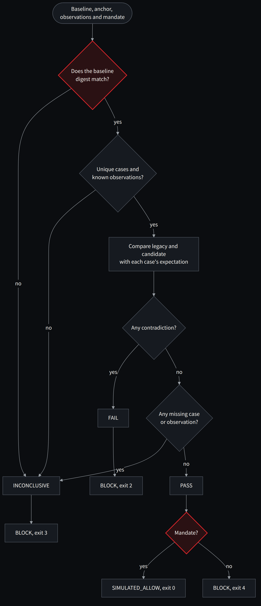

*Figure 27.1 · The decision logic of Gate/Program.cs: contradiction weighs more than absence, and authorization is evaluated separately.*

#### Three mutations of the candidate

The first mutation changes rounding to half-even. The 25-cent case detects the difference. The code may look reasonable at a quick review, because it uses a standard .NET operation. The contract makes visible why that operation does not match this rule.

The second raises the review threshold from 1,000,000 to 1,200,000 cents. The value immediately above the correct threshold and the case between both limits expose the defect. Testing only very small or very large amounts would let the change through.

The third omits the rejection of inactive customers. Here the order of decisions matters. We do not want the program to calculate a fee and approve an operation that should have been rejected earlier. The verifier compares the full output, including status and amount.

These controls are deliberately seeded and known to whoever built the lab. They serve to demonstrate the detection mechanism. They must not be described as defects discovered in a real product or as a blind productivity evaluation.

The three mutations live in the same candidate and are activated by argument. The rounding one is the most instructive, because at first sight it does not look like an error:

**Listing 27.2 · Candidate/Program.cs: where the defects are seeded** — *Executed*

```csharp
    if (line[13]=='N' && mode!="approve-inactive")
    { Console.WriteLine("REJECT|00000000"); continue; }
    var fee=decimal.Round(amount*(decimal)rate/10000m,0,
        mode=="round-even" ? MidpointRounding.ToEven : MidpointRounding.AwayFromZero);
    var threshold=mode=="wrong-threshold" ? 1200000 : 1000000;
```

#### Equality can be misleading too

Another control modifies both observations so they agree on an incorrect result. A COBOL–C#-only comparison would accept it. Our gate rejects it because it checks both observations against the normative expectation of the case.

This control does not prove the capturer is incorruptible. On the contrary, it makes its importance visible. In production we need to know who obtained the observation, which executable it launched and which transformations it applied. If the builder can fabricate all the evidence, a correct baseline is not enough.

Finally we remove the synthetic mandate. The functional results are still correct, but delivery is blocked. The reader can observe two simultaneous statements: the candidate meets the checks and does not have permission to be delivered under that configuration.

These are two real gate outputs from the reference run. The first blocks half-even rounding in case C003. The second is the misleading match: both programs say the same thing, and both are wrong.

**Listing 27.3 · reference-results/round-even-gate.json and equal-but-wrong-gate.json** — *Executed*

```json
{ "verdict": "FAIL", "authority": "DEMO_ONLY", "release": "BLOCK",
  "findings": [ "C003: candidate violates contract" ], "exitCode": 2 }

{ "verdict": "FAIL", "authority": "DEMO_ONLY", "release": "BLOCK",
  "findings": [ "C003: legacy violates contract", "C003: candidate violates contract" ],
  "exitCode": 2 }
```

And this is the correct but unauthorized delivery: PASS behaviour, authority denied, delivery blocked, exit code 4.

**Listing 27.4 · reference-results/no-mandate-gate.json** — *Executed*

```json
{ "verdict": "PASS", "authority": "DENY", "release": "BLOCK", "findings": [], "exitCode": 4 }
```

#### What we can conclude

The results show that the lab detects the defects and absences included, with the versions executed. They do not prove universal equivalence, the security of an enterprise pipeline or an autonomous modernization capability. Nor do they measure how much work AI saved.

It is a smaller conclusion than a promise of automatic migration. It is also a conclusion someone else can try to reproduce and refute.

#### Break it yourself

The lab is made for you to contradict it. Four five-minute experiments, with their expected result:

| Change | Expected result | What it teaches |
|---|---|---|
| Change `1000000` to `999999` in the candidate | FAIL on C008 | The exact threshold is a case, not a detail |
| Remove the `rate>10000` check | FAIL on C055 | Validation is behaviour too |
| Add a case to `cases.json` without updating the anchor | `run.py` refuses to start | The baseline has an identity |
| Rename a variable in the candidate | PASS | The gate judges behaviour, not style |

> **It is a smaller conclusion than a promise of automatic migration. It is also one someone else can reproduce and refute.**

### Chapter 28 · Transfers, locks and failures, locally

> [!IMPORTANT]
> **Chapter thesis.** Isolated functional equivalence says nothing about concurrency. The banking module takes the reasoning of chapters 17 and 18 to real processes that compete for a balance, crash after the debit and resend requests whose response they lost.

#### The lab that accompanies this decision

The banking module runs separate .NET processes over a real SQLite database with WAL and FULL synchronous commits. It checks races over a balance, concurrent resends, conflicting key reuse, rollback, a process crash after the debit and a commit with a lost response. It forces a lock wait, verifies bounded retries and reconciles balances, postings and outbox rows. A deliberate mutation of the history checks that the oracle rejects it.

SQLite serializes writes and does not represent the row locking of SQL Server or PostgreSQL [29]. That is why this module lets us learn about atomicity and idempotency locally; it does not prove a row deadlock, a banking cluster, machine failure tolerance or capacity equivalent to the mainframe.

The small measurements with one, two, four and eight processes serve to observe how latency and contention change on that machine. They are local closed-loop trials, with insufficient warm-up and duration to size production. The code keeps the results to make that limit explicit.

#### The contract is in the schema

Before the code, the schema. The database constraints are the first line of the oracle: a balance cannot be negative, an operation has a unique identity, every posting belongs to an operation and every committed operation has its outbox row.

**Listing 28.1 · Schema created by Bank/Program.cs** — *Executed*

```sql
CREATE TABLE accounts(id INTEGER PRIMARY KEY,balance INTEGER NOT NULL CHECK(balance>=0));
CREATE TABLE operations(id TEXT PRIMARY KEY,src INTEGER NOT NULL,dst INTEGER NOT NULL,
                        amount INTEGER NOT NULL CHECK(amount>0),status TEXT NOT NULL);
CREATE TABLE postings(op TEXT REFERENCES operations(id),account INTEGER REFERENCES accounts(id),
                      delta INTEGER NOT NULL CHECK(delta<>0),PRIMARY KEY(op,account));
CREATE TABLE outbox(op TEXT PRIMARY KEY REFERENCES operations(id),event TEXT NOT NULL);
```


*Figure 28.1 · The banking module schema: the constraints are the first line of the oracle.*

#### Idempotency: the same mandate, only once

Within the same transaction that will execute the movement, the service looks up the operation identity. If it exists and the content matches, it returns the previous decision. If it exists with different content, it is a conflict.

**Listing 28.2 · Bank/Program.cs: resend versus identity conflict** — *Executed*

```csharp
   var existing=db.Rows($"SELECT src,dst,amount,status FROM operations WHERE id='{id}'");
   if(existing.Count>0) {
    var e=existing[0];
    var same=e["src"]==src.ToString()&&e["dst"]==dst.ToString()&&e["amount"]==amount.ToString();
    db.Exec("COMMIT");begun=false;
    return new(same?"DUPLICATE_"+e["status"]:"ID_CONFLICT",retries,clock.Elapsed.TotalMilliseconds);
   }
```

A craft note: the lab builds SQL by interpolating values because it calls the native library without an intermediate layer, and it does so after validating the identity with a strict regular expression and typing the numbers. In a real service I would always use parameters. The business rule it demonstrates is the same.

#### Failures seeded where they hurt most

**Listing 28.3 · Bank/Program.cs: three injected failures and the bounded retry** — *Executed*

```csharp
   if(approved) {
    if(fault=="crash-after-debit")Environment.Exit(91);
    if(fault=="throw-after-debit")throw new InvalidOperationException("Injected failure after debit");
    db.Exec($"UPDATE accounts SET balance=balance+{amount} WHERE id={dst}");
   }
   // ... operation, postings and outbox ...
   db.Exec("COMMIT");begun=false;
   if(fault=="lost-response")Environment.Exit(92);
   return new(status,retries,clock.Elapsed.TotalMilliseconds);
  } catch(SqlFailure e) when(e.Code==5||e.Code==6) {
   if(begun)db.Exec("ROLLBACK");retries++;
   Thread.Sleep(Math.Min(50,2*(attempt+1))+Random.Shared.Next(1,8));
  }
```

The process that dies after the debit and before the commit leaves no partial charge, because the debit was never committed. The process that dies after the commit without answering leaves a durable decision: the resend with the same identity recovers it as `DUPLICATE_COMMITTED` instead of charging twice. And a lock held by another process produces waits and bounded retries; after twelve attempts the service reports `RETRY_EXHAUSTED` and does not touch the balances.


*Figure 28.2 · Two failures seeded in the lab: a crash before the commit and a lost response after the commit.*

#### The oracle does not ask the service

The verifier is a separate Python process that opens the database and checks invariants over the persisted data. It does not consult the service's response, because a service can answer "OK" and have left something else behind.

**Listing 28.4 · bank_test.py: accounting invariants over the persisted state** — *Executed*

```python
tests={
 'nonnegative':s('SELECT MIN(balance) FROM accounts')>=0,
 'conserved':s('SELECT SUM(balance) FROM accounts')==s('SELECT COUNT(*)*100000 FROM accounts'),
 'balancedPostings':s('SELECT COUNT(*) FROM (SELECT op FROM postings GROUP BY op '
                      'HAVING SUM(delta)<>0 OR COUNT(*)<>2)')==0,
 'projectionAgrees':s('SELECT COUNT(*) FROM accounts a WHERE balance<>100000+COALESCE('
                      '(SELECT SUM(delta) FROM postings p WHERE p.account=a.id),0)')==0,
 # ... twoPostingsPerCommit and outboxAtomic
}
```

Preserving the total is necessary and not sufficient: a movement charged to the wrong account also preserves the total. That is why the oracle also requires two balanced postings per operation and that each balance can be rebuilt from its history. The negative control deletes a posting from a copy of the database, and the oracle must reject it. It does.

#### Local measurements, and why they are not capacity

| Pattern | Processes | Operations | Ops/s incl. start-up | p50 ms | p95 ms | p99 ms | Retries |
|---|---|---|---|---|---|---|---|
| uniform | 1 | 32 | 221.9 | 1.52 | 1.99 | 2.03 | 0 |
| uniform | 2 | 64 | 348.4 | 1.27 | 1.82 | 10.51 | 0 |
| uniform | 4 | 128 | 509.4 | 0.93 | 1.90 | 41.70 | 1 |
| uniform | 8 | 256 | 693.3 | 0.77 | 27.22 | 124.90 | 4 |
| hot | 1 | 32 | 259.9 | 1.17 | 1.61 | 1.79 | 0 |
| hot | 2 | 64 | 351.3 | 1.13 | 3.82 | 11.77 | 0 |
| hot | 4 | 128 | 495.6 | 0.81 | 2.04 | 42.08 | 0 |
| hot | 8 | 256 | 624.4 | 0.85 | 28.40 | 109.78 | 5 |


*Figure 28.3 · Reference run with uniform accounts: red bars for p99 and a blue line for p50, in milliseconds. The median drops and the tail explodes.*

The table teaches one true thing and nothing more: when we add processes that compete for a serialized resource, the median improves and the tail explodes. It is the same phenomenon that will appear with a hot account or a saturated log. But these are 32 operations per process, in a closed loop, including the start-up of each .NET process, on an engine that serializes writes, on a single machine. There is no warm-up or sufficient duration, no mainframe baseline and no Azure. This table cannot approve capacity, and the code writes that down in the results summary itself.

> **The service can answer OK and leave something else behind. The oracle looks at what remains.**

### Chapter 29 · Bringing in agents without letting them write the approval

> [!IMPORTANT]
> **Chapter thesis.** The next step is to put an agent to build the candidate. It can consult, run and fix; it cannot touch the reserved cases or the evaluator. And every change of model, prompt or budget is a different experimental condition.

#### The next step has two modes

I would separate the deterministic demonstration from an experiment with agents. In the first mode, we keep implementations, inputs and pinned expectations to explain the process. In the second, an agent receives a build task and must produce a candidate under recorded constraints.

The agent can consult sources and the public contract, run its own tests and fix the program. It cannot change the reserved cases or the acceptance evaluator. An external verifier runs the candidate in a controlled environment. The report returns enough information to fix it, according to the experiment protocol.


*Figure 29.1 · A builder agent inside a governed harness: it fixes its work against an external verifier it does not control.*

If we change models, budgets, prompts or tools, we record it as a different experimental condition. Saying "AI did it" does not let us explain which combination produced the result or repeat the process.

A comprehension agent could propose rules from the COBOL. That proposal still needs contrast. The builder agent could translate them into C#. The gate checks the observed behaviour. Human approval establishes which rule is accepted and when a difference from the legacy is intentional.

#### REA comes in when the problem needs it

For the lab's small source we do not need a decompiler. Including REA for the sake of appearances would add complexity without clarifying the test. Its integration makes sense when the capability under investigation lives in an artifact its tools help examine.

A coherent extension would be to take an authorized executable, pin its hash and ask an agent to investigate a specific function through REA. The findings would feed hypotheses and tests. The reconstruction would then be evaluated against a suitable oracle. The result would document what was observed directly and what was inferred.

For larger COBOL sources, I would first evaluate the parser and the dialect. An MCP server can expose the inventory, relationships and executions of a specialized adapter. The protocol makes access to tools easier; it does not guarantee their correctness or grant authority to use them.

#### Correlated errors are still possible

Two agents can repeat the same wrong interpretation. Changing models does not guarantee independence either. If both receive an incorrect specification and the evaluator derives from that same specification without review, the loop can confirm its own error.

The defence requires diversity of evidence: observed behaviour, approved rules, known properties and adversarial controls. In a serious evaluation it is also worth separating who builds the solution from who prepares the hidden cases and adjudicates the results.

Anthropic distinguishes between workflows defined by code and agents that dynamically decide their steps and tools [11]. That distinction helps describe precisely what we have built. Our lab is a deterministic workflow. The future experiment can incorporate autonomy, but that autonomy must show it adds value compared with a simpler route.

In "Agents on the fly versus a governed harness" I compared command-line agents beyond the demo and reached an uncomfortable conclusion: defect detection, reliability and quality control have a cost, and that cost does not disappear; it is paid by measuring or paid in production [41]. In a COBOL modernization, the governed harness is the one that sets the mandate of chapter [9](#chapter-9--from-the-agents-authority-to-the-rules-authority), protects the gate of chapter [10](#chapter-10--todm-and-the-problem-of-accepting-what-we-build) and records every attempt for the study in chapter [34](#chapter-34--measuring-what-we-do-not-yet-know).

I built a concrete form of that harness in "From the model that answers to the agent that works", with C#, .NET 10 and Microsoft Foundry: the harness governs planning, state, tools and approvals, and CodeAct compactly runs data-intensive work and tool calls [43]. And in "MCP, A2A and AHP" I explained why those three acronyms solve different problems in different layers and why an agent should live in a container [46]. It is the same reason the lab runs in a container with no network, and the reason experiment E4 should lock the builder agent inside one.

> **Saying "AI did it" does not explain which combination produced the result, nor does it let you repeat the process.**

## Part VII · From evidence to the organization

A lab convinces a technical team. An organization needs coexistence, an SDLC that works in its favour, a plan with exit points, a way of measuring what it does not yet know and the courage to say "I would not migrate here".

### Chapter 30 · From the lab to a system that keeps running

> [!IMPORTANT]
> **Chapter thesis.** During coexistence, each capability has a single write owner; going back may require transforming data; and any change of rules, compilers or models forces the acceptance evidence to be renewed.

#### Coexistence has a write owner

A calculation without persistence is a good entry point to the problem. An enterprise application requires deciding how the two implementations coexist while the new one is verified.

In a shadow run, the reference system keeps operating and the new implementation receives comparable inputs to evaluate its response. That shadow must not duplicate external effects. A notification, a charge or an update must not be executed twice because we want to compare results.

The capture must define the observed state. If one implementation reads the data before an update and the other after, a difference may be due to the moment of reading. The evidence must allow us to distinguish a semantic defect from a divergence introduced by the experiment itself.

Write ownership must be explicit per capability and per phase. The strategy may include gradual routing, reconciliation and idempotency mechanisms, depending on the system. I would not introduce simultaneous writes to two data models as a minor integration detail.

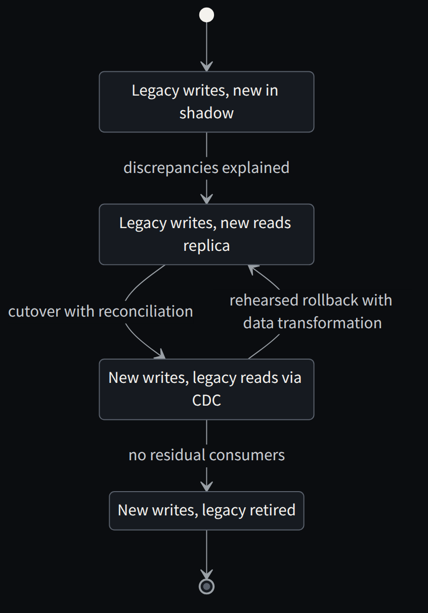

*Figure 30.1 · Coexistence phases: in each one there is a single write owner, and going back may require transforming data.*

#### Going back can also transform data

A code rollback does not guarantee that the previous system understands the data written by the new version. Nor does it withdraw a message already consumed or undo an external interaction. The return plan must describe which consequences can be reverted and which require compensation or repair.

Before increasing traffic, I would check the cutover mechanism, reconciliation and recovery. If the return window depends on a maximum volume of changes, that limit is part of the delivery decision. An option that disappears after a few hours should not be described as available indefinitely.

Operational oracles extend the functional ones. We care about processing time, resource usage, recovery and data consistency. Their thresholds are set according to the service. I would not choose a universal equivalence percentage to approve any migration.

A small discrepancy in frequency can affect the most important operation. That is why risk classification and critical rules weigh more than a global average. Zero observed differences does not prove the absence of differences in the whole population either.

#### Drift requires re-evaluating

After cutover, rules, data, compilers and dependencies change. The model that helps maintain the system can change too. G7 connects those changes with the acceptance evidence that must be renewed.

If a rate goes from two decimals to four, it is not enough to rerun the old set and celebrate that it is still green. The contract has changed. We need new boundaries, new expectations and possibly another representation.

The modernization will have truly improved the ability to evolve when we can make that change without losing the link between intent, implementation and acceptance. That continuity is one of the outcomes I want to pursue with TODM.

> **A code rollback does not withdraw a message already consumed or undo an external interaction.**

### Chapter 31 · The SDLC as part of the migration engine

> [!IMPORTANT]
> **Chapter thesis.** Good SDLC practices work in our favour when they turn uncertainties into repeatable checks. Switching them off just when AI lets us generate code faster than ever would be a mistake.

One of the ironies of modernizing COBOL is that the organization may today have a far richer engineering discipline than the one that existed when the system was written. It would be a mistake to switch off that advantage precisely because we want AI to generate code fast. The modern SDLC infrastructure lets us turn the speed of agents into repeatable evidence.

#### Starting before having the whole system

Good SDLC practices work in our favour when they turn uncertainties into repeatable checks. An input contract lets us run the same case against two implementations. An ADR keeps why we chose an isolation level or a partition. A regression test prevents reintroducing a difference we had already resolved.

I would bring performance and recovery objectives in from discovery. Microsoft's Well-Architected framework recommends setting measurable criteria and testing continuously under representative conditions [28]. For TODM, that translates into capacity and recovery oracles as well as functional ones.

I would not set the project's targets by copying figures from the example. The service owner must establish the necessary work, the times, the states allowed during a failure and the budget. Those criteria need approval and a version, just like a fee rule.

#### A chain of evidence during development

| Moment | Practice | Useful evidence for migration |
|---|---|---|
| Discovery | Inventory and characterization | What the system does and where we have doubts |
| Design | Transaction and concurrency ADRs | Which guarantees each boundary preserves |
| Build | Tests, analysis and review | Local defects and contract changes |
| Integration | Differential and history tests | Equivalence and concurrent conflicts |
| Performance | Load, stress and soak | Capacity under fixed conditions |
| Resilience | Failures and recovery | Committed state and time to restore |
| Delivery | Immutable artifacts and authorization | Exactly what was verified and delivered |
| Operations | Telemetry and reconciliation | Drift, queues and rules to review |

A quick test can run on every change. Long or expensive tests can run at milestones and on controlled infrastructure. The frequency must respond to the regression risk and the cost. Running a noisy load for thirty seconds on any runner does not produce a reliable capacity gate.

The repository must version sources and specifications, control permissions and separate proposal branches from approved baselines. Pipelines run parsing, linters, SAST, SBOM, characterization tests, contract tests, mutation, concurrency, load and artifact verification. Agents can open PRs and explain differences, but they must not be able to lower thresholds or edit the trusted verifier to get a green build. Signatures, hashes and change control are useful to reasonably attribute which artifacts were evaluated; they do not replace a verifiable human identity or business judgement.

Observability stops being an operations product and becomes part of the oracle. I would define correlated traces for a business transaction, latency and lock metrics, controlled cardinality, balance reconciliation, validation errors, CDC lag and outbox state. A modernization defect may not show up as an exception; it may be a statistical deviation in amounts, an increase in retries or a queue that does not finish before the bank opens.

#### The evidence sheet of every pull request

Each PR should include an **evidence sheet**: proposed change, affected rules, fixtures added, oracle results, coverage, performance effects, dependencies and rollback criterion. Human review must focus on material differences and the integrity of the process, not on approving thousands of generated lines blindly.

This is the template I would put in the repository. The author of the change —person or agent— writes it, and the pipeline validates it, not good faith.

**Listing 31.1 · Evidence sheet template for a modernization PR** — *Illustrative*

```markdown
## Evidence sheet
- Capability: fee-calculation · Mandate: MND-2026-114
- Affected rules: R-FEE-003 (rounding), no baseline change
- Baseline: contracts/cases.json @ 976d7127… (anchor verified by CI, not by the author)
- Candidate: sha256 of the binary published by the build, not the local one
- Oracles: G5 functional PASS 58/58 · G3 controls 10/10 · bank invariants 6/6
- Performance: no change in the critical path / capacity trial not required
- Authorized divergences from the legacy: none
- Rollback: revert the PR; no data migration
- Open questions: behaviour with production compiler options (EV-0142)
```

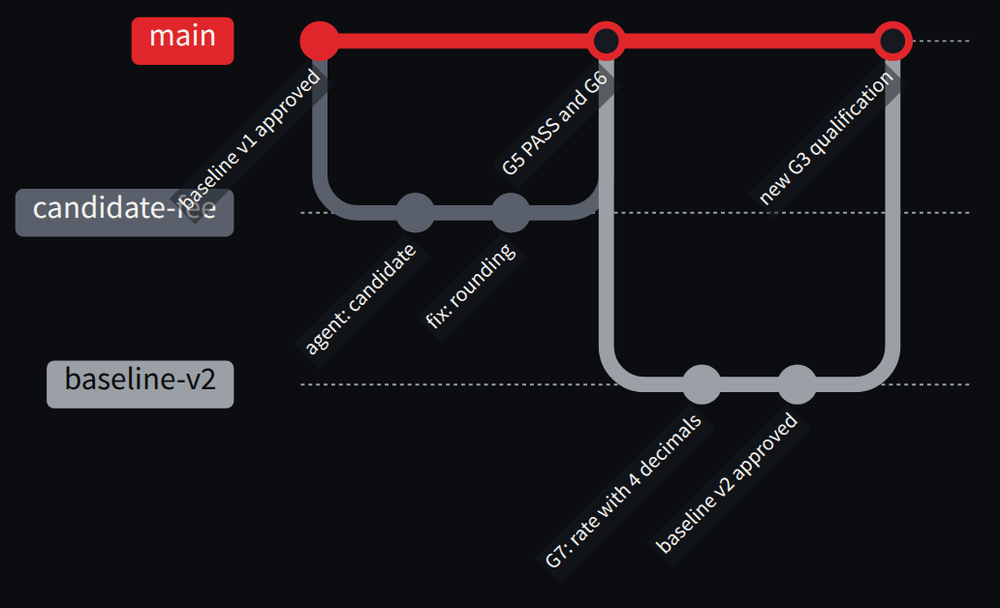

*Figure 31.1 · The baseline lives on its own protected branch: the candidate is merged when it passes G5 and G6, and a rule change opens a G7 revision.*

And this is the continuous integration that backs it. It is the template included in the lab; it is ready to copy to `.github/workflows/`, but it has not been enabled in any repository.

**Listing 31.2 · ci/github-actions.yml in the lab** — *Template · not enabled*

```yaml
name: COBOL and transactional evidence
on: [push, pull_request, workflow_dispatch]
permissions:
  contents: read
jobs:
  acceptance:
    runs-on: ubuntu-latest
    timeout-minutes: 15
    steps:
      - uses: actions/checkout@v4
      - uses: actions/setup-dotnet@v4
        with:
          dotnet-version: '10.0.x'
      - run: sudo apt-get update && sudo apt-get install -y gnucobol3 libsqlite3-0
      - run: python3 tools/verify_offline.py
      - run: python3 walkthrough.py --auto --bank
      - uses: actions/upload-artifact@v4
        if: always()
        with:
          name: execution-evidence
          path: results/
```

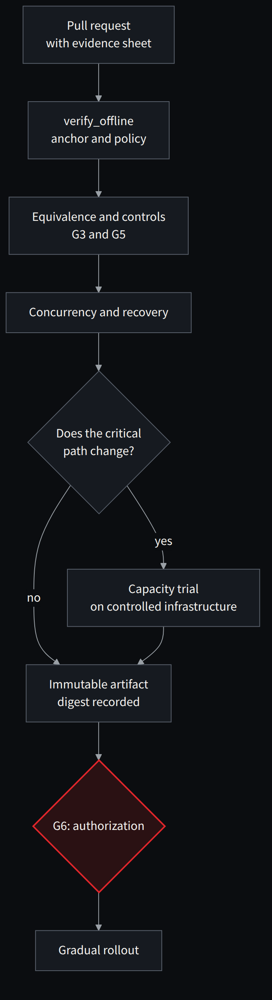

*Figure 31.2 · The pipeline as the migration engine: every stage leaves evidence and authorization consumes the exact artifact.*

Look at `permissions: contents: read` and `if: always()`. The first prevents the pipeline from modifying the repository it evaluates. The second keeps the evidence even when the gate blocks, which is precisely when it is needed most.

#### Making optimization accountable

When we change an index, the batch size, the isolation level or the number of workers, the improvement must face two questions: how much it improves the metric and which guarantee it preserves. A latency drop achieved by disabling durable commit is not an equivalent optimization if the contract required that durability.

I would version the generator, the mix, the data, the configurations and the approval criteria. I would keep raw results, not just the final chart. The record must allow us to distinguish a code improvement from an infrastructure change or an already warm database.

Agents can prepare tests, summarize discrepancies and propose optimizations. The gate must use the observed evidence and keep the protected criterion out of the builder's write scope. Delivery authorization also includes the conditions under which capacity was measured.

> **Agents can open PRs and explain differences. They must not be able to lower the thresholds or edit the verifier to get a green build.**

### Chapter 32 · A migration story: the account that looked easy

> [!IMPORTANT]
> **Chapter thesis.** A program that compiles on .NET 10 is not a migrated account. Three tests —two simultaneous withdrawals, a transfer and a nightly close— are enough to discover three responsibilities that were not on the program map.

Imagine a fictional bank with a COBOL program called `ACCTUPD`. It processes debits and credits, queries a limits table, records movements and takes part in a nightly closing process. The first demo shows a small fragment: input, balance validation, new amount and write. An LLM produces readable C#. Management celebrates that the program already compiles on .NET 10. The technical team then asks for three more tests.

First test: two simultaneous withdrawals. The service without concurrency control approves both. The solution is not to add a `lock` in a web controller: that lock protects one process and the bank will have several nodes. We introduce a transaction and versioning or database-level locking, with an idempotent key. Actors can reduce conflicts by identity, but the commit is still the decisive boundary.

Second test: a transfer. There are two accounts and two writes. A failure between them shows that in-memory sequencing is not enough. We move to a ledger with an atomic operation within a database, or we formally define a compensation protocol when the movement crosses systems where local atomicity is not possible. The business decides which intermediate states are observable and which are not.

Third test: the nightly close. A distributed version tries to calculate a million accounts with one actor per account and too many small writes. Commit time dominates the profile. We reorganize the work into stable partitions, batched writes, idempotent controls and checkpoints. The final code looks less like the original COBOL. The behaviour and the invariants look more like the system we really need.

At this point we are no longer translating a routine. We have identified three different responsibilities: **online acceptance**, **accounting integrity** and **batch processing**. Separating them lets us deploy and measure each with its own criteria. This decomposition was not necessarily on the legacy program map. It is an architectural decision based on responsibilities, not on file names.

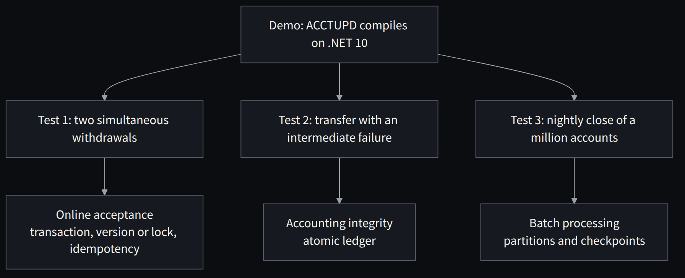

*Figure 32.1 · Three tests, three responsibilities that were not on the program map.*

> **The final code looks less like the original COBOL. The behaviour looks more like the system we really need.**

### Chapter 33 · Modernization plan: first a capability test, then a bet

> [!IMPORTANT]
> **Chapter thesis.** Management does not need promises that AI will convert everything. It needs staged decisions, bounded investment and explicit criteria to stop.

Management does not need promises that "AI will convert everything". It needs staged decisions, bounded investment and criteria to stop. I would propose a **Discovery** that measures inventory, criticality, dependencies, data semantics and observable capacity. Then a **Pilot** with a seam selected for risk and relevance, not for how good it looks in a demo. Then a **Parallel Run** with functional, operational and performance oracles. Only then a gradual rollout and a controlled retirement of the previous component.

Each stage closes with three questions. What property have we demonstrated? What uncertainty remains open? What risk does the next stage take on? A pilot may conclude that keeping COBOL is better. It may also conclude that the migration is viable but requires changing the data model. An early negative result is valuable: it avoids committing millions to a wrong hypothesis.

Governance must prevent false progress. I would not count converted lines as business progress. I would measure capabilities freed from dependencies, rules covered, failures found, change lead time, cost per operation, debt retired and real risk reduction. For AI I would include the percentage of proposals accepted unchanged, defects detected by independent oracles, agent cost and specification drift. No single metric sums up a modernization.

There is also an organizational design obligation: COBOL specialists are not an obstacle to remove; they are part of the domain authority. Their knowledge must be transferred to the evidence contract and to the team that will operate the new system. The goal is not to replace people with agents. It is to stop the business depending indefinitely on tacit knowledge that cannot be audited.

It was the concern I heard most often at Microsoft Frontier Transformation Week, where I took part as an MVP and moderator: moving from pilots to results takes maturity, leadership, governance and identity, not more demos [47]. A COBOL modernization is an extreme case of that same gap, because the pilot can go well and month-end close can still fail.

#### Four stages with an exit

| Stage | What it demonstrates | Exit evidence | It may conclude |
|---|---|---|---|
| Discovery | What exists, what it does and how much work it sustains | Inventory with hashes, workload footprint, transactional map | That it is not worth continuing |
| Pilot | That a relevant seam can be rebuilt and accepted | Approved baseline, qualified gate, PASS candidate | That the data model must change first |
| Parallel run | Functional, operational and capacity equivalence with real traffic | G5 reports, reconciliation, worst-day trial | That the chosen platform does not make it |
| Gradual rollout and retirement | That the legacy is no longer needed for that capability | Ownership transferred, telemetry without residual calls | That the capability is retired |

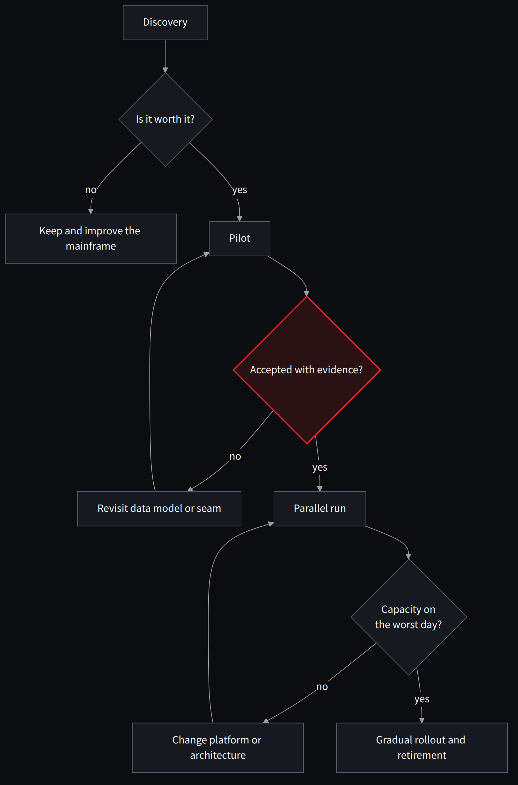

*Figure 33.1 · A plan with exits: each stage may conclude that we should not go on, and that is a result too.*

> **An early negative result is valuable: it avoids committing millions to a wrong hypothesis.**

### Chapter 34 · Measuring what we do not yet know

> [!IMPORTANT]
> **Chapter thesis.** The lab shows a mechanism; it does not show that TODM reduces defects compared with other ways of working. That question requires a protocol, an honest unit of analysis and the willingness to accept negative results.

#### A reproducible result is not a comparative study

The lab shows a mechanism. It does not establish that TODM reduces defects compared with any other way of working. Nor does it establish the hours that bringing agents into a modernization would save.

The public TODM protocol distinguishes three conditions for studying construction with agents: tests coupled to the implementation, an independent oracle, and an independent oracle with mutation qualification. It proposes keeping tasks and budgets comparable, recording costs and analysing at task level [12]. That separation lets us ask questions a demo cannot answer on its own.

Does the independent oracle reduce accepted defects? What does its qualification add? How many incorrect blocks does it produce? How much effort does clarifying and approving rules require? Which attempts to modify the evaluator do real permissions prevent? Those questions need data and a prior design.

The TODM repository itself frames this as an open challenge: it invites anyone to reproduce, falsify, compare or transfer the method, and accepts negative or inconclusive findings as contributions [2]. A book that argues for evidence needs that door open.

#### The unit of analysis matters

If we run the same task several times, we have repetitions of that task. If we inject ten mutations into one program, we have ten related variants. We should not present them as independent projects to artificially increase the sample.

Results must keep the grouping: task, variant, tool, model, run and condition. They must also include failed runs and those that remained inconclusive. Excluding them because they spoil the comparison changes the question we are answering.

The stopping rule is fixed before observing results when we aim for a confirmatory inference. A small pilot may be enough to find protocol failures or show feasibility. Learning from it does not automatically make it generalizable evidence of superiority.

#### What building trust costs

I would measure the human time spent preparing data, clarifying rules, reviewing contracts and resolving discrepancies. I would add model consumption, tool execution, retries and the cost of maintaining the tests.

I would also measure what changes after delivery: escaped defects, diagnosis time, recovery and ease of changing a rule. If an investment in oracles reduces the time to reconstruct why a version was accepted, that benefit deserves to be observed. It must be measured, not assumed.

The architecture is not exempt from evaluation either. A permissions system can be well described and badly configured. We need to attempt unauthorized changes and observe that the environment prevents them. An agent's refusal in natural language does not prove it lacks the permission.

#### A conclusion that may change

I am interested in a methodology capable of receiving negative results. If an oracle turns out too expensive for the risk it covers, it will have to be simplified. If a representation confuses business reviewers, it will have to change. If an agent barely improves on a deterministic workflow, perhaps we do not need that agent.

The value of the book does not depend on every hypothesis coming out in TODM's favour. It depends on the reader being able to distinguish a proposal from an observation and an observation from a sufficiently supported conclusion.

> **The value of the book does not depend on every hypothesis coming out in TODM's favour.**

### Chapter 35 · When I would NOT migrate

> [!IMPORTANT]
> **Chapter thesis.** Keeping the mainframe, improving it or combining it with new systems are legitimate decisions if the data justifies them. A well-governed hybrid architecture can be more modern than a reckless full rewrite.

There are systems that do their job, have a stable load, an acceptable cost, sufficient support and well-known guarantees. If modernization brings no functional value, no demonstrable risk reduction or reasonable economics, the best decision may be to stay on the mainframe and improve observability, automation, documentation and the exposure of capabilities. A well-governed hybrid architecture can be more modern than a reckless full rewrite.

I would not migrate a critical ledger without access to operational profiles and without an environment where equivalence and recovery tests can be run. I would not make an irreversible cutover while unidentified writers coexist. I would not accept an SLA because a synthetic benchmark achieved a striking TPS. I would not split into microservices a process whose atomicity we cannot recover. I would not use actors to simulate a cross-domain transaction and call it safe. And I would not entrust the acceptance of a baseline to the same AI that generated the candidate.

It is not technological conservatism. It is a discipline of reversible decisions. Good modernization is the kind that lets us learn without taking hostage the system that pays salaries, settles operations or protects policies.

#### Without dogma

| It makes sense to migrate a capability when | It does not when |
|---|---|
| There is a measurable business goal the current system prevents | The only argument is the age of the language |
| A behaviour and capacity oracle can be built | "Correct" cannot be defined verifiably |
| There is access to operational profiles and a test environment | There is no workload footprint or way to rehearse recovery |
| Data ownership can be transferred with a protocol | Unidentified writers coexist |
| The required atomicity is preserved in the target | A transaction the business needs to be atomic would have to be split |
| The cost of verifying is affordable compared with the benefit | Verification costs more than the problem it solves |

> **It is not technological conservatism. It is a discipline of reversible decisions.**

### Chapter 36 · A hundred risks for choosing patterns with judgement

> [!IMPORTANT]
> **Chapter thesis.** There is no canonical, verifiable catalog of the hundred COBOL problems ranked by frequency. We can, however, keep a working register where each risk carries an application option, an infrastructure capability and the test that could refute them.

I looked for a canonical catalog of the hundred main COBOL problems and found no verifiable reference with that scope and a frequency classification. There are useful sources to build a rigorous chapter: IBM documents specific compiler migration problems, AWS gathers mainframe and decoupling patterns, and Azure offers catalogs of patterns and OLTP architectures [30–34]. They are not a common list of a hundred problems, nor do they promise to cover any system.

That is why I present my own catalog of a hundred modernization risks. The numbering identifies them and links them to evidence; it does not express frequency, severity or a universal priority. Part of the catalog deals with COBOL semantics, another part with mainframe services and the rest gathers enterprise system problems that also appear when modernizing other technologies.

Each entry proposes a candidate combination of application and infrastructure and a check that could refute it. It does not claim the solution is implemented, validated or suitable for every case. The assessment must record applicability, owner, original rule, target decision and acceptance evidence before closing an entry.

IBM's documentation is particularly instructive: even recompiling for a new version of COBOL can expose invalid numeric data, incompatible sizes or uninitialized values. We do not need to change language to discover a semantic dependency [30]. A new architecture does not automatically fix those conditions.

#### How to use the catalog

I would start with three examples. Faced with a file with packed decimal, I would keep the bytes and the copybook, implement the codec and test limits before normalizing storage. Faced with two concurrent debits, I would fix the transactional unit and an overdraft test before deciding whether actors are involved. Faced with a missed batch window, I would analyse the critical path and the skew before adding workers. The pattern comes after the property we want to preserve.

Platform proposals express capabilities, not automatic equivalences between products. A local broker can implement per-key order; an Azure option can use sessions if its contract fits. A local database and a managed service can protect a transaction, but they must be compared against the real isolation, persistence and recovery policies.

Nor should an actor, CQRS or event sourcing become a mandatory destination. CQRS can separate a read projection from the write core; the projection needs a freshness and reconciliation policy. Event sourcing can provide a history of changes as the source of truth, but it requires event evolution, replay and validation. An append-only ledger is a more concrete domain decision: it can exist in SQL without adopting event sourcing for the whole application.

The lab includes the catalog in English, in JSON and Markdown (`risk-catalog/`), with the initial evaluation status and its relationship to the synthetic controls; Annex [E](#annex-e--catalog-of-one-hundred-risks) reproduces it. None of the hundred risks is marked as solved in production. That way we can use it as a working register and expand each entry when we have a real case.

Annex [E](#annex-e--catalog-of-one-hundred-risks) reproduces the full catalog, grouped into ten families: data and representations, money and time calculations, program flow and state, files and datasets, database access, transactions and financial messaging, batch and scheduling, integration and coexistence, performance and capacity, and SDLC, recovery and governance. Of the hundred, eleven are partially touched by a synthetic lab control; none is marked as solved in production.

#### Closing an entry takes more than recognizing a pattern

To close R048 it is not enough to say the code acquires locks in order: the relevant histories must be run on the target engine, observing victims and retries and reconciling effects. To close R094 we must restore and recover under the conditions the service accepts. To close R099 we must show that the platform prevents delivering a different artifact, even if the builder tries.

This discipline turns the catalog into a practical link between archaeology, architecture and SDLC. We can start by keeping COBOL, replacing a capability or changing infrastructure. On every route the same question remains: what evidence shows that the new combination preserves the commitment we have decided to accept.

> **The pattern comes after the property we want to preserve.**

### Chapter 37 · The new modernization contract

> [!IMPORTANT]
> **Chapter thesis.** Before moving a COBOL capability, any technical leader should be able to sign seven clauses, and each one should be demonstrable with a concrete artifact.

To close, I propose a simple contract that any technical leader should be able to sign before moving a COBOL capability. **First**: we have identifiable evidence of what the system does. **Second**: its invariants and exceptions are recorded in an approved baseline. **Third**: we know which old responsibilities need a new mechanism and why. **Fourth**: implementations are subjected to independent oracles, including concurrency and failures. **Fifth**: the selected environment passes a realistic load test, with documented cost and capacity. **Sixth**: there is a controlled transition of data ownership, support and recovery. **Seventh**: we know which part of the legacy we retire and how we will verify it is no longer needed.

AI-assisted engineering radically changes the speed at which we can investigate, propose and build. REA shows the value of evidence in reverse engineering; those who call for caution warn against losing business knowledge; TODM proposes separating authority and acceptance; architectural patterns let us rebuild guarantees in different environments. The result is a discipline, not a magic tool.

There is a sentence that sums up my position: **a 1:1 modernization can be a bridge, but we should never mistake the bridge for the city we want to reach**. If after changing the language we keep deploying the same way, locking the same way, accumulating dependencies the same way and without knowing how to demonstrate what the system does, we have not modernized it. We have only changed the language of its problems.

#### The contract, with its evidence

| Clause | Artifact that demonstrates it | Where it appears in the book |
|---|---|---|
| Identifiable evidence of what the system does | Inventory with hashes and EvidenceItems | Chapters [6](#chapter-6--rea-and-archaeology-that-leaves-a-trail) and [7](#chapter-7--legacy-archaeology-assisted-by-agents) |
| Invariants and exceptions in an approved baseline | Versioned baseline with a protected anchor | Chapters [10](#chapter-10--todm-and-the-problem-of-accepting-what-we-build) and [12](#chapter-12--cobol-and-c-must-agree-on-meaning) |
| Old responsibilities with a justified new mechanism | Substitution matrix and ADRs | Chapter [13](#chapter-13--before-choosing-a-pattern-identify-the-contract) and Annex [D](#annex-d--architecture-decisions) |
| Independent oracles, also for concurrency and failures | Qualified gate and accounting oracle | Chapters [17](#chapter-17--from-mainframe-locks-to-explicit-concurrency-control), [27](#chapter-27--making-the-error-visible) and [28](#chapter-28--transfers-locks-and-failures-locally) |
| Realistic load test with documented cost | Completed and approved performance contract | Chapters [22](#chapter-22--mips-do-not-fit-in-a-vcpu-conversion) to [25](#chapter-25--azure-or-a-huge-machine-at-the-customers-site) |
| Controlled transition of data, support and recovery | Ownership register and rehearsed return plan | Chapters [16](#chapter-16--data-ownership) and [30](#chapter-30--from-the-lab-to-a-system-that-keeps-running) |
| Verified retirement of the legacy | Telemetry without residual dependencies | Chapters [14](#chapter-14--strangler-fig-change-the-edge-before-the-heart) and [33](#chapter-33--modernization-plan-first-a-capability-test-then-a-bet) |

> **If after changing the language we keep deploying the same way, locking the same way and without knowing how to demonstrate what the system does, we have not modernized it. We have only changed the language of its problems.**

## Epilogue

I do not need to choose between protecting the legacy and exploring new tools. I need to decide what deserves to be preserved, what must change and how I will know whether the change has served its purpose.

COBOL forces us to keep that conversation close to the business. REA and other analysis tools can help us recover evidence. Agents can reduce part of the investigation and construction work. TODM proposes a way to relate that work to acceptance criteria and explicit authority.

No piece solves the whole problem. The parser does not approve the policy. The model does not legitimize its mandate. The hash does not prove correctness. The test does not, on its own, authorize a delivery. The architecture has to connect those responsibilities and preserve their limits.

When the lab blocks an implementation that rounds wrongly, we see something concrete. We know which input contradicts it, which rule is broken and which file holds the evidence. When it blocks a correct result without a mandate, we see another property: the capacity to build and the authority to deliver remain separate.

That is the kind of progress that interests me. Each step leaves something we can review and repeat. Each new capability also widens what we must check. Enthusiasm has a place in the process; the final decision needs evidence.

> Before asking an agent to rewrite your COBOL, build the oracle that tells it when it is wrong.

## Annexes

Reference material: how to run the lab, which contract it implements, what the reference run produced, which decisions I would document, the full risk catalog, the glossary and the sources.

### Annex A · A lab that can prove us wrong

> [!NOTE]
> In this repository the lab lives in the [`lab/`](../lab/README.md) folder. The commands in this text are run from there.

#### What it sets out to demonstrate

The lab is not built to convince but to be contradicted. It makes three claims, and each can fall if someone finds the counterexample.

The first: an executable COBOL program and a .NET 10 implementation can be compared against a **third, approved expectation**, so that two programs agreeing on an error also fail. The second: a gate that distinguishes **PASS, FAIL and INCONCLUSIVE**, and separates correct from authorized, blocks every deliberate defect and every missing piece of evidence in the set. The third: **isolated functional equivalence says nothing about concurrency**; the transfer module shows what must hold when two processes compete for a balance, a client resends or a process dies after the debit.

#### What you need

The recommended route only needs **Podman**. On Linux it installs from the package manager; on macOS and Windows, with Podman Desktop or `podman machine`. Podman runs without a daemon and without administrator privileges, so the files the container writes to `results/` belong to your user.

The native route needs Ubuntu 24.04 or WSL2 with the .NET 10 SDK, GnuCOBOL 3, Python 3 and the native SQLite library. The banking module loads `libsqlite3.so.0` through P/Invoke, so on Windows it must run in WSL2 or in the container.

For the offline checks, Python 3 is enough.

#### Running with Podman

**Listing A.1 · Starting with Podman** — *Executed by design · recipe not built here*

```bash
# Linux, macOS or WSL
bash scripts/run-podman.sh          # guided walkthrough, with pauses
bash scripts/run-podman.sh --auto   # everything, including the banking module

# Windows PowerShell
pwsh scripts/run-podman.ps1
pwsh scripts/run-podman.ps1 -Auto

# By hand
podman build -t cobol-modernization-lab -f Containerfile .
podman run --rm -it --network=none -v "$PWD/results:/work/results:Z" cobol-modernization-lab
```

The build needs network access once: the base image, the packages and the .NET restore. The lab itself runs with `--network=none`: no model, no key and no remote calls. The `:Z` option relabels the volume on SELinux systems and is harmless elsewhere. The base image tag is mutable; pin a digest before measuring anything you want to reproduce.

The reference run is native on Linux. The Podman recipe is built and run by the `podman` continuous integration job; if it behaves differently on your machine, that reproduction report is exactly the evidence the lab asks for.

#### Native run

```bash
sudo apt-get update
sudo apt-get install -y gnucobol3 python3 libsqlite3-0 gcc
python3 walkthrough.py                 # guided
python3 walkthrough.py --auto --bank   # everything
```

The `DOTNET` and `COBC` variables let you use other executables.

#### The walkthrough, step by step

| Step | Command | What you should see |
|---|---|---|
| 0 | `python3 tools/verify_offline.py` | `VERIFY: PASS`: correct anchor, 58/58 cases agree with the independent implementation, negative control rejected |
| 1 | `walkthrough.py`, step 1 | The `fee.cob` source with its `REDEFINES` |
| 2 | `python3 cobol_local.py legacy/fee.cob --input 0000002500200Y` | The `cobc -x -free` command and the output `APPROVE\|00000001` |
| 3 | `walkthrough.py`, step 3 | The C# candidate and its mutation modes |
| 4 | `python3 run.py` | Ten controls with the verdicts of chapter [27](#chapter-27--making-the-error-visible) and exit code 0 |
| 5 | `walkthrough.py`, step 5 | The table of verdicts and deliveries |
| 6 | `python3 bank_test.py` | `status: PASS`, nine controls and six true invariants |
| 7 | `python3 tools/coordinated_omission_demo.py` | A p99 of 1 ms in the closed loop versus 451 ms in the open loop |

The gate's exit codes are part of the contract: 0 for the synthetic permission, 2 for FAIL, 3 for INCONCLUSIVE and 4 for correct behaviour without a mandate. `run.py` ends with 0 when every control, including the expected blocks, behaves as it should.

#### The optional warm-up

`examples/commission-three-way/` contains the first, smaller lab: a commission with an implied decimal point (`PIC 9(8)V99`), an approved CSV baseline, a Python oracle that compares baseline against COBOL, baseline against .NET and COBOL against .NET, a rounding mutant that must exit with code 2 and an in-memory race where `SemaphoreSlim` protects two withdrawals within one process and nothing more. It runs with `bash examples/commission-three-way/run.sh`. It is not part of the reference run; its baseline is consistent with the written policy and the mutant differs in four of the eight cases.

#### What it does not prove

There is no REA integration, no autonomous agent, no actor cluster, no production SQL engine, no row locking, no SQL deadlock, no two-phase commit, no failover, no power-loss test, no Azure deployment and no real outbox publisher. There is no measured mainframe baseline. It does not demonstrate industrial effectiveness or independence between people: the components are separate processes, but they were built in the same piece of work.

The baseline hash and its anchor live in the same writable package. In production they must sit outside the builder's reach and be bound to a real approval. The mandate is synthetic.

#### Where it grows

The file `docs/EXPERIMENT_PROTOCOL.md` describes four experiments that are designed and not executed. E1 ports the banking module to an engine with row locking and adds deadlock victims, write skew and pool exhaustion. E2 implements the same contract with Orleans actors that coordinate and a ledger that commits, under uniform and skewed distributions and with one account receiving half the traffic. E3 compares Azure, a local server with its second unit and a hybrid configuration with the same performance contract. E4 has an agent build the candidate with writes limited to `Candidate/` and compares tests written by the agent, an independent oracle and an oracle qualified by mutations.

### Annex B · Lab contract

| Element | Fixed rule |
|---|---|
| Input | Fourteen characters without separators |
| Amount | Eight ASCII digits with non-negative cents |
| Rate | Five ASCII digits of basis points between 0 and 10,000 |
| Status | Y active or N inactive |
| Priority | Validate format and range before deciding |
| Inactive | REJECT and zero fee |
| Active above 1,000,000 cents | REVIEW |
| Active at or below the threshold | APPROVE |
| Fee for an active customer | Amount times rate divided by 10,000 and rounded to the nearest integer with ties away from zero |
| Output | Status followed by a vertical bar and eight fee digits |
| Missing evidence or invalid reference | INCONCLUSIVE and block |
| Discrepancy with the expectation | FAIL and block |
| Correct behaviour without a mandate | Functional PASS and delivery blocked |

The scope of the invalid tests is limited to fourteen-character records. Native COBOL reading has its own width rules. A production adapter must reject incorrect lengths before passing records to the program. The guided walkthrough applies that validation to interactive inputs.

The fee service does not include CICS, Db2, JCL, IBM i, distributed transactions, EBCDIC or negative values. The banking module adds local persistence and concurrency. Neither includes real IAM or a verified human identity. The internal COMP-3 does not prove cross-platform file interoperability.

### Annex C · Reference run

Local run verified on 29 October 2026. The .NET SDK used was 10.0.403 and the compiler cobc (GnuCOBOL) 3.1.2.0. The 58 cases completed the COBOL and C# comparison. The ten acceptance controls produced the expected verdicts.

| Control | Observed verdict | Observed delivery |
|---|---|---|
| none | PASS | SIMULATED_ALLOW |
| round-even | FAIL | BLOCK |
| wrong-threshold | FAIL | BLOCK |
| approve-inactive | FAIL | BLOCK |
| missing-evidence | INCONCLUSIVE | BLOCK |
| missing-case | INCONCLUSIVE | BLOCK |
| duplicate-case | INCONCLUSIVE | BLOCK |
| invalid-anchor | INCONCLUSIVE | BLOCK |
| no-mandate | PASS | BLOCK |
| equal-but-wrong | FAIL | BLOCK |

The transactional module ended with PASS. Its controls checked a race over a balance, duplicates, identity conflict, rollback, process crash, lost response after commit, lock wait, retry exhaustion and rejection of a deliberately corrupted history. The six reconciliation invariants were true.

The SQLite library used by the C# process was 3.45.1 and that of the Python verifier 3.53.1. The version difference is recorded so as not to attribute an identical environment to both processes.

The complete results and source hashes are in `reference-results/summary.json` and `reference-results/bank/summary.json`, which the lab keeps unmodified. The local measurements have no mainframe baseline and no Azure run. Their result cannot be used to approve enterprise capacity.

To repeat the process, follow Annex [A](#annex-a--a-lab-that-can-prove-us-wrong): `bash scripts/run-podman.sh --auto` with Podman, or `python3 walkthrough.py --auto --bank` in the native environment described. A new run writes its own record in `results/`.

#### Offline verification

`tools/verify_offline.py` checks what can be checked without compilers. Its result: the baseline anchor matches; a third implementation of the policy in Python reproduces the 58 expected results; every core source —`fee.cob`, `Candidate`, `Gate`, `Bank`, `run.py`, `bank_test.py` and `cases.json`— is byte-identical to the one recorded in the reference run; and the accounting oracle accepts the nine valid persisted databases and rejects the negative control because of unbalanced postings, operations without two postings and balances that cannot be rebuilt from the history. `walkthrough.py` and `cobol_local.py` differ from the reference run only in the text they display.

### Annex D · Architecture decisions

#### Decisions for a modernization

**ADR-001: The golden master is not the only truth.** It will be checked against approved rules and invariants; an intentional difference will have an explicit business decision.

**ADR-002: An account is not necessarily an ACID boundary.** The actor coordinates an identity; the ledger defines the source of truth and the commit of related operations.

**ADR-003: Avoid uncoordinated dual writes.** Coexistence relies on a single writer, an outbox, controlled CDC and reconciliation.

**ADR-004: Do not move functionality by program equivalence.** Seams are designed around business capabilities and data ownership.

**ADR-005: The benchmark includes failures.** There is no capacity acceptance without rehearsed durability, consistency, skewed load and recovery.

**ADR-006: AI does not approve its own tests.** The baseline and the trusted verifiers have owners and permissions different from those of the builder agent.

**ADR-007: A 1:1 translator can be temporary.** A documented exception is kept, with scope, review date and exit criteria.

#### Lab decisions

**Keep two references.** The COBOL execution provides observed behaviour; the approvable cases provide the normative expectation. A discrepancy between them must be resolved, not hidden.

**Separate processes.** Candidate and gate run as different programs. This makes the separation understandable and prepares a future permissions boundary. In the local package there is no security isolation between their authors.

**Use a small policy.** The fee and the threshold allow checking concrete errors. The case does not try to represent a banking core.

**Keep reproduction free of a remote model.** Deterministic execution makes results easy to repeat. Autonomous construction with agents requires a separate experiment.

**Record the environment.** The summary keeps tool versions and source hashes. A new run must generate its own record.

**Do not publish to production.** SIMULATED_ALLOW is a lab label. It deploys nothing, grants no privileges and does not represent a human signature.

### Annex E · Catalog of one hundred risks

The numbering identifies each risk; it does not express frequency, severity or priority. Each row proposes an application option, an infrastructure capability and the evidence that could refute them. The lab includes the same catalog in JSON and Markdown, with the owner and evidence fields empty so it can be used in a real assessment.

#### Data and representations

Main scope of this family: COBOL and formats. Infrastructure measures require the contract of the chosen engine or service.

| ID and risk | Application option | Infrastructure option | Evidence to demand |
|---|---|---|---|
| R001 Non-numeric data in numeric fields | Boundary validation and quarantine | Keep originals and rejections | Inject invalid bytes and check rejection |
| R002 Incompatible packed decimal and sign | Explicit COMP-3 codec | Binary staging with versioned schema | Compare bytes, sign, scale and extremes |
| R003 Zoned decimal sign misread | DISPLAY representation adapter | Traceable conversion per dataset | Test signs and source variants |
| R004 Shared memory through REDEFINES | Layout model and discriminated union where applicable | Version copybook and codec | Check every view of the same block |
| R005 OCCURS DEPENDING ON loses length | Collection with validated cardinality | Store length and version | Test zero, maximum and invalid length |
| R006 BY REFERENCE parameters lose aliasing | Call adapter with explicit ownership | Inventory of binary contracts | Observe shared mutation across calls |
| R007 Padding spaces change comparisons | Field type with explicit policy | Keep raw value during transition | Compare blanks, length and empty strings |
| R008 EBCDIC order changes when sorting Unicode | Defined comparer and collation | Staging with identified CCSID | Compare key sequences and ties |
| R009 Byte length confused with character length | Separate binary buffer from text | Encoding metadata per interface | Test accents, lengths and truncation |
| R010 Compiler options change results | Semantic profile per toolchain | Reproducible build with pinned versions | Run corpus with documented options |

#### Money and time calculations

Main scope of this family: Business semantics. Infrastructure measures require the contract of the chosen engine or service.

| ID and risk | Application option | Infrastructure option | Evidence to demand |
|---|---|---|---|
| R011 PICTURE range exceeds target type | Domain type with explicit range | Schema with precision and constraints | Test minimum, maximum and overflow |
| R012 Rounding follows a different rule | Rounding policy per operation | Version approved rules | Test ties and adjacent values |
| R013 Rounding partial results changes the total | Calculation pipeline with defined stages | Keep permitted calculation trace | Compare partials and final aggregate |
| R014 Negative amounts carry other semantics | Types for reversal, debit and credit | Constraints per movement type | Test negatives, zero and reversals |
| R015 Mixed currencies in one balance | Money with currency and scale | Partitions and indexes per currency when appropriate | Reject aggregates across currencies |
| R016 Business date uses server date | Injected business clock | Versioned calendar and time zone | Replay closings with a controlled clock |
| R017 Abbreviated dates hide pivots | Explicit calendar adapter | Keep original date and rule | Test century change and leap years |
| R018 Zero, spaces and NULL are confused | Explicit absence model | Reversible migration and constraints | Check the three values separately |
| R019 Rate table changes during a batch | Rule snapshot per run | Configuration with validity and version | Replay batch with the same rule |
| R020 Division by zero alters the flow | Typed result and exception policy | Log errors without losing input | Test zero divisor and later state |

#### Program flow and state

Main scope of this family: COBOL and design. Infrastructure measures require the contract of the chosen engine or service.

| ID and risk | Application option | Infrastructure option | Evidence to demand |
|---|---|---|---|
| R021 GO TO hides business paths | Control graph and gradual refactoring | Static tools with provenance | Cover branches before and after the change |
| R022 PERFORM or paragraphs depend on fall-through | Function extraction with explicit boundaries | Baseline of executed paths | Compare execution order and effects |
| R023 Reused variable mixes concepts | Typed contexts and domain names | Read/write traceability | Run sequences that reuse storage |
| R024 Dynamic CALL missing from dependencies | Dispatch registry and adapters | Inventory of loaded modules and versions | Test every target and an unknown target |
| R025 WORKING-STORAGE keeps state between calls | Explicit state per session or entity | Temporal affinity only when justified | Compare two invocations in sequence |
| R026 Non-reentrant routine receives parallel requests | Per-invocation context or bounded serialization | Isolate legacy runtime workers | Force concurrent calls to the same module |
| R027 Uninitialized value looks stable | Initialization and valid-value contract | Compiler diagnostics during discovery | Repeat with different initial state |
| R028 Apparently dead code has consumers | Reachability analysis and gradual retirement | Usage telemetry and observation window | Cover rare paths before deleting |
| R029 Return code becomes a generic exception | Explicit map of errors and decisions | Metrics per result class | Compare return, effect and recovery |
| R030 Duplicated rule evolves differently | Domain module or versioned table | Rule ownership and coordinated deployment | Check every consumer of the rule |

#### Files and datasets

Main scope of this family: Mainframe environment. Infrastructure measures require the contract of the chosen engine or service.

| ID and risk | Application option | Infrastructure option | Evidence to demand |
|---|---|---|---|
| R031 VSAM KSDS access loses key semantics | Repository with explicit keys and traversals | Indexes and storage matched to access | Compare missing key, duplicate and ranges |
| R032 RBA or physical position used as identity | Stable identifier and mapping table | Keep mapping during migration | Verify references after reordering |
| R033 Variable records lose length metadata | Record codec with framing | Format and block manifest | Test limits, empty and truncated records |
| R034 Sequential restart repeats committed records | Checkpoint plus idempotent processing | Durable checkpoint next to agreed progress | Crash and resume at commit boundaries |
| R035 Two jobs write the same file | Write owner with fencing | Lease verified by the target | Simulate old owner after handover |
| R036 Consumer reads a file still being written | Publication with completeness manifest | Immutable objects and final marker | Interrupt upload and forbid partial consumption |
| R037 Whole dataset loaded into memory | Streaming and bounded batches | Memory limits and temporary storage | Process volume larger than the working set |
| R038 SORT/MERGE changes order or stability | External sort and tie-break contract | Sized, recoverable temporary disk | Compare repeated keys and totals |
| R039 Sequential read becomes random access | Block or stable-range access | Indexes and layout matched to the traversal | Compare order, completeness and I/O cost |
| R040 Spool or report loses contractual format | Rendering service with versioned template | Output archive with defined retention | Compare content, pagination and consumers |

#### Database access

Main scope of this family: Data and concurrency. Infrastructure measures require the contract of the chosen engine or service.

| ID and risk | Application option | Infrastructure option | Evidence to demand |
|---|---|---|---|
| R041 CICS/Db2 unit of work split into calls | Explicit unit-of-work boundary | One transactional engine when viable | Crash between writes and check atomicity |
| R042 A cursor becomes N+1 queries | Set operations and batching | Indexes and round-trip budget | Measure queries per operation and p99 |
| R043 Balance query lacks a selective index | Access model and query tuning | Indexes based on measured plans | Compare plans with representative volume |
| R044 NULL and spaces alter SQL predicates | Semantic translation layer | Target schema with explicit rules | Compare filters, joins and aggregates |
| R045 Read-check-update allows races | Conditional update or version check | Constraints and transaction in the engine | Launch incompatible debits in parallel |
| R046 Global predicate suffers write skew | Isolation or locking that covers the invariant | Design indexes and consistency boundaries | Test concurrent histories over several rows |
| R047 Transaction waits on network or a human | Shrink critical section and move preparation out | Transaction timeouts and observability | Force a slow dependency and measure locks |
| R048 Variable lock order creates deadlocks | Consistent order and bounded full retry | Collect engine graphs and victims | Force a cycle and check recovery |
| R049 Lock wait consumes the whole budget | Deadline and bounded admission | Timeouts aligned across layers | Hold a lock and verify bounded exit |
| R050 Read replica shows a stale balance | Read-your-commit with required consistency | Read routing by criticality | Read after commit and during lag |

#### Transactions and financial messaging

Main scope of this family: Business guarantees. Infrastructure measures require the contract of the chosen engine or service.

| ID and risk | Application option | Infrastructure option | Evidence to demand |
|---|---|---|---|
| R051 Commit happens but the response is lost | Operation identity and result lookup | Durable decision log | Resend after commit without response |
| R052 Idempotency key reused with another mandate | Compare mandate identity and content | Uniqueness and decision retention | Reject same ID with a different amount |
| R053 Change and event stored separately | Transactional outbox | Store intent in the same transaction | Crash between commit and publication |
| R054 Redelivered event repeats its effect | Inbox or idempotent consumer | Persist deduplication with the effect | Redeliver and count confirmed effects |
| R055 Commit spans different resource managers | Keep compatible coordination or redraw the boundary | Recoverable coordinator and participants | Test prepared states and recovery |
| R056 Compensation replaces atomicity without approval | Choose transaction or saga by contract | Durable workflow and reconciliation | Observe permitted intermediate states |
| R057 Reservation expires without releasing funds | Reservation state machine | Persistence, timers and reconciliation | Crash on expiry, confirm and release |
| R058 Concurrency allows overdraft | Invariant in the engine and conditional debit | Transaction and balance constraint | Compete for a balance insufficient for both |
| R059 Stale owner keeps writing | Fencing with epoch validated at the target | Write authority and monotonic token | Revive old owner and reject its writes |
| R060 Balance and postings stop matching | Immutable ledger and reconcilable projection | Durable history and per-operation indexes | Recompute balances and per-movement balance |

#### Batch and scheduling

Main scope of this family: Mainframe operations. Infrastructure measures require the contract of the chosen engine or service.

| ID and risk | Application option | Infrastructure option | Evidence to demand |
|---|---|---|---|
| R061 JCL hides dependencies between jobs | DAG with declared inputs and outputs | Scheduler with durable history | Reproduce order and preconditions |
| R062 Return codes drive undocumented branches | Workflow with explicit decisions | Log of codes and transitions | Test each branch and an unexpected exit |
| R063 Batch restart re-applies movements | Idempotent chunk with checkpoint | Persist progress and dataset version | Restart before and after each commit |
| R064 GDG generations mixed up when moved | Dataset identity per generation | Versioned objects and batch manifest | Reprocess one generation without mixing another |
| R065 Batch window depends on a serial step | Optimize the critical path before scaling | Resources reserved per phase | Measure the full DAG and the deadline |
| R066 One batch partition concentrates the work | Cost-based partitioning and safe work stealing | Per-partition metrics and worker limits | Inject skew and measure maximum duration |
| R067 Commit size maximizes locks or rework | Chunk with defined atomicity | Sized log and checkpoints | Measure lock time and lost work |
| R068 Batch steals resources from interactive traffic | Bulkheads and explicit priorities | Pools, quotas and separate capacity | Run a mixed batch and online load |
| R069 Closing calendar differs across platforms | Versioned business calendar | Service or configuration with validity | Test holidays, time zone and day change |
| R070 Cancelling a job leaves untraceable work | Cooperative cancellation and resumption | Durable state and worker draining | Cancel at every stage and reconcile |

#### Integration and coexistence

Main scope of this family: Contracts and systems. Infrastructure measures require the contract of the chosen engine or service.

| ID and risk | Application option | Infrastructure option | Evidence to demand |
|---|---|---|---|
| R071 COMMAREA exposed as a DTO without a contract | Anti-corruption layer with versioned schema | Gateway and payload limits | Compare layout, ranges and responses |
| R072 Message exceeds transport limit | Payload reference with integrity | Durable object with temporary access | Test expiry, size and integrity |
| R073 Encoding converted twice | Single codec at a defined boundary | Conversion and origin metadata | Round-trip representative characters |
| R074 MQ acknowledgement decoupled from business effect | Receive protocol and idempotent effect | Transaction manager or inbox by scope | Crash before and after acknowledgement |
| R075 Operations for one entity arrive out of order | Business sequence and per-key consumer | Sessions or partitions plus durable state | Send out of order and detect gaps |
| R076 Poison message blocks a whole entity | Quarantine with resolution policy | DLQ, metrics and controlled resumption | Verify continuity without skipping critical rules |
| R077 Retries in several layers amplify load | A single retry budget with jitter | Admission limits and circuit breaker | Cut a dependency and measure amplification |
| R078 Slow external dependency holds the whole pool | Bulkhead and timeout per dependency | Isolated pools and reserve capacity | Saturate one target and observe the others |
| R079 Screen keeps hidden conversational state | Explicit session or workflow state | Persistence and expiry by contract | Resume a session after an instance change |
| R080 Technical identity replaces business permissions | Authorization context and least privilege | Workload identity and verified policies | Test allowed and denied access |

#### Performance and capacity

Main scope of this family: Application and infrastructure. Infrastructure measures require the contract of the chosen engine or service.

| ID and risk | Application option | Infrastructure option | Evidence to demand |
|---|---|---|---|
| R081 MIPS converted directly to vCPU | Demand model per transaction | Tested hardware candidates | Replay the mix with equivalent durability |
| R082 Per-record allocations trigger the GC | Streaming and measured allocation reduction | Memory budget and GC telemetry | Measure pauses at target volume |
| R083 Synchronous waits exhaust the ThreadPool | End-to-end async where it applies | Instrument queue and available threads | Force slow I/O and observe latency |
| R084 More workers increase conflicts and CPU | Concurrency limited by resource | Measured pools and limits | Concurrency sweep with errors and p99 |
| R085 Unbounded queue hides a service outage | Backpressure and explicit rejection | Durable queue with capacity and alarms | Sustain a rate above consumption and drain |
| R086 Fast disk capped by the VM | Complete I/O model | Verify VM, disk and network limits | Measure IOPS, bandwidth and queues |
| R087 Log or synchronous replica dominates commit | Reduce work and group only when valid | Storage and replica with a durable contract | Measure commits with replica and failure |
| R088 Hot actor imposes a serial ceiling | Shrink critical section or revisit the aggregate | Spread other keys and observe queues | Concentrate load on a single identity |
| R089 Warm-cache-only test misleads | Cold and warm test design | Representative dataset and memory | Measure startup, warm-up and steady state |
| R090 Microservices multiply network round trips | Right-grained operations and locality | Place compute and data by latency | Count round trips and measure on a real network |

#### SDLC, recovery and governance

Main scope of this family: Engineering and operations. Infrastructure measures require the contract of the chosen engine or service.

| ID and risk | Application option | Infrastructure option | Evidence to demand |
|---|---|---|---|
| R091 Nobody knows which version is in production | Artifact inventory and manifest | Traceable build and deployment | Reconcile binaries, configuration and hashes |
| R092 Runtime change alters behaviour | Pinned dependencies and differential regression | Verified images and upgrade plan | Replay corpus when the toolchain changes |
| R093 Incident cannot be reconstructed | Correlated traces and business events | Durable telemetry with data minimization | Follow one operation across all components |
| R094 High availability lacks proven recovery | Failure design and reconciliation | Rehearsed replicas, backups and restore | Measure RTO, RPO and consistency under load |
| R095 New schema prevents running the previous version | Expand/contract and reader compatibility | Versioned schema migration | Rehearse coexistence and cross reads |
| R096 Code rollback does not revert data or events | Return plan with repair or compensation | Snapshots and log of applied decisions | Rehearse return after real writes |
| R097 Shutdown cuts in-flight operations | Graceful shutdown and bounded draining | Probes and coordinated termination | Kill a worker during a commit |
| R098 Shared credentials widen the blast radius | Per-service identity and explicit authorization | Secret store or managed identity per environment | Rotate, revoke and check effective denial |
| R099 A different artifact is delivered than the one verified | Approval bound to digest and scope | Protected repository and immutable promotion | Swap the artifact and block delivery |
| R100 Every test inherits the same false assumption | Independent oracle and qualification | Protected baseline and controlled verifier | Seed a common fault and check rejection |

### Annex F · Operational glossary

| Term | Meaning in this book |
|---|---|
| ACID | Atomicity, consistency, isolation and durability, within the boundary supported by the specific transactional system |
| ACL | Anti-corruption layer: translates legacy formats and semantics so they do not contaminate the new model |
| Actor | Logical entity with identity that processes messages in turns; in Orleans, a grain |
| ADR | Architecture decision record, with context, alternatives and consequences |
| Baseline | Approved, versioned set of expected behaviours against which a candidate is judged |
| Batch | Batch work, often with dependencies, windows, checkpoints and restarts |
| CDC | Change data capture from a source system |
| CICS | Transaction processing platform in IBM environments |
| COMP-3 | Packed decimal representation: two digits per byte and the sign in the last nibble |
| Copybook | Reusable COBOL fragment, usually a shared data definition |
| Coordinated omission | Measurement error in which the generator stops offering load while the system is stalled |
| Deadlock | A cycle of waits between transactions that prevents progress; the engine chooses a victim |
| Fencing | Technique that lets the store reject writes from an owner whose epoch is no longer current |
| Golden master | Reference observation of existing behaviour, useful but not infallible |
| Idempotency | Repeating an identifiable command without repeating its business effect |
| INCONCLUSIVE | Verdict indicating the evidence does not allow a conclusion; it blocks delivery by default |
| JCL | Job control language that organizes batch execution on z/OS |
| Ledger | Authoritative accounting record, with traceability of movements |
| Mandate | Authorization bounded in scope, time, budget and actions for an agent or a person |
| MIPS / MSU | Capacity and consumption metrics from mainframe contexts; they are not equivalent to vCPUs |
| Oracle | Mechanism that answers whether a result is correct: approved examples, properties, decision tables or comparison |
| Oracle Gate | Automatable decision that checks an obligation against independent evidence |
| Outbox | Pending event written in the same transaction as the state change |
| REA | Reverse Engineer Anything: MCP server and CLI that connects agents to analysis tools and an evidence contract |
| REDEFINES | COBOL clause that describes the same memory region with another structure |
| RPO / RTO | Agreed maximum data loss and recovery time |
| Saga | Coordination of a distributed process through steps and compensations, when the business allows it |
| Strangler Fig | Incremental replacement of legacy capabilities behind a facade |
| Syncpoint | Point at which CICS commits or backs out the unit of work over recoverable resources |
| TODM | Test Oracle-Driven Methodology: governed acceptance through independent oracles and gates G0–G7 |
| VSAM | Family of file access methods on IBM systems |
| WLM | Workload and priority management on z/OS |

### Annex G · Sources and scope of the research

[1] José María Flores Zazo. *De Leviatán al Autopilot* (From Leviathan to Autopilot). jmfloreszazo.com, 27 October 2026. <https://jmfloreszazo.com/de-leviatan-al-autopilot/>

[2] José María Flores Zazo. *TODM — Test Oracle-Driven Methodology*. Public repository with research paper and synthetic Python/.NET 10 demonstration; version 1.4.0. Consulted 29 October 2026. <https://github.com/jmfloreszazo/TODM>

[3] morluto. *REA — Reverse Engineer Anything*. README and linked documentation, consulted 28 October 2026. Capabilities evolve; they must be pinned by version when running a project. <https://github.com/morluto/rea>

[4] ProLeap. *ANTLR4 based parser for COBOL*. README, consulted 28 October 2026. <https://github.com/uwol/proleap-cobol-parser>

[5] Microsoft. *Rehost mainframe applications to Azure with Raincode compilers*. Azure Architecture Center. Consulted 28 October 2026. <https://learn.microsoft.com/en-us/azure/architecture/reference-architectures/app-modernization/raincode-reference-architecture>

[6] IBM. *Validating applications using watsonx Code Assistant for Z chat* and Validation Assistant documentation. Consulted 28 October 2026. <https://www.ibm.com/docs/en/watsonx/watsonx-code-assistant-4z/2.x?topic=uzvawcazc2-validating-applications-using-watsonx-code-assistant-z-chat>

[7] AWS. *Transformation of mainframe applications*. AWS Transform documentation, consulted 28 October 2026. <https://docs.aws.amazon.com/transform/latest/userguide/transform-app-mainframe-workflow.html>

[8] Microsoft. *Math.Round Method*. Documentation of rounding conventions, consulted 28 October 2026. <https://learn.microsoft.com/dotnet/api/system.math.round>

[9] IBM. *SIZE ERROR phrases*. Enterprise COBOL for z/OS 6.3. Consulted 28 October 2026. <https://www.ibm.com/docs/en/cobol-zos/6.3.0?topic=operations-size-error-phrases>

[10] GnuCOBOL. *GnuCOBOL Manual*. Compilation and free format. Consulted 28 October 2026. <https://gnucobol.sourceforge.io/doc/gnucobol.html>

[11] Anthropic. *Building effective agents*. Published 19 December 2024; consulted 28 October 2026. <https://www.anthropic.com/research/building-effective-agents>

[12] José María Flores Zazo. *TODM comparative research — preregistration template*. Public protocol, not executed, consulted 28 October 2026. <https://github.com/jmfloreszazo/TODM/blob/61354abc03e73fbf258b6e8d66e35678da134ef8/docs/COMPARATIVE_PROTOCOL.md>

[13] Microsoft. *What is new in .NET 10*. Reference for the runtime chosen for the lab; consulted 28 October 2026. <https://learn.microsoft.com/en-us/dotnet/core/whats-new/dotnet-10/overview>

[14] IBM. *IBM Z Large Systems Performance Reference*. Consulted 29 October 2026. <https://www.ibm.com/support/pages/node/6910157>

[15] IBM. *Summary of performance monitoring tools*. CICS TS. Consulted 29 October 2026. <https://www.ibm.com/docs/en/cics-ts/6.x?topic=workloads-summary-performance-monitoring-tools>

[16] IBM. *Syncpointing*. CICS TS 5.5. Consulted 29 October 2026. <https://www.ibm.com/docs/en/cics-ts/5.5.0?topic=design-syncpointing>

[17] PostgreSQL. *Explicit Locking*. Version 17. Consulted 29 October 2026. <https://www.postgresql.org/docs/17/explicit-locking.html>

[18] PostgreSQL. *Transaction Isolation*. Version 16. Consulted 29 October 2026. <https://www.postgresql.org/docs/16/transaction-iso.html>

[19] Microsoft. *Transaction locking and row versioning guide*. Consulted 29 October 2026. <https://learn.microsoft.com/en-us/sql/relational-databases/sql-server-transaction-locking-and-row-versioning-guide>

[20] IBM. *Two-phase commit process*. Db2 13. Consulted 29 October 2026. <https://www.ibm.com/docs/en/db2-for-zos/13.0.0?topic=consistency-two-phase-commit-process>

[21] Microsoft. *Implement the Transactional Outbox pattern with Dataverse*. Used for the at-least-once delivery contract, without integrating Dataverse into the lab. Consulted 29 October 2026. <https://learn.microsoft.com/en-us/power-platform/architecture/reference-architectures/transactional-outbox-pattern>

[22] Microsoft. *Sequential Convoy pattern*. Consulted 29 October 2026. <https://learn.microsoft.com/en-us/azure/architecture/patterns/sequential-convoy>

[23] Microsoft. *BoundedChannelOptions*. API applicable to .NET 10. Consulted 29 October 2026. <https://learn.microsoft.com/en-us/dotnet/api/system.threading.channels.boundedchanneloptions?view=net-10.0>

[24] Microsoft. *Request scheduling in Orleans*. Consulted 29 October 2026. <https://learn.microsoft.com/en-us/dotnet/orleans/grains/request-scheduling>

[25] Microsoft. *Transactions in Orleans*. Consulted 29 October 2026. <https://learn.microsoft.com/en-us/dotnet/orleans/grains/transactions>

[26] Dapr. *Actors overview*. Consulted 29 October 2026. <https://docs.dapr.io/developing-applications/building-blocks/actors/actors-overview/>

[27] Microsoft. *Virtual machine and disk performance*. Consulted 29 October 2026. <https://learn.microsoft.com/en-us/azure/virtual-machines/disks-performance>

[28] Microsoft. *Architecture strategies for performance testing*. Consulted 29 October 2026. <https://learn.microsoft.com/en-us/azure/well-architected/performance-efficiency/performance-test>

[29] SQLite. *Isolation in SQLite*. Consulted 29 October 2026. <https://www.sqlite.org/isolation.html>

[30] IBM. *Migration recommendations to Enterprise COBOL V6*. Documented problems and diagnosis. Consulted 29 October 2026. <https://www.ibm.com/docs/en/cobol-zos/6.3.0?topic=strategies-migration-recommendations-enterprise-cobol-v6>

[31] AWS. *Mainframes — AWS Prescriptive Guidance Patterns*. Catalog by domain, without a common ranking of a hundred problems. Consulted 29 October 2026. <https://docs.aws.amazon.com/prescriptive-guidance/latest/patterns/mainframe-pattern-list.html>

[32] AWS. *Mainframe modernization — Decoupling patterns for migrating application code*. Consulted 29 October 2026. <https://docs.aws.amazon.com/prescriptive-guidance/latest/modernization-mainframe-decoupling-patterns/introduction.html>

[33] Microsoft. *Cloud Design Patterns*. Consulted 29 October 2026. <https://learn.microsoft.com/en-us/azure/architecture/patterns/>

[34] Microsoft. *Migrate IBM z/OS OLTP workloads to Azure*. Reference architecture, not proof of a particular migration. Consulted 29 October 2026. <https://learn.microsoft.com/en-us/azure/architecture/example-scenario/mainframe/ibm-zos-online-transaction-processing-azure>

[35] José María Flores Zazo. *Más allá del hype: ver un vídeo en YouTube está muy bien, pero la realidad es otra* (Beyond the hype: watching a YouTube video is fine, but reality is different). jmfloreszazo.com, 14 October 2026. Analysis of REA, the VB6 case and the decompilation-with-oracle case. <https://jmfloreszazo.com/mas-alla-del-hype-ver-un-video-en-youtube-esta-muy-bien-pero-la-realidad-es-otra/>

[36] Martin Fowler. *Strangler Fig Application*. <https://martinfowler.com/bliki/StranglerFigApplication.html>

[37] IBM. *Concurrency and locking controls*. Db2 for z/OS 13. <https://www.ibm.com/docs/en/db2-for-zos/13.0.0?topic=concurrency-controls-locking>

[38] Microsoft. *Anti-corruption Layer pattern*. Azure Architecture Center. Consulted 29 October 2026. <https://learn.microsoft.com/azure/architecture/patterns/anti-corruption-layer>

[39] Gil Tene. *wrk2 — a constant throughput, correct latency recording variant of wrk*. README explaining coordinated omission and measurement from the planned send time. Consulted 29 October 2026. <https://github.com/giltene/wrk2>

[40] José María Flores Zazo. *Auditar agentes de Copilot en VS Code: git es la única versión que importa (y auditar no es lo mismo que prevenir)* (Auditing Copilot agents in VS Code: git is the only version that matters, and auditing is not preventing). jmfloreszazo.com, 29 July 2026. <https://jmfloreszazo.com/auditar-agentes-de-copilot-en-vs-code-git-es-la-unica-version-que-importa-y-auditar-no-es-lo-mismo-que-prevenir/>

[41] José María Flores Zazo. *Agentes al vuelo frente a un harness gobernado* (Agents on the fly versus a governed harness). jmfloreszazo.com, 18 October 2026. <https://jmfloreszazo.com/agentes-al-vuelo-frente-a-un-harness-gobernado/>

[42] Maurice Heumann. *500+ Billion Tokens Later*. Published 9 October 2026. Primary source of the agent decompilation case. <https://momo5502.com/posts/2026-10-09-game-decompilation/>

[43] José María Flores Zazo. *Del modelo que responde al agente que trabaja: Agent Harness y CodeAct con C#* (From the model that answers to the agent that works: Agent Harness and CodeAct with C#). jmfloreszazo.com, 28 July 2026. <https://jmfloreszazo.com/del-modelo-que-responde-al-agente-que-trabaja-agent-harness-y-codeact-con-c/>

[44] José María Flores Zazo. *Agent Host Protocol (AHP): por qué el host, y no tu editor, es el dueño del estado de la sesión* (Why the host, not your editor, owns the session state). jmfloreszazo.com, 24 July 2026. <https://jmfloreszazo.com/agent-host-protocol-ahp-por-que-el-host-y-no-tu-editor-es-el-dueno-del-estado-de-la-sesion/>

[45] José María Flores Zazo. *Benchmark: dos Hosted Agents, mismo Foundry, .NET 10 LTS vs Python 3.12* (Two hosted agents, same Foundry, .NET 10 LTS vs Python 3.12). jmfloreszazo.com, 22 July 2026. <https://jmfloreszazo.com/benchmark-dos-hosted-agents-mismo-foundry-net-10-lts-vs-python-3-12/>

[46] José María Flores Zazo. *MCP, A2A y AHP: tres protocolos y por qué tu agente debería vivir en un contenedor* (MCP, A2A and AHP: three protocols and why your agent should live in a container). jmfloreszazo.com, 20 July 2026. <https://jmfloreszazo.com/mcp-a2a-y-ahp-tres-protocolos-y-por-que-tu-agente-deberia-vivir-en-un-contenedor/>

[47] José María Flores Zazo. *Después de Frontier Week: de la expectativa al impacto* (After Frontier Week: from expectation to impact). jmfloreszazo.com, 20 September 2026. <https://jmfloreszazo.com/despues-de-frontier-week-de-la-expectativa-al-impacto/>

The author's articles are cited by their original Spanish titles, with an English gloss.
