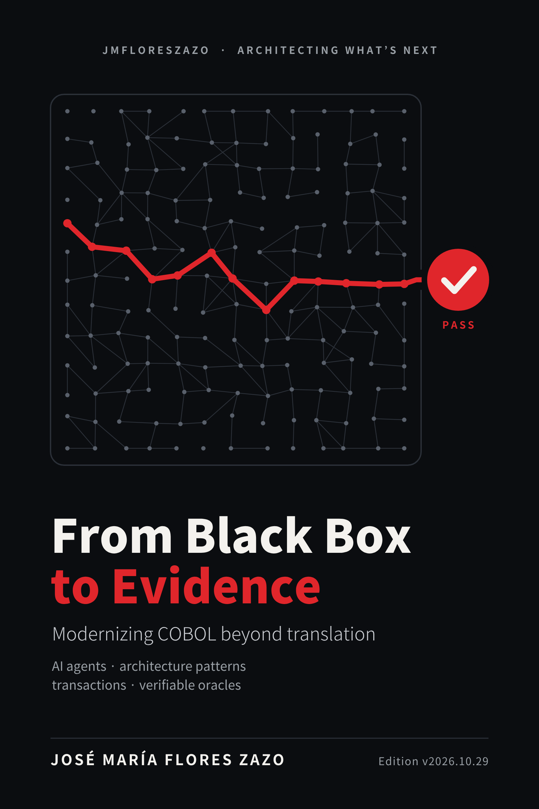

# From Black Box to Evidence

[Español](../es/README.md) · **English**

**Modernizing COBOL beyond translation: AI agents, architecture patterns, transactions and verifiable oracles.**

José María Flores Zazo · Edition v2026.10.29 · [The whole book on one page](../en.md) · [Diagram catalog](diagrams.md) · [Back to the repository](../../README.md)

## Contents

- [Conventions](00a-conventions.md)
- [Prologue](00b-prologue.md)
- [How to read this book](00c-how-to-read-this-book.md)
- **[Part I · Before translating](part-1-before-translating/README.md)**
  - [Chapter 1 · The mainframe is not a fast box](part-1-before-translating/01-the-mainframe-is-not-a-fast-box.md)
  - [Chapter 2 · The system we are trying to preserve](part-1-before-translating/02-the-system-we-are-trying-to-preserve.md)
  - [Chapter 3 · Why one-to-one conversion is not modernization](part-1-before-translating/03-why-one-to-one-conversion-is-not-modernization.md)
  - [Chapter 4 · What I share with other authors and where I disagree](part-1-before-translating/04-what-i-share-with-other-authors-and-where-i-disagree.md)
  - [Chapter 5 · Modernizing means choosing which problem we solve](part-1-before-translating/05-modernizing-means-choosing-which-problem-we-solve.md)
- **[Part II · Archaeology, knowledge and authority](part-2-archaeology-and-authority/README.md)**
  - [Chapter 6 · REA and archaeology that leaves a trail](part-2-archaeology-and-authority/06-rea-and-archaeology-that-leaves-a-trail.md)
  - [Chapter 7 · Legacy Archaeology assisted by agents](part-2-archaeology-and-authority/07-legacy-archaeology-assisted-by-agents.md)
  - [Chapter 8 · The agent's knowledge and the system's record](part-2-archaeology-and-authority/08-the-agent-s-knowledge-and-the-system-s-record.md)
  - [Chapter 9 · From the agent's authority to the rule's authority](part-2-archaeology-and-authority/09-from-the-agent-s-authority-to-the-rule-s-authority.md)
- **[Part III · Oracles: the right to accept](part-3-oracles/README.md)**
  - [Chapter 10 · TODM and the problem of accepting what we build](part-3-oracles/10-todm-and-the-problem-of-accepting-what-we-build.md)
  - [Chapter 11 · The architecture of a verifiable modernization](part-3-oracles/11-the-architecture-of-a-verifiable-modernization.md)
  - [Chapter 12 · COBOL and C# must agree on meaning](part-3-oracles/12-cobol-and-c-must-agree-on-meaning.md)
- **[Part IV · Patterns that replace responsibilities, not syntax](part-4-patterns/README.md)**
  - [Chapter 13 · Before choosing a pattern, identify the contract](part-4-patterns/13-before-choosing-a-pattern-identify-the-contract.md)
  - [Chapter 14 · Strangler Fig: change the edge before the heart](part-4-patterns/14-strangler-fig-change-the-edge-before-the-heart.md)
  - [Chapter 15 · Anti-Corruption Layer: translate meanings, not types](part-4-patterns/15-anti-corruption-layer-translate-meanings-not-types.md)
  - [Chapter 16 · Data ownership](part-4-patterns/16-data-ownership.md)
  - [Chapter 17 · From mainframe locks to explicit concurrency control](part-4-patterns/17-from-mainframe-locks-to-explicit-concurrency-control.md)
  - [Chapter 18 · Distributing without breaking the books](part-4-patterns/18-distributing-without-breaking-the-books.md)
  - [Chapter 19 · Actors: a great tool, a poor universal substitute](part-4-patterns/19-actors-a-great-tool-a-poor-universal-substitute.md)
  - [Chapter 20 · Batch and parallelism: speeding up without changing the result](part-4-patterns/20-batch-and-parallelism-speeding-up-without-changing-the.md)
  - [Chapter 21 · Event sourcing, CQRS and sagas: when they help and when they get in the way](part-4-patterns/21-event-sourcing-cqrs-and-sagas-when-they-help-and-when-they.md)
- **[Part V · Capacity: MIPS, concurrency and platform](part-5-capacity/README.md)**
  - [Chapter 22 · MIPS do not fit in a vCPU conversion](part-5-capacity/22-mips-do-not-fit-in-a-vcpu-conversion.md)
  - [Chapter 23 · Concurrency that makes use of the machine](part-5-capacity/23-concurrency-that-makes-use-of-the-machine.md)
  - [Chapter 24 · The benchmark that counts: load, contention, failure and cost](part-5-capacity/24-the-benchmark-that-counts-load-contention-failure-and-cost.md)
  - [Chapter 25 · Azure or a huge machine at the customer's site](part-5-capacity/25-azure-or-a-huge-machine-at-the-customer-s-site.md)
- **[Part VI · The lab: from demo to evidence](part-6-lab/README.md)**
  - [Chapter 26 · A local lab you can understand](part-6-lab/26-a-local-lab-you-can-understand.md)
  - [Chapter 27 · Making the error visible](part-6-lab/27-making-the-error-visible.md)
  - [Chapter 28 · Transfers, locks and failures, locally](part-6-lab/28-transfers-locks-and-failures-locally.md)
  - [Chapter 29 · Bringing in agents without letting them write the approval](part-6-lab/29-bringing-in-agents-without-letting-them-write-the-approval.md)
- **[Part VII · From evidence to the organization](part-7-organization/README.md)**
  - [Chapter 30 · From the lab to a system that keeps running](part-7-organization/30-from-the-lab-to-a-system-that-keeps-running.md)
  - [Chapter 31 · The SDLC as part of the migration engine](part-7-organization/31-the-sdlc-as-part-of-the-migration-engine.md)
  - [Chapter 32 · A migration story: the account that looked easy](part-7-organization/32-a-migration-story-the-account-that-looked-easy.md)
  - [Chapter 33 · Modernization plan: first a capability test, then a bet](part-7-organization/33-modernization-plan-first-a-capability-test-then-a-bet.md)
  - [Chapter 34 · Measuring what we do not yet know](part-7-organization/34-measuring-what-we-do-not-yet-know.md)
  - [Chapter 35 · When I would NOT migrate](part-7-organization/35-when-i-would-not-migrate.md)
  - [Chapter 36 · A hundred risks for choosing patterns with judgement](part-7-organization/36-a-hundred-risks-for-choosing-patterns-with-judgement.md)
  - [Chapter 37 · The new modernization contract](part-7-organization/37-the-new-modernization-contract.md)
- [Epilogue](epilogue.md)
- **[Annexes](annexes/README.md)**
  - [Annex A · A lab that can prove us wrong](annexes/annex-a-a-lab-that-can-prove-us-wrong.md)
  - [Annex B · Lab contract](annexes/annex-b-lab-contract.md)
  - [Annex C · Reference run](annexes/annex-c-reference-run.md)
  - [Annex D · Architecture decisions](annexes/annex-d-architecture-decisions.md)
  - [Annex E · Catalog of one hundred risks](annexes/annex-e-catalog-of-one-hundred-risks.md)
  - [Annex F · Operational glossary](annexes/annex-f-operational-glossary.md)
  - [Annex G · Sources and scope of the research](annexes/annex-g-sources-and-scope-of-the-research.md)
