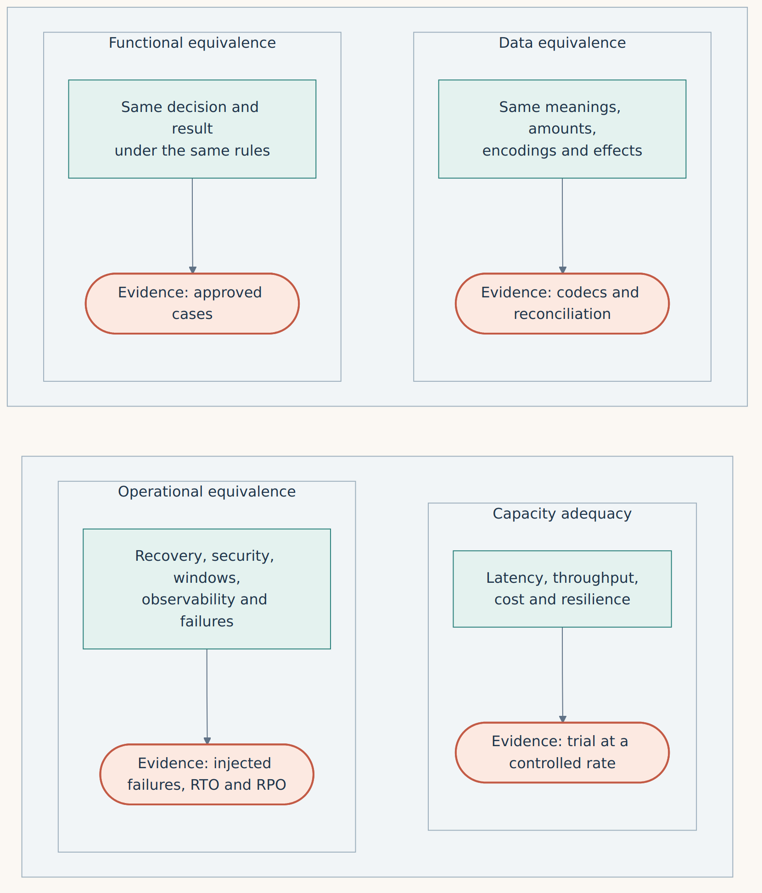

**English** · [Español](../../es/parte-1-antes-de-traducir/01-el-mainframe-no-es-una-caja-rapida.md)

[← Part I · Before translating](README.md) · [Contents](../README.md) · [Chapter 2 · The system we are trying to preserve →](02-the-system-we-are-trying-to-preserve.md)

# Chapter 1 · The mainframe is not a fast box

> [!IMPORTANT]
> **Chapter thesis.** A mainframe is a platform for execution, data, operations and control. If we only measure its processor, we still do not know what we are trying to replace.

There is a conversation I have heard far too often in modernization projects: "we have X MIPS; how many virtual machines do we need in Azure?". At first sight it looks like a capacity question. In reality it usually reveals that we do not yet understand the system we want to replace. The mainframe is a platform for execution, data, operations and control. Reducing it to a processor figure is like measuring an airport by counting only the thrust of its engines.

COBOL is the visible language. Behind it there may be CICS for transaction processing, IMS or Db2 for data, VSAM for indexed files, JCL to organize jobs, JES for batch execution, RACF for security, WLM for priorities, and recovery, queuing, journaling and observability systems that have been evolving for decades. Not every system has all of these components. That is precisely why the first task is to inventory what exists, not to draw the cloud solution we would like to sell.

A CICS application is not a COBOL program with an HTTP endpoint in front of it. It may rely on units of work that jointly commit changes to recoverable resources. `SYNCPOINT` marks that commit or rollback boundary [16]. Db2 applications also depend on isolation levels, locks, access plans and the particulars of concurrent processing [37]. If an agent translates a `READ UPDATE` and forgets the guarantees that came with that access, the new program will compile. It may even pass the first hundred tests. What we will have lost is the property for which the bank trusted the old program.

The platform also includes how work is organized. A batch process is not necessarily "a big loop". It may be chained to closing windows, checkpoint states, sorts, reconciliations, dependencies and recovery mechanisms. Some jobs must finish before a branch opens and others must coexist with online operations. Moving them to a cron job in Kubernetes without mapping those dependencies is a conversion of commands, not a modernization.

The distinction matters because a program can be simple and its execution complex. Calculating interest may take a few lines. Doing it for millions of accounts, exactly once per period, with business calendars, restarts and reconciliation, is a complete system. Preserving it requires designing both the economic invariants and the operation that protects them.

## Four layers of equivalence

I propose separating four obligations: **functional equivalence** (the same decision and result under the same rules); **data equivalence** (the same meanings, amounts, encodings and persistent effects); **operational equivalence** (recovery, security, windows, observability and failures); and **capacity adequacy** (meeting latency, throughput, cost and resilience targets). They are different gates. Passing one does not pass the others.

The new solution may be functionally equivalent and perform worse. It may also process three times as many operations and lose a cent through a different rounding. In neither case are we done.

*Figure 1.1 · Four different obligations. Passing one does not pass the others.*

Translated into a status meeting: when someone says "it's already equivalent", the right question is *in which of the four layers, with what evidence and within what scope?*

> **Measuring a mainframe by its MIPS is like measuring an airport by the thrust of its engines.**

## Identify the layer that owns each guarantee

An assessment needs a platform address, not just an application name: machine/model, partition, operating system/version, runtime/monitor, resource manager and configuration. A partition running Linux on IBM Z does not acquire z/OS, CICS or Db2 for z/OS semantics from the processor. Nor does a container constitute the recovery boundary of everything it calls. Record the installed topology before choosing what to retain, replatform or redesign.

The [source catalog](../../../research/platform-contracts/catalog.json) records ten bounded contracts, their version scope and a proposed falsification test. It separates documented source behavior, execution on the original platform and verification of the replacement. Here only the first has evidence. Unreviewed product families remain visible as unknowns; no blank means that a feature is absent.

| Layer / contract | Documented scope | What to investigate in the replacement |
|---|---|---|
| Partition and dispatch | PR/SM entitlement for shared CPU depends on partition weights and the shared pool [52] | Allocated versus consumed CPU, competition, topology and tail latency; a container CPU limit is not a semantic equivalent |
| Channel I/O | IBM describes CSS handling I/O asynchronously relative to central-processor work [51] | Queue/service time along the complete storage path; language-level async alone does not reproduce a channel subsystem |
| Virtual and real storage | z/OS may page or postpone work under real-storage shortage [53] | Resident working set, buffers, paging and allocation pressure; addressability and RAM capacity are different measurements |
| Workload policy | WLM uses service goals and importance [54] | Interactive versus batch budgets and delays; a priority queue alone is insufficient evidence |
| Processor roles | zIIPs run eligible work [55] | Workload eligibility, actual use and licensing inventory; count useful work rather than converting engines to vCPUs |
| Transaction monitor | A CICS task can span several units of work [49] | Actual syncpoints, participants and external effects; session/task/transaction boundaries need separate inventories |
| Data manager | Db2 for z/OS locking/isolation and data sharing depend on engine settings and topology [56], [57] | Concurrent histories, access paths, predicate safety and recovery; familiar isolation names or writable replicas do not establish equivalence |

The sources describe particular products and documentation versions, not every installation. The structured catalog records retrieval through an index where direct IBM document access was unavailable; publication dates remain unknown where not supplied. Version scope is not a statement of current support or availability. No CPU frequency, MIPS conversion, hardware capacity or bank workload result is derived from these rows.

## Follow one instruction through its recovery boundaries

Consider a **proposed assessment trace**, with no measured durations: branch/browser → channel adapter → transaction service → authoritative database → durable decision → response. Record the operation identity and distinguish it from a session, task, unit-of-work identifier and trace span. The [channel companion](../part-4-patterns/21a-channels-atm-and-the-core.md) develops the ATM/device boundary; the following trace concerns a recoverable account update.

| Observation point | Capture under approved access | Failure or ambiguity to investigate |
|---|---|---|
| Branch and adapter | Client send/receive, network budget, ingress identity and adapter mapping | Client timeout before acceptance versus response lost after commit; preserve the original operation identity |
| Dispatch and execution | Service-class delay, task/UOW boundaries and CPU consumption | An available CPU does not prove that a queued request met its deadline |
| Read and lock | Access path, logical/physical reads, buffer hit rate, lock wait and affected predicate | A cached read can be fast while a competing update violates the rule; inspect concurrent histories |
| Update and durability | Rows/records changed, recoverable participants, log/syncpoint acknowledgment and event publication | Crash before/after the boundary; determine which effects are committed, backed out or unresolved |
| Response and recovery | Authoritative decision, client outcome, retry identity and reconciliation | Lost acknowledgment remains uncertain to the client; a new transport connection must not silently create another debit |

Trace intervals must have defined endpoints. Use monotonic durations within each observer and retain clock offsets/uncertainty before comparing timestamps across machines. A host transaction-response metric does not automatically include branch display, WAN or device work. The [infrastructure chapter](../part-5-capacity/25a-mainframe-on-prem-azure-and-banking-network-infrastructure.md) addresses the network/capacity comparison; do not add overlapping durations as if they were independent.

Two **assessment designs**, rather than benchmarks, make the questions concrete. For a read-heavy candidate, preregister 32 concurrent clients querying an immutable 1,000,000-account fixture, then compare warm and cold working sets, query plans, real reads and response tails. Report the achieved cache behavior; a process restart is not proof that storage caches are cold. For a write-heavy candidate, preregister 16 concurrent clients issuing 1,000 unique transfers of 100 minor units across 100 accounts with 10,000 each, then a separate run concentrated on two hot accounts. Reconcile accepted/declined/uncertain operations, paired entries, deduplication and durability under pre/post-commit failure. The numbers define hypothetical inputs, not observed throughput. Both scenarios need approved service objectives, restore tests and matched persistence/security before comparison.

## Ask the operator and DBA for evidence that can change the design

Request only authorized, minimized extracts. The useful output is a manifest with collection interval, version/configuration, units, owner, sensitivity and missing-data reasons; production dumps, credentials and customer records do not belong in this public repository.

| Question | Evidence to request | Design decision it can change |
|---|---|---|
| Which environments actually execute this capability? | Model/partition/OS inventory, monitor and engine versions, active resource definitions | Retain an engine, replace an adapter or redraw the capability boundary |
| Which workload competes at the peak? | SMF/RMF and service-class records as applicable; CP/zIIP use, delays and batch deadlines | Admission, isolation, scheduling and capacity placement |
| Which data path dominates? | Db2 accounting/statistics, access plans, buffers, lock/deadlock evidence and log/storage timing | Query/index work, transaction size, concurrency limit or storage design |
| What else commits or changes state? | Dataset/queue/resource inventory, syncpoints, job graph, generations and external effects | Local transaction versus coordinated resources or explicit reconciliation |
| What must recovery preserve? | Acknowledged-effect history, backups/restore rehearsal, replication topology and RPO/RTO | Failure domains, ownership fence and operator runbook |
| Who approves the behavior and exceptions? | Versioned policy, accountable owner and independently expected outcomes | Business acceptance; observed source behavior alone is insufficient |

The unanswered fields remain `NEEDS_CUSTOMER_DATA` in an actual assessment. A Linux SQL test can validate a candidate invariant; it cannot measure an IBM channel fabric, establish an MCP recovery option or certify the old installation. The [pattern chapter](../part-4-patterns/13-before-choosing-a-pattern-identify-the-contract.md) uses three platform examples to show why attribution matters.

---

[← Part I · Before translating](README.md) · [Contents](../README.md) · [Chapter 2 · The system we are trying to preserve →](02-the-system-we-are-trying-to-preserve.md)
