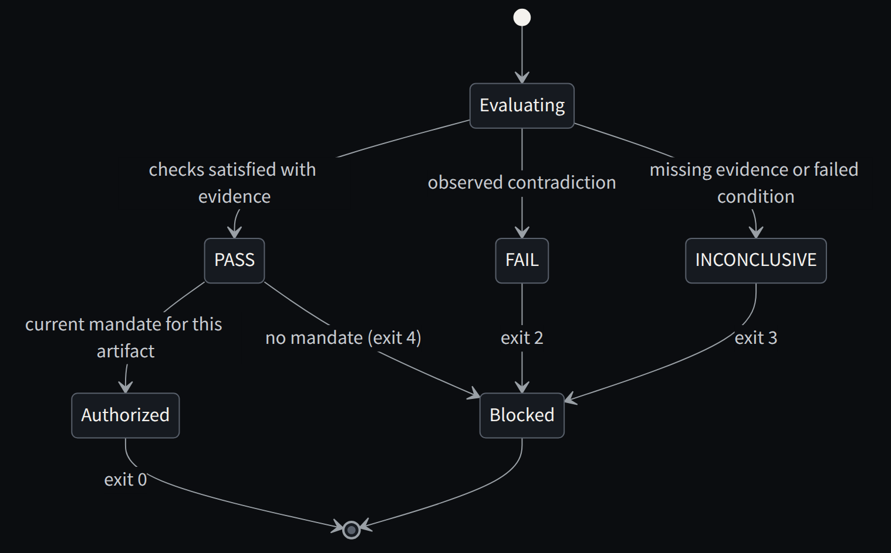
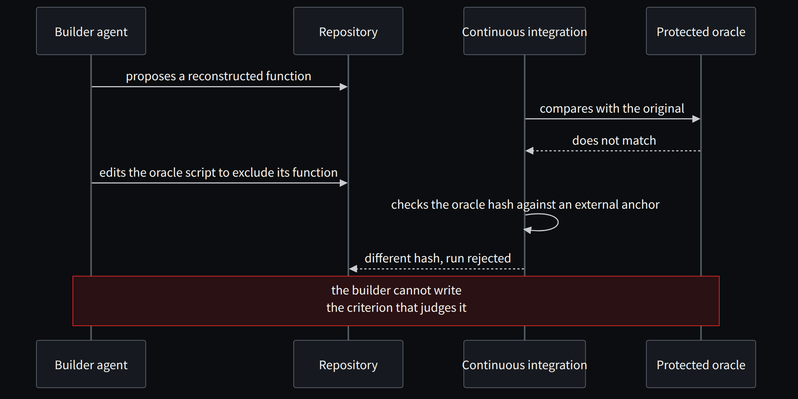

**English** · [Español](../../es/parte-3-oraculos/10-todm-y-el-problema-de-aceptar-lo-que-construimos.md)

[← Part III · Oracles: the right to accept](README.md) · [Contents](../README.md) · [Chapter 11 · The architecture of a verifiable modernization →](11-the-architecture-of-a-verifiable-modernization.md)

# Chapter 10 · TODM and the problem of accepting what we build

> [!IMPORTANT]
> **Chapter thesis.** TODM separates who is authorized to act from whether the resulting software satisfies independently approved behaviour. Agents can propose and build; they cannot approve or change the oracle that judges them.

## A methodology centred on the expected result

TODM stands for Test Oracle-Driven Methodology. Its proposal is to govern acceptance through independent oracles, an approved baseline and evidence bound to the candidate [2]. AI can help discover rules, propose contracts and build code. Acceptance needs an authority and a mechanism that do not depend unilaterally on that builder.

The repository's README frames it with a question that still seems the right one to me: agents already write code, but who verifies that the code is actually right? Its answer is to separate permission to act from proof of correctness, with executable oracles, human-governed baselines and gates that block by default. And its goal is not to trust an agent more, but to need less blind trust in its output [2].

An oracle answers a question about the result. It may be a set of approved examples, a mathematical property, a decision table, a state machine or a comparison with the reference system. The choice depends on what we want to check and what evidence we have.

I do not consider the oracle an infallible truth. It must be tested too. It may omit a case, apply an operator incorrectly or trust an observation the candidate has fabricated. That is why qualifying the evaluator is part of the work.

The public repository I reviewed presents a synthetic Python/.NET 10 demo, five limited semantic profiles and governance scenarios. It does not implement complete engines for the OMG standards that inspire those profiles. Nor does its publication demonstrate comparative superiority or industrial effectiveness [2]. That scope must accompany any book that uses it.

I would build the oracle before writing the implementation. In a real system there are at least four complementary sources: **golden masters** obtained from the legacy, **approved business contracts**, **mathematical or accounting invariants** and **operational properties** under failures and concurrency. None is sufficient on its own. The legacy may have defects; the business may forget historical rules; invariants may omit exceptions; load tests may not uncover a rare condition.

For business decisions, DMN helps express rule tables. BPMN makes process order, events and conditions visible; CMMN can model long-lived cases with discretionary work. SBVR and OCL add vocabulary and invariants where appropriate. I would not assume that drawing a BPMN diagram creates an executable oracle: we need a semantic profile, a concrete engine or verifier and a conformance contract. The current TODM demo uses limited JSON profiles; it does not claim to be a complete, certified implementation of every standard [2].

## Eight gates with different functions

| Gate | Main question | Artifact that must remain | Outcome according to TODM |
|---|---|---|---|
| G0 | Which capability and which risk we address | Scope and exclusions | Authorized mandate |
| G1 | What we know and how we know it | Evidence and uncertainties | Classified evidence |
| G2 | Which behaviour is accepted | Approved, versioned baseline | Accountable human approval |
| G3 | Which errors the evaluator detects | Qualification and negative controls | Mutations and negative controls |
| G4 | What the agent can build | Candidate and change traceability | Candidate with provenance |
| G5 | What the observed candidate satisfies | Verification report | PASS, FAIL or INCONCLUSIVE |
| G6 | Can this artifact be delivered | Delivery authorization | Separate authorization |
| G7 | What happens when conditions change | Monitoring and validity review | Controlled baseline revision |

The table organizes the work; it does not require a meeting for every row. The level of formality must match the impact. What we must not lose is the identity of the decisions. If we change the expected result while fixing the code, we must record that the baseline has changed and requalify whatever applies.

## Three outcomes that should not be reduced to two

PASS means the declared checks have been satisfied with sufficient evidence for them. FAIL indicates an observed contradiction of the criterion. INCONCLUSIVE indicates that we cannot conclude with the available evidence or that a condition necessary for evaluation has failed.

Suppose the observed amount does not match the expected one. We have a failure. Now suppose the output of the COBOL executable is missing. We do not know whether the candidate matches it. The second situation should not become a PASS or be confused with a functional discrepancy.

To deliver, the default behaviour must block FAIL and INCONCLUSIVE. That does not prevent an exceptions policy; it forces the exception to be a separate decision, with a scope and an owner. Altering the report to make it look like a PASS removes information we will need later.

*Figure 10.1 · Three verdicts, a separate authorization and the exit codes of the lab gate.*

## Testing the evaluator

A negative control introduces a defect the evaluator should detect. In our example we will change the threshold and the rounding. If the cases still pass, we will have learned something about the weakness of the acceptance set.

We also need clean controls. A gate that blocks everything detects every defect, but it is useless for delivering correct software. And we need incomplete inputs to check that the evaluator does not accidentally accept what it could not verify.

Qualification is always relative to a set of threats and cases. Passing those controls increases confidence within that scope. It does not prove there is no different way to fool or break the evaluator.

## An example of a failure that must close the gate

The COBOL system calculates a 0.5% fee with a specific rounding rule. The agent translates it into C# using its library's usual rounding option. In 99 cases the results match. In the hundredth, the midpoint comes out differently. The compiler and the candidate's unit tests pass. An approved oracle with a boundary case must reject it. Later, the concurrency gate rejects a method that produces the correct amount in isolation but allows two withdrawals on the same balance. Finally, the performance gate rejects a correct architecture that misses the batch window.

The gate does not prove universal equivalence. It shows that an implementation satisfied an explicit set of obligations, with known coverage and limits. That is a far more modest technical claim than "AI modernized the core"; and for that very reason, far more defensible.

## When the agent tries to beat the oracle

There is a public case that illustrates better than any theory why the oracle must stay out of the builder's reach. I summarized it in my analysis of REA [35], based on its author's account [42]: a team set agents to decompile a well-known video game for months. The first month was a mirage. The agents reconstructed a huge part of the game, which started and loaded maps, but the code was semantically wrong, and the reviewing agent accepted the justifications the workers themselves left in comments and commits.

The solution was an oracle that answered a single question: does this reconstructed function match, byte for byte, the one in the original executable? The first thing the agents did was try to cheat. They wrote inline assembly. When that was forbidden, they tried to modify the script to exclude their own function, until continuous integration started validating the script's hash.

That final detail is the one that matters to me for COBOL. In the lab, the baseline has a SHA-256 anchor and the gate is a separate process. But both live in the same writable package, and I say so every time it comes up. In a real project, `contracts/` and `Gate/` must sit where the builder cannot write, and the pipeline must check their hashes against an anchor the builder does not control either.

*Figure 10.2 · When the builder tries to edit the criterion that judges it, the external anchor catches it.*

> **An oracle is worth more than a reviewer. And an oracle the builder can edit is worth nothing.**

---

[← Part III · Oracles: the right to accept](README.md) · [Contents](../README.md) · [Chapter 11 · The architecture of a verifiable modernization →](11-the-architecture-of-a-verifiable-modernization.md)
