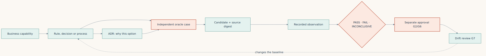

**English** · [Español](../../es/parte-3-oraculos/10a-herramientas-todm-modelos-y-adrs.md)

[← Chapter 10 · TODM and acceptance](10-todm-and-the-problem-of-accepting-what-we-build.md) · [Contents](../README.md) · [Chapter 11 · Verifiable architecture →](11-the-architecture-of-a-verifiable-modernization.md)

# Chapter 10 bis · Putting TODM to work: models, tools and ADRs

> [!IMPORTANT]
> **Chapter thesis.** Document decisions so that another person can inspect, execute and challenge them. A diagram explains a claim; a qualified oracle tests it; an accountable approval authorizes it. None replaces the other two.

## The source of truth is a governed baseline, not a file format

In a COBOL migration I want the future team to know what a capability means, why an architectural boundary exists and which observations justify changing it. Code alone does not answer all three questions. Nor does a collection of diagrams become authoritative merely because it is stored beside the code.

A useful baseline names the capability, vocabulary, rules, exceptions, operational obligations, source evidence, owner, version and approval scope. An observation from a legacy run is evidence of what happened, not automatic permission to preserve a defect. An agent's proposed model is a proposal, even if its syntax validates. When policy and observed behaviour disagree, record the conflict and obtain the business decision before treating either as accepted truth.

The baseline must identify the exact model bytes and evaluator version. Its hash detects a change relative to an independently retained reference; an editable manifest beside editable models does not authenticate the owner. This is why the [TODM adapter](../../../lab/todm_validation/README.md) distinguishes technical evaluation from G2 baseline approval and G6 release authorization. Our experiments can pass their technical checks while those approvals remain unavailable.

## Give each artifact a specific job

| Artifact | Question it answers | What it does not establish alone |
|---|---|---|
| SBVR-style vocabulary and rules | What do “available”, “booked” and “accepted” mean? | That a particular parser implements full SBVR semantics |
| DMN decision table | Which result follows from these inputs and rule precedence? | Transactions, process completion or business approval |
| BPMN process model | Which activities, decisions and boundaries make up the process? | That an XML drawing is an executed workflow or a durable transaction |
| CMMN case model | Which discretionary work and evidence complete a long-lived case? | A fixed execution trace for every possible case |
| OCL-style constraints or mathematical invariants | Which states or relationships are forbidden? | Coverage of every exception and environmental failure |
| ADR | Why was one architectural option selected, and with which trade-offs? | The observable business contract or permission to deploy |
| Golden Master and operational traces | What did the incumbent actually do? | That its behaviour is the business rule we should preserve |

Use the smallest set that makes the capability reviewable. A fee rule may need a vocabulary, decision table and examples. A disputed-payment case may also need a process, case model and external-effect reconciliation. Adding all five standards by default creates maintenance work without necessarily adding evidence.

## The tools in this repository and their boundaries

The [decision-model toolkit](../../../lab/decision_models/README.md) provides deliberately bounded executable profiles for decision tables and process traces, plus baseline and ADR traceability examples. Its README defines the accepted schema, operators and commands. Those profiles are not complete DMN/FEEL or BPMN engines. In particular, a linear trace checker must not be used to certify concurrent BPMN tokens, compensation, message delivery or transaction recovery.

The [TODM evidence adapter](../../../lab/todm_validation/README.md) performs a different job. It binds an explicit artifact inventory to retained bytes, examines experiment-specific observations, emits G0–G7 records and keeps release authority separate. Its negative controls challenge missing evidence, changed bytes, false invariants and untrusted approval fields. It does not derive domain truth from a report's `PASS` label.

The [isolated builder harness](../../../lab/e4_agents/README.md) constrains candidate execution and compares self-authored tests with reserved checks and known mutants. The [Azure operator](../../../infra/experiments/README.md) handles source export, execution, evidence collection and cost-aware shutdown. The [read-only CLI collector](../../../scripts/azure/capture-book-evidence.ps1) records deployed resource state. None of these tools gives another tool authority to approve business rules.

## From one COBOL capability to an executable obligation

Start with a named business operation rather than a source-file boundary. For a commission calculation, define amount units, rate units, activity status, invalid input behaviour, midpoint rounding and review threshold. For a transfer, also define operation identity, concurrent debit rules, ledger conservation, outbox atomicity and what an ambiguous acknowledgement means.

Separate three inventories:

1. **Normative proposals:** vocabulary, tables, process obligations and constraints awaiting review.
2. **Characterization:** authorized examples and traces from the incumbent, with environment and uncertainty.
3. **Decisions:** accepted rules and architectural choices, with accountable owners and precise scope.

Translate an approved obligation into independent expected results before allowing the builder to change the implementation. Maintain boundary cases: exact threshold, just above it, midpoint rounding, invalid representation, inactive account and retry after an uncertain response. For process traces, include both valid order and missing, duplicate or out-of-order steps. For ledgers, inspect persisted state independently; the candidate's own success response cannot prove atomicity.

A DMN table might decide whether a request needs review. BPMN might explain where that review occurs. The transaction design must still say whether money has been reserved, posted or not touched while the review waits. That boundary belongs in an ADR and executable failure tests, not in an assumption about the diagram.

### A small executable decision and process

From the repository root, validate the example and evaluate its midpoint case:

**Listing 10a.1 · Validate and evaluate the decision example** — *Reproduction commands · local synthetic demonstration*

```bash
python3 lab/decision_models/toolkit.py validate lab/decision_models/examples/fee-decision.json
python3 lab/decision_models/toolkit.py evaluate lab/decision_models/examples/fee-decision.json --input lab/decision_models/examples/fee-input.json
```

The recorded output includes `status: PASS`, `feeCents: 1`,
`resultCode: APPROVE` and `productionApproved: false`. Exact arithmetic and an
explicit rounding policy matter more than a visually convincing table.
`FIRST` uses declared order; `UNIQUE` rejects an input matching several rules.
These are limited JSON profiles inspired by DMN, not DMN XML or a FEEL engine.

Check the sequential process trace, then deliberately submit its invalid variant:

**Listing 10a.2 · Check valid and invalid process traces** — *Reproduction commands · expected negative control*

```bash
python3 lab/decision_models/toolkit.py check-trace lab/decision_models/examples/fee-process.json --input lab/decision_models/examples/fee-trace.json
python3 lab/decision_models/toolkit.py check-trace lab/decision_models/examples/fee-process.json --input lab/decision_models/examples/fee-trace-invalid.json
```

The first command exits 0; the negative control exits 1. The latter is expected
rejection, not a reason to remove the control from the documentation. The
process checker does not implement parallel gateways, token semantics or BPMN
XML interchange. Its limited transitions make only the declared trace testable.

Finally verify the baseline's model and ADR hashes, or export the decision
profile as deterministic JSON:

**Listing 10a.3 · Verify the baseline and export the decision profile** — *Reproduction commands · no approval authority*

```bash
python3 lab/decision_models/toolkit.py check-baseline lab/decision_models/examples/baseline.json --root lab/decision_models
python3 lab/decision_models/toolkit.py export lab/decision_models/examples/fee-decision.json
```

The baseline binds the actual sample ADR bytes; it does not authenticate approval.
Export is local-profile JSON, not RFC 8785 canonicalization or standards-certified
interchange. The [executed example record](../../../lab/decision_models/examples/demo-run.json)
and 21 unit tests distinguish supported behaviour from future extensions.

## ADRs preserve the reasons that models do not

An ADR is a short, versioned architectural decision record. Keep its status, context, options, decision, consequences, validation obligations and links to superseded records. Identify the owner responsible for accepting the trade-off; do not invent an approval date or name to complete a template.

For a COBOL migration, useful ADR subjects include the authoritative ledger, decimal representation, encoding boundary, idempotency key, transaction boundary, source-side writer fence, cutover and rollback constraints, consistency model, and deployment topology. Link each decision to a capability and evidence. An ADR choosing an outbox is incomplete if it does not define the duplicate-delivery and reconciliation obligations.

A practical traceability chain runs from the business capability to the drift review, with approval as a separate step after the verdict:



*Figure 10 bis.1 · The traceability chain: approval is a separate step after the verdict, and drift sends you back to the rule.*

Changing one item does not silently approve the next. If an ADR changes from synchronous posting to deferred processing, revisit the process model, consistency contract, latency budget, oracle and migration plan. Preserve the previous baseline and explain what supersedes it. The existing [architecture-decision annex](../annexes/annex-d-architecture-decisions.md) provides the book's decision context; the toolkit's templates turn that discipline into reusable project artifacts.

## Run the evidence process without granting yourself approval

For a captured portable bundle, enter its root and use a fresh output path:

**Listing 10a.4 · Revalidate a captured portable bundle** — *Illustrative commands · requires a bundle and fresh output paths*

```bash
python3 adapter/lab/todm_validation/validate.py --manifest manifest.json --root . --output validation-new.json
python3 adapter/lab/todm_validation/qualify_bundle.py --root . --output qualification-new
```

The qualification output is inside the bundle root because its controlled mutations are referenced relative to that root. Keep this new output separate from the original observations. Consult the toolkit README for decision-model examples; use its actual CLI and schema rather than treating the listings here as a replacement specification.

Review four things in order: whether inputs are complete and bound to the intended source, what the independent oracle observed, whether qualification detected the declared threats, and who has authority to approve the baseline and delivery. A technical `PASS` answers only the questions implemented by that evaluator. `INCONCLUSIVE` and `BLOCK` must remain visible in the handoff to people.

## What the Azure demonstration contributed

The [executed TODM campaign](../../../evidence/runs/todm-azure-2026-11-08.json) checked 134 snapshot files and 108 artifact bindings on Azure. Its E1–E4 technical checks passed with eight actual-input negative controls and twelve synthetic mandate cases, while methodology remained inconclusive and release blocked. The adapter first rejected missing original E3 runtime bytes. Recovering matching binaries from the preserved build tree repaired the evidence inventory without rewriting the failed bundle.

That is a useful demonstration of the process, not proof of industrial effectiveness. We did not authenticate a real business approval, implement every modelling standard, or compare organizational outcomes across migrations. The [Azure CLI records](../../../evidence/runs/azure-cli-2026-11-08/capture.json) additionally show deployed resource state, not performance or semantic correctness.

## Adapt the tools without weakening the claim

To adapt a profile, state the missing semantic feature first. Add its schema and evaluator behaviour, then independent positive, negative and incomplete cases. Preserve old fixtures and compatibility or declare a new profile version. Do not quietly interpret an unsupported operator as false, skip an unfamiliar task or promote a syntactically valid model to an approved baseline.

If the project needs full DMN or BPMN execution, select a conformant engine for the required version and features, record that selection in an ADR, and qualify its exact configuration. Continue verifying business outcomes outside the implementation. SBVR, CMMN and OCL references in this book do not claim that this repository implements those engines.

The final [cross-language annex](../annexes/annex-h-beyond-cobol.md) separates reusable method from language-specific proof. The durable investment is not a diagram format or one programming language: it is a maintained chain from accountable rule to observable result.

---

[← Chapter 10 · TODM and acceptance](10-todm-and-the-problem-of-accepting-what-we-build.md) · [Contents](../README.md) · [Chapter 11 · Verifiable architecture →](11-the-architecture-of-a-verifiable-modernization.md)
