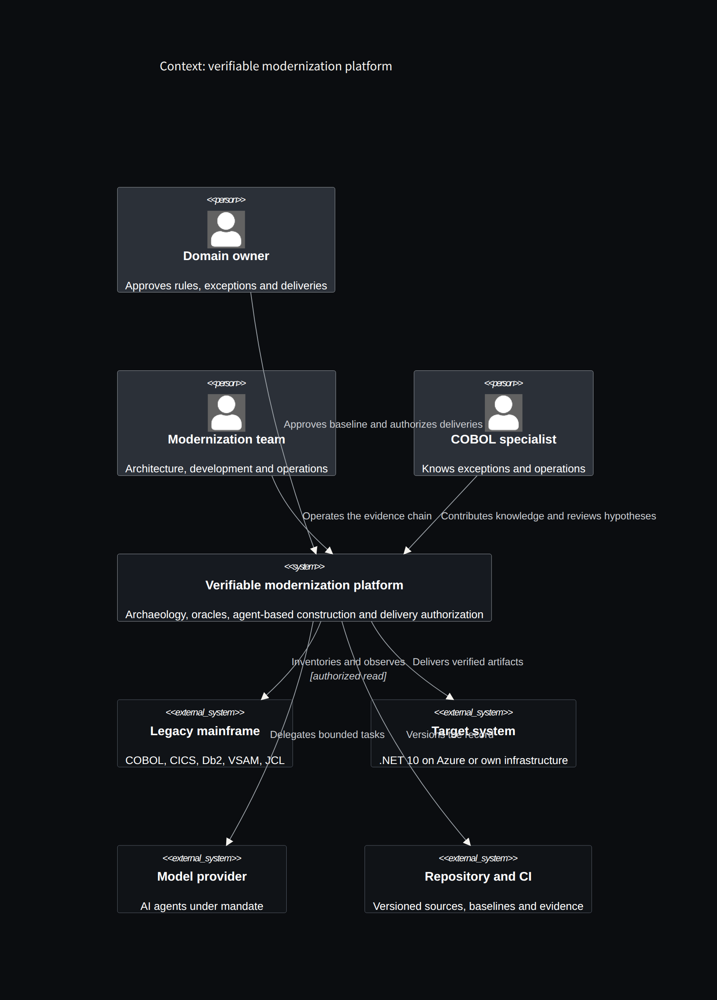
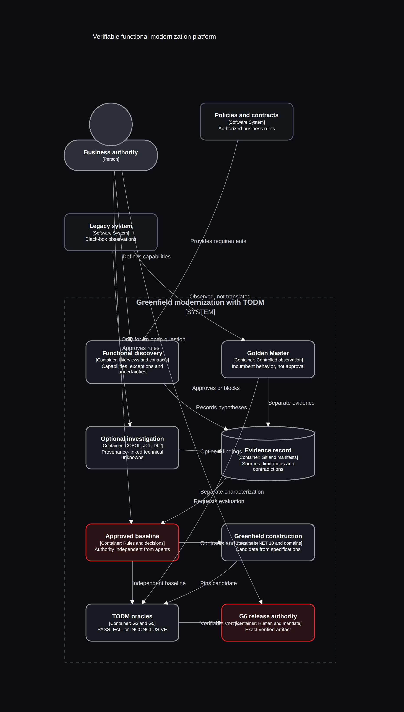
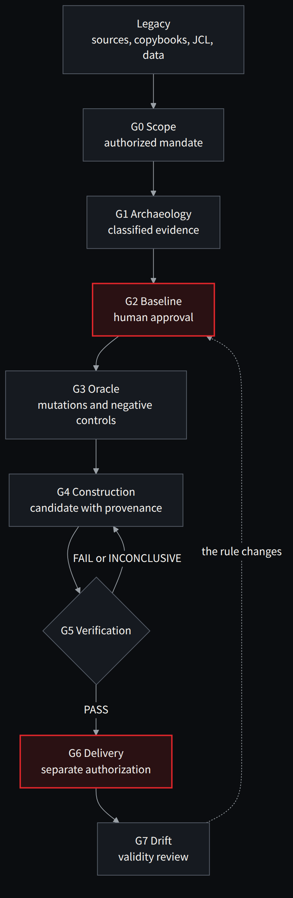

**English** · [Español](../../es/parte-3-oraculos/11-la-arquitectura-de-una-modernizacion-verificable.md)

[← Chapter 10 · TODM and the problem of accepting what we build](10-todm-and-the-problem-of-accepting-what-we-build.md) · [Contents](../README.md) · [Chapter 12 · COBOL and C# must agree on meaning →](12-cobol-and-c-must-agree-on-meaning.md)

# Chapter 11 · The architecture of a verifiable modernization

> [!IMPORTANT]
> **Chapter thesis.** Four responsibilities —discover, govern, build and verify— and a delivery authorization that consumes their results. The separation must exist in the permissions, not only in the diagram.

## Four responsibilities

I would organize the solution around four responsibilities: discovering evidence, governing expected behaviour, building candidates and verifying observations. Delivery authorization consumes their results and applies the release conditions.

*Figure 11.1 · Context of a verifiable modernization: people, systems and responsibilities.*

Capability discovery starts from business owners, approved policies, interface contracts, exceptional outcomes and authorized observations. The incumbent is part of the **brownfield** context, with controlled coexistence and reconciliation. Technical investigation of sources, binaries, configurations or COBOL dependencies is optional when a specific unknown requires evidence; an Evidence Adapter can normalize such findings but cannot approve business rules.

The oracle factory turns business decisions into executable contracts. An expert can review a decision table more easily than a collection of scattered assertions. But the table needs a known, tested executable interpretation. Drawing a BPMN process does not turn its image into an engine that checks traces.

The build factory receives the public contract and a limited write scope. It produces code and development tests. Those tests are useful for working, but they do not replace the independent acceptance set. If we allow no feedback at all, we make correction hard; if we expose every reserved case, we can turn evaluation into a memorization exercise. The design must decide what information to share.

The verifier executes or consumes observations obtained in a controlled way, checks the identity of the artifacts and issues a report. In a production architecture it should not simply accept a file written by the candidate claiming to have satisfied every property.

*Figure 11.2 · Brownfield capability discovery, separate Golden Master, optional source archaeology, TODM oracles and controlled coexistence/cutover. G6 requires independent release authority; the builder cannot write the baseline.*

## The boundaries that matter

| Component | Can write | Needs to read | Must not control on its own |
|---|---|---|---|
| Investigation | Findings and proposals | Authorized artifacts | Approval of behaviour |
| Domain authority | Baseline and decisions | Evidence and discrepancies | Results of other people's runs |
| Builder | Candidate and its own tests | Contract and permitted feedback | Protected oracles |
| Verifier | Execution reports | Pinned baseline and artifacts | Delivery authorization |
| Delivery service | Release record | Verification and approval | Silent redefinition of rules |

This table is a control proposal, not a description of permissions already in place in the demo. Making it effective requires identities, protected repositories or paths, isolated runners and enforcement points that check authorization. Separating folders in a ZIP helps understand the design, but it is not a security boundary.

## A binding record

The report should relate at least the candidate's hash, the baseline, the evaluator, the test data and the relevant environment. The delivery approval must refer to that set. If we change the binary after verifying it, the previous evidence does not vouch for the new artifact.

The same caution applies to policy. A change in a rule can invalidate an approval even if the code has not changed. The gate must be able to detect that situation and request a new evaluation.

We do not need to deploy five services at the start. A controlled pipeline and a few processes may be enough to test the logical separation. Physical distribution must respond to the risk and the need for isolation. Adding agents or containers without a clear boundary multiplies components without resolving authority.

*Figure 11.3 · From legacy to delivery: which gate produces each piece of evidence and where work loops back.*

> **Adding agents or containers without a clear boundary multiplies components without resolving authority.**

---

[← Chapter 10 · TODM and the problem of accepting what we build](10-todm-and-the-problem-of-accepting-what-we-build.md) · [Contents](../README.md) · [Chapter 12 · COBOL and C# must agree on meaning →](12-cobol-and-c-must-agree-on-meaning.md)
