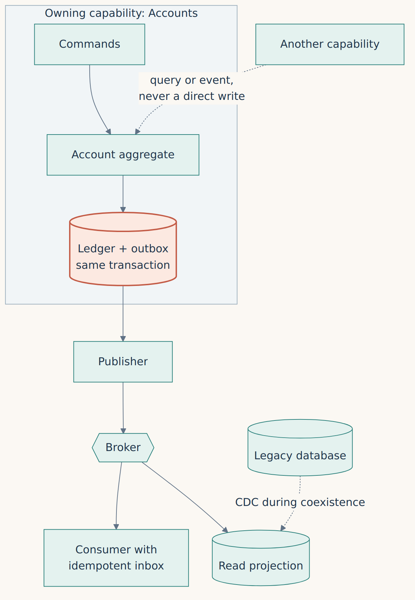

**English** · [Español](../../es/parte-4-patrones/16-la-propiedad-de-los-datos.md)

[← Chapter 15 · Anti-Corruption Layer: translate meanings, not types](15-anti-corruption-layer-translate-meanings-not-types.md) · [Contents](../README.md) · [Chapter 17 · From mainframe locks to explicit concurrency control →](17-from-mainframe-locks-to-explicit-concurrency-control.md)

# Chapter 16 · Data ownership

> [!IMPORTANT]
> **Chapter thesis.** If every box writes to the same tables, we still have a data monolith. Each aggregate needs a single owner of writes, and coexistence needs a protocol, not goodwill.

A microservices architecture can draw independent boxes, but if they all write the same tables a data monolith still exists. In mature COBOL systems it is common for several programs and jobs to touch the same set of records. Before moving the logic we must identify writers, readers, locks and reconciliations. The dynamic inventory matters as much as static searches: a table that looks read-only may have a batch maintenance job that only runs on the last day of the quarter.

## Identify who owns each change

I propose an **ownership register** for each aggregate. One capability owns accepting commands and determining the new state; other consumers receive queries or events. During the transition we may need to sustain a temporary mirror or CDC, but I would not accept two master writers without an explicit conflict-resolution protocol. Independent dual writes to the old and new databases fail precisely between the two writes; success on one side does not guarantee success on the other.

*Figure 16.1 · A single write owner per aggregate; everyone else queries or receives events.*

Reliable publication after COMMIT is a separate responsibility: the **Outbox and Inbox** mechanism belongs in [Chapter 18](18-distributing-without-breaking-the-books.md). The decision here comes first: who owns writes, how we fence the former writer, and which reads may tolerate stale data.

## Coexistence that can be reversed

Imagine an account still receiving nightly COBOL postings while a new API accepts online movements. If both sides confirm money independently, we have created two authorities. Before routing traffic I would require a writer inventory, an enforceable stop on old-source writes, reconciliation and a tested return path.

CDC is useful for coexistence and observation, not an automatic proof that the new database is correct. We must preserve order per key, detect lag, rebuild states from consistent snapshots and measure the difference between source and target. If the transition depends on reads from an eventually consistent replica, the contracts must acknowledge it.

> **Independent dual writes fail precisely between the two writes.**

---

[← Chapter 15 · Anti-Corruption Layer: translate meanings, not types](15-anti-corruption-layer-translate-meanings-not-types.md) · [Contents](../README.md) · [Chapter 17 · From mainframe locks to explicit concurrency control →](17-from-mainframe-locks-to-explicit-concurrency-control.md)
