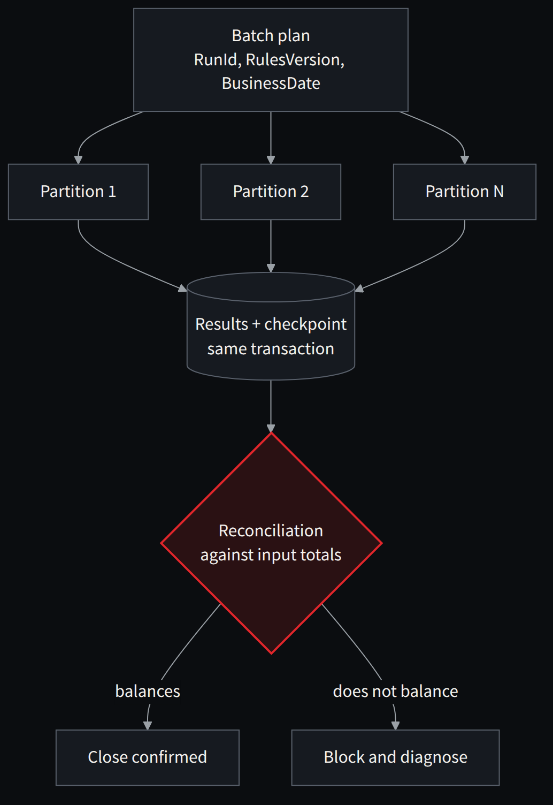
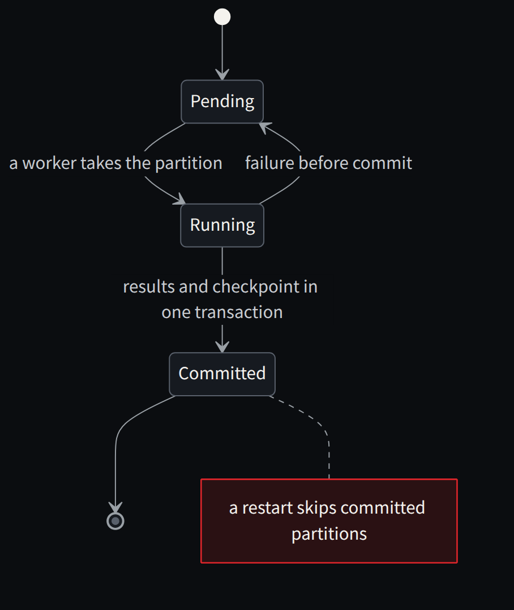

**English** · [Español](../../es/parte-4-patrones/20-batch-y-paralelismo-acelerar-sin-cambiar-el-resultado.md)

[← Chapter 19 · Actors: a great tool, a poor universal substitute](19-actors-a-great-tool-a-poor-universal-substitute.md) · [Contents](../README.md) · [Chapter 21 · Event sourcing, CQRS and sagas: when they help and when they get in the way →](21-event-sourcing-cqrs-and-sagas-when-they-help-and-when-they.md)

# Chapter 20 · Batch and parallelism: speeding up without changing the result

> [!IMPORTANT]
> **Chapter thesis.** Launching a thousand workers against the same index distributes the waiting, not the work. A modern batch partitions by a defensible key, commits idempotent checkpoints and reduces deterministically.

Batch modernization is usually where enthusiasm for microservices meets the storage bill. Launching a thousand workers is not enough. If they all compete for the same index, the same file or a control table, we will have distributed the waiting instead of the work. Before parallelizing we need to understand the JCL graph, sort/merge steps, windows, date dependencies and the points at which part of the batch may be committed.

The main pattern is **Partitioned Batch with checkpoint and replay**. We choose a stable key —for example, a range of accounts—, produce non-overlapping partitions, fix the rules version to apply and process each fragment idempotently. We record when it started, which inputs it used, which control totals it obtained and which commit made it final. A retry must not duplicate interest or fees. If parameters change mid-run, the batch needs a logical snapshot so that two partitions do not calculate different versions of the business.



*Figure 20.1 · Partitioned batch: rules and date fixed before starting, a checkpoint per partition and reconciliation against the input.*

Global results require **deterministic reductions**. The total of millions of records may be mathematically equal, but not if we change where amounts are rounded. The order of aggregation can even change decimal calculations with limited precision and scale. For each rule we must decide whether equivalence is per record, per batch or per aggregate, and what tolerances apply; in a ledger we will normally not accept arbitrary monetary tolerances.

Optimization follows a sequence: measure read, decode, calculation, write and commit; widen partitions until the bottleneck is found; set backpressure limits; observe contention and storage latency; and repeat with a realistic distribution. A pipeline with 64 workers is not necessarily twice as fast as one with 32. It can be slower if it triggers index contention or exhausts the buffer pool.

## Parallelizing work that can be independent

In a pure calculation we can split inputs and combine results. In a shared ledger, operations have dependencies. Concurrent design starts by identifying them.

One option is to partition by entity or by a business unit whose independence we can defend. We process changes affecting the same state sequentially and independent partitions in parallel. The chosen key determines the maximum parallelism and which operations need coordination again.

The sequential convoy pattern documented by Microsoft uses this principle and warns of the per-group limit [22]. In a transfer between accounts in different groups, local order does not solve global atomicity. In a consolidated close, local independence does not remove the need to fix which data takes part in the calculation.

A batch can be split by customer, portfolio or range when there are no unresolved cross dependencies. The run must preserve restart points, batch identity and reconciliation. Increasing the commit size reduces certain costs and increases the amount of work and locking exposed to a failure. The balance is measured.

## A batch that can crash and start again

**Listing 20.1 · Partitioned batch with the checkpoint in the same transaction as the results** — *Illustrative*

```csharp
var options = new ParallelOptions
{
    MaxDegreeOfParallelism = degree,
    CancellationToken = ct
};

await Parallel.ForEachAsync(plan.Partitions, options, async (partition, token) =>
{
    // A committed partition is not applied again: restarting is safe.
    if (await store.IsCommittedAsync(plan.RunId, partition.Id, token)) return;

    await using var tx = await store.BeginAsync(token);
    var totals = await ProcessAsync(partition, plan.RulesVersion,
                                    plan.BusinessDate, tx, token);

    // Results and checkpoint in the SAME transaction, with control totals.
    await tx.SaveCheckpointAsync(plan.RunId, partition.Id,
                                 totals.Count, totals.Amount, token);
    await tx.CommitAsync(token);
});

// Deterministic reduction over what was committed, not over the workers' memory.
var control = await store.ReconcileAsync(plan.RunId,
                                        plan.ExpectedCount, plan.ExpectedAmount, ct);
```



*Figure 20.2 · States of a partition: a restart skips what was committed and repeats what did not reach the commit.*

Three details hold this fragment together. `plan.RulesVersion` and `plan.BusinessDate` are fixed before starting, so that two partitions do not calculate with different versions of the business. `degree` is not the number of cores: it is the number of writers the engine can sustain before contention eats the gain, and it is found by measuring. And the final reconciliation compares against the input totals, not against what the workers believe they did.

## Restart, repeatability and calendar

A financial batch does not finish when the process returns code zero. It must state which business date it processed, which period is closed, which parts are committed, what can be repeated and how it reconciles against input totals. It is worth separating the technical clock from the value date, introducing versioned business calendars and controlling time changes. In nightly runs there are 23- and 25-hour days and processes that cross midnight. Those particularities do not show up in a hundred-line example, but they do in the accounting close.

> **A pipeline with 64 workers is not necessarily twice as fast as one with 32. It can be slower.**

---

[← Chapter 19 · Actors: a great tool, a poor universal substitute](19-actors-a-great-tool-a-poor-universal-substitute.md) · [Contents](../README.md) · [Chapter 21 · Event sourcing, CQRS and sagas: when they help and when they get in the way →](21-event-sourcing-cqrs-and-sagas-when-they-help-and-when-they.md)
