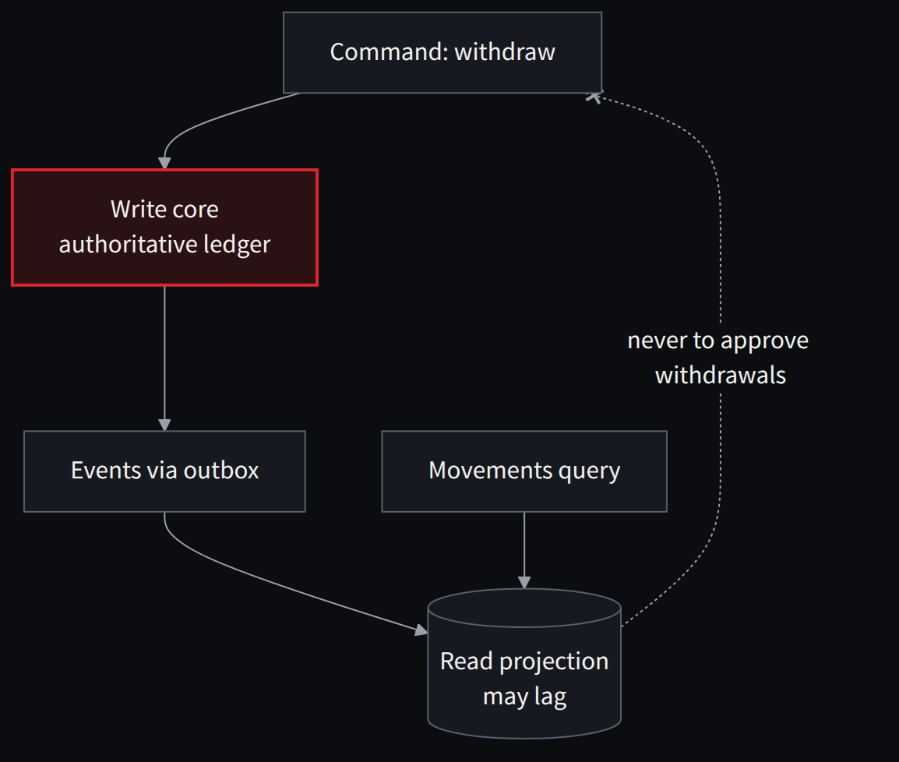

**English** · [Español](../../es/parte-4-patrones/21-event-sourcing-cqrs-y-sagas-cuando-ayudan-y-cuando-estorban.md)

[← Chapter 20 · Batch and parallelism: speeding up without changing the result](20-batch-and-parallelism-speeding-up-without-changing-the.md) · [Contents](../README.md) · [Part V · Capacity: MIPS, concurrency and platform →](../part-5-capacity/README.md)

# Chapter 21 · Event sourcing, CQRS and sagas: when they help and when they get in the way

> [!IMPORTANT]
> **Chapter thesis.** They are excellent patterns with precise conditions of use. A double-entry ledger is not an arbitrary event stream, an eventual projection must not approve withdrawals and a compensation does not erase what a third party has already seen.

Event sourcing has an obvious appeal for financial systems: keeping a sequence of changes that allows state to be rebuilt. But it is not a synonym for accounting. A double-entry ledger imposes invariants that an arbitrary set of events does not guarantee. Turning every operation into an event can increase volume, versioning complexity and the need for reprocessing. I would consider it when the domain needs full history as the source of truth, the team knows how to manage schemas and the cost of rebuilding is solved. I would not impose it on a COBOL table for the sake of modernity.

CQRS separates writes from reads when their needs diverge. It is useful for intensive queries, search and reporting. But its projections can lag. If an application decides to approve a withdrawal by querying an eventual projection, it can break rules that must be evaluated against the authoritative state. I would use CQRS to speed up views, not to replace, without analysis, the decision about the available balance.

*Figure 21.1 · CQRS without tricks: the projection is for looking; the decision about the balance is made in the write core.*

Sagas are suitable for long processes that cross systems with legitimate compensations: onboarding, communications, documentation, validations and reservations. An accounting transfer, on the other hand, does not automatically become a saga because we now have two microservices. A later compensation does not erase the fact that a third party observed an intermediate balance, nor does it guarantee recovering money sent outside our boundary.

The rule is demanding and simple: **the chosen pattern must preserve the level of consistency the business needs, not the level that is most convenient for us to implement**.

> **A projection is for looking. It is not for deciding about money.**

---

[← Chapter 20 · Batch and parallelism: speeding up without changing the result](20-batch-and-parallelism-speeding-up-without-changing-the.md) · [Contents](../README.md) · [Part V · Capacity: MIPS, concurrency and platform →](../part-5-capacity/README.md)
