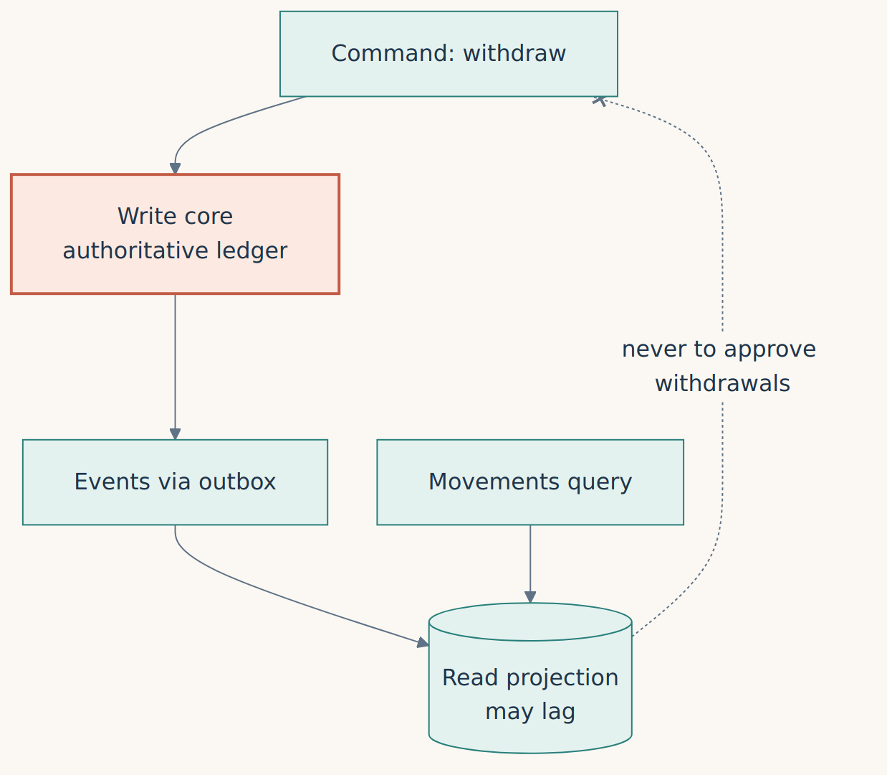

**English** · [Español](../../es/parte-4-patrones/21-event-sourcing-cqrs-y-sagas-cuando-ayudan-y-cuando-estorban.md)

[← Chapter 20 · Batch and parallelism: speeding up without changing the result](20-batch-and-parallelism-speeding-up-without-changing-the.md) · [Contents](../README.md) · [Companion chapter · Channels, ATM cash and the core →](21a-channels-atm-and-the-core.md)

# Chapter 21 · Event sourcing, CQRS and sagas: when they help and when they get in the way

> [!IMPORTANT]
> **Chapter thesis.** They are excellent patterns with precise conditions of use. A double-entry ledger is not an arbitrary event stream, an eventual projection must not approve withdrawals and a compensation does not erase what a third party has already seen.

## Event sourcing is not accounting

Event sourcing has an obvious appeal for financial systems: keeping a sequence of changes that allows state to be rebuilt. But it is not a synonym for accounting. A double-entry ledger imposes invariants that an arbitrary set of events does not guarantee. Turning every operation into an event can increase volume, versioning complexity and the need for reprocessing. I would consider it when the domain needs full history as the source of truth, the team knows how to manage schemas and the cost of rebuilding is solved. I would not impose it on a COBOL table for the sake of modernity.

## CQRS does not grant authority to a projection

CQRS separates writes from reads when their needs diverge. It is useful for intensive queries, search and reporting. But its projections can lag. If an application decides to approve a withdrawal by querying an eventual projection, it can break rules that must be evaluated against the authoritative state. I would use CQRS to speed up views, not to replace, without analysis, the decision about the available balance.

*Figure 21.1 · CQRS without tricks: the projection is for looking; the decision about the balance is made in the write core.*

## Sagas: only when the business allows intermediate states

A saga can coordinate onboarding, documents or reservations with legitimate compensations. I would not use one to disguise splitting a formerly atomic transfer in two. The mechanics of compensation and reliable publication belong to [Chapter 18](18-distributing-without-breaking-the-books.md). The decision here is whether each intermediate state has meaning and business acceptance. If not, a saga is the wrong pattern.

The rule is demanding and simple: **the chosen pattern must preserve the level of consistency the business needs, not the level that is most convenient for us to implement**.

> **A projection is for looking. It is not for deciding about money.**

---

[← Chapter 20 · Batch and parallelism: speeding up without changing the result](20-batch-and-parallelism-speeding-up-without-changing-the.md) · [Contents](../README.md) · [Companion chapter · Channels, ATM cash and the core →](21a-channels-atm-and-the-core.md)
