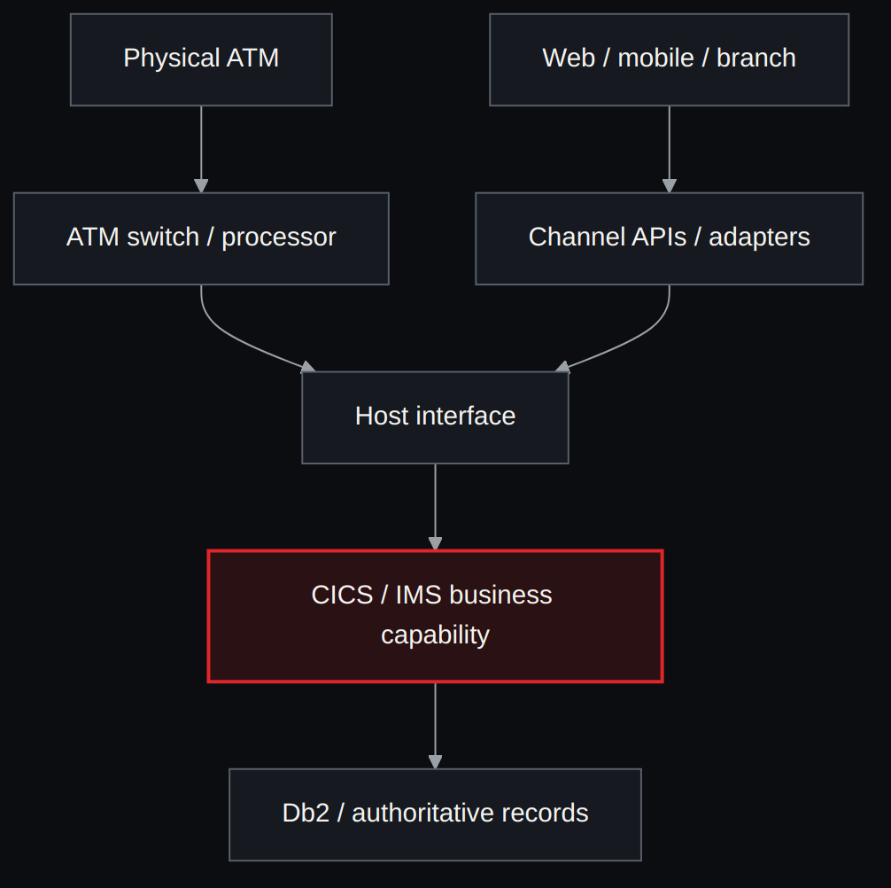
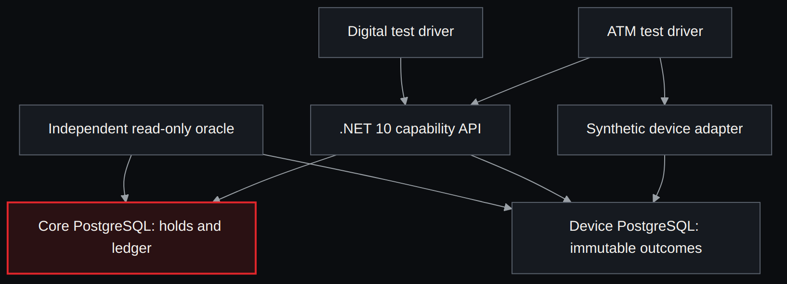
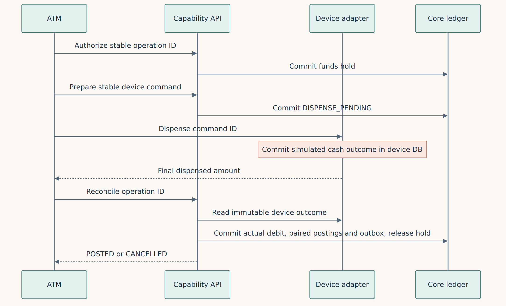
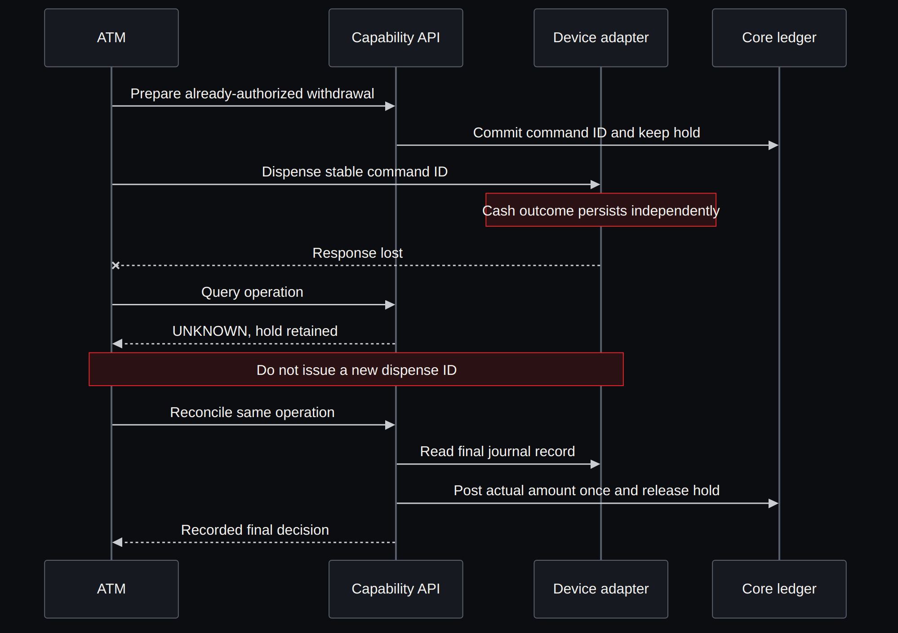
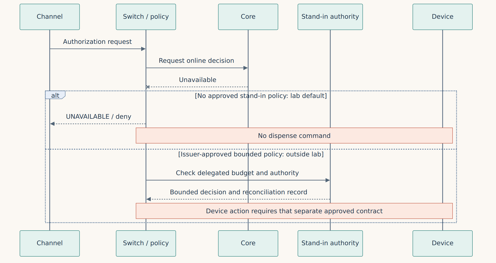
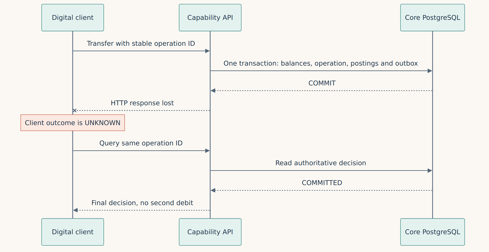

**English** · [Español](../../es/parte-4-patrones/21a-canales-atm-y-core.md)

[← Chapter 21 · Event sourcing, CQRS and sagas](21-event-sourcing-cqrs-and-sagas-when-they-help-and-when-they.md) · [Contents](../README.md) · [Part V · Capacity →](../part-5-capacity/README.md)

# Companion chapter · Channels, ATM cash and the core

> [!IMPORTANT]
> **Chapter thesis.** A banking channel initiates an instruction; an authoritative service decides what funds it may use; a device may produce an irreversible physical effect. Migration must preserve the contracts between those responsibilities. A successful SQL COMMIT does not prove that banknotes reached the customer.

## 1. Locate the authority before drawing the replacement

A physical ATM reads customer input and controls devices. An ATM controller or switch connects terminals and routes messages. A card processor may supply issuer or acquirer services; the issuer authorizes use of its customer's account, while the acquirer serves the acceptance side. Those roles can belong to different organizations and machines. The account ledger, authorization holds, fraud decision, card lifecycle and network settlement need named owners; calling all of them “the core” hides the integration work.

IBM's educational Bank of Z demonstrates a browser UI, REST APIs through z/OS Connect, CICS/IMS processing, Db2/IMS data and MQ integration [48]. It illustrates separation of responsibilities, not the topology of every bank. CICS requests can originate at terminals, browsers, APIs or messages; its default transaction scope is one unit of work, but SYNCPOINT can divide a task into several [49]. A browser session, CICS task, unit of work, network authorization and physical withdrawal therefore require separate identifiers and recovery rules.

*Figure C.1 · Illustrative starting topology: channels and switch reach host services; deployment and authority must be verified per installation.*

The diagram deliberately omits certified device/network protocols. Do not infer that every ATM speaks ISO 8583 directly, that CICS/IMS always share Db2, or that the host owns the switch. NDC/DDC variants, ISO 8583 network profiles, ISO 20022 integration and proprietary host contracts require the actual provider specifications and certification scope. A synthetic operation UUID is not a STAN, RRN, network authorization identifier or physical journal identifier.

| Architecture variant | What stays authoritative | Migration question and required evidence |
|---|---|---|
| Host core; external web/mobile and ATM switch | Identified host capability and its recoverable resources | Preserve the real adapter, authorization and posting boundaries; compare outcomes and source recovery evidence |
| Modern channels call z/OS Connect REST | Existing CICS/IMS service, according to the installed route | Version JSON/service mappings and business errors; measure the extra hops without claiming a new core |
| Outsourced issuer processing with delegated stand-in | Issuer-approved delegated authority within a bounded exposure | Reconcile replicated limits, age and concurrent consumption; obtain contractual approval before offline decisions |
| 3270 branch or modern teller API | Transaction/business service, not the screen | Recover pseudoconversational context, teller permissions and cash custody; a lost screen is not permission to repeat |
| Accounts, cards, loans, fraud and payments on different hosts | One owner per capability and financial effect | Trace instructions across domains; define compensation and reconciliation for effects outside one unit of work |
| New account core with residual host batch/history/products | New write owner plus explicitly retained host responsibilities | Retire adapters, credentials, schedules, reports and licenses only after their last dependencies and retention duties are resolved |

These are design alternatives. This repository has not surveyed installations or executed all six architectures.

## 2. State the withdrawal contract before choosing a pattern

The [synthetic lab contract](../../../lab/channels/CONTRACT.md) uses integer cents and invented policies. Its customer account starts at 10,000. Authorizing a 6,000 withdrawal reserves 6,000 without posting it; available funds become 4,000. Preparation durably binds one operation to one device command. Only a final device outcome permits the candidate to post the actual positive amount, or cancel a final zero. Posting debits the customer and credits a synthetic cash-control account; this closed-world teaching ledger is not a bank's general-ledger policy.

*Figure C.2 · Proposed synthetic target: core and dispenser have separate SQL stores; the independent oracle reads both.*

Both databases run on one CI host. Their separation proves only that a core transaction cannot roll back the emulator's committed device record. The device emulator puts its stock decrement and final journal row in a single local SQL transaction. Real banknotes, sensors, retract bins and customer collection do not acquire that atomicity from a database.

| Recorded situation | Candidate financial action | Required evidence / customer result |
|---|---|---|
| Authorization accepted, no command prepared | Keep the hold until preparation or expiry | No claim that cash was delivered |
| Command prepared, no final device row | Keep the hold; do not issue a new command ID | UNKNOWN, with investigation/reconciliation |
| Final device amount equals requested amount | Post actual amount once; release hold | One financial decision and its paired entries/outbox |
| Requested 6,000; final device amount 4,000 | Post 4,000 once; release the remaining reservation | Separate requested and delivered values; synthetic partial-cash policy |
| Final device amount zero | Cancel and release; no financial posting | A final zero is evidence; a missing record is not |
| Undispatched authorization expires | Mark EXPIRED and release | No late preparation under that authorization |
| Prepared command reaches expiry | Keep UNKNOWN and its hold | Expiry does not prove absence of physical delivery |
| Financial COMMIT succeeded; HTTP response lost | Query or retry the same operation ID | Client UNKNOWN until the durable decision is read |

A real issuer must approve partial delivery, hold lifetime, reversals, late advice, disputes and operator repair. The demonstration's POSTED state means its local accounting decision; it does not mean card-network clearing, presentment or interbank settlement. Those are additional contracts.

## 3. Follow the effect through success and uncertainty

*Figure C.3 · Happy path under the declared synthetic policy: authorize, prepare one command, record device outcome, then post actual cash.*

Preparation and financial settlement are separate core transactions. The device acts between them. A C# exception or core rollback after delivery cannot put money back into the ATM. A compensation is a new authorized business action with its own audit trail; it cannot erase customer receipt of cash.

*Figure C.4 · Lost device response: keep UNKNOWN and the hold, recover the original journal outcome and reconcile once.*

A stable command ID is useful only if the device/provider contract actually deduplicates it and preserves an authoritative journal across failures. The synthetic adapter provides that property in SQL. For a real terminal, obtain proof of delivered, partial, rejected and retracted notes and the meaning of a final journal result. Conflicting or unavailable evidence requires an operator procedure, a reconciliation deadline and an exposure record. The current fixture does not automate that repair.

*Figure C.5 · Core unavailable: this lab denies new cash; issuer-approved stand-in is a separate, unimplemented policy branch.*

Stand-in is a delegated decision, not a successful retry to a dead core. As a commercial example, CSFi describes EZswitch authorizing with a positive balance file and/or card limits when its host is unavailable [50]. That product description establishes that the alternative exists; it does not authorize our fixture or specify any bank's safe exposure. The lab has no delegated budget and must not dispense without a prepared online authorization. Replicated positive balances cannot by themselves prevent concurrent spending elsewhere.

*Figure C.6 · Digital transfer with a lost response after COMMIT: the status query resolves the original instruction without another debit.*

A web/mobile BFF may adapt presentation and aggregate informational reads. Business authorization still uses the authoritative account and active holds; an eventual balance projection cannot approve spending. An outbox records a financial event atomically with the decision, but a push notification, SMS or receipt alone is not proof of posting. Reopening the app should recover the original operation ID and decision rather than invent a second instruction.

## 4. Choose patterns against the channel contract

| Problem | Candidate and benefit | Cost, failure boundary and control |
|---|---|---|
| Evolving UI while retaining host behavior | Gateway/BFF plus semantic adapter | Extra hops and mapping drift; preserve source errors, identity and business approval |
| Cash delivered outside the ledger transaction | Durable state machine, holds and independent journal reconciliation | UNKNOWN can persist; immutable evidence, operator ownership and dispute deadlines are required |
| Concurrent mobile and ATM spending | One authoritative ledger with availability checks under locks | Hot-account contention; test both channels against the same reservation rule |
| Lost HTTP response | Durable identity and a status endpoint | Identity retention is a contract; conflicting reuse must fail and retries must not extend expiry |
| Slow informational reads | CQRS with freshness/watermark | Stale data; separate display from financial approval and define read-your-writes behavior |
| Processor, fraud and ledger have independent commits | Durable orchestration with explicit compensations | No global rollback; identify each irreversible effect and reconciliation owner |
| Host unavailable | Deny, or separately approved bounded stand-in | Availability versus credit/fraud exposure; test budget exhaustion, stale limits and recovery |
| Changing a channel or core route | Strangler with one write owner per financial domain | Coexistence and certification cost; read-only shadow, source-side fencing and in-flight tracking |

**Decision for this increment.** Use an explicit durable state machine, one SQL ledger and a separate device journal. Avoid adding actors, a broker or a fake protocol stack before this contract is falsifiable. The alternative of immediate debit on authorization is rejected for this example because it would need a separately approved reversal policy for zero/partial cash. The choice remains a teaching ADR, not a recommendation for an unidentified bank.

## 5. Make the laboratory capable of disproving itself

The [English reproduction guide](../../../lab/channels/README.md) specifies .NET 10, Podman, two PostgreSQL instances, fixed disposable identities and original evidence retention. Its initial matrix includes full/partial/zero cash, missing device evidence, lost replies, external process kills, duplicate/conflicting requests, expiry and concurrent mobile/ATM spending. A native API is required for an HTTP-loss claim; an exception printed to a console would not exercise that boundary.

| Independent oracle group | Evidence examined | Contradiction to reject |
|---|---|---|
| Projection | Initial funds, all postings and resulting balances | Negative or unexplained account balance |
| Conservation | Both customer accounts and synthetic cash-control account | Closed-world total changes |
| Identity and finality | Original offered instruction, stored intent and decision | Changed intent under the same ID or invalid finality |
| Paired postings | Each financial decision and both ledger entries | Missing, extra or wrong-amount debit/credit |
| Financial outbox | Decision and event in the core snapshot | Missing, duplicate or wrong financial event |
| Holds and availability | Authorization state, reservations and account balance | Released pending hold or overspend across channels |
| Device reconciliation | Separate journal, command, actual amount and inventory | Posting unsupported cash or losing the device effect after core rollback |

Conservation alone is insufficient: an excessive debit with an equal credit still balances. Negative controls therefore alter copies of SQL observations to introduce conserved extra cash postings and a false final decision without its entries/outbox. The independent oracle must reject them while preserving the unmodified original observations. Neither candidate/oracle agreement nor synthetic golden fixtures supply business approval: the production authorization gate remains blocked until the source contract and accountable approvers exist.

Execution status and exact CI provenance belong in the lab's evidence checkpoint. This chapter describes the declared design; it does not turn an unexecuted scenario into a passed test. The remaining issue #30 matrix includes network partitions at each hop, real protocol correlation, delegated stand-in, route cutover and measured latency/capacity.

## 6. Migrate the owner, then retire the route

Channel-first migration can replace web/mobile presentation while leaving the account host authoritative. Capability-first migration can replace the account service while preserving the channel adapter. Product or branch cohorts narrow exposure but still need consistent ownership when a customer uses another channel. Issuer-processing-first and ATM-switch-first change certified external boundaries; façade-first preserves them temporarily. CDC-first can populate read models but does not transfer write authority. A big bang shortens coexistence at the cost of a wider cutover and recovery problem.

A cutover needs a cohort manifest, a write-owner epoch enforced at the old source, drainage of in-flight authorizations, a reconciliation watermark and handling of late device/network messages. Read-only shadow must never send a second authorization or dispense. A feature flag alone does not fence the old writer. Returning traffic to the old route after new cash deliveries requires reconciled data and ownership transfer; switching the flag back cannot reverse delivery. These mechanisms are required follow-up work, not exercised by the first channel fixture. The [coexistence chapter](../part-7-organization/30-from-the-lab-to-a-system-that-keeps-running.md) develops the ownership problem.

| Channel / boundary | Rule and data authority | Pattern, risk and oracle | Retirement evidence |
|---|---|---|---|
| ATM to device/switch | Delivered cash plus issuer-approved authorization; protocol contract pending | Stable command and journal; irreversible cash; actual amount comparison | No unresolved cash outcomes; certified routes and terminal dependencies retired |
| Web/mobile to account API | Authoritative availability and durable operation ID | BFF/adapter, SQL/outbox; lost reply; status/ledger/hold checks | Clients recover decisions; old write endpoint fenced and unused |
| Teller/3270 or API | Teller authority, cash custody and source UOW | Semantic session recovery; repeat risk; receipt and cash reconciliation | Sessions drained, devices/operators migrated, teller controls accepted |
| Card issuer/network | Authorization, clearing and settlement each have an owner | Bounded delegation; delayed/duplicate messages; network reconciliation | Scheme/provider approval, late-message window and batch/report dependencies closed |
| Partner/open-banking API | Consent/identity plus account business authority | Gateway and versioned contract; revoked consent/stale reads; authorization audit | Certificates/routes/consumers retired under approved retention rules |

Outstanding UNKNOWN cash, inconsistent journal/ledger amounts, unprocessed late messages, an unfenced second writer or missing required certification are reasons to withhold a real cutover. External equipment and issuer approval are not merge blockers for this clearly scoped example: they are explicit follow-up validation. To make that validation realistic, replace the emulator's atomic stock assumption with instrumented device outcomes, approved rules, real transport failures and reconciliation procedures; preserve failures and raw evidence before drawing a conclusion.

## 7. Late advice, reversal and cash: correlation is not authorization

Consider a withdrawal authorized for 100.00 monetary units: the device attests that **60.00** was dispensed, but a switch may still carry an advice referring to the original requested 100.00. The ledger posts 60.00, and a full reversal request then arrives. It is wrong to infer either "post 100" or "credit 100" automatically. We need to establish what cash was physically available, which financial posting was committed, whether a message is merely a request, and who can adjudicate the discrepancy. A reversal request is not an executed ledger reversal.

The paired [EN research dossier](../../../docs/research/channel-late-advice.en.md) ([ES](../../../docs/research/channel-late-advice.es.md)) puts this against public ATM dispute guidance and conditional stand-in policies. The [channel forensic oracle](../../../lab/channels/advice_gate.py) adds a **fully synthetic, offline** four-instruction test with no database mutations:

| Synthetic observation | Correct oracle result | Never allowed |
| --- | --- | --- |
| Device dispenses 60 of 100 approved; identical late advice repeated | `MATCHED_PARTIAL_CASH` | Create a second posting or dispense |
| Device remains UNKNOWN; network advice says 80 | `UNKNOWN_REQUIRES_DEVICE_EVIDENCE` | Treat advice as physical confirmation or posting authority |
| Final device journal says zero; late reversal requested | `FINAL_ZERO_CASH` | Claim the requested reversal is booked |
| Core is unreachable with no issuer-delegated authority | `STAND_IN_DENIED` | Invent an offline issuer or cash authorization |

Neither STAN nor RRN alone is a durable financial identity. Retain the original **operation ID**, authorization, terminal, network context and source incarnation. STAN can be reused; a network message ID replayed with a different payload is a conflict, not idempotency. A request to reverse the whole amount after partial physical cash delivery must trigger review and a negative oracle for a false credit.

This is **not** a certified ISO 8583 implementation or a real ATM simulator. The new check has invented data: it **does not authenticate device journal entries, issuer policies, network settlement or actual bank operations**. It complements the prior ten native .NET 10/PostgreSQL experiments without treating their results as card-network certification. Even if the Python checks pass, no automatic dispense, posting or reversal is permitted; **TODM G2 INCONCLUSIVE / G6 BLOCK**.

## 8. There is no generic network failure: locate the hop and decision

A channel “timeout” can conceal different financial states. If **ATM→switch** fails before delivery, no original authorization is demonstrated. If **switch→core** drops the request before the issuer receives it, the switch cannot invent account authority or dispense cash. If the core durably committed and **only its reply** was lost, starting a new operation ID risks a duplicate effect. Recovery queries the **actual decision owner under the original identity**; approval does not prove physical cash.

The [EN per-hop failure dossier](../../../docs/research/channel-hop-failures.en.md) ([ES](../../../docs/research/channel-hop-failures.es.md)) adds seven fictional traces and forty negative controls. It extends the previous partial-cash and late-advice examples without duplicating the core simulator.

| Scenario | Synthetic oracle outcome | Forbidden inference or action |
| --- | --- | --- |
| H01: ATM→switch request not delivered | `NO_CORE_AUTHORIZATION_EVIDENCE` | Treat timeout as a confirmed decline or success |
| H02: switch→core request not delivered | `NO_CORE_AUTHORIZATION_EVIDENCE` | Invent stand-in authority |
| H03: issuer COMMIT, lost ACK, status recovered on restored link | `AUTHORIZATION_RECOVERED_BY_STATUS` | Start another operation identity or infer cash delivery |
| H04: approval and device command, ATM↔switch fails | `CASH_UNKNOWN_NO_REDISPENSE` | Re-send dispense while journal remains unknown |
| H05: old owner replies after writer epoch changes | `QUARANTINED_OLD_OWNER_REPLY` | Allow old host to create another posting |
| H06: partial cash and fictional ledger agree | `PARTIAL_CASH_RECONCILED_SYNTHETICALLY` | Present fictional agreement as hardware proof |
| H07: core outage with undelegated stand-in request | `STAND_IN_DENIED` | Authorize offline credit or dispense |

**Routing is not source fencing.** A real change of authoritative writer from a host capability to .NET/SQL requires proof that the previous owner **can no longer commit the same operation**, including batch, privileged and disconnected paths. The fixture's `sourceEpoch` field is only a correlation marker, not a cryptographic lock or independent proof of revocation.

Nor does CICS UOW equal an HTTP transaction: a CICS task can have multiple syncpoints, with atomicity scoped to recoverable resources in each UOW. Network authorization and physical notes are external boundaries. See [IBM CICS syncpoints](https://www.ibm.com/docs/en/cics-ts/6.x?topic=work-synchronization-points) and [Azure transient fault guidance](https://learn.microsoft.com/en-us/azure/architecture/best-practices/transient-faults).

The [lab Python trace oracle](../../../lab/channels/network_fault_gate.py) **only checks declared JSON events**. It does not disconnect TCP sockets, execute a certified card protocol, contact an issuer or post to a financial ledger. A PASS shows consistency of this model, not a network guarantee. Real acceptance requires independent per-hop loss/reconnection injection, native issuer COMMIT logs, original retry identity, authenticated device journals, reconciliation and business-owner approval. **No fixture outcome authorizes automatic cash, reversal, posting, writer cutover or stand-in.** TODM G2 `INCONCLUSIVE`, G6 `BLOCK`.

## 9. First real transport test: local TCP and the core COMMIT

The preceding H01–H07 tests represented disconnected hops with JSON events. The next experimental step uses **actual loopback TCP sockets**. An ephemeral one-shot proxy accepts the HTTP client's request, drops or forwards it to the existing **.NET 10** API, and observes the upstream response. The core commits in PostgreSQL while an independent Python oracle reads its tables and the separate synthetic device store. These are **real processes and sockets** but still run on **one host**: not a physical partition between branches, switch and mainframe.

| Transport test | Actual intervention | Independent assertion |
| --- | --- | --- |
| Request dropped before forwarding | Proxy accepts a real socket and resets it **without contacting the core** | Original SQL remains empty before recovery; same operation ID can commit once |
| Reply dropped after COMMIT | Proxy forwards request, observes HTTP 200 produced **after `CommitAsync`**, then resets the client socket without forwarding any response | Client sees `UNKNOWN` while SQL already has one committed operation, two paired postings and one outbox; original-status query and same-ID replay create no second effect |
| Reply delayed beyond client timeout | Proxy waits 0.8 s after upstream response versus a real client timeout of 0.15 s | Client sees timeout but the owner's original decision remains queryable and cannot be posted twice |

All three new cases are **fictional digital transfers**, not actual cash withdrawals. The existing ten native cases remain, including partial simulated cash, post-COMMIT failures, external `SIGKILL` and ATM/mobile competition. The [EN research protocol](../../../docs/research/channel-loopback-transport.en.md) ([ES](../../../docs/research/channel-loopback-transport.es.md)) documents scope, test replay, the proxy's fourteen safety checks and eighteen baseline/adversarial original-evidence controls.

**A client timeout alone does not prove absence of COMMIT.** The pre-forward drop has stronger evidence only because **our controlled proxy never opened an upstream socket and SQL was observed empty**. That independent proof may be unavailable in a real bank network. Retain the same durable `operationId` when querying status and, subject to the source owner's policy, retrying an ambiguous command.

This increment exercises **real local TCP interruption against durable SQL**, not `tc netem`, cross-host WAN failures, certified ISO 8583, CICS or authentic dispenser journals; it is not a MIPS/capacity benchmark. One financial writer must remain authoritative across all channels. Customer acceptance still requires native source signatures, owner policy, network evidence, source fencing and independent physical failure domains. **G2 INCONCLUSIVE, G6 BLOCK**, no banking cutover approval.

---

[← Chapter 21 · Event sourcing, CQRS and sagas](21-event-sourcing-cqrs-and-sagas-when-they-help-and-when-they.md) · [Contents](../README.md) · [Part V · Capacity →](../part-5-capacity/README.md)
