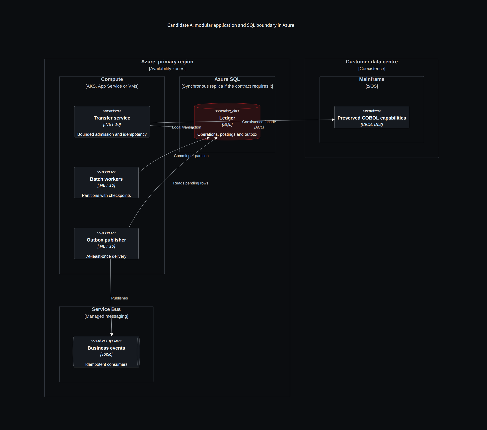
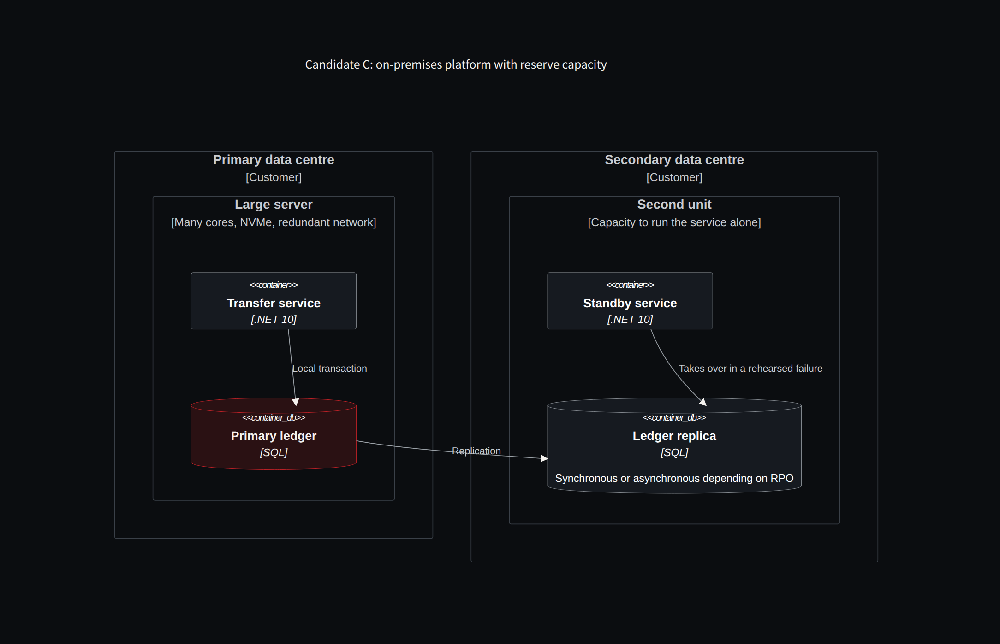

**English** · [Español](../../es/parte-5-capacidad/25-azure-o-una-maquina-enorme-en-el-cliente.md)

[← Chapter 24 · The benchmark that counts: load, contention, failure and cost](24-the-benchmark-that-counts-load-contention-failure-and-cost.md) · [Contents](../README.md) · [Part VI · The lab: from demo to evidence →](../part-6-lab/README.md)

# Chapter 25 · Azure or a huge machine at the customer's site

> [!IMPORTANT]
> **Chapter thesis.** The alternative is not buying a brutal machine: it is building a complete critical service, with its second unit, its recovery and its people. Winning an isolated test is not enough; the full contract must be met on the worst day we want to survive.

## The decision includes availability and operations

A server with a lot of CPU, abundant memory and fast storage can concentrate a workload with fewer network hops. It can also become a very expensive single point of failure. The local alternative must include the necessary second capacity, storage, network, power, recovery, spares, licences and the people who operate it.

In Azure, the budget includes VM limits, disk limits, log, network, replication and the data service. Microsoft documents that IOPS and bandwidth limits depend on both the storage and the VM [27]. Buying a faster disk does not guarantee the instance can use it.

Log commit latency deserves its own test. If the contract requires synchronous replication before responding, it must be measured with that replica. If we use temporary storage for rebuildable data, we must exclude from it any state whose loss would invalidate a confirmation.

There is not enough data about your workload to responsibly recommend a machine or SKU now. We first need the footprint described in chapter [22](22-mips-do-not-fit-in-a-vcpu-conversion.md) and an executable representative set. The result of this phase would be a short list of candidate configurations and a budget to compare them.

## Three configurations, one protocol

I would compare an **Azure** scenario (compute, transactional database and network specified), an **on-premises powerful** one (CPU, RAM, NVMe, network and redundancy defined) and, if appropriate, a **hybrid** one that keeps the core while extracting domains. I would not use commercial names as a substitute for a technical spec. The test must repeat the same load, key distribution, fixtures, commit policy and availability level. Figures per second without durable persistence or replication are not comparable with those of a system that guarantees both.

The customer's "supercomputer" can be excellent for bounded workloads and low latency, but it also needs high availability, durable disks, recovery, key management, maintenance without downtime and a second site according to RPO/RTO. The alternative is not simply buying a brutal machine: it is building an entire critical service.

## Three architecture candidates

| Candidate | Advantage to verify | Cost or limit to verify |
|---|---|---|
| Modular application and a SQL boundary in Azure | Transactional simplicity and managed services | Log, cost, limits and failover |
| Partitioned application with actors or workers | Parallelism across entities | Hot keys and cross coordination |
| On-premises platform with reserve capacity | Locality and control of the environment | Investment, redundancy and own operations |

*Figure 25.1 · Candidate A: modular application and a SQL boundary in Azure, coexisting with preserved COBOL capabilities.*

*Figure 25.2 · Candidate C: the "huge machine" is only a serious candidate with its second unit, its replica and rehearsed recovery.*

All three can include preserved COBOL and new C#. The platform change and the language change do not need to happen at once. Well-bounded coexistence lets us obtain measurements before committing to a full replacement.

My starting point would be to keep the simplest transactional boundary that covers the guarantees and to scale where the load allows independence. Then I would evaluate whether distributing state provides enough capacity to offset the additional coordination.

## A reference architecture: decisions, not coloured boxes

I propose a reference architecture with five operational domains. First, a **coexistence adapter** exposes authorized COBOL transactions, translates contracts and routes traffic. Second, a **business capabilities layer** contains .NET 10 services and, in suitable domains, Orleans; other components may be batch processes. Third, a **transactional data core** keeps the ledger and the commit rules. Fourth, a **reliable integration layer** uses outbox, inbox, queues and projections. Fifth, an **evidence and governance layer** runs oracles, watches drift and controls delivery.

I would not assume Kubernetes by default. An application with little variability, a well-known load and a single database can run efficiently on VMs or bare metal. Azure App Service, AKS, containers, VMs and Azure Local have different operational trade-offs; the choice responds to SLOs, the team and constraints, not to the eagerness to be cloud native. The same applies to Cosmos DB versus SQL: global distribution does not make up for losing a transactional boundary the business needs. For certain ledgers, an ACID relational engine is the most direct option.

The architecture has a **uniqueness rule**: no critical responsibility can remain ambiguous. One component approves commands; one system is authoritative for each piece of data; one gate approves each baseline; one person or committee authorizes business changes; one operation records its idempotency key. In designs that look highly distributed but do not resolve those responsibilities, failures move from the code to the coordination.

## Where to place the actors

If we use Orleans, I would place actors by account or contract keys for operations that benefit from identity isolation. I would not put all the accounting there without having verified persistence, transactions and recovery. Transfers between accounts should cross an explicit accounting boundary. For heavy batch loads I would choose partitioned workers with checkpoints. For queries I would use read models, knowing they can lag behind the ledger. Each choice has a falsifiable reason and an alternative.

## Testing the worst day we want to survive

The acceptance trial must combine interactive and batch load if they share resources in production. It must include the volume and distribution of data that produce the relevant query plans. A small database that fits in cache can hide a problem that appears when the working set grows.

I would test the loss of an instance while the rest is already under load, not only when the platform is empty. If we need to sustain the service with one unit less, the reserve capacity is demonstrated under that condition. The same goes for maintenance, index rebuilds, backups and recovery.

I would also measure the backlog and how it drains. A queue that absorbs a peak may look like a solution if we only look at the absence of errors; the service is still in breach if it takes hours to catch up. Message age and latency from the user's intent must accompany the consumer's throughput.

The selection criterion is not which one wins an isolated test. It is which one satisfies the full contract, at a cost and with an operational capacity the organization can sustain.

> **The customer's "supercomputer" also needs high availability, recovery, maintenance without downtime and a second site.**

---

[← Chapter 24 · The benchmark that counts: load, contention, failure and cost](24-the-benchmark-that-counts-load-contention-failure-and-cost.md) · [Contents](../README.md) · [Part VI · The lab: from demo to evidence →](../part-6-lab/README.md)
