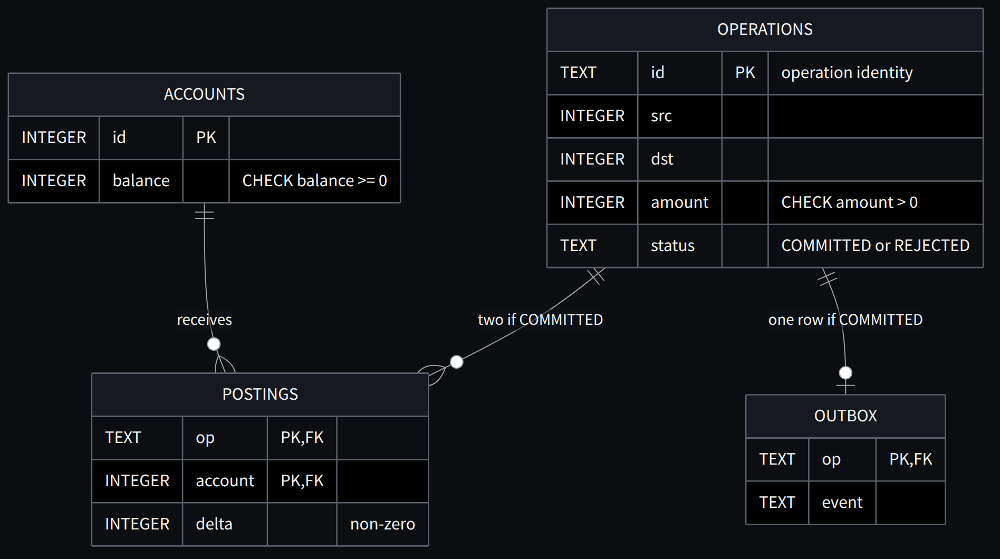
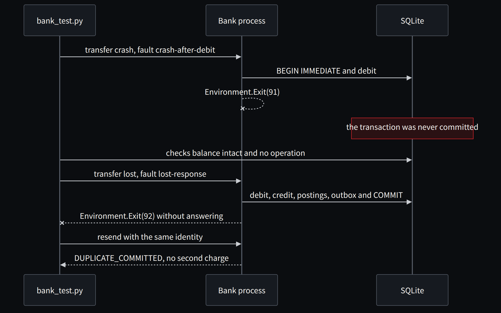
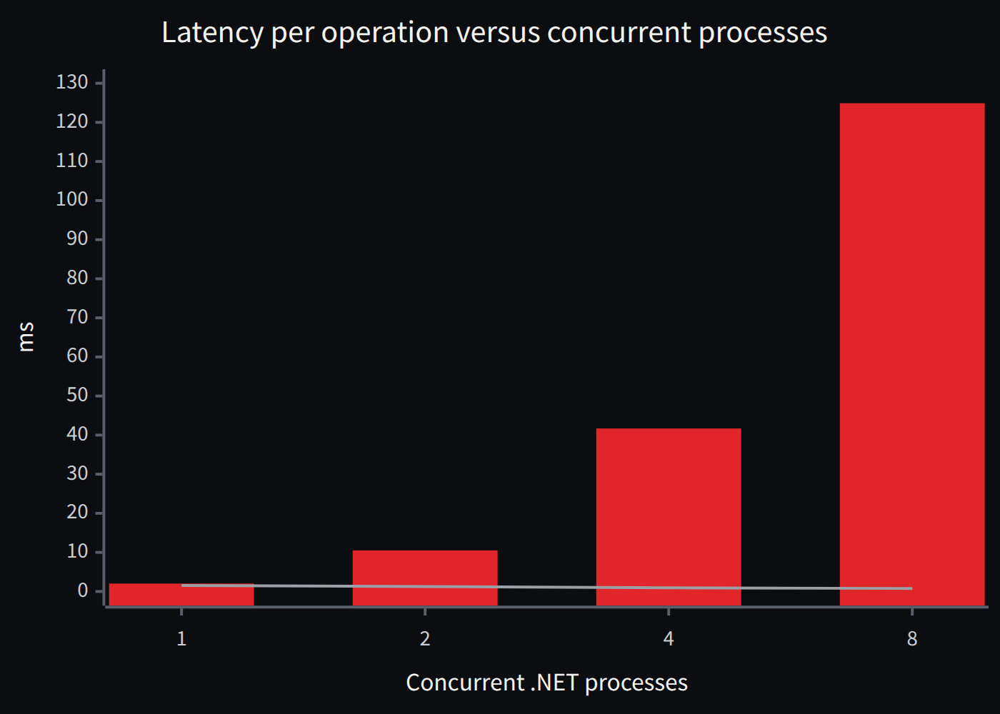

**English** · [Español](../../es/parte-6-laboratorio/28-transferencias-bloqueos-y-fallos-en-local.md)

[← Chapter 27 · Making the error visible](27-making-the-error-visible.md) · [Contents](../README.md) · [Chapter 29 · Bringing in agents without letting them write the approval →](29-bringing-in-agents-without-letting-them-write-the-approval.md)

# Chapter 28 · Transfers, locks and failures, locally

> [!IMPORTANT]
> **Chapter thesis.** Isolated functional equivalence says nothing about concurrency. The banking module takes the reasoning of chapters 17 and 18 to real processes that compete for a balance, crash after the debit and resend requests whose response they lost.

## The lab that accompanies this decision

The banking module runs separate .NET processes over a real SQLite database with WAL and FULL synchronous commits. It checks races over a balance, concurrent resends, conflicting key reuse, rollback, a process crash after the debit and a commit with a lost response. It forces a lock wait, verifies bounded retries and reconciles balances, postings and outbox rows. A deliberate mutation of the history checks that the oracle rejects it.

SQLite serializes writes and does not represent the row locking of SQL Server or PostgreSQL [29]. That is why this module lets us learn about atomicity and idempotency locally; it does not prove a row deadlock, a banking cluster, machine failure tolerance or capacity equivalent to the mainframe.

The small measurements with one, two, four and eight processes serve to observe how latency and contention change on that machine. They are local closed-loop trials, with insufficient warm-up and duration to size production. The code keeps the results to make that limit explicit.

**Extended evidence: from SQLite to PostgreSQL and SQL Server (30 October 2026).** The lab retains the unchanged SQLite reference and tests two additional .NET 10 implementations against real transactional engines in Podman containers. On PostgreSQL, [E1b](https://github.com/jmfloreszazo/de-la-caja-negra-a-la-evidencia/actions/runs/41034420329) completed eight logical workload cases—1, 2, 4 and 8 workers with uniform and hot-account distributions—960 committed transfers per candidate and matching persisted states. On SQL Server 2022 Developer, [E1c](https://github.com/jmfloreszazo/de-la-caja-negra-a-la-evidencia/actions/runs/41042317263) repeated the matrix with another 960 committed transfers per candidate, four-table parity and seven independent accounting invariants passing for every case. The [original SQL Server results](https://github.com/jmfloreszazo/de-la-caja-negra-a-la-evidencia/blob/experiment/e1-postgres-row-locking/evidence/runs/e1c-sqlserver-worker-parity.json) retain configuration, case outcomes and executable source hashes.

**What differs is the concurrency protocol, not the business contract.** SQLite serializes writers; PostgreSQL supports explicit row locks; this SQL Server implementation combines `UPDLOCK` with `sp_getapplock`. In separate SQL Server tests, [the transactional execution](https://github.com/jmfloreszazo/de-la-caja-negra-a-la-evidencia/actions/runs/41041573996) observed a real deadlock victim (`1205`) retried as a whole transaction, exhausted database lock timeouts (`1222`), a distinct client command timeout (`-2`), idempotency, duplicate unique-key rejection, and a negative *write-skew* control: `SNAPSHOT` violated the rule requiring an active operator, whereas `SERIALIZABLE` preserved it. The independent oracle rejected a deliberately deleted posting and accepted its restoration.

**Mandatory limitation.** The 960 transfers in each workload matrix used different process models: SQLite worker processes remained alive, while the SQL Server candidate launched a .NET process per transfer. Therefore there is no valid cross-engine throughput, p99 or efficiency comparison. Neither power-loss recovery, high availability, branch WAN latency, CICS/Db2 equivalence nor mainframe MIPS capacity has been demonstrated. This evidence establishes **accounting behavior under the tested cases**, not capacity acceptance for the target architecture.

## The contract is in the schema

Before the code, the schema. The database constraints are the first line of the oracle: a balance cannot be negative, an operation has a unique identity, every posting belongs to an operation and every committed operation has its outbox row.

**Listing 28.1 · Schema created by Bank/Program.cs** — *Executed*

```sql
CREATE TABLE accounts(id INTEGER PRIMARY KEY,balance INTEGER NOT NULL CHECK(balance>=0));
CREATE TABLE operations(id TEXT PRIMARY KEY,src INTEGER NOT NULL,dst INTEGER NOT NULL,
                        amount INTEGER NOT NULL CHECK(amount>0),status TEXT NOT NULL);
CREATE TABLE postings(op TEXT REFERENCES operations(id),account INTEGER REFERENCES accounts(id),
                      delta INTEGER NOT NULL CHECK(delta<>0),PRIMARY KEY(op,account));
CREATE TABLE outbox(op TEXT PRIMARY KEY REFERENCES operations(id),event TEXT NOT NULL);
```



*Figure 28.1 · The banking module schema: the constraints are the first line of the oracle.*

## Idempotency: the same mandate, only once

Within the same transaction that will execute the movement, the service looks up the operation identity. If it exists and the content matches, it returns the previous decision. If it exists with different content, it is a conflict.

**Listing 28.2 · Bank/Program.cs: resend versus identity conflict** — *Executed*

```csharp
   var existing=db.Rows($"SELECT src,dst,amount,status FROM operations WHERE id='{id}'");
   if(existing.Count>0) {
    var e=existing[0];
    var same=e["src"]==src.ToString()&&e["dst"]==dst.ToString()&&e["amount"]==amount.ToString();
    db.Exec("COMMIT");begun=false;
    return new(same?"DUPLICATE_"+e["status"]:"ID_CONFLICT",retries,clock.Elapsed.TotalMilliseconds);
   }
```

A craft note: the lab builds SQL by interpolating values because it calls the native library without an intermediate layer, and it does so after validating the identity with a strict regular expression and typing the numbers. In a real service I would always use parameters. The business rule it demonstrates is the same.

## Failures seeded where they hurt most

**Listing 28.3 · Bank/Program.cs: three injected failures and the bounded retry** — *Executed*

```csharp
   if(approved) {
    if(fault=="crash-after-debit")Environment.Exit(91);
    if(fault=="throw-after-debit")throw new InvalidOperationException("Injected failure after debit");
    db.Exec($"UPDATE accounts SET balance=balance+{amount} WHERE id={dst}");
   }
   // ... operation, postings and outbox ...
   db.Exec("COMMIT");begun=false;
   if(fault=="lost-response")Environment.Exit(92);
   return new(status,retries,clock.Elapsed.TotalMilliseconds);
  } catch(SqlFailure e) when(e.Code==5||e.Code==6) {
   if(begun)db.Exec("ROLLBACK");retries++;
   Thread.Sleep(Math.Min(50,2*(attempt+1))+Random.Shared.Next(1,8));
  }
```

The process that dies after the debit and before the commit leaves no partial charge, because the debit was never committed. The process that dies after the commit without answering leaves a durable decision: the resend with the same identity recovers it as `DUPLICATE_COMMITTED` instead of charging twice. And a lock held by another process produces waits and bounded retries; after twelve attempts the service reports `RETRY_EXHAUSTED` and does not touch the balances.



*Figure 28.2 · Two failures seeded in the lab: a crash before the commit and a lost response after the commit.*

## The oracle does not ask the service

The verifier is a separate Python process that opens the database and checks invariants over the persisted data. It does not consult the service's response, because a service can answer "OK" and have left something else behind.

**Listing 28.4 · bank_test.py: accounting invariants over the persisted state** — *Executed*

```python
tests={
 'nonnegative':s('SELECT MIN(balance) FROM accounts')>=0,
 'conserved':s('SELECT SUM(balance) FROM accounts')==s('SELECT COUNT(*)*100000 FROM accounts'),
 'balancedPostings':s('SELECT COUNT(*) FROM (SELECT op FROM postings GROUP BY op '
                      'HAVING SUM(delta)<>0 OR COUNT(*)<>2)')==0,
 'projectionAgrees':s('SELECT COUNT(*) FROM accounts a WHERE balance<>100000+COALESCE('
                      '(SELECT SUM(delta) FROM postings p WHERE p.account=a.id),0)')==0,
 # ... twoPostingsPerCommit and outboxAtomic
}
```

Preserving the total is necessary and not sufficient: a movement charged to the wrong account also preserves the total. That is why the oracle also requires two balanced postings per operation and that each balance can be rebuilt from its history. The negative control deletes a posting from a copy of the database, and the oracle must reject it. It does.

## Local measurements, and why they are not capacity

| Pattern | Processes | Operations | Ops/s incl. start-up | p50 ms | p95 ms | p99 ms | Retries |
|---|---|---|---|---|---|---|---|
| uniform | 1 | 32 | 221.9 | 1.52 | 1.99 | 2.03 | 0 |
| uniform | 2 | 64 | 348.4 | 1.27 | 1.82 | 10.51 | 0 |
| uniform | 4 | 128 | 509.4 | 0.93 | 1.90 | 41.70 | 1 |
| uniform | 8 | 256 | 693.3 | 0.77 | 27.22 | 124.90 | 4 |
| hot | 1 | 32 | 259.9 | 1.17 | 1.61 | 1.79 | 0 |
| hot | 2 | 64 | 351.3 | 1.13 | 3.82 | 11.77 | 0 |
| hot | 4 | 128 | 495.6 | 0.81 | 2.04 | 42.08 | 0 |
| hot | 8 | 256 | 624.4 | 0.85 | 28.40 | 109.78 | 5 |



*Figure 28.3 · Reference run with uniform accounts: red bars for p99 and a blue line for p50, in milliseconds. The median drops and the tail explodes.*

The table teaches one true thing and nothing more: when we add processes that compete for a serialized resource, the median improves and the tail explodes. It is the same phenomenon that will appear with a hot account or a saturated log. But these are 32 operations per process, in a closed loop, including the start-up of each .NET process, on an engine that serializes writes, on a single machine. There is no warm-up or sufficient duration, no mainframe baseline and no Azure. This table cannot approve capacity, and the code writes that down in the results summary itself.

> **The service can answer OK and leave something else behind. The oracle looks at what remains.**

---

[← Chapter 27 · Making the error visible](27-making-the-error-visible.md) · [Contents](../README.md) · [Chapter 29 · Bringing in agents without letting them write the approval →](29-bringing-in-agents-without-letting-them-write-the-approval.md)
