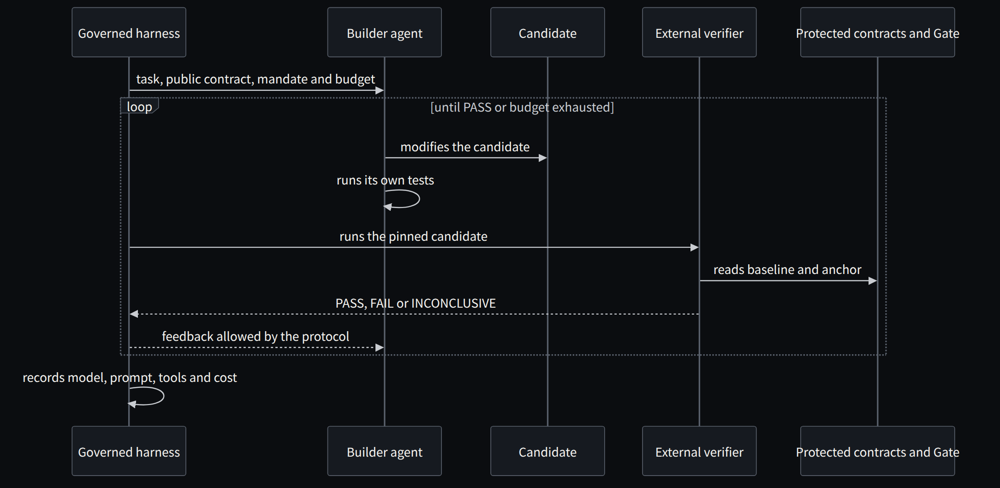

**English** · [Español](../../es/parte-6-laboratorio/29-incorporar-agentes-sin-permitir-que-escriban-el-aprobado.md)

[← Chapter 28 · Transfers, locks and failures, locally](28-transfers-locks-and-failures-locally.md) · [Contents](../README.md) · [Part VII · From evidence to the organization →](../part-7-organization/README.md)

# Chapter 29 · Bringing in agents without letting them write the approval

> [!IMPORTANT]
> **Chapter thesis.** The next step is to put an agent to build the candidate. It can consult, run and fix; it cannot touch the reserved cases or the evaluator. And every change of model, prompt or budget is a different experimental condition.

## The next step has two modes

I would separate the deterministic demonstration from an experiment with agents. In the first mode, we keep implementations, inputs and pinned expectations to explain the process. In the second, an agent receives a build task and must produce a candidate under recorded constraints.

The agent can consult sources and the public contract, run its own tests and fix the program. It cannot change the reserved cases or the acceptance evaluator. An external verifier runs the candidate in a controlled environment. The report returns enough information to fix it, according to the experiment protocol.

*Figure 29.1 · A builder agent inside a governed harness: it fixes its work against an external verifier it does not control.*

If we change models, budgets, prompts or tools, we record it as a different experimental condition. Saying "AI did it" does not let us explain which combination produced the result or repeat the process.

A discovery agent may propose rules from policies, interviews and authorized observations; COBOL is supplementary evidence when needed. The builder can **implement the capability from scratch** in C# without copying legacy structure. TODM verifies outcomes against independent oracles and approved rules; Golden Master separately preserves observed incumbent behavior. Business authority decides what to preserve, correct or retire.

## REA comes in when the problem needs it

For the lab's small source we do not need a decompiler. Including REA for the sake of appearances would add complexity without clarifying the test. Its integration makes sense when the capability under investigation lives in an artifact its tools help examine.

A coherent extension would be to take an authorized executable, pin its hash and ask an agent to investigate a specific function through REA. The findings would feed hypotheses and tests. The reconstruction would then be evaluated against a suitable oracle. The result would document what was observed directly and what was inferred.

For larger COBOL estates, I would begin with **capabilities, external contracts, exceptions and operational guarantees**. Only when a specific technical uncertainty remains would I evaluate dialect parsers or dependency tools. MCP can expose findings, but syntactic analysis is not required to reimplement a system and does not approve business rules.

## Correlated errors are still possible

Two agents can repeat the same wrong interpretation. Changing models does not guarantee independence either. If both receive an incorrect specification and the evaluator derives from that same specification without review, the loop can confirm its own error.

The defence requires diversity of evidence: observed behaviour, approved rules, known properties and adversarial controls. In a serious evaluation it is also worth separating who builds the solution from who prepares the hidden cases and adjudicates the results.

Anthropic distinguishes between workflows defined by code and agents that dynamically decide their steps and tools [11]. That distinction helps describe precisely what we have built. Our lab is a deterministic workflow. The future experiment can incorporate autonomy, but that autonomy must show it adds value compared with a simpler route.

In "Agents on the fly versus a governed harness" I compared command-line agents beyond the demo and reached an uncomfortable conclusion: defect detection, reliability and quality control have a cost, and that cost does not disappear; it is paid by measuring or paid in production [41]. In a COBOL modernization, the governed harness is the one that sets the mandate of chapter [9](../part-2-archaeology-and-authority/09-from-the-agent-s-authority-to-the-rule-s-authority.md), protects the gate of chapter [10](../part-3-oracles/10-todm-and-the-problem-of-accepting-what-we-build.md) and records every attempt for the study in chapter [34](../part-7-organization/34-measuring-what-we-do-not-yet-know.md).

I built a concrete form of that harness in "From the model that answers to the agent that works", with C#, .NET 10 and Microsoft Foundry: the harness governs planning, state, tools and approvals, and CodeAct compactly runs data-intensive work and tool calls [43]. And in "MCP, A2A and AHP" I explained why those three acronyms solve different problems in different layers and why an agent should live in a container [46]. It is the same reason the lab runs in a container with no network, and the reason experiment E4 should lock the builder agent inside one.

> **Saying "AI did it" does not explain which combination produced the result, nor does it let you repeat the process.**

---

[← Chapter 28 · Transfers, locks and failures, locally](28-transfers-locks-and-failures-locally.md) · [Contents](../README.md) · [Part VII · From evidence to the organization →](../part-7-organization/README.md)
