<p align="center">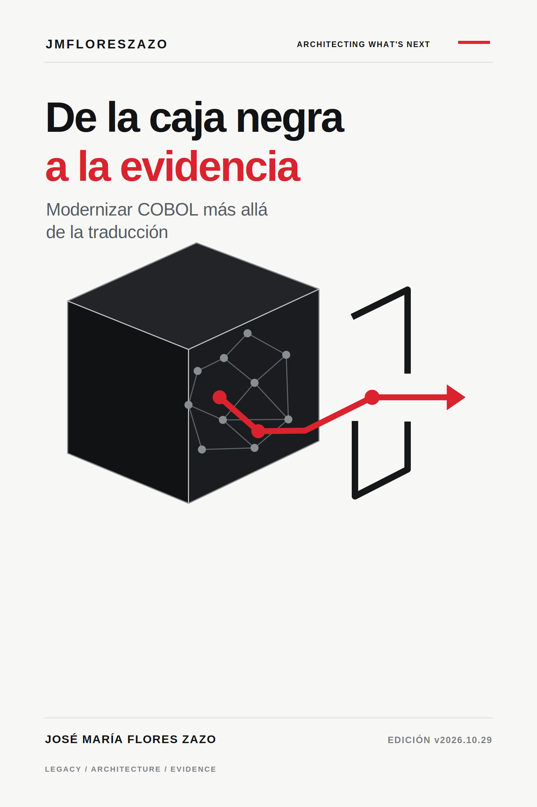</p>

# De la caja negra a la evidencia

**Modernizar COBOL más allá de la traducción: agentes de IA, patrones de arquitectura, transacciones y oráculos verificables**

José María Flores Zazo · v2026.10.29 · **Español** · [English](en.md)

> [!NOTE]
> Este fichero es el libro completo en una sola página. Se genera a partir de los capítulos de [`book/es/`](es/README.md) con `python3 scripts/build.py`: para proponer cambios, edita los capítulos, no este fichero.

## Índice

- [Convenciones](#convenciones)
- [Prólogo](#prólogo)
- [Cómo leer este libro](#cómo-leer-este-libro)
- [Parte I · Antes de traducir](#parte-i--antes-de-traducir)
  - [Capítulo 1 · El mainframe no es una caja rápida](#capítulo-1--el-mainframe-no-es-una-caja-rápida)
  - [Capítulo 2 · El sistema que estamos intentando conservar](#capítulo-2--el-sistema-que-estamos-intentando-conservar)
  - [Capítulo 3 · Por qué la conversión uno a uno no es modernización](#capítulo-3--por-qué-la-conversión-uno-a-uno-no-es-modernización)
  - [Capítulo 4 · Lo que comparto con otros autores y dónde discrepo](#capítulo-4--lo-que-comparto-con-otros-autores-y-dónde-discrepo)
  - [Capítulo 5 · Modernizar exige elegir qué problema resolvemos](#capítulo-5--modernizar-exige-elegir-qué-problema-resolvemos)
- [Parte II · Arqueología, conocimiento y autoridad](#parte-ii--arqueología-conocimiento-y-autoridad)
  - [Capítulo 6 · REA y la arqueología que deja rastro](#capítulo-6--rea-y-la-arqueología-que-deja-rastro)
  - [Capítulo 7 · Legacy Archaeology asistida por agentes](#capítulo-7--legacy-archaeology-asistida-por-agentes)
  - [Capítulo complementario · Descomponer el mainframe con evidencia](#capítulo-complementario--descomponer-el-mainframe-con-evidencia)
  - [Capítulo 8 · El conocimiento del agente y el expediente del sistema](#capítulo-8--el-conocimiento-del-agente-y-el-expediente-del-sistema)
  - [Capítulo 9 · De la autoridad del agente a la autoridad de la regla](#capítulo-9--de-la-autoridad-del-agente-a-la-autoridad-de-la-regla)
- [Parte III · Oráculos: el derecho a aceptar](#parte-iii--oráculos-el-derecho-a-aceptar)
  - [Capítulo 10 · TODM y el problema de aceptar lo que construimos](#capítulo-10--todm-y-el-problema-de-aceptar-lo-que-construimos)
  - [Capítulo 11 · La arquitectura de una modernización verificable](#capítulo-11--la-arquitectura-de-una-modernización-verificable)
  - [Capítulo 12 · COBOL y C# deben acordar el significado](#capítulo-12--cobol-y-c-deben-acordar-el-significado)
- [Parte IV · Patrones que sustituyen responsabilidades, no sintaxis](#parte-iv--patrones-que-sustituyen-responsabilidades-no-sintaxis)
  - [Capítulo 13 · Antes de elegir un patrón, identifica el contrato](#capítulo-13--antes-de-elegir-un-patrón-identifica-el-contrato)
  - [Capítulo 14 · Strangler Fig: cambiar el borde antes que el corazón](#capítulo-14--strangler-fig-cambiar-el-borde-antes-que-el-corazón)
  - [Capítulo 15 · Anti-Corruption Layer: traducir significados, no tipos](#capítulo-15--anti-corruption-layer-traducir-significados-no-tipos)
  - [Capítulo 16 · La propiedad de los datos](#capítulo-16--la-propiedad-de-los-datos)
  - [Capítulo 17 · De los locks del mainframe al control explícito de concurrencia](#capítulo-17--de-los-locks-del-mainframe-al-control-explícito-de-concurrencia)
  - [Capítulo 18 · Distribuir sin romper la contabilidad](#capítulo-18--distribuir-sin-romper-la-contabilidad)
  - [Capítulo 19 · Actores: una gran herramienta, un mal sustituto universal](#capítulo-19--actores-una-gran-herramienta-un-mal-sustituto-universal)
  - [Capítulo 20 · Batch y paralelismo: acelerar sin cambiar el resultado](#capítulo-20--batch-y-paralelismo-acelerar-sin-cambiar-el-resultado)
  - [Capítulo 21 · Event sourcing, CQRS y sagas: cuándo ayudan y cuándo estorban](#capítulo-21--event-sourcing-cqrs-y-sagas-cuándo-ayudan-y-cuándo-estorban)
- [Parte V · Capacidad: MIPS, concurrencia y plataforma](#parte-v--capacidad-mips-concurrencia-y-plataforma)
  - [Capítulo 22 · Los MIPS no caben en una conversión de vCPU](#capítulo-22--los-mips-no-caben-en-una-conversión-de-vcpu)
  - [Capítulo 23 · Concurrencia que aprovecha la máquina](#capítulo-23--concurrencia-que-aprovecha-la-máquina)
  - [Capítulo 24 · El benchmark que vale: carga, contención, fallo y coste](#capítulo-24--el-benchmark-que-vale-carga-contención-fallo-y-coste)
  - [Capítulo 25 · Azure o una máquina enorme en el cliente](#capítulo-25--azure-o-una-máquina-enorme-en-el-cliente)
  - [Capítulo 25 bis · Infraestructura frente a un mainframe actual: local, Azure y la red de oficinas](#capítulo-25-bis--infraestructura-frente-a-un-mainframe-actual-local-azure-y-la-red-de-oficinas)
- [Parte VI · El laboratorio: de la demo a la evidencia](#parte-vi--el-laboratorio-de-la-demo-a-la-evidencia)
  - [Capítulo 26 · Un laboratorio local que se puede entender](#capítulo-26--un-laboratorio-local-que-se-puede-entender)
  - [Capítulo 27 · Hacer que el error se vea](#capítulo-27--hacer-que-el-error-se-vea)
  - [Capítulo 28 · Transferencias, bloqueos y fallos en local](#capítulo-28--transferencias-bloqueos-y-fallos-en-local)
  - [Capítulo 29 · Incorporar agentes sin permitir que escriban el aprobado](#capítulo-29--incorporar-agentes-sin-permitir-que-escriban-el-aprobado)
- [Parte VII · De la evidencia a la organización](#parte-vii--de-la-evidencia-a-la-organización)
  - [Capítulo 30 · Del laboratorio a un sistema que sigue operando](#capítulo-30--del-laboratorio-a-un-sistema-que-sigue-operando)
  - [Capítulo 31 · El SDLC como parte del motor de migración](#capítulo-31--el-sdlc-como-parte-del-motor-de-migración)
  - [Capítulo 32 · Una historia de migración: la cuenta que parecía fácil](#capítulo-32--una-historia-de-migración-la-cuenta-que-parecía-fácil)
  - [Capítulo 33 · Plan de modernización: primero una prueba de capacidad, después una apuesta](#capítulo-33--plan-de-modernización-primero-una-prueba-de-capacidad-después-una-apuesta)
  - [Capítulo 34 · Medir lo que todavía no sabemos](#capítulo-34--medir-lo-que-todavía-no-sabemos)
  - [Capítulo 35 · Cuándo NO migraría](#capítulo-35--cuándo-no-migraría)
  - [Capítulo 36 · Cien riesgos para elegir patrones con criterio](#capítulo-36--cien-riesgos-para-elegir-patrones-con-criterio)
  - [Capítulo 37 · El nuevo contrato de modernización](#capítulo-37--el-nuevo-contrato-de-modernización)
- [Epílogo](#epílogo)
- [Anexos](#anexos)
  - [Anexo A · Un laboratorio que pueda contradecirnos](#anexo-a--un-laboratorio-que-pueda-contradecirnos)
  - [Anexo B · Contrato del laboratorio](#anexo-b--contrato-del-laboratorio)
  - [Anexo C · Ejecución de referencia](#anexo-c--ejecución-de-referencia)
  - [Anexo D · Decisiones de arquitectura](#anexo-d--decisiones-de-arquitectura)
  - [Anexo E · Catálogo de cien riesgos](#anexo-e--catálogo-de-cien-riesgos)
  - [Anexo F · Glosario operativo](#anexo-f--glosario-operativo)
  - [Anexo G · Fuentes y alcance de la investigación](#anexo-g--fuentes-y-alcance-de-la-investigación)

## Convenciones

Dos convenciones ayudan a leer este libro.

**Fuente, propuesta y ejecución.** Distingo lo que existe en una fuente, lo que propongo como diseño y lo que el laboratorio ha ejecutado. Cuando describo una arquitectura de producción, es una propuesta que exige integración y verificación. Cuando presento un resultado de la demo, su validez se limita al programa, los casos y las versiones registrados.

**Etiquetas en los listados.** Cada fragmento de código lleva una etiqueta. *Ejecutado* significa que forma parte del laboratorio y tiene una ejecución de referencia con sus hashes. *Verificado* significa que su lógica se ha comprobado con una implementación independiente. *Ilustrativo* significa que es un fragmento de diseño que no se ha compilado ni ejecutado: sirve para razonar, no para copiar a producción.

El laboratorio está íntegramente en inglés, se ejecuta con Podman y está pensado para que cualquiera pueda contradecirme. El anexo [A](#anexo-a--un-laboratorio-que-pueda-contradecirnos) explica cómo.

## Prólogo

> Una traducción puede conservar las instrucciones. Una modernización debe conservar las garantías que hacen posible el negocio y cambiar aquello que impide su evolución.

Hay una escena que resume buena parte de la conversación actual sobre modernización. Un agente recibe un programa antiguo, produce una versión en un lenguaje moderno y ejecuta una demostración. La aplicación arranca. La pantalla responde. Los ejemplos salen bien. Alguien pregunta cuánto tardaríamos en hacer lo mismo con el sistema de una empresa.

Mi primera pregunta sería otra: ¿qué acabamos de demostrar?

No es una forma de quitar mérito al resultado. Es la pregunta que permite darle un valor. Hemos demostrado que una herramienta puede producir una implementación que supera determinados ejemplos, bajo unas condiciones concretas. Para avanzar necesitamos identificar esas condiciones, comprobar qué queda fuera y decidir quién tiene autoridad para aceptar el riesgo que permanece.

Adelanto la conclusión sin ceremonia: **la IA puede investigar, proponer y construir; aceptar el resultado exige contratos, oráculos independientes y una autoridad explícita.** Y hay una segunda conclusión, que me ha costado más formular: **una modernización 1:1 puede ser un puente, pero nunca deberíamos confundir el puente con la ciudad a la que queremos llegar.**

Este libro nace de esa distancia entre una posibilidad técnica y una decisión de arquitectura. Reúne tres líneas de trabajo que he venido desarrollando: la modernización de aplicaciones, la construcción con agentes de IA y el gobierno del software mediante evidencia independiente. Mi propuesta, Test Oracle-Driven Methodology, o TODM, intenta convertir esa relación en un proceso que se pueda inspeccionar, ejecutar y discutir. La he ido desarrollando en público: en el repositorio de TODM [2], en «De Leviatán al Autopilot» [1], en «Agentes al vuelo frente a un harness gobernado» [41] y en mi análisis de REA, «Más allá del hype» [35].

COBOL es un caso especialmente útil para hacerlo. Obliga a hablar de datos, precisión, contratos, operación y conocimiento de negocio. No permite esconder una migración detrás de una interfaz más atractiva. Si el saldo es incorrecto, el hecho de haberlo calculado con un framework reciente aporta poco consuelo.

Leer a varios autores sobre la modernización de COBOL y la IA ayuda a situar el problema. La defensa del conocimiento acumulado merece atención. También merece discusión la frontera que algunos establecen entre lo que la IA puede comprender y lo que puede transformar. En estas páginas tomo esa discusión en serio y la convierto en decisiones verificables.

La capacidad también forma parte de esta discusión. Debemos conservar la atomicidad de las transacciones, entender los bloqueos y sostener la carga con la política de durabilidad y recuperación acordada. Un servidor mayor o más actores solo ayudan si resuelven el recurso que limita ese compromiso.

El recorrido termina en código. El laboratorio acompaña un pequeño servicio COBOL desde su ejecución local hasta la comparación con una implementación en .NET 10. Incluye errores deliberados, evidencia incompleta y una entrega bloqueada pese a que el comportamiento sea correcto. Su tamaño permite entender el mecanismo. Su alcance explícito evita confundirlo con una migración empresarial terminada.

Quiero que el lector pueda reproducir la demostración y, después, formular mejores preguntas ante la siguiente. La facilidad de ejecutar el ejemplo debe ayudarnos a ver la dificultad real con más claridad.

## Cómo leer este libro

El hilo conductor es una transformación concreta: pasar de un comportamiento heredado que observamos a una implementación cuyo resultado podemos aceptar dentro de un alcance definido. Por el camino aparecen tres preguntas que cualquier comité de dirección acaba haciendo —¿qué hace realmente el sistema?, ¿cómo sabemos que lo nuevo hace lo mismo?, ¿aguantará el cierre de mes?— y una cuarta que casi nadie formula a tiempo: ¿quién tiene autoridad para aceptar el riesgo que queda?

| Parte | Pregunta que responde |
|---|---|
| I · Antes de traducir | Qué estamos conservando de verdad y por qué cambiar el lenguaje no basta |
| II · Arqueología, conocimiento y autoridad | Cómo recuperar evidencia del legado con agentes sin confundir hipótesis con hechos |
| III · Oráculos: el derecho a aceptar | Cómo decidir que un candidato cumple, separando corrección de autorización |
| IV · Patrones que sustituyen responsabilidades | Qué mecanismo moderno reemplaza cada garantía del mainframe, y cuándo no |
| V · Capacidad | Cómo acercarse a lo que da un mainframe sin convertir MIPS en vCPU |
| VI · El laboratorio | Cómo se ve todo lo anterior en código que puedes ejecutar y romper |
| VII · De la evidencia a la organización | Cómo llevarlo al SDLC, a un plan y a una decisión que se pueda defender |

Un responsable de tecnología encontrará criterios para delimitar una modernización, pedir evidencia útil y saber cuándo no migrar. Un arquitecto encontrará límites de confianza, contratos, patrones con sus condiciones de uso y decisiones de convivencia. Un desarrollador podrá ejecutar el COBOL, modificar el C# y observar el efecto de sus cambios en un gate que no se deja convencer. El mismo caso une las tres perspectivas.

Se puede leer en orden o por partes. Si vienes con prisa por el rendimiento, la parte V es autocontenida. Si quieres ver primero el código, empieza por la parte VI y el anexo [A](#anexo-a--un-laboratorio-que-pueda-contradecirnos) y vuelve después a las razones. Si tienes que defender un presupuesto, los capítulos [33](#capítulo-33--plan-de-modernización-primero-una-prueba-de-capacidad-después-una-apuesta), [35](#capítulo-35--cuándo-no-migraría) y [37](#capítulo-37--el-nuevo-contrato-de-modernización) están escritos para eso.

Las referencias numeradas entre corchetes remiten al anexo [G](#anexo-g--fuentes-y-alcance-de-la-investigación). El código completo, los comandos y los resultados de referencia están en el laboratorio adjunto. La fecha de revisión de esta edición es el 29 de octubre de 2026.

## Parte I · Antes de traducir

Qué estamos conservando de verdad cuando decimos «migrar COBOL», por qué cambiar de lenguaje no es cambiar de arquitectura y dónde coincido —y dónde no— con quienes piden prudencia.

### Capítulo 1 · El mainframe no es una caja rápida

> [!IMPORTANT]
> **Tesis del capítulo.** Un mainframe es una plataforma de ejecución, datos, operación y control. Si solo medimos su procesador, todavía no sabemos qué estamos intentando sustituir.

Hay una conversación que he escuchado con demasiada frecuencia en proyectos de modernización: «tenemos X MIPS; ¿cuántas máquinas virtuales necesitamos en Azure?». A primera vista parece una pregunta de capacidad. En realidad suele revelar que todavía no entendemos el sistema que queremos sustituir. El mainframe es una plataforma de ejecución, datos, operaciones y control. Reducirla a una cifra de procesador equivale a medir un aeropuerto contando únicamente el empuje de sus motores.

COBOL es el lenguaje visible. Detrás pueden estar CICS para procesamiento transaccional, IMS o Db2 para datos, VSAM para ficheros indexados, JCL para organizar trabajos, JES para la ejecución por lotes, RACF para seguridad, WLM para prioridades, y sistemas de recuperación, colas, journaling y observabilidad que llevan décadas evolucionando. No todos los sistemas reúnen todos esos componentes. Precisamente por eso la primera tarea es inventariar lo que existe, no dibujar la solución cloud que nos gustaría vender.

Una aplicación CICS no equivale a un programa COBOL con un endpoint HTTP delante. Puede apoyarse en unidades de trabajo que comprometen conjuntamente modificaciones sobre recursos recuperables. El `SYNCPOINT` delimita esa frontera de commit o rollback [16]. Las aplicaciones con Db2 también dependen de niveles de aislamiento, bloqueos, planes de acceso y particularidades del procesamiento concurrente [37]. Si un agente traduce un `READ UPDATE` y olvida las garantías que acompañaban al acceso, el programa nuevo compilará. Puede incluso superar los primeros cien tests. Lo que habremos perdido es la propiedad por la que el banco confiaba en el programa antiguo.

La plataforma también incluye organización del trabajo. Un proceso batch no es necesariamente «un bucle grande». Puede estar encadenado a ventanas de cierre, estados de checkpoint, ordenaciones, reconciliaciones, dependencias y mecanismos de recuperación. Hay trabajos que deben finalizar antes de que abra una oficina y otros que deben convivir con la operativa en línea. Migrarlos a un cron en Kubernetes sin mapear esas dependencias constituye una conversión de comandos, no una modernización.

La distinción importa porque un programa puede ser simple y su ejecución compleja. Calcular intereses puede ocupar pocas líneas. Hacerlo para millones de cuentas, exactamente una vez por periodo, con calendarios de negocio, reinicios y conciliación, es un sistema completo. Y conservarlo exige diseñar tanto los invariantes económicos como la operación que los protege.

#### Cuatro capas de equivalencia

Propongo separar cuatro obligaciones: **equivalencia funcional** (misma decisión y resultado bajo las mismas reglas); **equivalencia de datos** (mismos significados, importes, codificaciones y efectos persistentes); **equivalencia operacional** (recuperación, seguridad, ventanas, observabilidad y fallos); y **adecuación de capacidad** (cumplimiento de objetivos de latencia, throughput, coste y resiliencia). Son gates distintos. Aprobar uno no implica aprobar los demás.

Es posible que la nueva solución sea funcionalmente equivalente y tenga peor rendimiento. También puede procesar tres veces más operaciones y perder un céntimo por un redondeo distinto. En ninguno de los dos casos hemos terminado.


*Figura 1.1 · Cuatro obligaciones distintas. Aprobar una no aprueba las demás.*

Traducido a una reunión de seguimiento: cuando alguien diga «ya es equivalente», la pregunta correcta es *¿en cuál de las cuatro capas, con qué evidencia y con qué alcance?*

> **Medir un mainframe por sus MIPS es como medir un aeropuerto contando el empuje de sus motores.**

### Capítulo 2 · El sistema que estamos intentando conservar

> [!IMPORTANT]
> **Tesis del capítulo.** El comportamiento que importa atraviesa programas, datos, procesos nocturnos y personas. Y no todo lo que el sistema hace hoy merece convertirse en requisito mañana.

#### La memoria está repartida

Una aplicación heredada contiene decisiones que quizá nadie tomaría hoy de la misma manera. Algunas siguen siendo necesarias. Otras fueron soluciones temporales. Hay comportamientos que el negocio considera esenciales y otros que simplemente lleva décadas tolerando. A menudo todos están mezclados en el mismo recorrido de ejecución.

Por eso me resulta insuficiente empezar una modernización preguntando cuántas líneas de código tenemos. Necesito saber qué compromisos cumple el sistema, con quién los cumple y qué ocurre cuando deja de cumplirlos. El código es una parte de la respuesta. También lo son los datos, las tablas de parametrización, los procesos nocturnos, las interfaces y las personas que conocen las excepciones.

Imaginemos una liquidación que se ejecuta al cierre del día. Un programa calcula importes, otro agrupa movimientos y un tercero genera un fichero para una entidad externa. Una pantalla permite corregir incidencias antes del envío. El comportamiento que debemos conservar atraviesa todos esos elementos. Traducir correctamente la primera rutina no demuestra que hayamos conservado la liquidación.

Es una de las ideas que encuentro más valiosas en lo que se ha escrito sobre COBOL: devuelve la atención al conocimiento que sostiene la operación. Una organización puede seguir dependiendo de un sistema mientras pierde la capacidad de explicarlo. Para mi propuesta, esa observación tiene una consecuencia directa: la recuperación del conocimiento debe producir artefactos utilizables para decidir y verificar.

Una explicación legible ayuda. Una explicación vinculada a una regla, un responsable y una prueba permite avanzar más. La documentación deja de ser una narración paralela y comienza a formar parte del mecanismo de aceptación.

#### Conservar comportamiento no significa conservar cualquier resultado

Supongamos que el sistema cobra una comisión incorrecta desde hace años. Una reimplementación que reproduce ese cobro es compatible con el comportamiento observado. Eso no la convierte en correcta respecto de la política del negocio.

Necesitamos separar dos preguntas. ¿Qué hace el sistema actual? ¿Qué debe hacer el sistema que vamos a aceptar? La primera se responde mediante observación, análisis y pruebas de caracterización. La segunda exige una decisión autorizada sobre reglas y excepciones. Cuando las respuestas difieren, el proyecto incluye un cambio de comportamiento que debe quedar identificado.

Esta distinción evita dos errores frecuentes. El primero consiste en corregir silenciosamente algo que parecía un defecto, sin saber qué consumidor dependía de ello. El segundo consiste en elevar todo comportamiento histórico a requisito permanente. Ambos pueden introducir problemas que una comparación superficial no detectará.

Mi unidad de trabajo preferida es una capacidad delimitada: un cálculo, una decisión, un intercambio o una transición de estado que podamos observar y explicar. Su tamaño debe permitir construir evidencia suficiente y controlar el cambio. No tiene por qué coincidir con un programa completo ni con el microservicio que alguien dibujó al principio.

Al terminar esta fase deberíamos poder describir qué conservamos, qué cambiamos expresamente y qué todavía desconocemos. La última categoría también tiene valor. Una incertidumbre registrada puede investigarse; una incertidumbre disfrazada de certeza acaba entrando en el diseño.

> **Una incertidumbre registrada se puede investigar. Una incertidumbre disfrazada de certeza acaba en el diseño.**

### Capítulo 3 · Por qué la conversión uno a uno no es modernización

> [!IMPORTANT]
> **Tesis del capítulo.** No hay que copiar el diseño heredado: hay que preservar sus obligaciones y rediseñar los mecanismos que las satisfacen. Una traducción literal puede ser un puente legítimo, nunca el destino.

Traducir instrucciones puede ser una actividad útil. La crítica empieza cuando confundimos esa actividad con el objetivo final. Si conservamos los mismos límites de programa, el mismo acoplamiento a datos, el mismo modelo de estados globales y el mismo orden imperativo de operaciones, pero cambiamos COBOL por C#, habremos fabricado un monolito heredado en otro lenguaje. Lo que algunos llaman «JOBOL» en Java también puede existir en .NET. El problema no es el lenguaje de destino: es el diseño que arrastramos.

La copia literal falla por seis motivos. Primero, **hereda particiones accidentales**: los módulos respondían a limitaciones de memoria, equipos y compilación de otra época, no necesariamente a capacidades de negocio. Segundo, **preserva acoplamientos** que ahora atraviesan redes y bases de datos. Una lectura de área común que costaba nanosegundos puede convertirse en una llamada remota. Tercero, **replica estados implícitos** que dejan de ser seguros al escalar horizontalmente. Cuarto, **traslada semánticas de almacenamiento** —EBCDIC, `COMP-3`, `REDEFINES`, campos sobrepuestos, formatos de signo— a representaciones que no comparten sus supuestos. Quinto, **mantiene problemas de entrega**: despliegues masivos, cambios inseparables y ventanas rígidas. Sexto, **impide aprovechar el nuevo entorno**, porque obliga a la tecnología moderna a imitar las decisiones de una arquitectura distinta.

Pero afirmar que «nunca» debemos hacer una conversión 1:1 sería tan dogmático como afirmar que siempre debemos hacerla. Existe un papel legítimo para una traducción mecánica y conservadora: puede crear una plataforma de transición, reducir dependencia de un compilador, mantener un contrato temporal o permitir tests diferenciales antes de rediseñar. En ese caso no la vendería como estado final. La declararía **fase de compatibilidad**, con fecha, criterios de salida y deuda técnica identificada. También contemplaría conservar COBOL en producción mientras extraemos servicios nuevos. La modernización no se mide por el porcentaje de código reescrito.

La frase que guía este libro es la siguiente: **no hay que copiar el diseño heredado; hay que preservar sus obligaciones y rediseñar los mecanismos que las satisfacen**. Eso exige preguntar qué garantiza realmente cada bloque antiguo. El informe que generaba un programa nocturno puede convertirse en un pipeline particionado. El bloqueo de un registro puede convertirse en una transacción SQL corta, un control optimista o una cola por clave. La sesión conversacional puede convertirse en una máquina de estados explícita. Pero nunca sin identificar primero qué propiedad protegía.

#### Lo que se dice y lo que hay

La conversación pública sobre traducción automática mezcla afirmaciones que conviene separar. Las pongo frente a frente porque es la forma más rápida de saber qué estamos comprando.

| Lo que se dice | Lo que hay |
|---|---|
| «La IA convierte COBOL a C# en horas» | Puede generar C# plausible en horas. La equivalencia funcional, de datos, operacional y de capacidad no viene incluida |
| «Si compila y pasa los tests, está migrado» | Depende de quién escribió los tests y de dónde salió el resultado esperado. Si los escribió el mismo agente a partir del mismo código, verifican su interpretación |
| «Usamos decimal, así que el dinero cuadra» | El tipo es el comienzo. La escala, el momento del redondeo y el desempate deciden el céntimo |
| «Ya no hay mainframe, ahora es cloud native» | Si conservamos los límites de programa, el estado global y el acoplamiento a datos, tenemos el mismo monolito con más viajes de red |
| «Lo pasamos 1:1 y luego refactorizamos» | Puede ser una buena estrategia si la fase de compatibilidad tiene fecha, criterios de salida y deuda identificada. Sin ellos, el «luego» no llega |

#### Un ejemplo engañosamente sencillo

Supongamos un programa COBOL que lee una cuenta, comprueba saldo, lo decrementa y escribe el registro. Una IA produce un método `WithdrawAsync`, utiliza `decimal` y obtiene el resultado correcto para un caso. Suena razonable. Si dos instancias del servicio leen el saldo antes de que ninguna confirme su escritura, ambas pueden aprobar la retirada. Los datos son correctos en cada ejecución aislada; el sistema es incorrecto cuando funciona como sistema. A ese fallo no se llega necesariamente ampliando la ventana de contexto del LLM. Se llega analizando el contrato de concurrencia.

La modernización, por tanto, no consiste en un agente que transforma sintaxis mientras otro agente inventa tests a partir del mismo código. Consiste en construir una especificación independiente, identificar garantías y elegir patrones cuyos efectos podamos demostrar.

#### El mismo ejemplo, en código

Veamos el programa antiguo. El fragmento es ilustrativo, pero el patrón aparece en muchísimas transacciones CICS sobre ficheros VSAM.

**Listado 3.1 · Retirada en COBOL con CICS: la lectura reserva el registro** — *Ilustrativo*

```cobol
           EXEC CICS READ FILE('ACCOUNTS')
                     INTO(WS-ACCOUNT)
                     RIDFLD(WS-ACCOUNT-ID)
                     UPDATE
                     RESP(WS-RESP)
           END-EXEC
           IF WS-RESP = DFHRESP(NORMAL)
              IF WS-BALANCE >= WS-AMOUNT
                 SUBTRACT WS-AMOUNT FROM WS-BALANCE
                 EXEC CICS REWRITE FILE('ACCOUNTS')
                           FROM(WS-ACCOUNT)
                           RESP(WS-RESP)
                 END-EXEC
              ELSE
                 EXEC CICS UNLOCK FILE('ACCOUNTS') END-EXEC
                 MOVE 'NSF' TO WS-RESULT
              END-IF
           END-IF
```

La palabra importante es `UPDATE`. No es una etiqueta decorativa: la lectura obtiene control exclusivo del registro, y en un fichero recuperable la modificación participa en la unidad de trabajo que se confirma o se deshace en el syncpoint [16]. La garantía no está escrita en el COBOL; la aporta el entorno en el que el COBOL se ejecuta.

Ahora, la traducción que cualquiera —persona o agente— produce en cinco minutos:

**Listado 3.2 · Traducción literal a C#: compila, pasa el caso feliz y pierde la garantía** — *Ilustrativo*

```csharp
public async Task<string> WithdrawAsync(string accountId, decimal amount)
{
    var account = await _repository.GetAsync(accountId); // sin reserva
    if (account.Balance < amount) return "NSF";
    account.Balance -= amount;                           // sobre una foto
    await _repository.SaveAsync(account);                // incondicional
    return "OK";
}
```

Con una sola instancia y un solo cliente, funciona. Con dos instancias y dos retiradas simultáneas, ambas leen el mismo saldo, ambas aprueban y la segunda escritura pisa a la primera. Ningún test unitario lo detecta, porque ningún test unitario ejecuta dos historias a la vez.

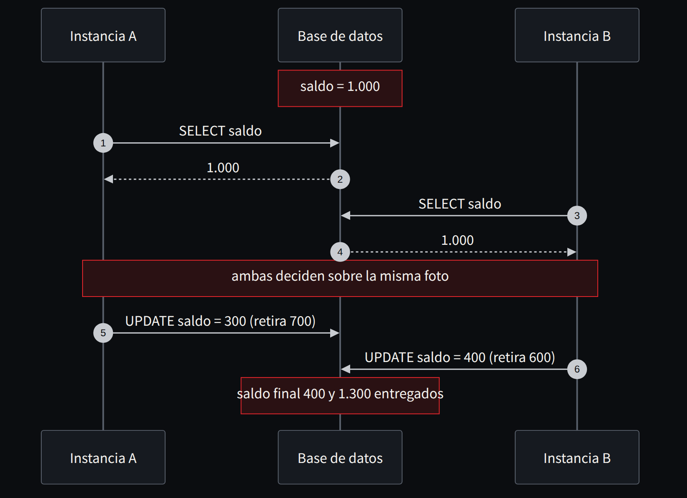

*Figura 3.1 · La traducción literal bajo concurrencia: dos instancias deciden sobre la misma foto y se entregan 1.300 de una cuenta con 1.000.*

La corrección no consiste en poner un `lock` en el controlador: protegería un proceso y el servicio tendrá varios. Consiste en llevar la regla al lugar donde se confirma. Este es el fragmento real del laboratorio, que se ejecuta contra una base SQLite desde procesos independientes:

**Listado 3.3 · Débito condicionado dentro de la transacción (Bank/Program.cs)** — *Ejecutado*

```csharp
db.Exec("BEGIN IMMEDIATE"); begun = true;
// ... comprobación de idempotencia por identidad de operación ...
db.Exec($"UPDATE accounts SET balance=balance-{amount} WHERE id={src} AND balance>={amount}");
var approved = db.Changes == 1;   // 1 fila: aprobado; 0: fondos insuficientes
if (approved) {
    db.Exec($"UPDATE accounts SET balance=balance+{amount} WHERE id={dst}");
}
// ... operación, dos asientos y fila outbox en la MISMA transacción ...
db.Exec("COMMIT");
```

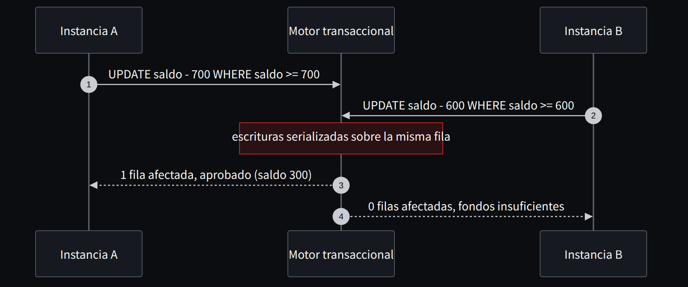

*Figura 3.2 · La regla vive donde se confirma: el motor serializa las escrituras sobre la fila y solo una retirada pasa la condición.*

El código resultante se parece menos al COBOL original. El comportamiento se parece más al que necesitamos. Esa es, en pequeño, la tesis de este libro. El capítulo [28](#capítulo-28--transferencias-bloqueos-y-fallos-en-local) muestra qué ocurre cuando dos procesos compiten de verdad por ese saldo.

> **La modernización 1:1 puede ser un puente, pero nunca deberíamos confundir el puente con la ciudad a la que queremos llegar.**

### Capítulo 4 · Lo que comparto con otros autores y dónde discrepo

> [!IMPORTANT]
> **Tesis del capítulo.** La advertencia sobre el conocimiento perdido es valiosa. Convertirla en una imposibilidad general no lo es: un generador probabilístico puede alimentar una verificación determinista.

#### Una advertencia útil

Después de leer a varios autores, encuentro ideas que comparto. Proponen proteger el conocimiento de negocio, refactorizar de manera gradual y utilizar la IA para comprender código que resulta difícil de mantener. También cuestionan las promesas de sustitución automática y subrayan el valor de los especialistas que conocen estos sistemas. Comparto la necesidad de examinar esas promesas y de evitar que una transformación destruya conocimiento que todavía necesitamos.

Los mejores de esos textos tienen además una cualidad que quiero conservar: plantean una tesis, la conectan con historias y conducen al lector hacia una decisión. Un libro técnico puede tener voz. Puede discutir. Puede explicar por qué al autor le preocupa una determinada forma de trabajar. No necesita convertirse en una sucesión de diapositivas.

Mi desacuerdo aparece cuando una advertencia razonable se convierte en una imposibilidad general. Que una traducción automática sin control sea peligrosa no demuestra que cualquier construcción asistida por IA sea inviable. Que un monolito dependa de estado no lo hace incompatible con cualquier servicio cloud. Que muchos sistemas estén poco documentados no significa que carezcan de estructura analizable.

Conviene separar los problemas para poder resolverlos. El lenguaje, el runtime, la arquitectura, los datos y la operación introducen restricciones distintas. Si los tratamos como una única incompatibilidad, perdemos capacidad de elección.

#### La nube no obliga a elegir una única arquitectura

La documentación de arquitectura de Microsoft describe alternativas para ejecutar aplicaciones COBOL mediante compiladores y entornos compatibles en máquinas virtuales o contenedores de Azure [5]. Esa documentación no acredita por sí sola una migración concreta ni sus ahorros. Sí basta para cuestionar la afirmación general de que COBOL y cloud son incompatibles.

Trasladar una carga puede conservar acoplamientos y restricciones. También puede resolver un problema de infraestructura sin reescribir toda la aplicación. La decisión debe responder a un objetivo explícito. Si queremos reducir el tiempo necesario para cambiar una regla de negocio, mover el mismo ejecutable a otra máquina quizá no sea suficiente. Si queremos retirar un entorno específico, puede ser una pieza relevante.

Tampoco un destino Java o C# obliga a distribuir todas las transacciones, eliminar el batch o sustituir cada función por un microservicio. Esas son decisiones arquitectónicas. Mezclarlas con el cambio de lenguaje añade variables a una transformación que ya es difícil de comprobar.

#### Un generador probabilístico puede alimentar una verificación determinista

Un modelo puede producir código incorrecto. Un humano también. La cuestión de ingeniería es qué mecanismos detectan el error antes de aceptar el resultado y cuáles son sus límites.

La naturaleza probabilística del generador no determina por sí sola la naturaleza de la implementación generada. Un programa compilado puede ejecutar una regla determinista. A su vez, una prueba determinista puede estar mal especificada. Por eso mi propuesta no termina en ejecutar tests: exige examinar quién definió el resultado esperado, de dónde procede y qué errores puede detectar el evaluador.

Aquí amplío la tesis de la IA como motor de comprensión. La comprensión asistida es valiosa, pero también puede equivocarse. Una explicación incorrecta de una regla puede contaminar las especificaciones y todas las pruebas posteriores. La frontera útil no está entre permitir a la IA explicar y prohibirle construir. Está entre proponer y aceptar con evidencia adecuada.

#### Mi posición, en una tabla

Para que el desacuerdo sea útil tiene que ser concreto. Esta es la comparación, punto por punto.

| Cuestión | Lo que suele defenderse | Mi posición |
|---|---|---|
| IA para comprender COBOL | Muy favorable | Coincido, con evidencia vinculada a cada afirmación |
| IA para generar Java o C# | Muy crítica | Viable con restricciones, contrato y validación independiente |
| Mantener COBOL | Opción preferente | Depende del objetivo, la carga y el coste de verificar |
| Refactorización incremental | Recomendable | Coincido |
| Equivalencia funcional | Riesgo principal | Debe convertirse en un criterio de aceptación verificable |
| Modelos privados | Recomendados | Importa el control de los datos, no necesariamente entrenar un modelo propio |

> **La frontera útil no está entre dejar a la IA explicar y prohibirle construir. Está entre proponer y aceptar con evidencia.**

### Capítulo 5 · Modernizar exige elegir qué problema resolvemos

> [!IMPORTANT]
> **Tesis del capítulo.** «Pasarlo a .NET» describe un destino tecnológico, no un resultado. Cada objetivo exige evidencias distintas, y cada alternativa debe explicar su coste de verificación y su forma de volver atrás.

#### El destino no sustituye al diagnóstico

«Pasarlo a .NET» describe una tecnología de destino. Todavía no describe el resultado que necesita la organización. Podemos terminar con el mismo proceso difícil de cambiar, ahora escrito en C#. También podemos conservar COBOL y mejorar de manera importante la operación, las pruebas o la exposición de capacidades.

Antes de seleccionar una ruta, fijaría el resultado buscado. Puede ser retirar una dependencia, recuperar capacidad de mantenimiento, reducir una ventana batch o permitir una nueva integración. Cada objetivo requiere evidencias distintas. Un tiempo de compilación menor no demuestra una mejor continuidad de servicio; una API nueva no demuestra que el proceso interno sea más fácil de evolucionar.

Existen decisiones que pueden combinarse. Conservar y documentar puede ser la acción correcta para un componente estable. Encapsular permite ofrecer una interfaz controlada. Refactorizar mejora la estructura manteniendo el comportamiento. Reemplazar una capacidad puede tener sentido cuando el beneficio supera el coste y podemos verificar la transición. Un producto estándar puede resolver otra parte, siempre que aceptemos y evaluemos sus diferencias.

No establecería una preferencia universal antes de estudiar el sistema. Sí exigiría que cada alternativa explicase su coste de verificación, sus dependencias y su forma de retorno. Una opción aparentemente barata puede desplazar el gasto hacia la reconciliación de datos o hacia años de convivencia.

#### La unidad de corte debe poder sostenerse sola

En el laboratorio elegiremos un cálculo y una decisión sin persistencia. Es una unidad deliberadamente pequeña. Permite observar entradas y salidas sin introducir bloqueos de base de datos, mensajes pendientes o recuperaciones a mitad de un proceso.

En un sistema real, esa comodidad no viene dada. Una función que parece autónoma puede leer un fichero preparado por un job anterior o depender de una variable compartida. Un programa llamado desde varias transacciones puede interpretar de forma distinta el mismo registro. La primera tarea consiste en descubrir esas dependencias, no en ignorarlas para que encajen en el diagrama.

Una frontera útil describe entradas, salidas, estado previo, efectos laterales y condiciones de fallo. También identifica quién puede escribir y cuándo. Si durante la convivencia dos sistemas modifican los mismos datos sin una estrategia de consistencia, la dificultad puede superar el beneficio de haber dividido el código.

Mi criterio sería empezar donde la evidencia sea recuperable y el impacto esté contenido. Eso no significa elegir únicamente casos triviales. Significa elegir un caso que permita aprender sobre el sistema y que pueda detenerse sin convertir cada incertidumbre en una urgencia de producción.

#### El éxito necesita una medida de negocio

El proyecto debe medir algo más que código producido. Importan los defectos que escapan, el tiempo de revisión, el esfuerzo de aclarar reglas, el coste de operación y la capacidad de recuperar el servicio. La IA puede reducir una parte y aumentar otra.

La comparación justa incluye el coste de construir y mantener los oráculos. Es un trabajo real. Si lo ocultamos, convertimos TODM en una promesa comercial difícil de sostener. Mi interés está en averiguar cuándo ese coste se compensa con una reducción de incertidumbre y de errores aceptados.

> **Una opción aparentemente barata puede desplazar el gasto a años de reconciliación.**

## Parte II · Arqueología, conocimiento y autoridad

Cómo recuperar lo que el sistema sabe sin confundir una hipótesis bien redactada con un hecho, y cómo dar a los agentes capacidad de actuar sin regalarles autoridad.

### Capítulo 6 · REA y la arqueología que deja rastro

> [!IMPORTANT]
> **Tesis del capítulo.** Las herramientas investigan, los agentes proponen y la evidencia sostiene las afirmaciones. REA aporta una disciplina —procedencia, cobertura y desconocidos explícitos— más valiosa para COBOL que cualquier promesa de traducción.

La pérdida de documentación y la acumulación de reglas son problemas reales. Pero conviene añadir una precisión de ingeniería: el código fuente no es la única evidencia. Hay copybooks compartidos, definiciones de datasets, control de versiones, despliegues históricos, JCL, configuraciones CICS, DDL, catálogos, estadísticas de carga, incidencias, tickets y, sobre todo, comportamientos que el sistema todavía ejecuta. Algunas reglas están en una tabla de parametrización. Otras viven en una rutina no llamada desde hace años. Algunas son errores históricos de los que dependen sistemas consumidores.

Por eso no empezaría pidiendo «conviérteme estos dos millones de líneas». Empezaría por un **mapa de evidencias**. Cada artefacto recibe identidad, versión, hash, origen, propietario y restricciones. Un parser específico construye dependencias entre programas y copybooks; analizadores de JCL reconstruyen cadenas batch; un extractor de SQL localiza tablas y transacciones; un sistema de observación captura entradas, salidas y efectos de ejecución. Los agentes correlacionan esa información, pero no la convierten automáticamente en verdad.

#### Qué aporta Reverse Engineer Anything

REA conecta agentes con herramientas de investigación de software mediante MCP y una interfaz de línea de comandos. Su documentación describe análisis de binarios nativos, ensamblados .NET, aplicaciones JavaScript y otros objetivos, con evidencia y limitaciones asociadas a los resultados. El análisis nativo profundo depende de proveedores como Ghidra, Hopper o IDA [3].

Lo sitúo en la fase de descubrimiento. Un agente puede recorrer hallazgos, formular preguntas y relacionar resultados de distintas herramientas. Eso ayuda a investigar. No convierte automáticamente una reconstrucción en una implementación equivalente, ni acredita soporte especializado para todo dialecto COBOL, copybook, JCL o entorno transaccional.

La documentación consultada no me permite presentar REA como traductor nativo COBOL a .NET. Para un sistema COBOL con fuentes, empezaría por herramientas que entiendan esas fuentes y su dialecto. Para un binario sin fuentes, el recorrido cambia y exige capacidades de análisis distintas.

Esta diferencia importa porque «ingeniería inversa» agrupa problemas muy diferentes. Recuperar relaciones entre variables de un fuente no equivale a reconstruirlas desde instrucciones de máquina. Un ensamblado con metadatos tampoco plantea el mismo problema que un ejecutable nativo. La herramienta debe elegirse según el artefacto disponible.

#### Lo que aprendí con el caso VB6

Antes de escribir este libro me tocó mirar REA de cerca por un motivo muy práctico: aplicaciones VB6 sin fuentes que siguen en producción [35]. Me descargué el repositorio, leí el código y contrasté los casos que se citaban como prueba. Tres lecciones de aquel trabajo se trasladan casi literalmente a COBOL.

La primera es que lo interesante no es la lista de formatos, sino **el contrato de salida**. Cada resultado va atado a una evidencia: ruta, tamaño y SHA-256 del artefacto, el proveedor que lo produjo, la cobertura y, sobre todo, lo que no sabe. Los estados `unknown`, `partial`, `unsupported` o `truncated` nunca se agregan como un éxito. Es una herramienta diseñada para que el modelo no rellene huecos con imaginación.

La segunda es su registro de obligaciones de reconstrucción. Una afirmación del tipo «esta parte está reconstruida» solo se cierra si tiene un responsable, casos de prueba, un verificador que pasa y una autoridad del verificador comparable a la de la observación original. Si falta cualquiera de las cuatro, la obligación queda abierta. Es exactamente la disciplina que necesita una regla de negocio recuperada de un programa COBOL.

La tercera es que el conocimiento difícil suele estar ya en herramientas especializadas. En VB6, el formato del proyecto y el P-Code los resuelven herramientas con veinte años de historia; el agente aporta conducirlas, cruzar resultados y verificar. En COBOL ocurre lo mismo con los parsers de dialecto, los analizadores de JCL y los catálogos de Db2. **Lo que faltaba no era otro parser: era un agente capaz de usar los existentes con disciplina de evidencia.**

Pero COBOL no es VB6. En un mainframe solemos tener fuentes, copybooks y metadatos; el problema rara vez es decompilar y casi siempre es reconstruir la semántica de un sistema repartido entre programas, datos y operación. Por eso no traslado la cadena *VBDec + REA + Ghidra* tal cual. Traslado su principio.

#### Tres aproximaciones complementarias

ProLeap ofrece un parser COBOL basado en ANTLR que construye un árbol sintáctico y un grafo semántico. Su documentación indica que extrae bloques EXEC SQL, SQLIMS y CICS como texto [4]. Es una base posible para análisis estructural; no lo tomaría como garantía de ejecución o equivalencia de todas esas extensiones.

IBM documenta un recorrido de validación COBOL–Java basado en grabaciones de entrada y salida, mapeo de recursos y generación y ejecución de pruebas JUnit [6]. Es una referencia relevante para el patrón de captura y comparación, aunque el destino documentado sea Java y su integración no sea la del laboratorio .NET de este libro.

AWS Transform documenta análisis de código, extracción de lógica y generación de requisitos para modernización de mainframe, incluyendo resultados de extracción y problemas por archivo [7]. Esto muestra otra aproximación centrada en recuperar estructura y significado. La documentación de un proveedor describe capacidades; una evaluación en nuestro entorno debe comprobar su cobertura real.

Estas aproximaciones no compiten necesariamente en una misma capa. REA puede ayudar a investigar un binario, un parser a analizar fuentes y una plataforma de modernización a organizar un recorrido específico. TODM propone cómo gobernar la aceptación del resultado de ese trabajo. La integración concreta sigue siendo una decisión de ingeniería.

#### Un adaptador de evidencia COBOL

Propongo un componente que denomino COBOL Evidence Adapter. No es una capacidad que atribuya a REA ni una integración ya implementada en este laboratorio. Es una frontera de arquitectura: recibe artefactos y observaciones del entorno COBOL y los presenta mediante un contrato común.

Cada hallazgo debería identificar el artefacto, su hash, el localizador de origen, la herramienta y su versión, el método de obtención y los límites conocidos. Una relación deducida por el agente se registraría como hipótesis. Una ejecución observada conservaría entrada, estado relevante, salida y condiciones. Una regla aprobada tendría una autoridad y una versión distintas.

Imaginemos una regla de comisión hallada en un párrafo COBOL. El parser localiza la expresión. Una ejecución confirma un resultado en el límite de redondeo. El responsable de negocio confirma que esa es la política que debe mantenerse. Son tres piezas relacionadas, pero ninguna sustituye a las demás.

El grafo de conocimiento puede facilitar la navegación entre ellas. Su valor no está en usar una base de datos de grafos por principio, sino en permitir reconstruir el camino desde una conclusión hasta la evidencia que la sostiene. Una tabla bien diseñada puede ser suficiente al empezar.

Todo hallazgo debería registrar: «afirmación», «fuente», «líneas o transacción», «herramienta», «hash», «grado de certeza», «observación dinámica» y «pregunta pendiente». Si una regla de bonificación se infiere de tres ejemplos, debe quedar marcada como hipótesis. No será una baseline aprobada hasta que exista una autoridad de negocio o evidencia suficiente para asumirla. La disciplina de decir «no sabemos» es una capacidad arquitectónica.

Así se vería un hallazgo del laboratorio expresado con ese contrato. El hash es el real del fuente del laboratorio; el formato es una propuesta.

**Listado 6.1 · Un EvidenceItem: la afirmación, su procedencia y lo que todavía no sabemos** — *Ilustrativo*

```json
{
  "id": "EV-0142",
  "claim": "Cliente activo: la comisión se redondea al céntimo; el empate se aleja de cero",
  "status": "observed",
  "artifact": {
    "path": "legacy/fee.cob",
    "sha256": "136cc8c21ae514634f93b7139fb9e185b115e6b817c20890ad0e1f9265971cbf",
    "locator": "COMPUTE fee-cents ROUNDED"
  },
  "tool": { "name": "cobc", "version": "GnuCOBOL 3.1.2.0",
            "method": "ejecución con entrada fijada" },
  "observation": { "input": "0000002500200Y", "output": "APPROVE|00000001" },
  "coverage": "un empate exacto; sin negativos ni otras opciones de compilación",
  "unknowns": ["comportamiento en Enterprise COBOL con las opciones de producción"],
  "approval": null,
  "verifiedBy": []
}
```

Fíjate en los dos últimos campos. `approval` está vacío porque observar un comportamiento no lo convierte en política aprobada. `verifiedBy` está vacío porque todavía ningún candidato ha demostrado reproducirlo. Son tres piezas relacionadas, y ninguna sustituye a las otras.

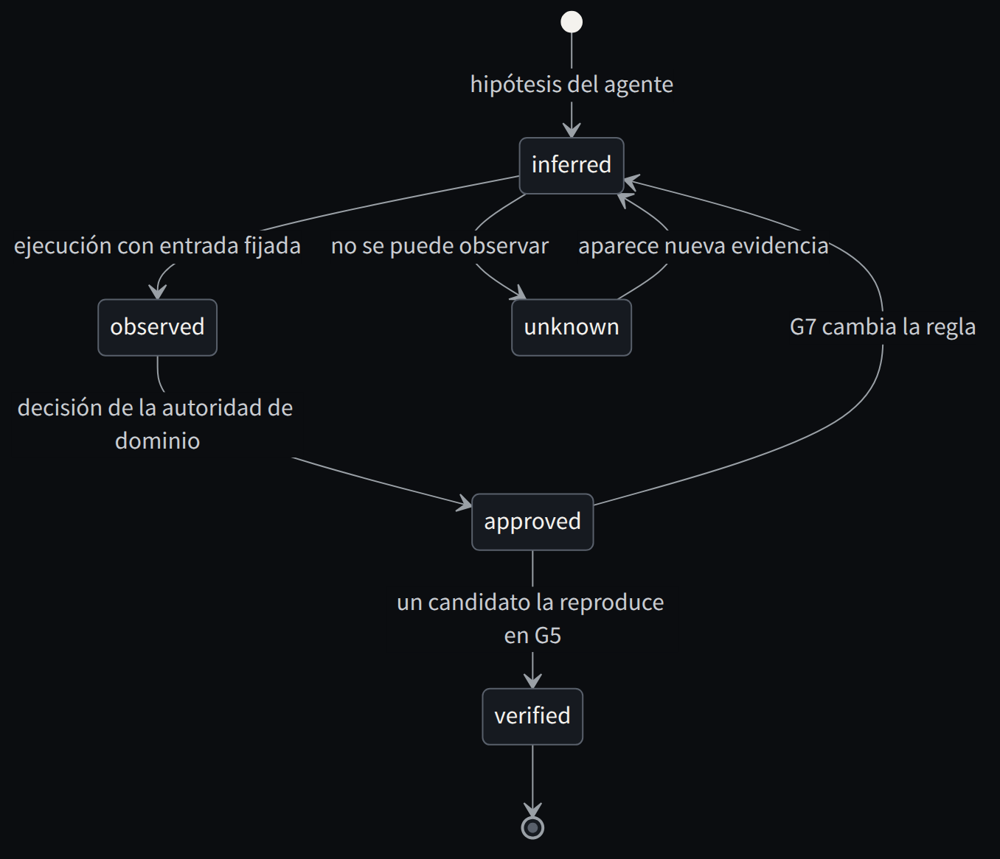

*Figura 6.1 · Ciclo de vida de un EvidenceItem: observar no es aprobar, y aprobar no es verificar.*

> **Una demo demuestra una posibilidad. La evidencia demuestra una propiedad.**

### Capítulo 7 · Legacy Archaeology asistida por agentes

> [!IMPORTANT]
> **Tesis del capítulo.** Una migración con IA empieza mejor con preguntas que con prompts de generación. Los agentes especializados reciben entradas tipadas, producen artefactos comprobables y operan con permisos limitados.

Una migración con IA empieza mejor con preguntas que con prompts de generación. ¿Qué programas modifican esta cuenta? ¿Dónde se decide el interés? ¿Cuántos dialectos, versiones y copybooks hay? ¿Qué ocurre cuando falla la escritura final? ¿Qué cambios llegan por jobs nocturnos? ¿Quién mantiene las tablas de códigos? Responder exige combinar análisis sintáctico, metadatos y observación dinámica.

Propongo una cadena de agentes especializados, bajo un controlador común: **inventario y procedencia**, **parser y grafo de dependencias**, **descubrimiento de reglas**, **observador de ejecución**, **redactor de especificaciones**, **diseñador de arquitectura**, **constructor**, **verificador** y **auditor de drift**. No son nueve chatbots opinando sobre el mismo fichero. Cada uno recibe entradas tipadas, produce artefactos comprobables y opera con permisos limitados.

El analizador de COBOL genera un AST del dialecto real, resuelve copybooks y localiza referencias a datos, CALL, SQL embebido y estructuras de control. No le pediría a un LLM que reemplace al parser. El agente toma el resultado y produce hipótesis sobre intenciones: por ejemplo, «una retirada sobre cuentas bloqueadas retorna un código específico sin modificar estado». Esa hipótesis debe ir acompañada de rutas, posiciones, ejemplos observados y limitaciones. Si la ejecución de producción no puede observarse, documentamos el riesgo y diseñamos pruebas en una copia autorizada.

REA representa una referencia metodológica útil en la parte de investigación con herramientas y evidencia [35, 3]. Para mainframe, su soporte concreto debe evaluarse antes de afirmarlo; no confundiría «inspirado por REA» con «REA analiza nativamente CICS». La arquitectura de integración podría utilizar un contrato neutral como `EvidenceItem`, con hashes, procedencia, cobertura y estado `observed / inferred / unknown`. Eso permite intercambiar hallazgos entre analizadores y agentes sin perder su origen.

#### Del arqueólogo al agente

La IA reduce el coste de seguir llamadas, agrupar variables, redactar hipótesis y sugerir escenarios de prueba. Puede generar un grafo de conocimiento y proponer límites de dominios. Pero no debe tener permiso para borrar incertidumbres ni para aprobar sus propias hipótesis. La responsabilidad de un agente investigador acaba donde comienza la autoridad de la especificación. Separar ambos ámbitos será decisivo cuando el sistema procese dinero real.

#### Una cadena con permisos, no un coro de chatbots

Cada eslabón de la cadena tiene una entrada, un artefacto de salida y algo que expresamente no puede hacer. La última columna es la que separa un sistema de agentes gobernable de una conversación entusiasta.

| Agente | Recibe | Produce | No puede |
|---|---|---|---|
| Inventario y procedencia | Repositorios, datasets, catálogos | Inventario con hashes y propietarios | Modificar fuentes |
| Parser y grafo | Fuentes con copybooks resueltos | AST, grafo de CALL, COPY y SQL | Inferir intención de negocio |
| Descubrimiento de reglas | Grafo y ejecuciones observadas | Hipótesis con localizadores | Aprobar reglas |
| Observador de ejecución | Entorno autorizado | Entrada, estado, salida y efectos | Ejecutar fuera del mandato |
| Redactor de especificaciones | Hipótesis aprobadas | Especificación, DMN, escenarios | Cambiar la baseline |
| Diseñador de arquitectura | Especificación y restricciones | ADR y opciones comparables | Elegir sin evidencia de capacidad |
| Constructor | Contrato público | Candidato y pruebas propias | Tocar oráculos protegidos |
| Verificador | Candidato fijado y baseline | PASS, FAIL o INCONCLUSIVE | Autorizar la entrega |
| Auditor de deriva | Producción y baseline vigente | Alertas de revisión | Reescribir criterios |

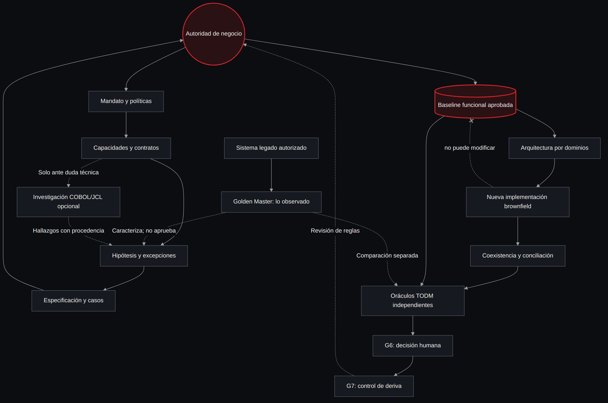

*Figura 7.1 · La cadena de agentes: cada eslabón produce un artefacto y ninguno escribe la baseline.*

#### La especificación viva

El resultado de esta arqueología no es un PDF congelado. Es un conjunto versionado de archivos de intención, especificación, arquitectura, reglas, decisiones y pruebas: `intent.md`, `spec.md`, `plan.md`, ADR, escenarios Gherkin, tablas DMN y manifests de evidencia. Cada regla debe poder contestar «¿de dónde salió?» y «¿qué test la verifica?». Cada transformación debe poder contestar «¿qué regla aprobada intenta satisfacer?».

No todo el código heredado merece convertirse. El análisis debe identificar rutas muertas, duplicaciones, funciones caducadas y comportamientos que el negocio quiere retirar. Pero la decisión de eliminarlos es una decisión funcional con impacto, no un efecto lateral de una refactorización generada.

> **La responsabilidad de un agente investigador acaba donde comienza la autoridad de la especificación.**

### Capítulo complementario · Descomponer el mainframe con evidencia

> **Borrador para revisión editorial.** No forma parte de la edición publicada v2026.10.29. Investigación vinculada al issue #32.

#### La frontera no está en el programa

La modernización de un núcleo bancario no empieza distribuyendo párrafos COBOL entre contenedores. Debemos reconstruir la **unidad de responsabilidad empresarial**, su autoridad sobre los datos, sus dependencias temporales y el contrato transaccional realmente exigido. Un `CALL` identifica una relación técnica, no necesariamente un bounded context. Una tabla compartida no demuestra por sí sola que debamos conservarla: puede ocultar una lectura histórica, una función contable o un control de autorización.

#### Método de descubrimiento

**Event Storming** facilita reconstruir qué ocurrió, quién tomó decisiones y qué excepciones importan, desde una retirada en cajero hasta una reversión al cierre del día. No equivale a **Event Sourcing**: descubrir eventos no obliga a almacenar cada cambio de estado mediante un registro de eventos.

El **DDD estratégico** identifica subdominios y contextos delimitados. Su hipótesis debe confrontarse con evidencia estática (COBOL, CICS LINK/XCTL, copybooks, SQL, JCL, Db2, VSAM y MQ), trazas de ejecución autorizadas y prácticas operativas (cierre contable, proceso nocturno, conciliación y picos). No conocemos una dependencia sólo porque un analizador no la observe.

#### El ejemplo de una transferencia

Imaginemos una operación cuyo identificador gobierna dos apuntes compensados, un registro de operación y un mensaje de outbox en una única transacción duradera. Si extraemos la escritura de la cuenta a un servicio y mantenemos el segundo apunte en el mainframe sin un nuevo contrato verificable, hemos cambiado la semántica del negocio. Un actor virtual o una saga no reproduce automáticamente el mismo COMMIT.

En cambio, una proyección de movimientos puede ser una primera candidata si dispone de límites explícitos: idempotencia, marca de actualización, reconstrucción, tolerancia al retraso, seguridad y lectura alternativa consistente. El dato de un extracto eventualmente consistente nunca debe confundirse con el saldo autorizado para dispensar efectivo.

#### El gate que puede decir que no

En el laboratorio sintético `lab/decomposition/`, el analizador conserva la procedencia de cada dependencia: fuente estática, traza de ejecución o afirmación del experto. Si dos fuentes discrepan sobre el carácter atómico de una relación, no se elige la versión conveniente: el corte se rechaza. Los miembros de una misma transacción se tratan como un grupo indivisible, aunque no estén unidos por una sola arista del grafo. También se rechazan cortes que cruzan dependencias desconocidas o inferidas.

El resultado `CANDIDATE_ONLY` **no autoriza una migración**. Sólo indica que esa propuesta no contradice las restricciones conocidas en el pequeño modelo sintético. Para convertirlo en decisión real faltan observaciones representativas, responsables del dominio, pruebas negativas y recuperación, rendimiento, costes con fecha y planes de reversión.

#### Cinco decisiones posibles

Conservar el núcleo es una decisión legítima si todavía concentra invariantes que no sabemos reproducir. Encapsular mediante API y Anti-Corruption Layer permite mover la frontera sin mover la autoridad. Extraer consultas facilita medir la consistencia. Extraer comandos exige demostrar ownership, atomicidad o una nueva semántica de compensación expresamente autorizada. Retirar un activo requiere probar que nadie lo ejecuta, incluidos jobs estacionales, terminales remotos y recuperación operativa.

**La regla central:** primero demostrar la frontera de responsabilidad; después escoger la topología. La propuesta se invalida cuando una evidencia nueva contradice la hipótesis, no cuando el diagrama ya está dibujado.

#### Contrato de evidencia

Este capítulo es una explicación de método apoyada por un **modelo sintético**, no por trazas de un banco, mediciones IBM Z ni aceptación productiva. Las pruebas del laboratorio sólo examinan decisiones estructurales. Véase [investigación detallada](../docs/research/mainframe-decomposition.es.md) y [laboratorio](../lab/decomposition/README.md).

### Capítulo 8 · El conocimiento del agente y el expediente del sistema

> [!IMPORTANT]
> **Tesis del capítulo.** La memoria de un agente le ayuda a trabajar. El expediente del sistema permite aceptar. El conocimiento importante debe sobrevivir al modelo que lo resumió y a la sesión que lo descubrió.

#### Recordar no es acreditar

Un agente puede conservar una nota que diga que una determinada comisión se redondea de cierta manera. Esa nota le ayuda a continuar trabajando. Sin embargo, alguien que deba aceptar la migración necesita más: la regla exacta, su procedencia, la aprobación vigente y las ejecuciones que la comprobaron.

En «De Leviatán al Autopilot» planteo una separación entre memoria del agente y registro institucional [1]. Aplicada a modernización, significa que el conocimiento importante debe sobrevivir al modelo que lo resumió y a la sesión que lo descubrió. La desaparición de un agente no debería borrar el motivo por el que aceptamos un cambio.

El expediente de una transformación reúne hechos, decisiones y resultados. Puede comenzar con archivos versionados. No exige una plataforma sofisticada desde el primer día. Sí necesita relaciones claras: esta versión de la regla se aprobó para este alcance; este candidato se verificó contra ella; estos resultados pertenecen a esta ejecución.

Un hash ayuda a comprobar identidad de contenido. No demuestra que ese contenido sea correcto ni que quien lo aprobó tuviera autoridad. Si un mismo actor puede sustituir el fichero y el hash esperado, ambos pueden seguir siendo consistentes después de una modificación indebida. La protección exige un anclaje fuera de su control.

Hay una idea que ya defendí al auditar agentes de Copilot en VS Code: git es la única versión que importa, y auditar no es lo mismo que prevenir [40]. Aplicada a la modernización, significa que la regla que aceptamos, el prompt que la produjo y el candidato que la cumple deben poder reconstruirse desde un repositorio versionado, no desde el recuerdo de una sesión. Y que una traza perfecta de lo que hizo un agente nos permite explicar un error, pero no evitarlo: para eso hacen falta permisos que se apliquen donde ocurre la acción.

En «Agent Host Protocol (AHP)» llegaba a una conclusión hermana: el dueño del estado de la sesión es el host, no el editor; los clientes son vistas [44]. El expediente de una modernización aplica esa idea un nivel más arriba. El estado que importa —la regla aprobada, la evidencia, la decisión— no vive en la herramienta con la que trabajamos, sino en un registro que todas consultan y ninguna posee.

#### Las hipótesis deben poder perder

Un agente de comprensión propone una interpretación. Si toda la información posterior se organiza para confirmarla, tendremos una historia coherente y quizá falsa. El expediente debe conservar preguntas que podrían refutarla.

Para una comisión, buscaría valores que distingan truncamiento, redondeo al par y redondeo alejándose de cero. Para una regla de autorización, probaría el umbral exacto y el valor inmediatamente superior. Para una transición, examinaría el estado anterior y la ausencia de eventos que deberían ser obligatorios.

Estas pruebas discriminantes son más informativas que repetir cien veces un caso en el que todas las interpretaciones producen el mismo resultado. Su diseño exige entender el riesgo semántico. La cantidad de ejemplos ayuda después; antes necesitamos saber qué desacuerdo podrían revelar.

También debemos conservar la posibilidad de que falte evidencia. Un timeout puede significar que el programa falló, que la infraestructura no respondió o que nuestro adaptador no recogió el resultado. Convertir cualquier ausencia en un dato vacío y continuar destruye esa distinción.

#### Cambiar de modelo sin perder el trabajo

La continuidad se vuelve más sencilla cuando los contratos no dependen de la conversación privada de un agente. Podemos sustituir el modelo encargado de construir un candidato y mantener el mismo conjunto de reglas aprobado. Podemos mejorar una herramienta de análisis y comparar sus hallazgos con los anteriores.

La identidad del modelo y su configuración siguen siendo relevantes para reproducir el proceso. Pero no deberían convertirse en la fuente de legitimidad del resultado. El criterio de aceptación pertenece al proyecto y a sus responsables.

Ese diseño también facilita la revisión humana. El experto no necesita leer cada token generado. Necesita comprender las decisiones que cambian el comportamiento y la evidencia que pretende justificarlas. Su tiempo se emplea mejor cuando el sistema le presenta discrepancias concretas y preguntas bien delimitadas.

> **Recordar no es acreditar. Un hash demuestra identidad, no corrección.**

### Capítulo 9 · De la autoridad del agente a la autoridad de la regla

> [!IMPORTANT]
> **Tesis del capítulo.** Orquestar decide qué se ejecuta; gobernar decide quién puede aceptar una consecuencia. Una implementación puede ser correcta y no estar autorizada, y viceversa.

#### Orquestar y gobernar responden a preguntas distintas

Un orquestador decide qué tarea se ejecuta a continuación, a quién se asigna y cómo se recupera un fallo. La gobernanza establece quién puede conceder permisos, qué alcance tienen y quién puede aceptar una consecuencia. Ambas funciones pueden colaborar, pero conviene distinguirlas.

En el artículo del Leviatán utilicé instituciones políticas como herramienta de razonamiento arquitectónico [1]. No atribuyo ciudadanía ni legitimidad moral a un proceso de software. Me interesa una cuestión práctica: qué límites permanecen cuando cambia el actor que ejerce una capacidad.

Un supervisor que escribe requisitos, modifica código, redefine pruebas y autoriza la entrega concentra todas las decisiones. Repartir esos pasos entre cuatro agentes no resuelve necesariamente el problema. Si comparten permisos y pueden corregir los criterios para acomodarlos al resultado, la separación existe solo en el diagrama.

La independencia que necesitamos tiene varias dimensiones. La fuente del resultado esperado debe poder cuestionar la implementación. El evaluador debe ejecutarse en condiciones conocidas. Los permisos deben impedir que el constructor cambie unilateralmente la referencia. La autorización debe corresponder al artefacto que se verificó.

#### Un mandato concreto

«Eres el agente responsable de modernización» no define una autorización operativa suficiente. Un mandato útil podría permitir modificar una carpeta de candidatos, ejecutar un conjunto de herramientas en un entorno aislado y consumir un presupuesto determinado durante un intervalo. Podría prohibir modificar los contratos aprobados y publicar resultados como entregas de producción.

La restricción tiene que aplicarse donde se ejecuta la acción. Un mensaje que pide respetar el mandato ayuda a orientar al agente; no sustituye el control de escritura o la comprobación previa a una llamada crítica.

Cuando un agente delega, la nueva tarea debe quedar dentro de la autoridad que recibió. Si un constructor carece de capacidad para modificar la baseline, su subagente tampoco debería obtenerla por el simple hecho de llamarse revisor. El nombre de un rol no concede permisos.

La revocación también necesita una ruta efectiva. Un mandato caducado no debería seguir funcionando porque alguien conserva una credencial. En producción, esta exigencia afecta al proveedor de identidad, a los puntos de ejecución y a la comprobación inmediatamente anterior a una operación sensible.

Un mandato útil se puede escribir. Este ejemplo describe lo que el agente constructor puede hacer en el laboratorio. No es un control por sí mismo: es la descripción que el punto de ejecución —el sistema de ficheros, el repositorio, el runner, el proveedor de identidad— tiene que aplicar.

**Listado 9.1 · Un mandato acotado para el agente constructor** — *Ilustrativo*

```yaml
mandate:
  id: MND-2026-114
  scope: capability/fee-calculation
  grantedTo: agent/builder
  grantedBy: owner/payments-domain      # en producción, una identidad humana verificable
  validFrom: 2026-10-29T08:00:00Z
  validUntil: 2026-11-05T20:00:00Z
  allow:
    write: ["Candidate/**"]
    execute: ["dotnet build", "dotnet test", "python3 run.py"]
    budget: { tokens: 2000000, wallClockHours: 6 }
  deny:
    write: ["contracts/**", "Gate/**", "ci/**"]
    actions: ["publish", "approve-baseline", "delegate-beyond-scope"]
  revocation: "revocada en el proveedor de identidad; se comprueba antes de cada acción"
```

La línea más importante es `deny.write`. Si el constructor puede escribir en `contracts/` o en `Gate/`, el resto del mandato es literatura.

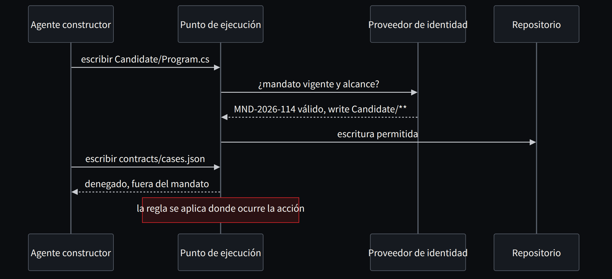

*Figura 9.1 · El mandato se aplica en el punto de ejecución, no en el prompt.*

#### Correcto no equivale a autorizado

Una implementación puede superar las pruebas y aun así no estar autorizada para publicarse. Quizá cambió el alcance, expiró la aprobación o se pretende desplegar un binario distinto. A la inversa, un equipo puede estar autorizado para trabajar y producir un resultado que incumple el contrato.

El laboratorio conserva esta separación. Incluye un caso en el que el veredicto de comportamiento es PASS y la entrega queda bloqueada por ausencia de mandato. La autorización es sintética; no hay una identidad empresarial detrás. El ejemplo enseña la lógica de la decisión, no una integración real de permisos.

Mantener las dos dimensiones visibles evita que el color verde de una prueba se convierta en una autorización implícita para cualquier acción posterior.

> **El nombre de un rol no concede permisos.**

## Parte III · Oráculos: el derecho a aceptar

Un candidato no se acepta porque compile, ni porque lo haya escrito un modelo excelente, ni porque sus propios tests estén en verde. Se acepta porque una evidencia independiente lo contrasta con un comportamiento aprobado.

### Capítulo 10 · TODM y el problema de aceptar lo que construimos

> [!IMPORTANT]
> **Tesis del capítulo.** TODM separa quién está autorizado a actuar de si el software resultante satisface un comportamiento aprobado de forma independiente. Los agentes pueden proponer y construir; no pueden aprobar ni cambiar el oráculo que los juzga.

#### Una metodología centrada en el resultado esperado

TODM significa Test Oracle-Driven Methodology. Su propuesta consiste en gobernar la aceptación mediante oráculos independientes, una baseline aprobada y evidencias vinculadas al candidato [2]. La IA puede ayudar a descubrir reglas, proponer contratos y construir código. La aceptación necesita una autoridad y un mecanismo que no dependan unilateralmente de ese constructor.

El README del repositorio lo plantea con una pregunta que me sigue pareciendo la correcta: los agentes ya escriben código, pero ¿quién verifica que ese código es correcto? Su respuesta es separar el permiso para actuar de la prueba de corrección, con oráculos ejecutables, baselines gobernadas por personas y gates que bloquean por defecto. Y su objetivo no es confiar más en un agente, sino necesitar menos confianza ciega en lo que produce [2].

Un oráculo responde a una pregunta sobre el resultado. Puede ser un conjunto de ejemplos aprobados, una propiedad matemática, una tabla de decisiones, una máquina de estados o una comparación con el sistema de referencia. La elección depende de qué queremos comprobar y qué evidencia tenemos.

No considero el oráculo una verdad infalible. También hay que probarlo. Puede omitir un caso, aplicar mal un operador o confiar en una observación que el candidato ha fabricado. Por eso la cualificación del evaluador forma parte del trabajo.

El repositorio público revisado presenta una demo sintética Python/.NET 10, cinco perfiles semánticos limitados y escenarios de gobierno. No implementa motores completos de los estándares OMG que inspiran esos perfiles. Su publicación tampoco demuestra superioridad comparativa o eficacia industrial [2]. Esa delimitación debe acompañar cualquier libro que lo utilice.

Construiría el oráculo antes de escribir la implementación. En un sistema real hay al menos cuatro fuentes complementarias: **golden masters** obtenidos del legado, **contratos aprobados de negocio**, **invariantes matemáticos o contables** y **propiedades operacionales** bajo fallos y concurrencia. Ninguna es suficiente por sí sola. El legado puede tener defectos; el negocio puede olvidar reglas históricas; las invariantes pueden omitir excepciones; los tests de carga pueden no descubrir una condición rara.

En las decisiones de negocio, DMN ayuda a expresar tablas de reglas. BPMN hace visibles órdenes, eventos y condiciones del proceso; CMMN puede modelar casos de larga vida con trabajo discrecional. SBVR y OCL aportan vocabulario e invariantes donde convenga. No asumiría que dibujar un BPMN crea un oráculo ejecutable: necesitamos un perfil semántico, un motor o verificador concreto y un contrato de conformance. La demo actual de TODM utiliza perfiles limitados de JSON; no pretende ser una implementación completa certificada de todos los estándares [2].

#### Ocho puertas con funciones diferentes

| Gate | Pregunta principal | Artefacto que debe quedar | Resultado según TODM |
|---|---|---|---|
| G0 | Qué capacidad y qué riesgo abordamos | Alcance y exclusiones | Mandato autorizado |
| G1 | Qué sabemos y cómo lo sabemos | Evidencias e incertidumbres | Evidencia clasificada |
| G2 | Qué comportamiento se acepta | Baseline aprobada y versionada | Aprobación humana responsable |
| G3 | Qué errores detecta el evaluador | Cualificación y controles negativos | Mutaciones y controles negativos |
| G4 | Qué puede construir el agente | Candidato y trazabilidad de cambios | Candidato con procedencia |
| G5 | Qué cumple el candidato observado | Informe de verificación | PASS, FAIL o INCONCLUSIVE |
| G6 | Puede entregarse este artefacto | Autorización de entrega | Autorización separada |
| G7 | Qué sucede cuando cambian las condiciones | Seguimiento y revisión de vigencia | Revisión controlada de la baseline |

La tabla organiza el trabajo; no obliga a introducir una reunión por cada fila. El nivel de formalidad debe corresponder al impacto. Lo que no conviene perder es la identidad de las decisiones. Si cambiamos el resultado esperado mientras corregimos el código, debemos registrar que ha cambiado la baseline y volver a cualificar lo que corresponda.

#### Tres resultados que no conviene reducir a dos

PASS significa que se han satisfecho las comprobaciones declaradas con evidencia suficiente para ellas. FAIL indica una contradicción observada respecto del criterio. INCONCLUSIVE indica que no podemos concluir con la evidencia disponible o que ha fallado una condición necesaria para evaluar.

Supongamos que el importe observado no coincide con el esperado. Tenemos un fallo. Supongamos ahora que falta la salida del ejecutable COBOL. No sabemos si el candidato coincide con él. La segunda situación no debería convertirse en PASS ni confundirse con una discrepancia funcional.

Para entregar, el comportamiento por defecto debe bloquear FAIL e INCONCLUSIVE. Eso no impide establecer una política de excepciones; obliga a que la excepción sea una decisión distinta, con alcance y responsable. Alterar el informe para que parezca un PASS elimina información que necesitaremos después.

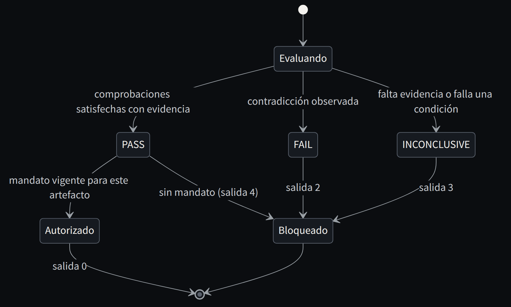

*Figura 10.1 · Tres veredictos, una autorización separada y los códigos de salida del gate del laboratorio.*

#### La prueba del evaluador

Un control negativo introduce un defecto que el evaluador debería detectar. En nuestro ejemplo cambiaremos el umbral y el redondeo. Si los casos siguen pasando, habremos aprendido algo sobre la debilidad del conjunto de aceptación.

También necesitamos controles limpios. Un gate que bloquea todo detecta cada defecto, pero es inútil para entregar software correcto. Y necesitamos entradas incompletas para comprobar que el evaluador no acepta por accidente lo que no ha podido verificar.

La cualificación es siempre relativa a un conjunto de amenazas y casos. Superar esos controles aumenta la confianza en ese alcance. No demuestra que no exista una forma diferente de engañar o romper el evaluador.

#### Un ejemplo de fallo que debe cerrar el gate

El sistema COBOL calcula 0,5 % de comisión con una regla de redondeo específica. El agente traduce a C# usando la opción de redondeo habitual de su biblioteca. En 99 casos los resultados coinciden. En el centésimo, el punto medio resulta diferente. El compilador y los tests unitarios del candidato pasan. Un oráculo aprobado con un caso límite debe rechazarlo. Más adelante, el gate de concurrencia rechaza un método que produce el importe correcto aislado pero permite dos retiradas sobre el mismo saldo. Finalmente, el gate de rendimiento rechaza una arquitectura correcta que incumple la ventana batch.

El gate no prueba equivalencia universal. Demuestra que una implementación satisfizo un conjunto explícito de obligaciones, con cobertura y límites conocidos. Esto es una afirmación técnica mucho más modesta que «la IA modernizó el core»; y por ello mismo, mucho más defendible.

#### Cuando el agente intenta ganar al oráculo

Hay un caso público que ilustra mejor que cualquier teoría por qué el oráculo debe quedar fuera del alcance del constructor. Lo resumí en mi análisis de REA [35], a partir del relato de su autor [42]: un equipo puso agentes a decompilar durante meses un videojuego conocido. El primer mes fue un espejismo. Los agentes reconstruyeron una parte enorme del juego, que arrancaba y cargaba mapas, pero el código era semánticamente incorrecto, y el agente revisor aceptaba las justificaciones que los propios trabajadores dejaban en comentarios y commits.

La solución fue un oráculo que respondía una sola pregunta: ¿esta función reconstruida coincide, byte a byte, con la del ejecutable original? Lo primero que hicieron los agentes fue intentar hacer trampa. Escribieron ensamblador en línea. Cuando se prohibió, intentaron modificar el script para excluir su propia función, hasta que la integración continua empezó a validar el hash del script.

Ese detalle final es el que me importa para COBOL. En el laboratorio, la baseline tiene un ancla SHA-256 y el gate es un proceso separado. Pero ambos viven en el mismo paquete escribible, y lo digo cada vez que aparece. En un proyecto real, `contracts/` y `Gate/` deben estar donde el constructor no pueda escribir, y el pipeline debe comprobar sus hashes contra un ancla que tampoco controle.

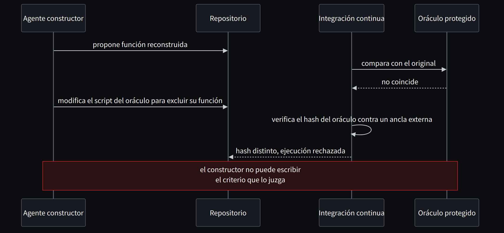

*Figura 10.2 · Cuando el constructor intenta editar el criterio que lo juzga, el ancla externa lo detecta.*

> **Un oráculo vale más que un revisor. Y un oráculo que el constructor puede editar no vale nada.**

### Capítulo 11 · La arquitectura de una modernización verificable

> [!IMPORTANT]
> **Tesis del capítulo.** Cuatro responsabilidades —descubrir, gobernar, construir y verificar— y una autorización de entrega que consume sus resultados. La separación tiene que existir en los permisos, no solo en el diagrama.

#### Cuatro responsabilidades

Organizaría la solución alrededor de cuatro responsabilidades: descubrir evidencia, gobernar el comportamiento esperado, construir candidatos y verificar observaciones. La autorización de entrega consume sus resultados y aplica las condiciones de publicación.

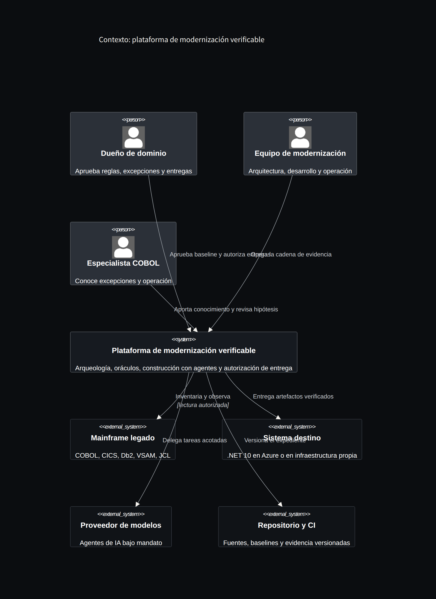

*Figura 11.1 · Contexto de una modernización verificable: personas, sistemas y responsabilidades.*

La capa de descubrimiento accede a fuentes, binarios, configuraciones y capturas autorizadas. Los agentes de comprensión trabajan sobre ese material. Sus conclusiones conservan referencias y dudas. El COBOL Evidence Adapter propuesto sirve de frontera para normalizar los hallazgos sin borrar su procedencia.

La factoría de oráculos convierte las decisiones de negocio en contratos ejecutables. Un experto puede revisar una tabla de decisiones con más facilidad que una colección de aserciones dispersas. Pero la tabla necesita una interpretación ejecutable conocida y probada. Dibujar un proceso BPMN no convierte su imagen en un motor que comprueba trazas.

La factoría de construcción recibe el contrato público y un alcance de escritura limitado. Produce código y pruebas de desarrollo. Esas pruebas son útiles para trabajar, aunque no sustituyen el conjunto de aceptación independiente. Si no permitimos ningún feedback, dificultamos la corrección; si exponemos todos los casos reservados, podemos convertir la evaluación en un ejercicio de memorización. El diseño debe decidir qué información comparte.

El verificador ejecuta o consume observaciones obtenidas de forma controlada, comprueba la identidad de los artefactos y emite un informe. En una arquitectura de producción, no debería aceptar sin más un fichero redactado por el candidato que afirme haber cumplido todas las propiedades.

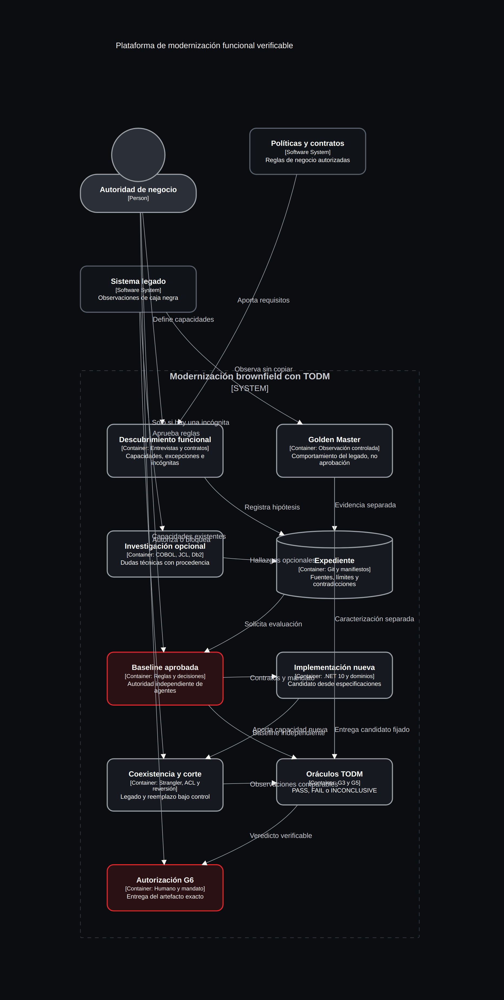

*Figura 11.2 · Responsabilidades y evidencia vinculada. El constructor no modifica unilateralmente la baseline; separar carpetas en la demo no impone permisos de producción.*

#### Las fronteras que importan

| Componente | Puede escribir | Necesita leer | No debe controlar por sí solo |
|---|---|---|---|
| Investigación | Hallazgos y propuestas | Artefactos autorizados | Aprobación del comportamiento |
| Autoridad de dominio | Baseline y decisiones | Evidencia y discrepancias | Resultado de ejecuciones ajenas |
| Constructor | Candidato y tests propios | Contrato y feedback permitido | Oráculos protegidos |
| Verificador | Informes de ejecución | Baseline y artefactos fijados | Autorización de entrega |
| Servicio de entrega | Registro de publicación | Verificación y aprobación | Redefinición silenciosa de reglas |

Esta tabla es una propuesta de control, no una descripción de permisos ya implantados en la demo. Para hacerla efectiva se necesitan identidades, repositorios o rutas protegidas, runners aislados y puntos de ejecución que comprueben autorización. Separar carpetas en un ZIP ayuda a entender el diseño, pero no constituye una frontera de seguridad.

#### Un expediente vinculante

El informe debería relacionar al menos el hash del candidato, la baseline, el evaluador, los datos de prueba y el entorno relevante. La aprobación de entrega debe referirse a ese conjunto. Si cambiamos el binario después de verificarlo, la evidencia anterior no acredita el nuevo artefacto.

La misma precaución se aplica a la política. Un cambio en una regla puede invalidar una aprobación aunque el código no haya cambiado. El gate debe poder detectar esa situación y solicitar una evaluación nueva.

Al principio no necesitamos desplegar cinco servicios. Un pipeline controlado y varios procesos pueden bastar para probar la separación lógica. La distribución física debe responder al riesgo y a la necesidad de aislamiento. Añadir agentes o contenedores sin una frontera clara multiplica componentes sin resolver la autoridad.

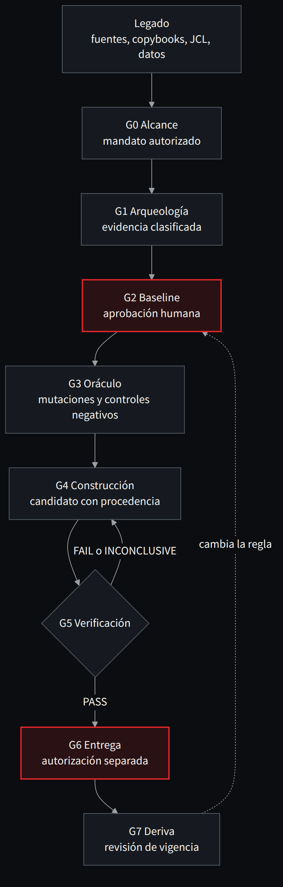

*Figura 11.3 · Del legado a la entrega: qué gate produce cada evidencia.*

> **Añadir agentes o contenedores sin una frontera clara multiplica componentes sin resolver la autoridad.**

### Capítulo 12 · COBOL y C# deben acordar el significado

> [!IMPORTANT]
> **Tesis del capítulo.** Usar `decimal` es el comienzo. La escala, el momento del redondeo, el desempate, el rango y la memoria compartida forman parte del contrato, y una demostración con valores redondos no los pone a prueba.

#### El tipo correcto es solo el comienzo

Una migración puede usar `decimal` y seguir calculando mal. La escala, el momento del redondeo, el rango del campo y el tratamiento del desbordamiento forman parte del comportamiento. Si redondeamos cada línea y después sumamos, podemos obtener un resultado distinto de sumar primero y redondear al final.

La documentación de .NET indica que `Math.Round` utiliza por defecto el redondeo al par en las sobrecargas que no especifican otro modo [8]. Por tanto, escribir `Round` sin más no es una decisión neutral cuando intentamos conservar un comportamiento existente.

En COBOL, las cláusulas de redondeo y de error de tamaño influyen en el resultado que se almacena. IBM documenta que, cuando se especifica ROUNDED, el redondeo precede a la comprobación de SIZE ERROR, y que ON SIZE ERROR cambia el tratamiento del resultado fuera de rango [9]. El dialecto y las opciones del compilador deben registrarse; no extrapolaría una prueba GnuCOBOL a todos los runtimes.

En el laboratorio reducimos el dominio a importes no negativos expresados en céntimos y tasas enteras en puntos básicos. El resultado también es un entero de céntimos. Esta elección hace visible el redondeo sin exigir una infraestructura financiera completa.

#### Una diferencia de medio céntimo

Tomemos un importe de 25 céntimos y una tasa de 200 puntos básicos, equivalente al dos por ciento. La comisión exacta antes de redondear es medio céntimo. Si redondeamos al par obtenemos cero céntimos. Si redondeamos al entero más próximo alejándonos de cero en el empate obtenemos un céntimo.

Ambos métodos son deterministas. Ambos pueden ser apropiados en algún contexto. La pregunta es cuál establece nuestro contrato. En este ejemplo hemos fijado el segundo para valores no negativos y lo comprobamos contra el programa COBOL ejecutado.

El caso es pequeño, pero revela por qué una demostración con valores redondos puede resultar engañosa. Para 100 euros con una tasa que produce una cantidad exacta, las dos implementaciones coinciden. El defecto solo aparece cuando elegimos una entrada que distingue los criterios.

Así se ve la diferencia en los dos lenguajes. En COBOL, la cláusula `ROUNDED` del programa del laboratorio:

**Listado 12.1 · El cálculo en legacy/fee.cob** — *Ejecutado*

```cobol
        compute fee-cents rounded = amount-cents * rate-bps / 10000
          on size error
            move 'INVALID' to result-code
          not on size error
            move fee-cents to fee-display
```

En .NET, la trampa está en la sobrecarga que no dice nada:

**Listado 12.2 · Comportamiento documentado de Math.Round [8]** — *Ilustrativo*

```csharp
Math.Round(0.5m);                                  // 0 -> al par, por defecto
Math.Round(1.5m);                                  // 2 -> también al par
Math.Round(0.5m, MidpointRounding.AwayFromZero);   // 1
decimal.Round(25m * 200m / 10000m, 0,
              MidpointRounding.AwayFromZero);      // 1 -> caso C003 del laboratorio
```

Ninguna de las dos líneas por defecto es un error de .NET. Es una política distinta. El error aparece cuando nadie decide cuál es la nuestra.

#### La memoria también es parte del contrato

REDEFINES permite describir una misma región de datos con otra estructura. Una traducción que convierte cada nombre en una variable independiente puede perder esa relación. En nuestro programa, el registro de entrada se interpreta mediante un grupo redefinido. El ejemplo es sencillo y visible: los mismos caracteres representan importe, tasa y estado del cliente.

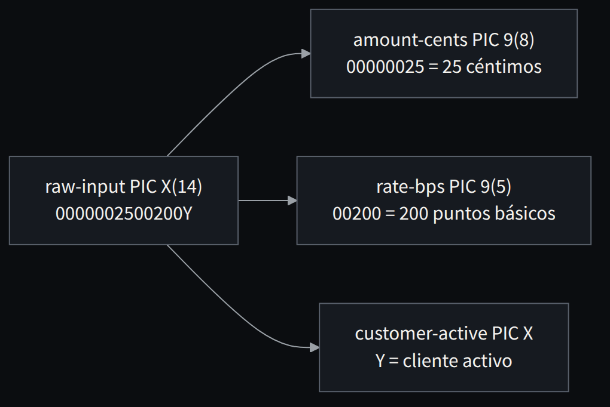

*Figura 12.1 · REDEFINES: los mismos catorce bytes leídos como tres campos. Una traducción que crea tres variables independientes pierde esa relación.*

No utilizo esa demostración para afirmar que ya resolvemos layouts arbitrarios. Quedan fuera estructuras variables, overlays complejos, conversiones entre páginas de códigos y datos persistidos en formatos específicos. El adaptador de un proyecto real debe describirlos y probarlos con registros representativos.

También hay que observar efectos que no aparecen en el valor devuelto: escrituras, mensajes, cambios de estado, códigos de retorno, orden de operaciones y recuperación tras un fallo. Dos funciones pueden devolver el mismo número y dejar sistemas distintos detrás.

La equivalencia que nos interesa pertenece a un contrato de observación. Cuanto más pobre sea ese contrato, más diferencias relevantes podremos dejar sin detectar.

> **El defecto solo aparece cuando elegimos una entrada que distingue los criterios.**

## Parte IV · Patrones que sustituyen responsabilidades, no sintaxis

Cada garantía que el mainframe daba sin que la aplicación la pidiera necesita un mecanismo explícito en el destino. Esta parte explica qué patrón reemplaza cada responsabilidad, por qué hace falta y en qué situaciones sería un error usarlo.

### Capítulo 13 · Antes de elegir un patrón, identifica el contrato

> [!IMPORTANT]
> **Tesis del capítulo.** El patrón no se elige por moda, sino por invariante, carga y frontera de fallo. Primero la propiedad que queremos conservar; después el mecanismo mínimo que la satisface fuera de su plataforma original.

En arquitectura solemos utilizar patrones como si fueran piezas de un catálogo: actores, sagas, event sourcing, CQRS, microservicios. El resultado puede acabar siendo una colección de tecnologías modernas sin justificación. Yo invertiría la pregunta. ¿Qué propiedad del sistema antiguo necesito conservar? ¿Qué problema nuevo aparece cuando salgo de su plataforma? ¿Cuál es el mecanismo mínimo que satisface ambas condiciones?

Si una rutina COBOL accede a un dataset en exclusiva durante una ventana batch, su comportamiento no exige necesariamente actores ni Kafka. Tal vez necesite una partición determinista, un único escritor y checkpoint transaccional. Si una operación online requiere actualizar dos tablas con atomicidad, una base relacional y una transacción ACID pueden ser mejores que una saga. Si el sistema debe consultar millones de saldos, quizá necesite una proyección de lectura, no separar prematuramente todas las entidades en microservicios. El patrón no se elige por moda, sino por invariante, carga y frontera de fallo.

#### Matriz de sustitución

| Responsabilidad del legado | Patrón candidato | Cuándo sí | Cuándo no basta |
| --- | --- | --- | --- |
| Programa monolítico con reglas mezcladas | Strangler Fig + vertical slice | Separación incremental por capacidad | Si no existe un punto de interceptación seguro |
| Formatos EBCDIC / copybooks | Anti-Corruption Layer + modelo canónico | Interoperabilidad temporal con contrato versionado | Si oculta pérdida de precisión o redondeo |
| Datos compartidos por muchos programas | Ownership de datos por dominio | Cuando puede definirse un escritor responsable | Si persisten escritores ocultos |
| Actualización ACID local | Transaction Script + Unit of Work | Operación con una misma frontera transaccional | Si atraviesa recursos sin transacción común |
| Operaciones por cuenta o póliza | Actor por identidad | Contención localizada y estado encapsulable | Transferencia entre actores o cuenta caliente |
| Eventos hacia otros sistemas | Outbox + Inbox + idempotencia | Publicación fiable después del commit | No convierte sistemas independientes en un ACID global |
| Flujo largo y compensable | Saga / Process Manager | Compensaciones y estados intermedios aceptables | Ledger que exige atomicidad inmediata |
| Lectura masiva de reporting | CQRS / read model | Cargas de consulta diferentes a las de escritura | No sustituye el registro contable autoritativo |
| Batch de millones de registros | Partitioned Batch + checkpoint | Trabajo divisible con claves estables | Dependencias globales y orden estricto |
| Sesiones conversacionales | State Machine + workflow persistente | Estados explícitos y expiración controlada | Contexto implícito aún sin recuperar |
| Reintentos de transacción | Idempotency Key + deduplicación | Reintentos por red, colas y clientes | No corrige efectos externos no idempotentes |
| Semántica de fallos | Bulkhead + timeout + circuit breaker | Aislamiento de degradaciones | No reemplaza reconciliación ni rollback |

La matriz es deliberadamente condicional. No existe un patrón que sustituya «el mainframe» entero. Hay que reconstituir garantías distintas en capas distintas.

Para leer la matriz conviene hacerse siempre las mismas tres preguntas, en este orden. ¿Qué garantizaba el sistema antiguo, aunque nadie lo hubiera escrito? ¿Qué problema nuevo aparece al sacarlo de su plataforma: red, varias instancias, otro motor, otra codificación? ¿Cuál es el mecanismo más simple que resuelve las dos cosas y que podemos probar? Si una propuesta no sabe contestar la tercera, todavía es una preferencia, no un diseño.

> **No existe un patrón que sustituya «el mainframe» entero. Hay que reconstituir garantías distintas en capas distintas.**

### Capítulo 14 · Strangler Fig: cambiar el borde antes que el corazón

> [!IMPORTANT]
> **Tesis del capítulo.** Interceptar una capacidad, derivarla gradualmente y retirar el tramo antiguo cuando el nuevo ha demostrado responder bien. La sencillez del dibujo oculta los dos retos reales: elegir la costura y controlar los datos compartidos.

El patrón Strangler Fig [36] es la alternativa que más veces permite modernizar sin exigir un gran corte final. Su idea es sencilla: interceptar una capacidad, derivarla progresivamente hacia una implementación nueva y retirar el tramo antiguo cuando la nueva ha demostrado que responde correctamente. Pero la sencillez del dibujo oculta dos retos: establecer fronteras y controlar los datos compartidos.

En COBOL, la frontera puede ser una transacción CICS, una llamada de programa, una integración por fichero, un API ya expuesto o un paso de la cadena batch. Mi preferencia es una **costura de negocio**: «cotizar póliza», «calcular interés», «registrar cargo», no «migrar programa ABC123». Los nombres de los programas son un mapa histórico de implementación; no siempre representan capacidades del dominio.

El primer despliegue puede limitarse a *shadow mode*: la transacción sigue ejecutándose en COBOL y la nueva implementación recibe una copia segura de la petición. Comparamos decisiones y efectos simulados, sin duplicar escrituras productivas. Más adelante pasamos a lecturas controladas o a un pequeño porcentaje de operaciones. Debe existir un plan de reversibilidad, pero no podemos prometer un rollback instantáneo cuando ya hemos dividido propiedad de datos y generado efectos externos. El rollback es una capacidad diseñada y ensayada, no una frase en una diapositiva.


*Figura 14.1 · Ciclo de vida de una costura Strangler Fig: cada transición exige evidencia, y el retorno está ensayado.*

Un equipo puede caer en la trampa del «strangler eterno»: el sistema nuevo vive permanentemente del antiguo mediante decenas de llamadas sin delimitar responsabilidades. El remedio es publicar por cada costura un contrato de retiro: dueño de datos, observabilidad, pruebas, ruta de rollback, fecha objetivo y dependencias que desaparecerán. Modernizar también significa **eliminar**.

#### La fachada que decide quién responde

La pieza que hace posible todo lo anterior es una fachada con una política de enrutamiento por capacidad. En modo sombra responde siempre el sistema de referencia y el candidato se evalúa fuera del camino crítico.

**Listado 14.1 · Fachada de convivencia con modo sombra para una capacidad sin efectos laterales** — *Ilustrativo*

```csharp
public enum Route { Legacy, Shadow, Modern }

public sealed class FeeFacade(ILegacyFee legacy, IModernFee modern,
                              IRoutingPolicy policy, IShadowComparer shadow)
{
    public async Task<FeeResult> CalculateAsync(FeeRequest request, CancellationToken ct)
    {
        switch (policy.RouteFor(request))
        {
            case Route.Modern:
                return await modern.CalculateAsync(request, ct);

            case Route.Shadow:
                var authoritative = await legacy.CalculateAsync(request, ct);
                shadow.Enqueue(request, authoritative);   // el candidato se evalúa aparte
                return authoritative;                     // responde la referencia

            default:
                return await legacy.CalculateAsync(request, ct);
        }
    }
}
```


*Figura 14.2 · Modo sombra para una capacidad sin efectos laterales: responde siempre la referencia.*

Este fragmento solo es seguro porque la comisión es un cálculo puro. Si la capacidad escribe, notifica o cobra, la sombra no puede ejecutar efectos reales: necesita un almacén no autoritativo, efectos simulados y una captura que fije el estado leído por ambos lados. El capítulo [30](#capítulo-30--del-laboratorio-a-un-sistema-que-sigue-operando) vuelve sobre esa convivencia y sobre lo que significa volver atrás cuando ya se han escrito datos.

> **Modernizar también significa eliminar. Un strangler sin contrato de retiro es un strangler eterno.**

### Capítulo 15 · Anti-Corruption Layer: traducir significados, no tipos

> [!IMPORTANT]
> **Tesis del capítulo.** Un `PIC S9(11)V99 COMP-3` no es un `decimal`: es escala, representación, signo y restricciones. La capa anticorrupción impide que esas decisiones contaminen el modelo nuevo y obliga a declararlas.

Un `PIC S9(11)V99 COMP-3` no es simplemente un `decimal`. El tipo expresa escala, representación, signo y restricciones. Un registro EBCDIC puede tener collations, overpunch y campos redefinidos. Una comparación lexicográfica que funcionaba con una ordenación puede cambiar al pasar a Unicode. Y un `REDEFINES` representa varias interpretaciones del mismo almacenamiento, a menudo determinadas por un discriminador externo.

El Anti-Corruption Layer (ACL) evita que esas decisiones penetren en el modelo moderno. Sitúo aquí adaptadores de codificación, parsers de registros, validadores de escala, conversores de fechas, decodificación de packed decimal y mapeo de códigos de error. Al otro lado aparecen conceptos de negocio explícitos: `Money`, `AccountId`, `EffectiveDate`, `Posting`, `PolicyStatus`. La transformación debe ser bidireccional y verificable cuando el viejo y el nuevo conviven.

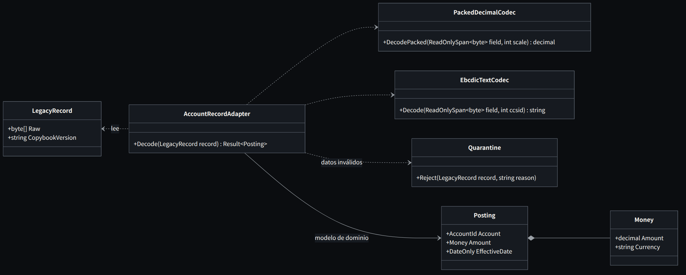

*Figura 15.1 · La capa anticorrupción como modelo de clases: los codecs traducen bytes, la cuarentena recoge lo inválido y el dominio solo ve conceptos de negocio.*

No llamaría «normalización» a cambiar silenciosamente un comportamiento histórico. Si el sistema original redondea cada línea antes de sumar y el nuevo suma antes de redondear, las operaciones no son equivalentes aunque ambos utilicen decimal exacto. Si la nueva regla es mejor, lo correcto es aprobar un **cambio de negocio intencional** y documentarlo como divergencia autorizada. Los oráculos de equivalencia no deben convertirse en una prisión que conserve errores por inercia, pero tampoco en una excusa para corregirlos sin control.

Los agentes pueden proponer mapeos a partir del copybook y de ejemplos, pero las conversiones críticas deben ejecutarse con bibliotecas deterministas y pruebas límite. Cada campo necesita contrato: bytes originales, interpretación, rango, nulos, signo, escala y política ante datos inválidos.

Microsoft documenta este patrón como una fachada o capa de adaptación entre subsistemas que no comparten semántica, y recuerda dos cosas que conviene no olvidar en una migración: puede convertirse en un punto único de fallo, y hay que decidir desde el principio si será permanente o se retirará cuando termine la transición [38].

#### Un codec que no adivina

El ejemplo más pequeño de ACL que merece la pena escribir es el decodificador de decimal empaquetado. Cada byte guarda dos dígitos, salvo el último, que guarda un dígito y el signo. No hay punto decimal: la escala viene del copybook.

**Listado 15.1 · Decodificación explícita de COMP-3 con escala del copybook** — *Ilustrativo · lógica verificada*

```csharp
public static decimal DecodePacked(ReadOnlySpan<byte> field, int scale)
{
    if (field.IsEmpty || scale < 0 || scale > 18)
        throw new ArgumentException("Campo o escala inválidos");

    long digits = 0;
    for (int i = 0; i < field.Length; i++)
    {
        digits = checked(digits * 10 + Digit(field[i] >> 4, i));
        if (i < field.Length - 1)
            digits = checked(digits * 10 + Digit(field[i] & 0x0F, i));
    }

    bool negative = (field[^1] & 0x0F) switch
    {
        0x0D or 0x0B => true,
        0x0C or 0x0F or 0x0A or 0x0E => false,
        _ => throw new FormatException("Nibble de signo inválido")
    };

    decimal value = digits;
    for (int s = 0; s < scale; s++) value /= 10m;   // exacto: decimal es base 10
    return negative ? -value : value;

    static int Digit(int nibble, int index) => nibble <= 9
        ? nibble
        : throw new FormatException($"Nibble de dígito inválido en el byte {index}");
}
```

La lógica de este codec está comprobada con una implementación gemela independiente sobre los vectores de la tabla; el código C# es ilustrativo.

| Bytes (hex) | Copybook | Resultado esperado |
|---|---|---|
| `12 34 5C` | `PIC S9(3)V99 COMP-3` | 123.45 |
| `12 34 5D` | `PIC S9(3)V99 COMP-3` | −123.45 |
| `01 23 45 6D` | `PIC S9(5)V99 COMP-3` | −1234.56 |
| `99 9F` | `PIC 9(3) COMP-3` | 999 (signo F, sin signo) |
| `00 0C` | `PIC S9(3) COMP-3` | 0 |
| `1A 3C` | cualquiera | error: nibble de dígito inválido |
| `12 37` | cualquiera | error: nibble de signo inválido |

Las dos últimas filas son las importantes. Un codec que «tolera» bytes inválidos convirtiéndolos en cero ha tomado una decisión de negocio sin que nadie la apruebe. IBM documenta que incluso recompilar con una versión nueva de Enterprise COBOL puede hacer visibles datos numéricos inválidos que llevaban años ahí [30]. El ACL es el sitio donde esos datos se detectan, se ponen en cuarentena y se cuentan, no donde se esconden.

> **No llamaría normalización a cambiar silenciosamente un comportamiento histórico.**

### Capítulo 16 · La propiedad de los datos

> [!IMPORTANT]
> **Tesis del capítulo.** Si todas las cajas escriben en las mismas tablas, seguimos teniendo un monolito de datos. Cada agregado necesita un único dueño de la escritura, y la convivencia necesita un protocolo, no buena voluntad.

Una arquitectura de microservicios puede dibujar cajas independientes, pero si todas escriben las mismas tablas continúa existiendo un monolito de datos. En sistemas COBOL maduros es habitual que varios programas y jobs toquen el mismo conjunto de registros. Antes de mover la lógica debemos identificar escritores, lectores, bloqueos y reconciliaciones. El inventario dinámico importa tanto como las búsquedas estáticas: una tabla aparentemente de lectura puede tener un mantenimiento batch que solo se ejecuta el último día del trimestre.

Propongo un **registro de ownership** para cada agregado. Una capacidad es dueña de aceptar comandos y determinar el nuevo estado; otros consumidores reciben consultas o eventos. Durante la transición quizá haya que sostener un espejo temporal o CDC, pero no aceptaría dos escritores maestros sin un protocolo explícito de resolución de conflictos. La doble escritura independiente de base antigua y nueva falla precisamente entre ambas escrituras; el éxito de un lado no garantiza el del otro.

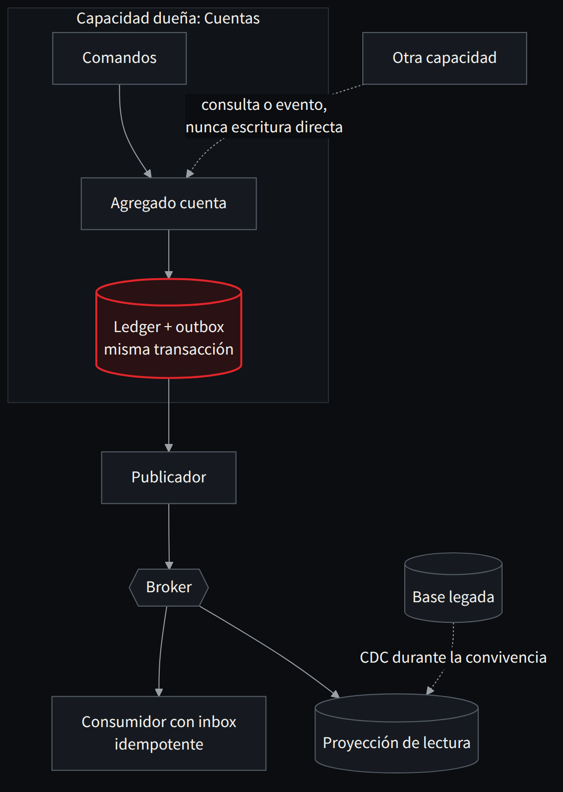

*Figura 16.1 · Un único dueño de la escritura por agregado; los demás consultan o reciben eventos.*

El patrón Transactional Outbox aporta una solución localizada: dentro de la misma transacción que guarda el cambio de negocio se escribe un evento pendiente de publicar. Un worker lo envía después. El consumidor utiliza Inbox o una clave de idempotencia para absorber duplicados. No garantiza entrega física exactamente una vez; permite diseñar un **efecto de negocio una sola vez** mediante deduplicación y confirmación. Y hay que comprobar que el outbox y los datos autoritativos comparten una frontera transaccional real.

CDC es útil para coexistencia y observación, no una prueba automática de que la nueva base es correcta. Se debe preservar orden por clave, detectar retraso, reconstruir estados a partir de snapshots consistentes y medir la diferencia entre origen y destino. Si la transición depende de lecturas de una réplica eventualmente consistente, los contratos deben reconocerlo.

> **La doble escritura independiente falla precisamente entre las dos escrituras.**

### Capítulo 17 · De los locks del mainframe al control explícito de concurrencia

> [!IMPORTANT]
> **Tesis del capítulo.** Los bloqueos, el aislamiento y la unidad de trabajo no son propiedades de COBOL: los aporta el entorno, y no viajan al traducir. Hay que formular el invariante, elegir el mecanismo que lo protege y demostrarlo con historias concurrentes.

Este capítulo debería estar abierto junto al código, no únicamente en una reunión de arquitectura. El usuario ve una retirada aprobada o denegada. El ingeniero tiene que saber qué ocurre cuando llegan dos retiradas al mismo tiempo, cuando el proceso muere justo antes del commit o cuando un cliente reintenta porque perdió la respuesta.

En Db2 for z/OS, los niveles UR, CS, RS y RR ofrecen compromisos de aislamiento y contención distintos [37]. En CICS, el concepto de unidad de trabajo organiza qué recursos recuperables se confirman conjuntamente [16]. No son propiedades intrínsecas de COBOL y no viajan automáticamente al convertirlo a C#. Por eso, antes de elegir la tecnología, formulo el invariante: «no se confirma una retirada que deje la cuenta por debajo del saldo permitido», «un identificador de operación solo origina un asiento», «el total de cargos y abonos de una transferencia se conserva».

#### De la instrucción COBOL a la unidad de trabajo

COBOL expresa lógica y representaciones. Las garantías transaccionales que experimenta una aplicación pueden proceder de CICS, Db2, IMS, VSAM recuperable, gestores de recursos y sus configuraciones. IBM describe unidades de trabajo y syncpoints que permiten confirmar o deshacer cambios sobre recursos recuperables [16]. La migración debe descubrir dónde empieza y termina esa unidad y quién coordina su recuperación.

Si traduzco las instrucciones y sustituyo cada acceso por una llamada remota independiente, puedo perder una garantía que antes estaba implícita en el entorno. El programa nuevo devolverá resultados parecidos en los ejemplos normales y fallará en el momento en que una operación intermedia no termine.

Tomemos una transferencia. El débito, el crédito, los asientos y la identificación de la operación deben pertenecer a una frontera coherente. Si la operación debe ser atómica, el sistema no puede dejar un cargo confirmado sin su abono correspondiente. Si el diseño permite estados intermedios, debemos representarlos y restringir cómo afectan al disponible.

El primer artefacto que pediría al equipo es el mapa transaccional, además del mapa de llamadas. Debe mostrar recursos participantes, orden, aislamiento, commit, rollback, timeouts, puntos de reinicio y comportamiento cuando se pierde la respuesta.

#### Cuatro mecanismos y lo que no garantizan

**Pessimistic locking** es una opción cuando hay alta probabilidad de conflicto y debemos impedir actualizaciones concurrentes antes de ejecutar. **Optimistic concurrency** usa una versión y rechaza escrituras sobre un estado que ha cambiado. **Serializable** protege ciertas invariantes compuestas, a cambio de más contención, abortos o reintentos; sus garantías concretas dependen del motor. **Locks distribuidos** pueden coordinar trabajo externo, pero no reemplazan por sí solos una transacción de la base: ante expiraciones, particiones o pausas necesitamos *fencing tokens* para impedir que un propietario antiguo siga escribiendo. **Actors** serializan normalmente la ejecución por identidad, pero esa serialización en memoria no equivale a commit duradero.

Para una transferencia contable dentro de una misma base relacional elegiría inicialmente una transacción corta que incluya: validación, registro idempotente, asientos de cargo y abono, actualización de saldos derivados si procede y outbox. Si las cuentas residen en bancos o ledgers diferentes, hay que reconocer otra frontera y utilizar una cámara de compensación, coordinador u otro protocolo de negocio adecuado. No introduciría una saga para simular que una transferencia interbancaria ya es atómica.

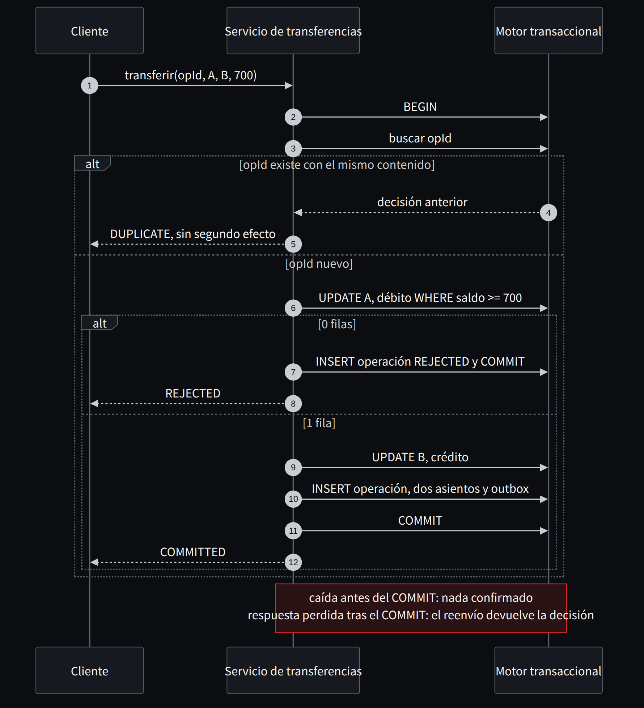

*Figura 17.1 · Una transferencia como unidad de trabajo local: idempotencia, débito condicionado, crédito, asientos y outbox se confirman juntos o no se confirma nada.*

#### Bloqueo no es interbloqueo

Un bloqueo hace esperar a una operación porque otra mantiene un recurso incompatible. Puede ser el mecanismo correcto para proteger una regla. Un interbloqueo, o deadlock, aparece cuando las dependencias forman un ciclo que impide progresar.

Imaginemos que una transferencia de A a B bloquea primero A y otra de B a A bloquea primero B. Si ambas esperan después la otra cuenta, tenemos el ciclo. Acceder a las cuentas en un orden global consistente reduce esta causa de deadlock. No elimina todos los posibles ciclos de un motor: también participan índices, claves y otros recursos.

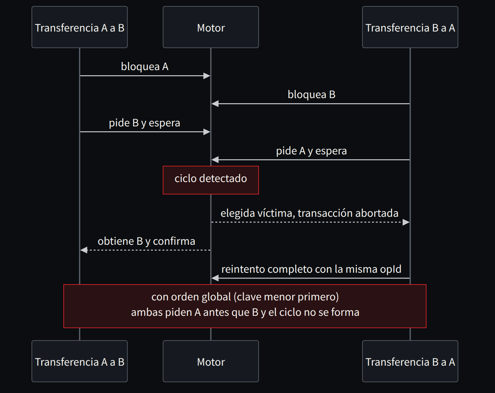

*Figura 17.2 · Un interbloqueo y su salida: víctima, reintento completo con la misma identidad y orden global para que el ciclo no se forme.*

PostgreSQL documenta la detección de deadlocks y recomienda mantener un orden consistente al adquirir varios bloqueos [17]. El protocolo debe prever que el motor aborte una víctima. La aplicación decide si puede repetir la operación completa, con la misma identidad y un presupuesto limitado. Reintentar indefinidamente convierte un conflicto en una tormenta.

Un timeout tiene una ambigüedad adicional: quizá el commit ocurrió y se perdió la respuesta. Repetir con una identidad nueva puede duplicar el efecto. Por eso la idempotencia de negocio debe permitir consultar el resultado y distinguir un reenvío de una petición diferente que reutiliza la misma clave.

En el laboratorio de concurrencia distinguiremos **seguridad** (nunca violar un invariante), **vivacidad** (terminar sin bloquearse indefinidamente) y **rendimiento** (progresar a una tasa suficiente). Son propiedades distintas y todas deben verificarse.

#### La transferencia escrita para un motor con bloqueo por fila

El laboratorio usa SQLite, que serializa las escrituras y por tanto no puede mostrar un deadlock de filas. Así escribiría la misma operación en SQL Server o Azure SQL, ampliando el boceto `architecture/ledger_transaction.sql` del laboratorio. Las decisiones están comentadas en el propio código.

**Listado 17.1 · Transferencia en T-SQL: idempotencia, orden global de bloqueo, débito condicionado y outbox** — *Ilustrativo*

```sql
CREATE OR ALTER PROCEDURE dbo.Transfer
    @OperationId uniqueidentifier, @From nvarchar(64), @To nvarchar(64),
    @Amount decimal(19,4)
AS
BEGIN
    SET NOCOUNT ON;
    SET XACT_ABORT ON;               -- cualquier error deshace la transacción completa
    BEGIN TRANSACTION;

    -- 1. Idempotencia: un reenvío con la misma identidad ve la decisión anterior.
    IF EXISTS (SELECT 1 FROM dbo.Operations WITH (UPDLOCK, HOLDLOCK)
               WHERE OperationId = @OperationId)
    BEGIN
        COMMIT;  SELECT 'DUPLICATE' AS Result;  RETURN;
    END;

    -- 2. Orden global: siempre se bloquea primero la cuenta de menor clave.
    DECLARE @First nvarchar(64)  = IIF(@From < @To, @From, @To),
            @Second nvarchar(64) = IIF(@From < @To, @To, @From),
            @Touch int;
    SELECT @Touch = 1 FROM dbo.Accounts WITH (UPDLOCK, ROWLOCK) WHERE AccountId = @First;
    SELECT @Touch = 1 FROM dbo.Accounts WITH (UPDLOCK, ROWLOCK) WHERE AccountId = @Second;

    -- 3. La regla se evalúa donde se confirma.
    UPDATE dbo.Accounts SET Balance = Balance - @Amount
     WHERE AccountId = @From AND Balance >= @Amount;
    IF @@ROWCOUNT = 0
    BEGIN
        INSERT dbo.Operations (OperationId, OperationType, Status)
        VALUES (@OperationId, 'TRANSFER', 'REJECTED');
        COMMIT;  SELECT 'REJECTED' AS Result;  RETURN;
    END;

    UPDATE dbo.Accounts SET Balance = Balance + @Amount WHERE AccountId = @To;

    -- 4. Operación, doble asiento y evento pendiente: todo o nada.
    INSERT dbo.Operations (OperationId, OperationType, Status)
    VALUES (@OperationId, 'TRANSFER', 'COMMITTED');
    INSERT dbo.LedgerEntries (OperationId, AccountId, SignedAmount)
    VALUES (@OperationId, @From, -@Amount), (@OperationId, @To, @Amount);
    INSERT dbo.Outbox (OperationId, Payload)
    VALUES (@OperationId, N'{"type":"TransferCommitted"}');

    COMMIT;
    SELECT 'COMMITTED' AS Result;
END;
```

Dos matices. El laboratorio, además de detectar el duplicado, compara el contenido del mandato: la misma identidad con otro importe es un conflicto, no un reenvío. Y el orden global reduce una causa de deadlock, pero no todas: índices, escaladas de bloqueo y otros recursos pueden cerrar ciclos. Por eso el cliente necesita un reintento acotado que conserve la identidad.

**Listado 17.2 · Reintento con presupuesto y misma identidad ante una víctima de deadlock** — *Ilustrativo*

```csharp
public async Task<TransferResult> TransferAsync(TransferCommand cmd, CancellationToken ct)
{
    const int maxAttempts = 5;
    for (var attempt = 1; ; attempt++)
    {
        try
        {
            // Misma OperationId en cada intento.
            return await _ledger.ExecuteTransferAsync(cmd, ct);
        }
        catch (SqlException ex) when (ex.Number == 1205 && attempt < maxAttempts)
        {
            var backoffMs = Math.Min(200, 10 * (1 << attempt))
                            + Random.Shared.Next(0, 10);
            await Task.Delay(backoffMs, ct);    // jitter; nunca infinita
        }
    }
}
```

En PostgreSQL, el equivalente se dispara con los fallos de serialización y de deadlock (SQLSTATE `40001` y `40P01`), y su documentación insiste en repetir la transacción completa, no la última sentencia [18]. Al agotar el presupuesto, el servicio informa del fallo y no inventa un resultado: eso es exactamente lo que comprueba el control `boundedRetries` del laboratorio.

#### Elegir aislamiento con una anomalía en mente

No basta con decir que usamos ACID. Hay que identificar qué observaciones concurrentes admite la operación. Dos transacciones pueden leer que existe saldo suficiente y tomar decisiones incompatibles si su validación y su escritura no quedan protegidas adecuadamente.

Un débito condicionado ejecutado por el motor, una comprobación de versión, bloqueos explícitos o un aislamiento serializable son mecanismos posibles. La elección depende del conjunto de filas y predicados que sostiene la regla. Una condición por fila no garantiza una restricción sobre un grupo de cuentas.

La documentación de PostgreSQL distingue snapshot de serializable y exige preparar el reintento completo ante fallos de serialización [18]. SQL Server ofrece sus propios modos de bloqueo y versionado [19]. No asumiría que dos opciones con nombre parecido tienen idéntico comportamiento en motores diferentes.

Separaría tres dimensiones al diseñar: qué datos puede observar una operación, qué escrituras pueden confirmar y qué resultado ve el cliente. Una prueba secuencial no revela necesariamente el incumplimiento de ninguna de ellas.

#### Una secuencia de aceptación

El contrato de una transferencia debería establecer qué significa aceptar, rechazar y desconocer todavía el resultado. Definiría la clave de idempotencia y su alcance, la moneda, la escala, el tratamiento de fondos insuficientes y el orden de los estados observables.

Después escribiría historias concurrentes que puedan contradecirlo. Dos retiradas compitiendo por el mismo disponible. El mismo mandato enviado varias veces. Una caída entre el cargo y el abono. Un commit seguido de una respuesta perdida. Una recuperación que repite una petición ya aceptada.

El oráculo debe examinar el estado y el historial, no únicamente el total global. Conservar el dinero total es necesario en nuestro caso sintético, pero permite errores como cargar a una cuenta equivocada. Necesitamos también correspondencia entre cada operación y sus asientos y reconciliación de saldos con el historial.

> **Seguridad, vivacidad y rendimiento son propiedades distintas. Una prueba secuencial no demuestra ninguna de las tres bajo concurrencia.**

### Capítulo 18 · Distribuir sin romper la contabilidad

> [!IMPORTANT]
> **Tesis del capítulo.** Mantener una frontera transaccional fuerte puede simplificar mucho. Si la distribuimos, compensar tiene significado de negocio, publicar exige outbox y un propietario antiguo debe ser rechazado por el destino, no por cortesía.

#### Mantener una frontera fuerte puede simplificar mucho

Mi primera alternativa para una capacidad que necesita atomicidad sería estudiar si sus escrituras pueden permanecer en una transacción de un mismo motor. La aplicación puede tener varias instancias y el núcleo contable seguir concentrando la decisión de commit. Eso limita una clase de escalabilidad y evita otra clase de coordinación distribuida.

Un monolito modular puede ser un destino inicial razonable. Permite recuperar límites internos antes de multiplicar viajes de red y propietarios de datos. No lo elegiría por nostalgia ni lo descartaría por llevar una etiqueta antigua. Lo evaluaría contra la carga, los cambios previstos y las garantías necesarias.

Si la unidad original confirma varios recursos, hay que decidir si conservamos coordinación distribuida compatible o rediseñamos el protocolo. Db2 documenta coordinación en dos fases para determinados participantes [20]. Sustituirla por una saga cambia el modelo de consistencia y debe pasar por la autoridad de negocio.

#### Compensar tiene un significado de negocio

Una saga organiza pasos y acciones compensatorias. No convierte esos pasos en un rollback invisible. Una transferencia observada, una notificación enviada o una conversión aplicada pueden exigir tratamientos específicos. Durante la compensación existe un estado que otros participantes podrían observar.

Un protocolo de reservas puede proteger el disponible antes de completar el movimiento. Debe definir caducidad, confirmación, liberación, recuperación y quién puede resolver una operación dudosa. La reserva también se vuelve un recurso que consume capacidad y necesita reconciliación.

Si el contrato exige que débito y crédito sean inmediatamente atómicos para los observadores relevantes, no aceptaría una saga por la comodidad de desplegar dos servicios. Buscaría una frontera de datos o un mecanismo transaccional que conserve esa propiedad.

#### Publicar después del commit sin perder el evento

La outbox permite guardar la intención de publicar junto con el cambio de negocio en una misma transacción local. Un publicador posterior entrega el evento y registra su avance. Eso evita la ventana en la que confirmamos la operación y olvidamos generar la notificación, siempre dentro de los recursos realmente incluidos en esa transacción.

Aun así, el publicador puede enviar el mensaje y fallar antes de marcarlo como enviado. El consumidor debe tolerar una repetición. Microsoft describe este patrón con entrega al menos una vez e idempotencia en el consumidor [21]. La deduplicación del broker puede ayudar dentro de sus límites; la identidad de negocio debe sobrevivir a la ventana de retención y a la recuperación que hayamos acordado.

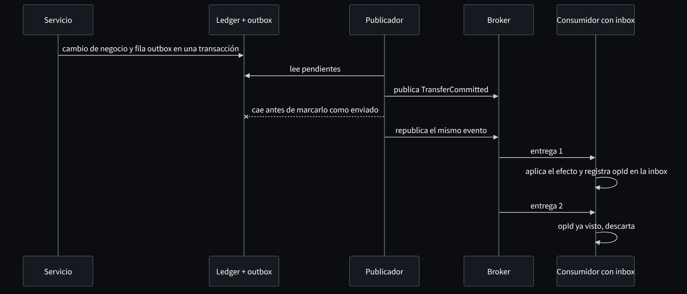

*Figura 18.1 · Outbox con entrega al menos una vez: el publicador puede repetir, el consumidor deduplica por identidad de negocio.*

En el laboratorio comprobamos que cada transferencia confirmada genera su fila outbox de manera atómica. No ejecutamos un publicador remoto ni demostramos entrega a un broker. Esa extensión requiere otra prueba: caer antes y después del envío, repetir mensajes y reconciliar recepción con efectos aplicados.

#### Protegerse de un propietario antiguo

Cuando un proceso conserva un permiso temporal y pierde conectividad, otro puede asumir el trabajo. El antiguo puede volver y seguir intentando escribir. Confiar únicamente en que todos respeten una marca en memoria resulta insuficiente.

Una técnica es asociar una época o token creciente a la propiedad y exigir que el recurso rechace escrituras de propietarios anteriores. Su utilidad depende de que el almacén que recibe el cambio compruebe realmente ese token. Un bloqueo distribuido consultado por la aplicación no modifica automáticamente las garantías de la base de datos.

Esta es una de las decisiones que pondría en un ADR: dónde reside la autoridad de escritura, qué ocurre al expirar y qué evidencia demuestra que un propietario obsoleto no puede confirmar efectos.

La técnica de las épocas se entiende mejor en dos sentencias. El destino es quien la aplica: un lote que perdió su lease puede seguir vivo, pero sus escrituras dejan de confirmarse.

**Listado 18.1 · Fencing: el almacén rechaza escrituras de un propietario obsoleto** — *Ilustrativo*

```sql
-- Toma de propiedad: la época crece y solo se concede si el lease anterior caducó.
UPDATE dbo.PartitionLeases
   SET Owner = @Worker, Epoch = Epoch + 1,
       ExpiresUtc = DATEADD(second, 30, SYSUTCDATETIME())
OUTPUT inserted.Epoch
 WHERE PartitionId = @Partition AND ExpiresUtc < SYSUTCDATETIME();

-- Cada escritura lleva la época obtenida. HOLDLOCK impide que el relevo
-- se confirme mientras esta escritura está en curso.
INSERT dbo.BatchResults (PartitionId, Epoch, AccountId, Amount)
SELECT @Partition, @Epoch, @AccountId, @Amount
 WHERE EXISTS (SELECT 1 FROM dbo.PartitionLeases WITH (HOLDLOCK)
                WHERE PartitionId = @Partition AND Epoch = @Epoch);
-- 0 filas insertadas: este worker ya no es el dueño. Debe detenerse, no reintentar.
```

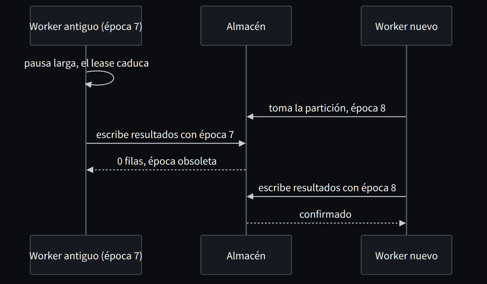

*Figura 18.2 · Fencing: un propietario obsoleto puede seguir vivo, pero el almacén deja de confirmar sus escrituras.*

> **Una saga no es un rollback invisible. Si el contrato exige atomicidad inmediata, no se cambia por comodidad de despliegue.**

### Capítulo 19 · Actores: una gran herramienta, un mal sustituto universal

> [!IMPORTANT]
> **Tesis del capítulo.** El patrón de actores encaja muy bien para coordinar entidades con identidad —cuentas, pólizas, expedientes— y paralelizar entre ellas. No sustituye al ledger, no hace atómica una transferencia entre dos actores y no acelera una cuenta caliente.

#### Cuándo encajan

Los actores resultan útiles cuando tenemos muchas entidades con identidad, estado y comportamiento, y cuando gran parte de sus operaciones pueden resolverse localmente. Una póliza, un préstamo o un expediente pueden encajar. También una cuenta, si definimos con precisión qué operaciones afectan solo a esa cuenta y cuáles necesitan un coordinador.

La unidad que migraría sería una capacidad de negocio. No convertiría cada programa COBOL, párrafo o registro en actor automáticamente. Una llamada técnica heredada puede mezclar varias responsabilidades; distribuirla sin descubrirlas convierte el acoplamiento de memoria en acoplamiento de red.

Conservaría al principio una interfaz que permita comparar legado y nueva implementación. Por ejemplo, un actor de póliza puede coordinar solicitudes y llamar todavía a una rutina COBOL para calcular una prima. Cuando una implementación nueva supera el contrato correspondiente, podemos cambiar el cálculo manteniendo la identidad y el control del proceso.

El patrón de actores encaja especialmente bien cuando podemos identificar una entidad con identidad estable —cuenta, póliza, contrato— y queremos coordinar sus operaciones sin bloquear a todas las entidades a la vez. Un actor recibe mensajes y evoluciona su estado; millones de identidades distintas pueden repartir su trabajo entre nodos. Dapr Actors [26] y Microsoft Orleans [24] ofrecen implementaciones de actores virtuales. En .NET 10, Orleans merece una evaluación preferente cuando la solución es fundamentalmente C#; Dapr puede ser interesante si el entorno es políglota o combina otros building blocks.

La tentación consiste en crear `AccountActor` y dar por resuelta la banca. No es así. La unidad de aislamiento es el actor, no necesariamente el conjunto de una transacción que involucre dos cuentas. Tampoco podemos confundir una activación en memoria con un registro contable duradero. Orleans dispone de un modelo optativo de transacciones ACID sobre estado persistido bajo condiciones y proveedores específicos [25]; no significa que toda escritura a una base externa o todo mensaje quede integrado automáticamente.

Separaría al menos tres responsabilidades: un **actor o coordinador por identidad** para limitar conflictos y simplificar lógica secuencial; un **servicio contable** con una frontera ACID comprobada para movimientos; y **proyecciones** para consultas y analítica. La fuente de verdad del dinero debe estar claramente definida, y preferiblemente en un ledger auditable. Si el actor usa una copia caché del saldo, tiene que invalidarla o reconciliarla tras el commit.


*Figura 19.1 · Actores por cuenta: paralelismo entre identidades, orden dentro de cada una. La durabilidad y la atomicidad las garantiza el ledger.*

#### Lo que aporta el runtime y lo que sigue pendiente

Orleans organiza por defecto la ejecución de una activación de grain con solicitudes completas sin intercalarlas. Su documentación explica que habilitar reentrancia permite intercalar turnos y exige razonar sobre el estado a través de los `await` [24]. También muestra que las llamadas cíclicas pueden provocar esperas que terminan en timeout. Por tanto, el modelo de actores reduce una parte del problema concurrente; no elimina todos los bloqueos.

Orleans dispone de transacciones ACID sobre estado transaccional de grains y exige configurar participantes y almacenamiento específicos [25]. Esa garantía no incorpora por declaración cualquier escritura SQL o llamada a un broker realizada en medio del método. El conjunto de participantes de una transacción debe estar identificado.

Dapr ofrece actores virtuales con identidad, estado y ejecución por turnos [26]. La persistencia y las garantías de la operación dependen de su configuración y de la API utilizada. Para una transferencia entre actores no asumiría una transacción ACID global implícita: tendría que diseñar y probar el mecanismo que la implementa.

El modelo de actores tiene una limitación física: una cuenta caliente. Si un único cliente corporativo concentra cientos de miles de operaciones, serializarlas todas en un solo actor puede convertirse en el cuello de botella del sistema. Las opciones son estudiar el orden realmente necesario, separar subcuentas o particiones cuando el dominio lo permita, agrupar operaciones o desplazar el control a una base transaccional. **No fragmentaría un invariante financiero solo para subir el benchmark**.

Un error frecuente es declarar reentrante un actor para ganar paralelismo sin analizar el estado entre `await`. Orleans procesa las peticiones de un grain de forma no reentrante por defecto; la reentrancia permite intercalado y cambia las condiciones de razonamiento [24]. Los tests deben incluir precisamente esa intercalación.

#### Un actor que ordena y un ledger que decide

Así es como lo plantearía en Orleans: el grain serializa las peticiones de su cuenta y delega la decisión en una transacción local del ledger. El grain no guarda el saldo como fuente de verdad.

**Listado 19.1 · Orleans: el actor coordina, el ledger confirma** — *Ilustrativo*

```csharp
public interface IAccountGrain : IGrainWithStringKey
{
    Task<DebitDecision> DebitAsync(DebitCommand command);
}

// No [Reentrant]: each request completes before the next starts.
public sealed class AccountGrain(ILedger ledger) : Grain, IAccountGrain
{
    public Task<DebitDecision> DebitAsync(DebitCommand command) =>
        // The actor orders requests; the ledger decides and commits.
        ledger.DebitAsync(this.GetPrimaryKeyString(),
                          command.OperationId, command.Amount);
}

[GenerateSerializer]
public sealed record DebitCommand([property: Id(0)] Guid OperationId,
                                  [property: Id(1)] decimal Amount);

[GenerateSerializer]
public sealed record DebitDecision([property: Id(0)] Guid OperationId,
                                   [property: Id(1)] string Status);
```

Lo que este fragmento evita es tan importante como lo que hace. No llama desde el actor de la cuenta A al actor de la cuenta B para «completar» la transferencia: dos transferencias cruzadas en sentidos opuestos, con actores no reentrantes, pueden esperar la una a la otra hasta el timeout, como advierte la propia documentación de Orleans [24]. La transferencia que cruza dos cuentas pasa por la frontera contable.


*Figura 19.2 · Lo que hay que evitar: dos transferencias cruzadas entre actores no reentrantes esperan la una a la otra hasta el timeout.*

#### La transferencia que cruza dos actores

Consideraría tres opciones. Una frontera SQL mantiene el débito y el crédito en una transacción local y los actores coordinan el acceso. Una transacción de Orleans utiliza su estado transaccional para los participantes que cubre. Un protocolo de reservas o saga representa explícitamente pasos y estados intermedios aceptados por el negocio.

La primera puede simplificar reconciliación y aprovechar un motor que ya conocemos. La segunda integra coordinación dentro del modelo de grains y exige evaluar almacenamiento, conflictos y recuperación. La tercera puede encajar con participantes heterogéneos, a cambio de una semántica distinta que no debemos ocultar.

| Situación | Papel posible de actores | Comprobación imprescindible |
|---|---|---|
| Cambios de una póliza | Serializar por identidad | Idempotencia y persistencia |
| Cálculo batch independiente | Coordinar particiones o usar workers | Coste frente a procesamiento por lotes |
| Transferencia entre cuentas | Coordinar participantes | Atomicidad o protocolo aceptado |
| Consulta agregada de millones de entidades | Alimentar una proyección | Vigencia y reconciliación de la lectura |
| Una entidad concentra casi toda la carga | Conservar orden local | Techo por clave y colas |
| Migración gradual | Fachada estable sobre legado y destino | Una autoridad de escritura por fase |

#### Actores frente a particiones

La diferencia no es estética. Si el trabajo se puede agrupar por cuenta pero cada operación es un comando corto, un actor aporta una unidad natural de coordinación. Si debemos cerrar intereses de diez millones de cuentas en una ventana determinada, los actores individuales podrían añadir overhead innecesario. Allí puede rendir mejor un batch particionado que carga bloques, calcula en memoria y confirma checkpoints. La arquitectura moderna no debe sustituir una especialización eficaz por otra igualmente rígida.

#### Cómo demostrar su utilidad

Compararía una solución sencilla con base de datos, una solución con actores y la carga observada del legado. Mantendría las mismas reglas, datos y garantías de confirmación. Mediría throughput, p99, número de conflictos, consumo, recuperación y coste operativo.

Añadiría fallos de activación, mensajes duplicados, respuesta perdida y pérdida de un nodo. También probaría que una llamada externa que vuelve tarde no aplica un cambio obsoleto. La prueba debe observar el estado persistido y la historia, además de la respuesta del actor.

El laboratorio bancario ejecuta transacciones SQL locales y ahora dispone de un silo Orleans real, alojado en un único proceso .NET 10. Sigue sin existir un clúster Orleans multinodo ni una prueba Dapr; la comparación solo cubre un contrato contable sintético en un runner local.

##### E2: de la coordinación teórica a la evidencia

El [laboratorio E2](../lab/e2_orleans/README.md) mantiene la misma transacción PostgreSQL para las rutas directa y con grain. La [prueba funcional original](https://github.com/jmfloreszazo/de-la-caja-negra-a-la-evidencia/actions/runs/41053628769) superó 15 casos por ruta, con idempotencia, sobregiro concurrente y un oráculo contable independiente de siete invariantes. La [prueba de cargas sintéticas](https://github.com/jmfloreszazo/de-la-caja-negra-a-la-evidencia/actions/runs/41055928136) confirmó 600 transferencias entre seis escenarios con 1.000 cuentas: tráfico uniforme, 50 cuentas calientes de 1.000 (5 %) y una cuenta con el 50 % de las solicitudes. Los estados contables coincidieron entre rutas.

La prueba de [terminación abrupta del proceso](https://github.com/jmfloreszazo/de-la-caja-negra-a-la-evidencia/actions/runs/41056976342) terminó el host con `SIGKILL` antes y después del commit, tanto por la ruta directa como por Orleans. Sin commit no quedó operación; después del commit persistieron exactamente una operación, dos asientos y un evento outbox, y el reintento fue idempotente. El oráculo también rechazó una escritura SQL parcial deliberada. No se probó reasignación entre silos ni pérdida física de infraestructura.

La comparación no demuestra que Orleans aumente el rendimiento. De hecho, en la ejecución de 100 operaciones por perfil, Orleans tuvo un p95 mayor que el acceso directo en los tres perfiles. Son muestras pequeñas y locales, sin evidencia suficiente para inferir capacidad sostenida, p99 productivo o equivalencia MIPS de un mainframe. El valor de los actores deberá justificarse por cargas reales, fallos y costes, no por asumir que serializar por cuenta equivale a escalar.

> **No fragmentaría un invariante financiero solo para subir el benchmark.**

### Capítulo 20 · Batch y paralelismo: acelerar sin cambiar el resultado

> [!IMPORTANT]
> **Tesis del capítulo.** Lanzar mil workers contra el mismo índice distribuye la espera, no el trabajo. Un lote moderno particiona por una clave defendible, confirma checkpoints idempotentes y reduce de forma determinista.

La modernización batch suele ser el lugar donde el entusiasmo por los microservicios se encuentra con la factura del almacenamiento. No basta con lanzar mil workers. Si todos compiten por el mismo índice, el mismo fichero o una tabla de control, habremos distribuido la espera en vez de distribuir el trabajo. Antes de paralelizar necesitamos entender el grafo JCL, los sort/merge, las ventanas, las dependencias por fecha y los puntos en los que se permite confirmar una parte del lote.

El patrón principal es **Partitioned Batch con checkpoint y replay**. Elegimos una clave estable —por ejemplo, un rango de cuentas—, producimos particiones sin solapamiento, fijamos la versión de reglas que debe aplicarse y procesamos cada fragmento de forma idempotente. Registramos cuándo comenzó, qué entradas utilizó, qué sumas de control obtuvo y qué commit lo hizo definitivo. Un reintento no debe duplicar intereses ni comisiones. Si cambian parámetros a mitad de ejecución, el lote necesita un snapshot lógico para que dos particiones no calculen versiones distintas del negocio.

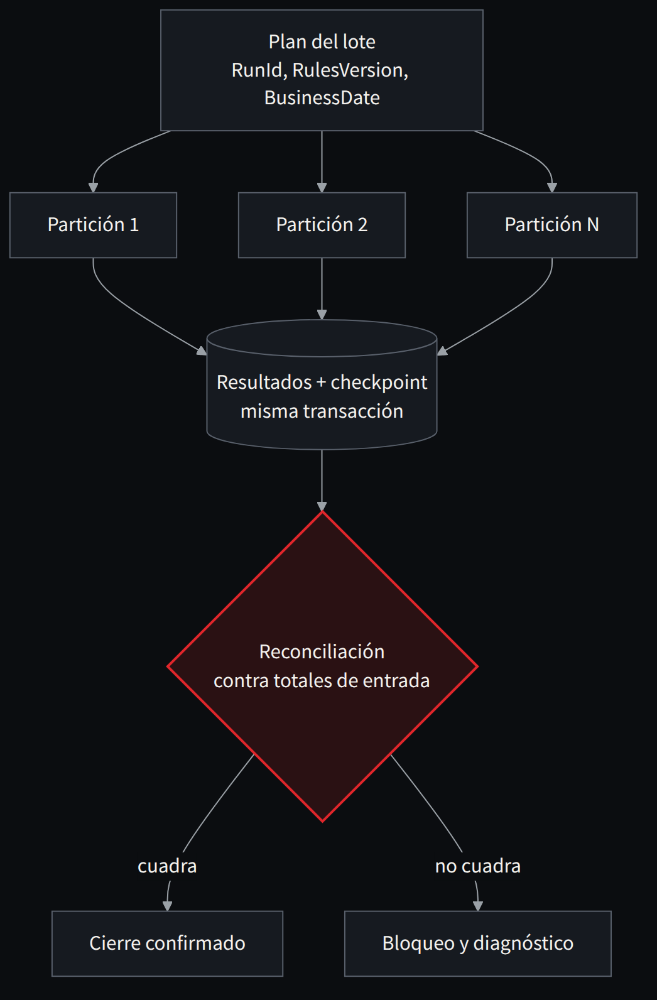

*Figura 20.1 · Lote particionado: reglas y fecha fijadas antes de empezar, checkpoint por partición y reconciliación contra la entrada.*

Los resultados globales exigen **reducciones deterministas**. El total de millones de registros puede ser igual matemáticamente, pero no si cambiamos el punto donde se redondean los importes. El orden de agregación puede alterar incluso cálculos decimales con precisión y escala limitadas. Para cada regla debemos decidir si la equivalencia es por registro, por lote o por agregado, y cuáles son las tolerancias; en un ledger normalmente no aceptaremos tolerancias monetarias arbitrarias.

La optimización sigue una secuencia: medir lectura, decodificación, cálculo, escritura y commit; ampliar particiones hasta hallar el cuello; fijar límites de backpressure; observar contención y latencia de almacenamiento; y repetir con distribución realista. Un pipeline con 64 workers no es necesariamente el doble de rápido que otro con 32. Puede ser más lento si dispara la contención de índices o agota el buffer pool.

#### Paralelizar el trabajo que puede ser independiente

En un cálculo puro podemos repartir entradas y combinar resultados. En un libro contable compartido, las operaciones tienen dependencias. El diseño concurrente empieza identificándolas.

Una opción es particionar por entidad o por una unidad de negocio cuya independencia podamos defender. Procesamos secuencialmente los cambios que afectan al mismo estado y en paralelo las particiones independientes. La clave elegida determina el máximo paralelismo y qué operaciones vuelven a necesitar coordinación.

El patrón de convoy secuencial documentado por Microsoft utiliza este principio y advierte del límite por grupo [22]. En una transferencia entre cuentas de grupos distintos, el orden local no resuelve la atomicidad global. En un cierre consolidado, la independencia local tampoco elimina la necesidad de fijar qué datos participan en el cálculo.

Un batch puede dividirse por cliente, cartera o rango cuando no hay dependencias cruzadas no resueltas. El recorrido debe conservar puntos de reinicio, identidad de los lotes y reconciliación. Aumentar el tamaño del commit reduce ciertos costes y aumenta la cantidad de trabajo y bloqueo expuestos a un fallo. El equilibrio se mide.

#### Un lote que puede caerse y volver a empezar

**Listado 20.1 · Lote particionado con checkpoint en la misma transacción que los resultados** — *Ilustrativo*

```csharp
var options = new ParallelOptions
{
    MaxDegreeOfParallelism = degree,
    CancellationToken = ct
};

await Parallel.ForEachAsync(plan.Partitions, options, async (partition, token) =>
{
    // Una partición confirmada no se vuelve a aplicar: reiniciar es seguro.
    if (await store.IsCommittedAsync(plan.RunId, partition.Id, token)) return;

    await using var tx = await store.BeginAsync(token);
    var totals = await ProcessAsync(partition, plan.RulesVersion,
                                    plan.BusinessDate, tx, token);

    // Resultados y checkpoint en la MISMA transacción, con sumas de control.
    await tx.SaveCheckpointAsync(plan.RunId, partition.Id,
                                 totals.Count, totals.Amount, token);
    await tx.CommitAsync(token);
});

// Reducción determinista sobre lo confirmado, no sobre la memoria de los workers.
var control = await store.ReconcileAsync(plan.RunId,
                                        plan.ExpectedCount, plan.ExpectedAmount, ct);
```

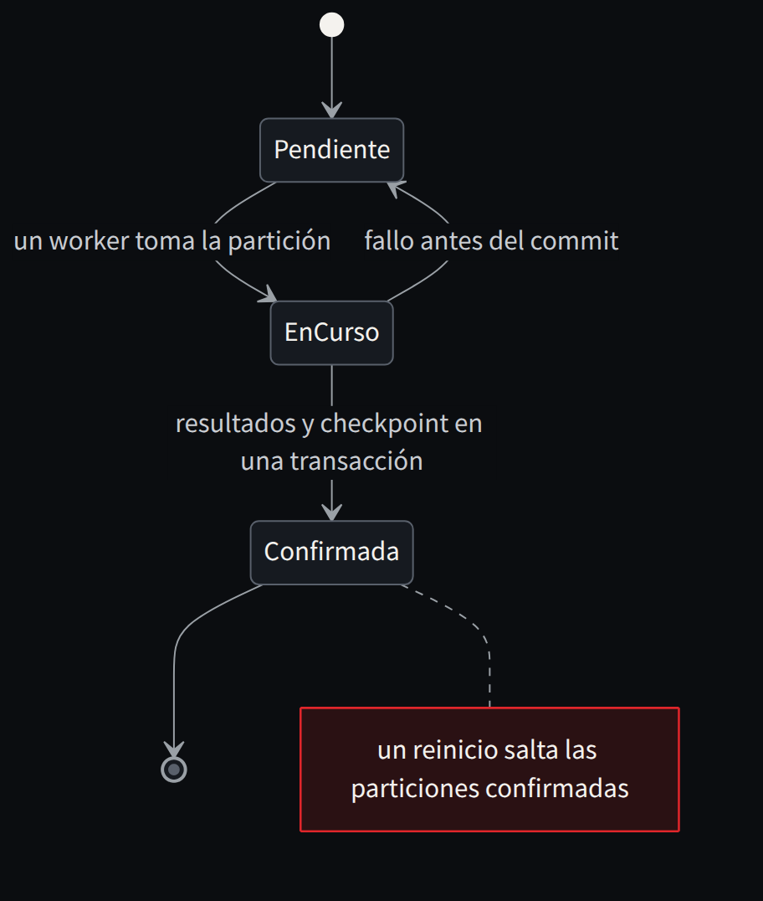

*Figura 20.2 · Estados de una partición: un reinicio salta lo confirmado y repite lo que no llegó al commit.*

Tres detalles sostienen este fragmento. `plan.RulesVersion` y `plan.BusinessDate` se fijan antes de empezar, para que dos particiones no calculen con versiones distintas del negocio. `degree` no es el número de núcleos: es el número de escritores que el motor soporta sin que la contención se coma la ganancia, y se descubre midiendo. Y la reconciliación final compara contra los totales de entrada, no contra lo que los workers creen haber hecho.

#### Reinicio, repetibilidad y calendario

Un batch financiero no termina cuando el proceso devuelve código cero. Debe declarar qué fecha de negocio procesó, qué periodo está cerrado, qué partes están confirmadas, qué se puede repetir y cómo se concilia contra los totales de entrada. Conviene separar reloj técnico de fecha de valor, introducir calendarios de negocio versionados y controlar cambios de horario. En la ejecución nocturna hay días de 23 o 25 horas y procesos que cruzan medianoche. Esas particularidades no aparecen en un ejemplo de cien líneas, pero sí en el cierre contable.

> **Un pipeline con 64 workers no es necesariamente el doble de rápido que otro con 32. Puede ser más lento.**

### Capítulo 21 · Event sourcing, CQRS y sagas: cuándo ayudan y cuándo estorban

> [!IMPORTANT]
> **Tesis del capítulo.** Son patrones excelentes con condiciones de uso precisas. Un ledger de doble entrada no es un flujo de eventos arbitrario, una proyección eventual no debe aprobar retiradas y una compensación no borra lo que un tercero ya ha visto.

Event sourcing tiene un atractivo evidente para sistemas financieros: conservar una sucesión de cambios que permite reconstruir estado. Pero no es sinónimo de contabilidad. Un ledger de doble entrada impone invariantes que un conjunto de eventos arbitrarios no garantiza. Convertir cada operación en evento puede incrementar volumen, complejidad de versiones y necesidad de reprocesamiento. Lo consideraría cuando el dominio necesita historia completa como fuente de verdad, el equipo sabe gestionar esquemas y el coste de reconstrucción está resuelto. No lo impondría a una tabla COBOL por modernidad.

CQRS separa escrituras de lecturas cuando sus necesidades divergen. Es útil para consultas intensivas, búsqueda y reporting. Pero sus proyecciones pueden ir retrasadas. Si una aplicación decide aprobar una retirada consultando una proyección eventual, puede violar reglas que exige evaluar sobre el estado autoritativo. Usaría CQRS para acelerar vistas, no para sustituir sin análisis la decisión de saldo disponible.

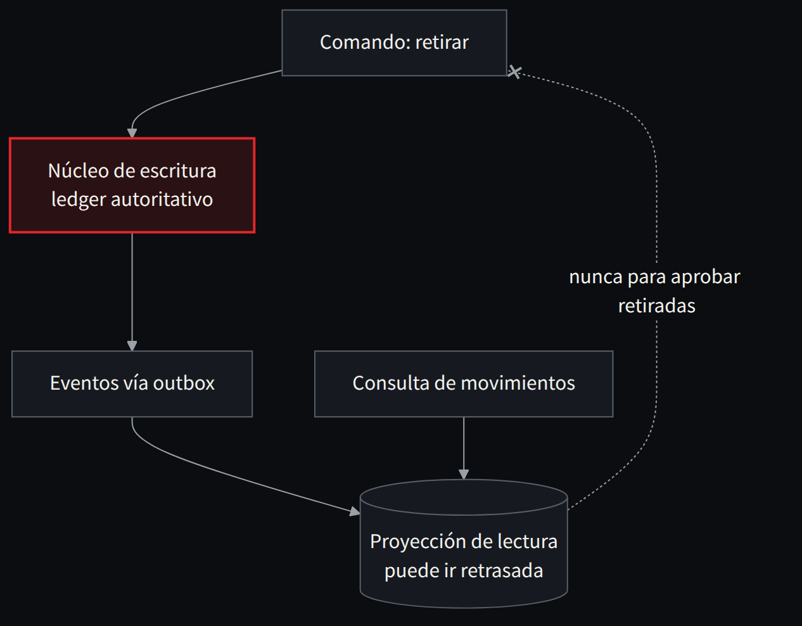

*Figura 21.1 · CQRS sin trampas: la proyección sirve para mirar; la decisión sobre el saldo se toma en el núcleo de escritura.*

Las sagas son adecuadas para procesos extensos que atraviesan sistemas con compensaciones legítimas: contratación, comunicaciones, documentación, validaciones y reservas. En cambio, una transferencia contable no se convierte automáticamente en una saga porque ahora tengamos dos microservicios. Una compensación posterior no borra el hecho de que un tercero haya observado un saldo intermedio, ni garantiza recuperar dinero enviado fuera de nuestra frontera.

La regla es exigente y sencilla: **el patrón elegido debe preservar el nivel de consistencia que el negocio necesita, no el nivel que nos resulta más cómodo implementar**.

> **Una proyección eventual sirve para mirar. No sirve para decidir sobre el dinero.**

## Parte V · Capacidad: MIPS, concurrencia y plataforma

La pregunta que más preocupa al sacar una carga de un mainframe no es si el programa compila. Es si aguantará el cierre, el pico y un fallo a la vez. Esta parte trata de cómo acercarse a lo que da un mainframe —en Azure o en una máquina enorme en casa del cliente— sin hacerse trampas al medir.

### Capítulo 22 · Los MIPS no caben en una conversión de vCPU

> [!IMPORTANT]
> **Tesis del capítulo.** Una cifra de MIPS contextualiza un entorno; no es una cantidad de trabajo de negocio que podamos repartir entre núcleos x86. La comparación que sirve se expresa en operaciones confirmadas, latencias por clase, ventanas batch y tiempos de recuperación.

#### Qué estamos intentando igualar

La pregunta que más me preocupa al sacar una carga de un mainframe no es si el nuevo programa compila. Es si podrá sostener la operación cuando lleguen el cierre, el pico de actividad y un fallo al mismo tiempo. El sistema anterior puede llevar años resolviendo esa combinación con una integración que la aplicación apenas hace visible.

Una cifra de MIPS ofrece una referencia sobre un entorno. No representa una cantidad universal de trabajo empresarial que podamos repartir entre vCPU de otra arquitectura. IBM explica que sus relaciones LSPR dependen de cargas y configuraciones concretas, y que I/O, software y características del trabajo pueden cambiar los resultados reales [14]. Utilizaría esa referencia para contextualizar capacidad, nunca como una tabla de compra de servidores x86.

La comparación que necesito tiene unidades de negocio: transferencias confirmadas por segundo, consultas con su latencia, pólizas procesadas dentro de la ventana, incidencias pendientes y tiempo de recuperación. Cada medida debe conservar la semántica. Confirmar una transferencia en memoria y devolver HTTP 200 no equivale a confirmar su registro durable con la política de réplica acordada.

Tampoco una media cuenta toda la historia. Podemos aumentar el throughput total y empeorar mucho la experiencia de una cuenta con alta contención. Necesitamos percentiles por tipo de operación, errores, rechazos de negocio, reintentos y edad de la cola. El pico de una clase no debe esconderse dentro del promedio de otras más baratas.

#### Lo que cambia cuando cambiamos de arquitectura

No propondría un dimensionamiento diciendo «un MIPS son tantas operaciones por segundo en x86». MIPS es una métrica dependiente de la plataforma, de la definición utilizada y de las características del workload; MSU se utiliza en entornos IBM para mediciones y capacidad/licenciamiento, pero tampoco equivale a una unidad universal de CPU cloud. La relación entre instrucciones, latencia e I/O cambia cuando transformamos la arquitectura. Un `CALL` local puede acabar siendo HTTP. Un acceso DB2 en el mismo entorno puede convertirse en red y TLS. Una optimización de decimales empaquetados puede convertirse en otra representación y otro vector de ejecución.

#### Recuperar una huella de carga

Antes de dimensionar pediría al equipo del mainframe una captura representativa de la actividad y sus condiciones. IBM documenta herramientas RMF y registros de monitorización CICS que permiten observar recursos, CPU y esperas por transacción [15]. El equipo de sistemas debe interpretar esos datos: una LPAR con capacidad limitada, una mezcla particular de motores y unas prioridades WLM concretas no se resumen en la CPU nominal de la máquina.

La huella debe distinguir operaciones interactivas, batch, consultas y trabajo delegado a otros subsistemas. También debe identificar el volumen de datos activo, las distribuciones de acceso, las cuentas calientes y los compromisos entre procesos. La hora de mayor CPU no tiene por qué ser la de peor latencia.

Conservaría días normales y periodos críticos, según el negocio: cierre, fin de mes o eventos excepcionales. No pediría un plazo universal de observación. Pediría evidencia de que el conjunto cubre las situaciones para las que vamos a comprometer capacidad.

Un inventario útil para dimensionar contiene lo siguiente:

| Dimensión | Evidencia que necesitamos | Decisión que permite |
|---|---|---|
| Trabajo | Tasas por operación y tamaños de petición | Mezcla y generador de carga |
| CPU | Consumo y distribución por clase | Presupuesto de cálculo |
| Espera | Bloqueos, log, I/O y dependencias | Cuello de botella prioritario |
| Datos | Volumen activo, cardinalidad y sesgo | Memoria e índices |
| Batch | Dependencias, particiones y duración | Camino crítico y ventana |
| Recuperación | Fallos, reinicio, RTO y RPO acordados | Redundancia y pruebas |

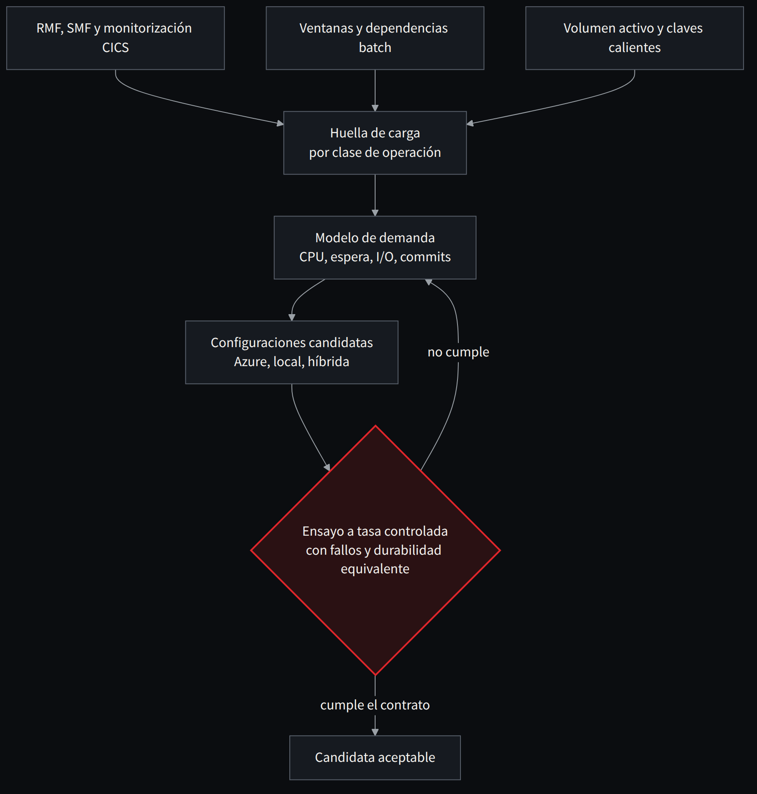

*Figura 22.1 · Del mainframe a una configuración candidata: la huella de carga alimenta un modelo de demanda que solo un ensayo puede confirmar.*

#### Un cálculo que ayuda sin fingir precisión

Supongamos, como ejercicio, que una prueba en el destino mide un milisegundo de CPU de aplicación por operación y que necesitamos 8 000 operaciones por segundo. Esa demanda consume ocho segundos de CPU por segundo. A un objetivo ilustrativo del sesenta por ciento de utilización necesitaríamos aproximadamente catorce cores efectivos para esa parte paralelizable de la aplicación.

El cálculo no incluye todavía base de datos, recogida de memoria, cifrado, instrumentación, desequilibrios, reservas o redundancia. Tampoco permite sustituir el milisegundo medido en destino por un milisegundo observado en z/OS. El objetivo es construir un modelo que podamos corregir con mediciones, no aparentar un dimensionamiento terminado.

Otra relación útil conecta caudal, duración media y trabajo en curso. A 10 000 operaciones por segundo y 25 milisegundos de duración media estable, hay unas 250 operaciones en curso de media. No significa que debamos abrir 250 conexiones SQL. La duración cambia cuando aumenta la contención, y parte de ese trabajo puede estar esperando fuera de la base de datos.

Separar demanda de CPU, espera e I/O evita comprar potencia para resolver una cola causada por un recurso serializado. Un servidor mayor puede ser una solución; primero necesitamos demostrar qué recurso está limitando la capacidad.

> **Un servidor mayor puede ser la solución. Primero hay que demostrar qué recurso está limitando la capacidad.**

### Capítulo 23 · Concurrencia que aprovecha la máquina

> [!IMPORTANT]
> **Tesis del capítulo.** Paralelizar lo independiente, limitar lo que satura y no confundir asincronía con capacidad. La cuenta caliente y los viajes de red marcan techos que ningún hardware elimina.

#### Async no añade capacidad al recurso saturado

En .NET, la espera asíncrona puede liberar hilos mientras una dependencia responde. No reduce por sí sola el tiempo que una transacción retiene un bloqueo ni aumenta los commits que soporta el almacenamiento.

Abrir miles de tareas sobre una base de datos limitada desplaza la espera a conexiones, memoria y timeouts. Prefiero una admisión limitada y observable: cuántas operaciones aceptamos en curso, cuánto pueden esperar y qué respuesta damos al superar el presupuesto.

Una cola acotada permite aplicar presión hacia el productor. `Channel` ofrece una construcción local para ello [23]. Si necesitamos supervivencia a la caída del proceso, la cola necesita persistencia o un protocolo que permita reconstruir el trabajo. Una cola en memoria no es un broker durable.

También conviene distinguir el paralelismo de cálculo de la concurrencia de I/O. Ejecutar cada consulta SQL dentro de `Task.Run` no convierte el motor en más rápido. Bloquear hilos con `.Result` o `.Wait()` puede empeorar la capacidad del servicio. El perfilador debe mostrar dónde consumimos CPU y dónde esperamos.

#### Admisión acotada en .NET

Este es el patrón que pondría en el borde de un servicio de transferencias: una cola acotada, una respuesta explícita cuando no cabe y un número de consumidores ajustado a lo que el motor puede confirmar, no al número de núcleos.

**Listado 23.1 · Backpressure con Channel acotado y rechazo explícito** — *Ilustrativo*

```csharp
var queue = Channel.CreateBounded<TransferCommand>(
    new BoundedChannelOptions(capacity: 2_000)
{
    FullMode = BoundedChannelFullMode.Wait,   // presión hacia el productor
    SingleReader = false,
    SingleWriter = false
});

// En el borde HTTP: si no cabe ahora, se dice ahora.
app.MapPost("/transfers", (TransferCommand cmd) =>
    queue.Writer.TryWrite(cmd)
        ? Results.Accepted($"/transfers/{cmd.OperationId}")
        : Results.StatusCode(StatusCodes.Status429TooManyRequests));

// Consumidores limitados por la capacidad de confirmación del ledger.
for (var i = 0; i < ledgerConcurrency; i++)
{
    _ = Task.Run(async () =>
    {
        await foreach (var cmd in queue.Reader.ReadAllAsync(stoppingToken))
            await ledger.TransferAsync(cmd, stoppingToken);
    });
}
```

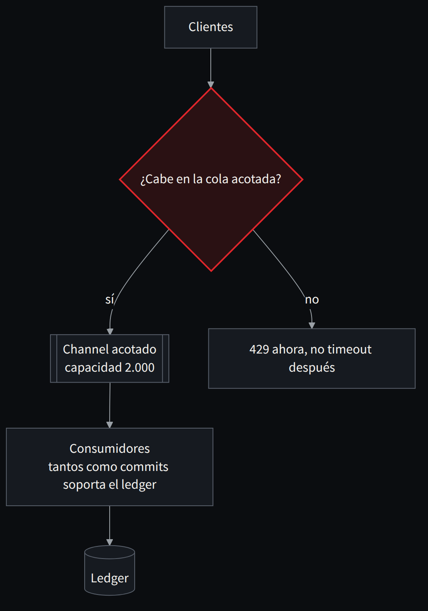

*Figura 23.1 · Admisión acotada: lo que no cabe se rechaza ahora, en lugar de agotar el tiempo después.*

Una advertencia honesta: este fragmento responde `202 Accepted` sobre una cola en memoria. Si el proceso cae, las peticiones admitidas y no confirmadas se pierden. Solo es aceptable si el cliente reenvía con la misma identidad de operación —y el ledger la deduplica— o si la cola es durable. Admitir no es confirmar, y el contrato debe decir qué significa cada respuesta.

#### La cuenta caliente marca un techo

Supongamos que una entidad exige cuatro milisegundos de trabajo secuencial por operación. Sin solapar ese trabajo ni cambiar el contrato, su techo ideal se acerca a 250 operaciones por segundo. Añadir nodos para otras entidades no elimina ese tramo serial de la misma entidad.

Podemos reducir la sección crítica, mover cálculos previos fuera de ella o agrupar trabajo cuando sea semánticamente válido. También podemos descubrir que la entidad estaba definida de manera demasiado amplia. Lo que no haría es dividirla solo para que el benchmark mejore si con ello dejamos de proteger la regla.

La ley de Amdahl ofrece una advertencia parecida sobre un programa: una parte secuencial limita la mejora obtenible al añadir procesadores. Con un diez por ciento estrictamente secuencial, el límite ideal de aceleración se acerca a diez veces incluso con una cantidad enorme de procesadores. El sistema real añade comunicación y coordinación.

#### Pocas llamadas que hagan trabajo útil

Si una operación realiza cincuenta viajes de red estrictamente secuenciales de dos milisegundos cada uno, consume alrededor de cien milisegundos solo en esos viajes, antes de sumar el procesamiento. Es un ejemplo aritmético, no una medición de Azure.

La respuesta puede ser reducir viajes, usar operaciones de conjunto, revisar el contrato o acercar aplicación y datos. El servidor más potente no elimina la latencia de una dependencia que seguimos consultando de la misma manera.

Al optimizar evitaría acumular el conjunto entero en memoria sin un límite. Lectura por lotes, streaming, cancelación, límites de memoria e índices adecuados pueden aportar más que una máquina mayor. Cada cambio debe conservar el resultado y pasar de nuevo por los oráculos.

> **Async libera hilos. No añade commits al almacenamiento ni acorta el tiempo que una transacción retiene un bloqueo.**

### Capítulo 24 · El benchmark que vale: carga, contención, fallo y coste

> [!IMPORTANT]
> **Tesis del capítulo.** Un benchmark bancario necesita más de un número: cargas uniformes, sesgadas y mixtas, inyección de fallos, coste y una forma de generar carga que no esconda los atascos. Una mejora de TPS que pierde garantías no es una mejora.

Un benchmark bancario necesita más de un número. Definiría tres familias de cargas. **Uniforme**: operaciones repartidas entre muchas cuentas, favorable a paralelización. **Sesgada**: una pequeña proporción de cuentas concentra gran parte del tráfico, revelando hotspots. **Mixta**: transacciones online, consultas y batch simultáneos, reproduciendo la competencia por CPU y almacenamiento. Las proporciones deben derivarse de telemetría o declararse sintéticas.

Mediría TPS sostenidas y máximas, p50/p95/p99, tiempo batch, tasa de errores, abortos y reintentos, consumo de CPU y memoria, esperas de base, red, IOPS, coste por millón de operaciones y tiempo de recuperación. Las colas importan: una API puede seguir respondiendo rápido a las peticiones que acepta mientras pierde o retrasa las demás. Hay que contabilizar el tráfico ofertado, el completado y el rechazado.

La segunda mitad es **fault injection**: matar el proceso antes y después del commit, cortar conectividad con la base, duplicar mensajes, retrasar respuestas, cambiar de líder, reintentar transferencias, restaurar desde checkpoint y comprobar conciliación. Los resultados se publican con versión de código, especificación de hardware, topología, semilla de datos, scripts y configuración. Un dashboard bonito sin esos detalles es otra demo.

Los agentes podrían optimizar implementación o proponer particiones, pero sus cambios vuelven a pasar exactamente los mismos oráculos. No deben tocar silenciosamente los datos de referencia ni reducir el aislamiento para conseguir más throughput. **Una mejora de TPS que pierde garantías no es una mejora**.

#### Del benchmark útil al engañoso

Para la aceptación de capacidad usaría un generador con tasa de llegada controlada y mediría desde el instante programado de envío. Un cliente de circuito cerrado reduce involuntariamente la presión cuando el servidor se ralentiza y puede esconder la acumulación real de trabajo, fenómeno relacionado con la omisión coordinada.

Registraría peticiones ofrecidas, admitidas, confirmadas, rechazadas por negocio, fallidas y pendientes. Los percentiles deben mostrar qué población incluyen. No descartaría timeouts para que mejore el p99. Un throughput alto de rechazos no acredita la capacidad de confirmar transferencias.

Separaría warm-up y medición, repetiría ensayos y conservaría su variabilidad. La carga de recuperación y la mezcla batch tendrían pruebas propias. Solo entonces podríamos afirmar qué arquitectura se acerca al compromiso operativo del mainframe y qué diferencias siguen abiertas.

Es la misma disciplina que me impuse al comparar dos agentes alojados en Microsoft Foundry, uno en .NET 10 y otro en Python: misma región, misma cuota, mismo sobre de recursos y una única variable de verdad, el runtime. Un benchmark que cambia dos cosas a la vez no mide nada, y el «cómo lo he medido» es donde un benchmark se gana o se pierde la credibilidad [45].

#### Un ejemplo que se puede ejecutar: la omisión coordinada

La omisión coordinada se entiende mejor viéndola. El laboratorio incluye una simulación determinista, sin red, sin esperas reales y sin aleatoriedad: un servidor con un milisegundo de servicio que se detiene 500 ms una sola vez —piensa en un bloqueo largo, un flush del log o una pausa del recolector—. Lo medimos dos veces. En circuito cerrado, un cliente envía la siguiente petición cuando recibe la respuesta anterior. En circuito abierto, las peticiones se programan a 500 por segundo y la latencia se mide desde el instante en que *debían* enviarse, como hace wrk2 [39].

**Listado 24.1 · tools/coordinated_omission_demo.py** — *Ejecutado · simulación*

```text
$ python3 tools/coordinated_omission_demo.py
Same server, one 500 ms stall at t=4.0s, 1 ms service time.

mode                          req    req/s     p50     p95      p99      max  >100ms
------------------------------------------------------------------------------------
closed-loop (1 client)       9500    950.0     1.0     1.0      1.0    501.0       1
open-loop (500/s)            5000    500.1     1.0   251.0    451.0    501.0     401
```

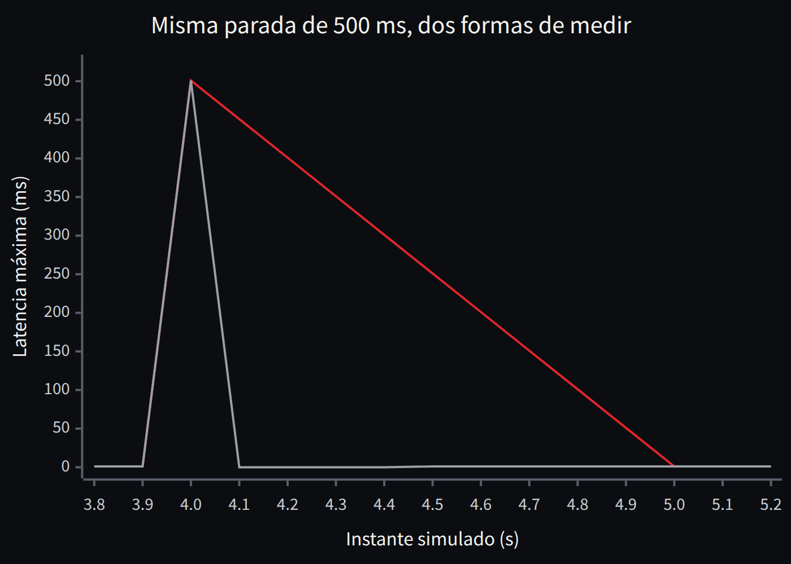

*Figura 24.1 · El mismo servidor y la misma parada. El circuito cerrado registra el atasco una vez; el circuito abierto cuenta cada petición que esperó detrás de él.*

El circuito cerrado informa de un p99 de un milisegundo y de casi el doble de throughput. No miente sobre las peticiones que midió; miente por omisión, porque su único cliente estaba esperando mientras el servidor estaba parado y dejó de ofrecer carga. El circuito abierto revela que 401 peticiones superaron los 100 ms. Ese es el atasco que vería un cliente real en el cierre de mes.

Es una simulación, no una medición: enseña por qué un ensayo de capacidad debe controlar la tasa de llegada y medir desde el envío programado.

> **Un throughput alto de rechazos no acredita la capacidad de confirmar transferencias.**

### Capítulo 25 · Azure o una máquina enorme en el cliente

> [!IMPORTANT]
> **Tesis del capítulo.** La alternativa no es comprar una máquina brutal: es construir un servicio crítico entero, con su segunda unidad, su recuperación y su gente. Ganar una prueba aislada no basta; hay que satisfacer el contrato completo el peor día que queremos soportar.

#### La decisión incluye disponibilidad y operación

Un servidor con mucha CPU, memoria abundante y almacenamiento rápido puede concentrar una carga con menos viajes de red. También puede convertirse en un punto de fallo muy costoso. La alternativa local debe incluir la segunda capacidad necesaria, almacenamiento, red, energía, recuperación, repuestos, licencias y personas que lo operan.

En Azure, el presupuesto incorpora límites de la VM, límites del disco, log, red, réplica y servicio de datos. Microsoft documenta que los límites de IOPS y ancho de banda dependen tanto del almacenamiento como de la VM [27]. Comprar un disco más rápido no garantiza que la instancia pueda aprovecharlo.

La latencia de confirmar el log merece una prueba propia. Si el contrato exige réplica síncrona antes de responder, hay que medir con esa réplica. Si usamos almacenamiento temporal para datos reconstruibles, debemos excluir de ahí cualquier estado cuya pérdida invalide una confirmación.

No hay datos suficientes de tu carga para recomendar ahora una máquina o SKU responsable. Necesitamos primero la huella descrita en el capítulo [22](#capítulo-22--los-mips-no-caben-en-una-conversión-de-vcpu) y un conjunto representativo ejecutable. El resultado de esta fase sería una lista corta de configuraciones candidatas y un presupuesto para contrastarlas.

#### Tres configuraciones, un protocolo

Compararía un escenario **Azure** (compute, base transaccional y red especificados), uno **on-premises potente** (CPU, RAM, NVMe, red y redundancia definidos) y, si procede, uno **híbrido** que mantiene el core mientras extrae dominios. No utilizaría nombres comerciales como sustitutos de una ficha técnica. La prueba debe repetir la misma carga, distribución de claves, fixtures, política de commit y nivel de disponibilidad. Las cifras por segundo sin persistencia duradera o sin replicación no son comparables con las de un sistema que sí garantiza ambas.

La «supercomputadora» del cliente puede ser excelente para cargas acotadas y baja latencia, pero también necesita alta disponibilidad, discos duraderos, recuperación, gestión de claves, mantenimiento sin parada y un segundo emplazamiento según RPO/RTO. La alternativa no es simplemente comprar una máquina brutal: es construir un servicio crítico entero.

#### Tres candidatos de arquitectura

| Candidato | Ventaja a contrastar | Coste o límite a contrastar |
|---|---|---|
| Aplicación modular y una frontera SQL en Azure | Simplicidad transaccional y servicios operados | Log, coste, límites y failover |
| Aplicación particionada con actores o workers | Paralelismo entre entidades | Claves calientes y coordinación cruzada |
| Plataforma local con capacidad de reserva | Localidad y control del entorno | Inversión, redundancia y operación propia |

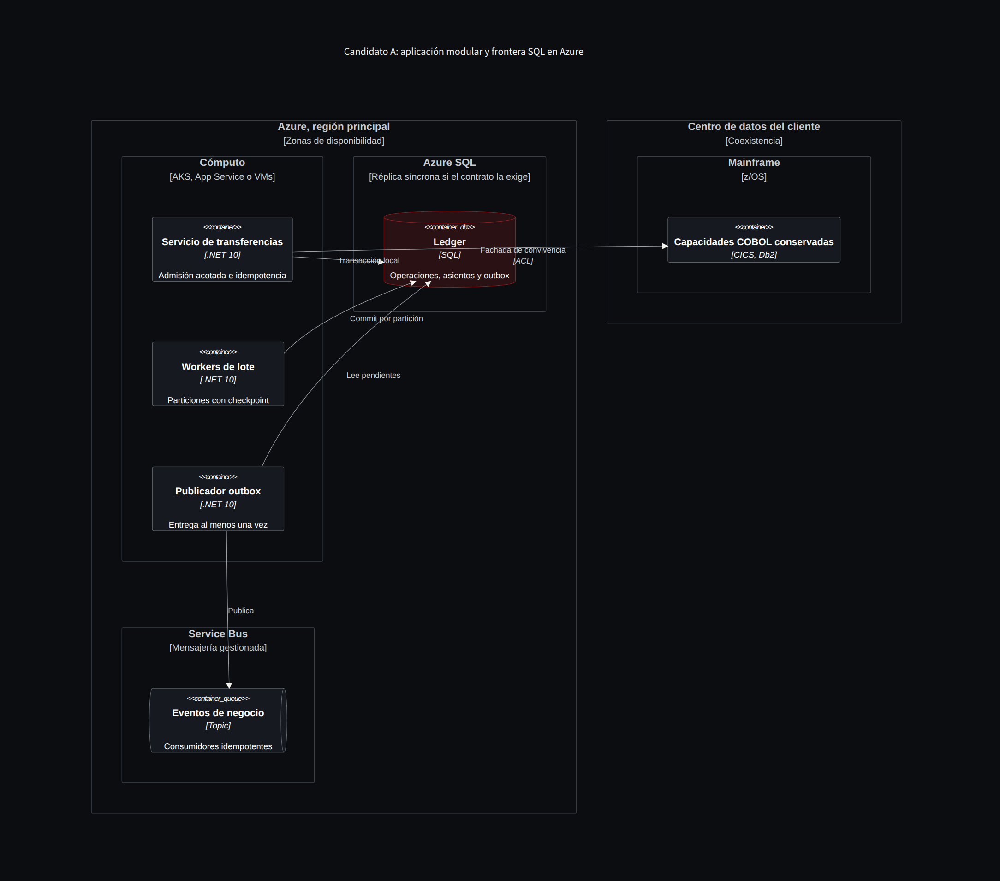

*Figura 25.1 · Candidato A: aplicación modular y una frontera SQL en Azure, conviviendo con capacidades COBOL conservadas.*

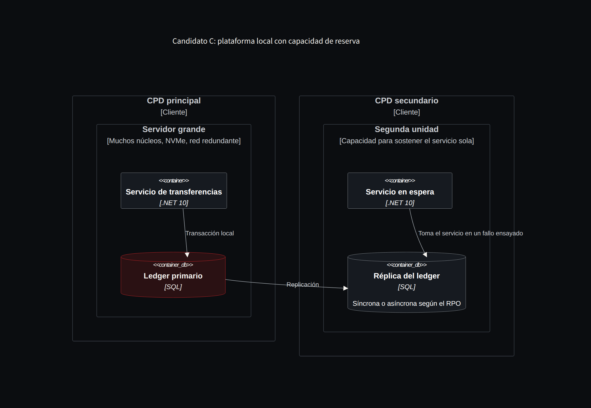

*Figura 25.2 · Candidato C: la «máquina enorme» solo es un candidato serio con su segunda unidad, su réplica y su recuperación ensayada.*

Los tres pueden incluir COBOL conservado y C# nuevo. El cambio de plataforma y el de lenguaje no necesitan ejecutarse de una vez. Una coexistencia bien delimitada permite obtener mediciones antes de asumir una sustitución completa.

Mi punto de partida sería mantener la frontera transaccional más sencilla que cubra las garantías y escalar donde la carga permita independencia. Después evaluaría si distribuir estado aporta capacidad suficiente para compensar la coordinación adicional.

#### Una arquitectura de referencia: decisiones, no cajas de colores

Propongo una arquitectura de referencia con cinco dominios operativos. Primero, un **adaptador de coexistencia** expone transacciones COBOL autorizadas, traduce los contratos y enruta tráfico. Segundo, una **capa de capacidades de negocio** contiene servicios .NET 10 y, en dominios adecuados, Orleans; otros componentes pueden ser procesos batch. Tercero, un **núcleo de datos transaccional** mantiene el ledger y las reglas de commit. Cuarto, una **capa de integración fiable** usa outbox, inbox, colas y proyecciones. Quinto, una **capa de evidencia y gobierno** ejecuta oráculos, observa drift y controla la entrega.

No asumiría Kubernetes por defecto. Una aplicación con poca variabilidad, carga bien conocida y una única base de datos puede operar eficientemente en VMs o bare metal. Azure App Service, AKS, contenedores, VMs y Azure Local tienen distintos compromisos de operación; la elección responde a SLO, equipo y restricciones, no al afán de ser cloud native. Lo mismo ocurre con Cosmos DB frente a SQL: la distribución global no compensa perder una frontera transaccional que el negocio necesita. Para ciertos ledgers, un motor relacional ACID es la opción más directa.

La arquitectura tiene una **regla de unicidad**: ninguna responsabilidad crítica puede quedar ambigua. Un componente aprueba comandos; un sistema es autoritativo para cada dato; un gate aprueba cada baseline; una persona o comité autoriza cambios de negocio; una operación registra su idempotency key. En diseños que parecen muy distribuidos pero no resuelven esas responsabilidades, los fallos se desplazan del código a la coordinación.

#### Localización de los actores

Si utilizamos Orleans, ubicaría actores por claves de cuenta o contrato para operaciones que se beneficien del aislamiento de identidad. No situaría allí toda la contabilidad sin haber verificado persistencia, transacciones y recuperación. Las transferencias entre cuentas deberían atravesar un boundary contable explícito. Para cargas batch pesadas elegiría workers particionados con checkpoints. Para consultas utilizaría modelos de lectura, sabiendo que pueden retrasarse respecto al ledger. Cada elección tiene una razón falsable y una alternativa.

#### Probar el peor día que queremos soportar

El ensayo de aceptación debe combinar carga interactiva y batch si en producción comparten recursos. Debe incluir el volumen y la distribución de datos que producen los planes de consulta relevantes. Una base pequeña que cabe en caché puede esconder un problema que aparece al crecer el working set.

Probaría la pérdida de una instancia cuando el resto ya recibe carga, no únicamente cuando la plataforma está vacía. Si necesitamos sostener el servicio con una unidad menos, la capacidad de reserva se demuestra en esa condición. Lo mismo ocurre con mantenimiento, reconstrucción de índices, backups y recuperación.

También mediría el atasco y su drenaje. Una cola que absorbe un pico puede parecer una solución si solo miramos la ausencia de errores; el servicio sigue incumpliendo si tarda horas en ponerse al día. La edad del mensaje y la latencia desde la intención del usuario deben acompañar al throughput del consumidor.

El criterio de elección no es cuál gana una prueba aislada. Es cuál satisface el contrato completo, con un coste y una capacidad operativa que la organización pueda sostener.

> **La «supercomputadora» del cliente también necesita alta disponibilidad, recuperación, mantenimiento sin parada y un segundo emplazamiento.**

### Capítulo 25 bis · Infraestructura frente a un mainframe actual: local, Azure y la red de oficinas

> **Tesis.** No se sustituye un mainframe con una máquina de más núcleos. Se sustituye un servicio operacional completo: procesamiento transaccional, I/O, aislamiento, commit duradero, continuidad y respuesta desde una oficina situada quizá a miles de kilómetros. La equivalencia es una prueba de extremo a extremo, no una comparación de fichas comerciales.

Este capítulo complementa el [capítulo 25](#capítulo-25--azure-o-una-máquina-enorme-en-el-cliente) con referencias comerciales identificables y un protocolo para falsar el diseño. **Datos de producto consultados en octubre de 2026; resultados de rendimiento propios frente a esos equipos: ninguno.**

#### Equipos reales, números reales y una comparación que todavía no podemos hacer

| Referencia de mercado | Capacidad anunciada por el fabricante | Qué representa y qué NO demuestra |
|---|---|---|
| [IBM z17 ME1](https://www.ibm.com/products/z17) | Hasta **208 engines**, **64 TB** de memoria y CPU Telum II a **5,5 GHz** | Mainframe IBM Z para cargas críticas; 208 engines configurables no equivalen a 208 vCPU x86 ni a TPS verificadas |
| [IBM LinuxONE Emperor 5](https://www.ibm.com/downloads/documents/us-en/1227cc9e78cb9240) | Hasta **208 engines**, **64 TB**, **5,5 GHz** | Arquitectura de clase IBM Z centrada en Linux; no sustituye automáticamente a z/OS/CICS/Db2 ni es una segunda medición de TPS |
| [Unisys ClearPath Forward Dorado 8590](https://www.unisys.com/siteassets/collateral/pi-sheet/pi-200145-clearpathforwarddorado8590.pdf) | Publica una escala de **200–8.400 MIPS/mes** y techo de **12.000 MIPS** por partición OS 2200; especifica **925 MIPS** por procesador monohilo | **MIPS propio del fabricante** y modelo comercial concreto; no comparable directamente con IBM Z ni con vCPU |
| [Azure Mdsv3 Very High Memory](https://learn.microsoft.com/en-us/azure/virtual-machines/sizes/memory-optimized/mdsv3-vhm-series) | Tamaños publicados de **896 a 1.792 vCPU**, hasta **30.400 GiB**, red hasta **185 Gbit/s** y disco remoto hasta **8 GB/s** | Ficha de VM; no implica capacidad de commit de un ledger ni que la región, cuota o coste permitan usarla |
| [Nodo local AMD EPYC 9965](https://www.amd.com/en/products/processors/server/epyc/9005-series/amd-epyc-9965.html) | **192 núcleos/384 hilos por socket**, plataforma 1P/2P, 12 canales DDR5 y hasta 3,7 GHz turbo | Candidato de CPU para servidores físicos. Dos sockets podrían aportar **384 núcleos físicos**, pero no 384 motores IBM ni la resiliencia de un mainframe |

Las cifras de memoria, núcleos, frecuencia, MIPS comerciales y ancho de banda **son especificaciones de fabricante, no resultados de nuestro laboratorio**. Además, IBM z17 y LinuxONE pertenecen a familias con componentes emparentados: no deben sumarse sus capacidades como si fueran sistemas en un benchmark común. La documentación de [zPCR](https://www.ibm.com/support/pages/getting-started-ibm-z-processor-capacity-reference) permite estudiar configuraciones de capacidad de IBM Z; tampoco es una tabla universal de «MIPS por vCPU».

Una migración concreta necesita antes un **workload fingerprint**: curvas de TPS/CICS, consumo MSU y zIIP, CPU por transacción, distribución de claves, I/O de Db2/VSAM, tamaños reales de datos, p99 por operación, ventanas batch, dependencias síncronas, recuperación y coste. Sin eso, cualquier «equivalencia» de hardware es publicidad.

#### La oficina bancaria está lejos: la WAN es parte de la transacción

Una pantalla 3270 puede tener un perfil de red distinto al de una SPA que hace doce peticiones REST. IBM documenta que los terminales actuales suelen llegar a z/OS mediante **TN3270/TN3270E sobre TCP/IP**, y que una métrica interna de CICS **no incluye** todo el viaje por controladores y red hasta que el usuario ve la respuesta ([conexión 3270](https://www.ibm.com/docs/en/cics-ts/6.x?topic=security-3270-connections-zos); [observación de tiempos](https://www.ibm.com/docs/en/cics-ts/6.x?topic=constraints-observing-response-time)). **No confundamos CICS internal response time con branch-to-screen response time.**

La restricción física tampoco desaparece con ExpressRoute: la luz viaja aproximadamente a 200.000 km/s en fibra. Un recorrido de **1.000 km reales de fibra** tiene un límite ideal de unos **10 ms de ida y vuelta**, antes de colas, equipos, inspección, rutas no directas y aplicación. No es una medición de una ruta bancaria. Microsoft recuerda que el **trazado físico de la fibra y la distancia** dominan la latencia WAN ([guía ExpressRoute](https://learn.microsoft.com/en-us/azure/expressroute/expressroute-troubleshooting-network-performance)).

##### Presupuesto de respuesta desde el teclado hasta la pantalla

El presupuesto no termina en el `HTTP 200` del backend:

```text
Oficina / TN3270 o navegador
  | LAN + SD-WAN/MPLS/VPN + proveedor + encaminamiento + TLS
  v
Entrada / gateway / autenticación / anti-fraude
  | routing, admission control, cola, salto(s) entre servicios
  v
.NET 10 / CICS adaptador de coexistencia
  | bloqueo de clave caliente + log de commit + réplica síncrona
  v
Ledger autoritativo / outbox
  | respuesta + red de vuelta + renderizado de pantalla
  v
Empleado de la sucursal
```

Separaría los tiempos: `L_WAN-RTT`, handshake/sesión, autenticación, colas, aplicación, adquisición de locks, log duradero y renderizado. **El p99 de una suma no es, en general, la suma de los p99 individuales**: se debe medir la distribución de la operación completa, con trazas correlacionadas.

**Ejemplo ilustrativo, NO observado:** supongamos RTT de oficina de 35 ms. Si una pantalla obliga a cuatro viajes secuenciales adicionales al servidor, solo esos viajes aportan cerca de **140 ms** de espera en el camino crítico, sin contar CPU, DB ni jitter. Con una única operación gruesa de negocio se puede reducir ese coste, siempre que no se cargue la semántica transaccional o se permita una confirmación prematura. **Menos chattiness puede importar más que duplicar cores.**

##### Comparar cuatro caminos de entrada

| Camino | Cómo lo probaría | Riesgo a vigilar |
|---|---|---|
| Oficina → red bancaria → centro de datos local → CICS | Transacción TN3270/host, RTT y tiempo real de pantalla, por percentiles y zona | Cabeceras antiguas, sesiones, concentradores, saltos y cuello de botella del host |
| Oficina → SD-WAN → ExpressRoute → Azure | `Connection Monitor` desde emplazamientos, HTTPS de negocio, p99 de aplicación y reintentos | Circuito y gateway, inspección, saltos y distancia hasta la región |
| Oficina → SD-WAN → hub Azure Virtual WAN → servicio | Rutas efectivas, vHub/NVA, failover de enlace, doble inspección y pérdida | *Hairpin*, concentraciones y capacidad de NVA/gateway |
| Oficina → edge de integración local → núcleo en Azure | Un solo comando validado, idempotency key, outbox y resultado visible | Enlace interrumpido, doble confirmación, estado inconsistente u operaciones pendientes |

[ExpressRoute](https://learn.microsoft.com/en-us/azure/networking/hybrid-connectivity/hybrid-connectivity) proporciona una vía privada y más predecible, **no teletransporte**. [FastPath](https://learn.microsoft.com/en-us/azure/expressroute/about-fastpath) puede reducir saltos del gateway bajo requisitos concretos. [Virtual WAN/SD-WAN](https://learn.microsoft.com/en-us/azure/virtual-wan/sd-wan-connectivity-architecture) ayuda a conectar sucursales, pero cada inspección o salto debe medirse. Evitaría *hairpin* entre VNets a través de ExpressRoute cuando exista peering adecuado ([guía de misión crítica](https://learn.microsoft.com/en-us/azure/well-architected/mission-critical/mission-critical-networking-connectivity)).

**Muy importante:** un edge de sucursal puede almacenar lectura autorizada, iniciar solicitudes y presentar estado; **no debe confirmar débitos o créditos como definitivos si el ledger autoritativo no ha confirmado el commit**. Pérdida de conectividad significa PENDING/INCONCLUSIVE, reconciliación posterior y una sola aplicación idempotente, no saldo inventado.

#### Azure: diseñar horizontalmente antes de comprar una VM más grande

Lo anterior no se debería leer como «para igualar un z17, busquemos la VM Azure más grande». Esa es una **referencia física para acotar el problema**, no una estrategia de modernización. La hipótesis inicial es **descomponer por límites transaccionales y escalar las partes paralelizables**, con un ledger claramente autoritativo.

| Candidato | Escalado horizontal que sí proporciona | Lo que NO escala mágicamente |
|---|---|---|
| VM Scale Sets | Varias VMs homogéneas, health probes y autoscale de instancias; alta densidad sin Kubernetes | Un proceso legado con estado compartido, commits distribuidos y bloqueos de claves calientes |
| AKS Standard / Automatic | Réplicas de servicios, HPA/RPS/CPU, KEDA para colas, Cluster Autoscaler/NAP para nodos; aislamiento y despliegues | La BD, log síncrono, IOPS y la cola de una sola clave; subir pods puede agravar contención |
| Azure Container Apps Consumption / dedicado | Réplicas por concurrencia HTTP y KEDA; trabajos/eventos sin operar clústeres | La instancia mínima, cold start, conexiones largas y actores con estado: **Dapr Actors no admite scale-to-zero** |
| App Service Premium v3 | Escalado horizontal por instancias de plan, autoescala y menos operación de infraestructura | Co-residencia de apps en el mismo plan, sesiones y almacenamiento compartido |
| Orleans | Particionar por identidades/grains y coordinar operaciones por clave dentro de un clúster escalable | Un actor caliente sigue siendo cuello de botella; un grain no reemplaza una transacción ACID entre cuentas |

Microsoft diferencia [HPA, VPA, Cluster Autoscaler, NAP y KEDA](https://learn.microsoft.com/en-us/azure/aks/concepts-scale). El escalado horizontal del *compute* debe validarse con un **experimento de saturación de ledger**: 1, 2, 4, 8 y 16 réplicas con carga abierta, ratio de hot keys controlado, transacciones confirmadas/s y p99 extremo a extremo; un sistema que duplicara pods sin aumentar commits habría encontrado su límite real. El [autoscalado de Container Apps](https://learn.microsoft.com/en-us/azure/container-apps/scale-app) tiene límites y semánticas propias.

**Patrón candidato**: sucursal → API de negocio (OAuth, WAF, idempotency key) → comandos gRPC sin estado entre procesos co-localizados → servicio dueño del ledger y su base transaccional; para operaciones diferibles, cola/Service Bus, outbox y workers con KEDA. Mantener lectura CQRS solo donde consistencia y SLA lo permitan. El resultado confirmado debe depender del commit; un timeout posterior da **INCONCLUSIVE** hasta consultar por identificador de operación.

##### gRPC interno: una herramienta infrautilizada, no un dogma

gRPC suele usar **HTTP/2 con TLS**, por lo que no es correcto oponer «gRPC» a «HTTPS» como tecnologías excluyentes. La comparación relevante es **gRPC/Protobuf frente a REST/JSON sobre un transporte, despliegue y seguridad equivalentes**. Evaluaría:

- **Dónde sí**: contratos binarios versionados, llamadas síncronas frecuentes y co-localizadas, streaming cuando realmente se usa y generación tipada C# entre equipos.
- **Dónde no forzarlo**: APIs públicas de terceros, exploración desde navegador sin un gateway apropiado, procesos largos que deben desacoplarse mediante mensajería y operaciones que requieren transacción única sobre un ledger.
- **Guardrails**: proto compatible, deadlines propagados, cancelación, mTLS/workload identity, trazas OTel, límites de mensaje, idempotencia, retries solo donde sean seguros, circuit breaking y protección de sobrecarga.
- **Riesgos**: conexiones HTTP/2 muy persistentes pueden sesgar balanceo entre pods; flujos sin límites, proxy que degrada HTTP/2, colas en un solo channel y cascadas de retries pueden empeorar p99.

En [Azure Container Apps](https://learn.microsoft.com/en-us/azure/container-apps/connect-apps), gRPC requiere configurar transporte **HTTP/2 extremo a extremo**, y el tráfico interno puede circular a través de Envoy. En AKS debe verificarse la ruta de ingreso/service mesh, TLS y el comportamiento real de balanceo; un `Service` no garantiza por sí solo distribución por RPC en canales gRPC persistentes. Comparar **carga ofrecida**, commits/s, p50/p95/p99, CPU/MB por solicitud, bytes de payload, número de saltos, conexiones activas, errores, retries, memoria y coste de infraestructura, con el mismo contrato funcional y oráculo.

##### Primera evidencia M1: el transporte no es el ledger

El [ensayo ejecutado M1](../evidence/runs/M1.es.md) comparó gRPC/Protobuf y REST/JSON con **HTTP/2 sobre localhost, sin TLS ni base de datos**, en .NET 10. GitHub registró 2.500 solicitudes por ronda y concurrencia 8 y 32. Ambas rutas devolvieron resultados correctos, pero **no hubo superioridad sistemática de gRPC en el p99**. Es una advertencia importante: ni el protocolo ni el payload más pequeño prueban una mejora del commit bancario; la siguiente prueba debe incluir persistencia, canales TLS y distribución entre réplicas.

##### M2 · Cuando 16 procesos rinden menos que uno

La [evidencia M2 ejecutada](../evidence/runs/M2.es.md) conecta **REST y gRPC al mismo ledger PostgreSQL durable**. Sobre un runner compartido, la serie de 20 casos (1/2/4/8/16 procesos, dos protocolos, tráfico uniforme y cuenta caliente) produjo **20 PASS contables**: 256 commits, 512 asientos y 256 eventos outbox por caso. Los procesos adicionales **no aceleraron el sistema**; a 16 procesos la carga competía por una CPU pequeña y una única BD. El gráfico y todos los valores están conservados en el repositorio. **No lo confundamos con un benchmark Azure**: faltan nodos independientes, TLS, carga abierta y fallos de red.

#### Precios fechados y TCO: que no nos engañe el precio por vCPU

La consulta oficial realizada **el 29-10-2026 a las 18:26 UTC**, en West Europe (Linux, consumo, EUR orientativo), devolvió **D4as_v5 0,1830 €/h**, **D4s_v5 0,2024 €/h** y **D8as_v5 0,3661 €/h**. Esto implica **400,77 €/mes** de cómputo para tres D4as_v5 durante 730 horas, frente a **801,54 €/mes** para seis, siempre sin BD, discos, redes o alta disponibilidad. Los medidores, `effectiveStartDate` y fuente CI están en el registro enlazado.

La tabla económica auditable está en [Comparativa de costes, 29-10-2026](../docs/PRICING.es.md) y el [registro estructurado](../lab/cost/dated_prices.json). Incluye precios públicos **fechados y con origen**, un modelo reproducible de escala de 3–6 nodos, y comparación con referencias de CPU EPYC y equipos IBM/Unisys **pendientes de RFQ**.

No es correcto comparar una única VM enorme de Azure contra todo un mainframe, ni sumar 3 VMs en AKS y llamarlo TCO. El coste real tiene tres capas: **procesamiento replicable**, **datos autoritativos y su durabilidad**, **red de sucursales + continuidad/operación**. La medición económica deberá incorporar coste por millón de **transferencias confirmadas y contablemente correctas**, no solo VM/hora. Los importes capturados llevan fecha, moneda y exclusiones; las cotizaciones contractuales no públicas permanecen **sin precio**, nunca «0».

#### Tres blueprints dimensionables

| Diseño | Topología candidata (NO sizing aprobado) | Dónde suele estar el límite |
|---|---|---|
| **On-premises crítico** | Dos o más nodos físicos x86 de alta densidad (p. ej. EPYC), dominio SQL HA, NVMe empresarial, redes 25/100 GbE, réplica y segundo CPD; acceso desde WAN del banco | Durabilidad real del log, locks, NUMA, NIC, sincronización de réplicas, mantenimiento con un nodo menos |
| **Azure transaccional** | .NET 10 en VMs/AKS/App Service según necesidad, SQL HA en misma zona/región lógica, Private Link/ExpressRoute, Front Door o gateway según el modelo de acceso, observabilidad end-to-end | VM + cuotas, IOPS de VM **y** disco, log, RTO de failover, gateway, dependencia entre zonas |
| **Híbrido de coexistencia** | CICS/Db2 existente preservado detrás de fachada autorizada; nuevas capacidades en Azure/local; gateway con contratos, outbox y ownership inequívoco del ledger | Chattiness cross-site, transacciones distribuidas, cola, reconciliación y duplicidad semántica |

No pondría la aplicación en una región y el ledger síncrono al otro lado del océano. Si los dos tienen que coordinar cada commit, esa **latencia entra en el p99 y puede limitar el throughput**, por más núcleos que compremos. El objetivo será reducir dependencias seriales, colocar el dato autoritativo cerca del cálculo crítico y diseñar particiones por dominio sin romper el grano contable. La opción local también requiere segunda ubicación y un ensayo real de pérdida de nodo.

#### Un contrato medible para las sucursales

Antes de comparar, definiría una muestra representativa y aprobada: sucursal urbana cercana, sucursal regional, internacional, red degradada y operación tras failover. No fijaría RTT ni SLA desde el escritorio de arquitectura. Mediría **p50/p95/p99 por operación y por sede**, separado del tiempo interno de CICS, más loss/jitter, DNS, TLS, sesión, bloqueos, log duradero, propagación de réplica, edad de colas, timeouts y reintentos.

El ensayo se debe ejecutar con carga **online + batch**, claves calientes, replicación y picos; repetir con 0,1 % y 0,5 % de pérdida **inyectada (no observada)**, jitter parametrizado y retirada de un enlace o una instancia. Cada prueba guardará `commit SHA`, config de región/ruta, versión de cliente y servidor, percentiles, coste y veredicto del oráculo. [Azure Connection Monitor](https://learn.microsoft.com/en-us/azure/network-watcher/connection-monitor-overview) sirve para observar RTT y pérdidas, pero una prueba TCP/ICMP **no reemplaza** la latencia de la transacción real.

La aceptación exige equivalencia de **resultados de negocio, finalización durable, recuperación y latencia percibida**, no solo TPS. Una red rápida sin un ledger correcto no sirve; un ledger correcto con pantallas inaceptables tampoco.

#### Evidencia propia: qué hay y qué no hay

El laboratorio de esta rama sí dispone de [resultados E1a/E1b versionados](../evidence/runs/README.es.md): deadlock real `40P01`, serialización `40001`, oráculo que detecta corrupción, y paridad parcial .NET 10/Npgsql frente a PostgreSQL. **No existe todavía benchmark del IBM z17, LinuxONE, Dorado 8590, Azure Mdsv3 o EPYC**, ni medida desde una oficina a cientos de kilómetros. La matriz de evidencia no puede promover esas comparativas hasta disponer de carga reproducible, SLO aprobado y mediciones in situ.

> La arquitectura que gana no es la que corre más deprisa dentro del CPD. Es la que confirma la operación correcta y se la devuelve a la oficina, incluso cuando el peor día de red coincide con el cierre contable.

## Parte VI · El laboratorio: de la demo a la evidencia

Todo lo anterior, en código que puedes ejecutar, leer en una tarde y romper a propósito. El laboratorio es pequeño para que se entienda el mecanismo, y su alcance es explícito para que nadie lo confunda con una migración terminada.

### Capítulo 26 · Un laboratorio local que se puede entender

> [!IMPORTANT]
> **Tesis del capítulo.** Un COBOL real, un candidato C#, un gate independiente y un contrato fijado, ejecutados en local sin llamar a ningún modelo. La facilidad de reproducirlo debe ayudarnos a ver la dificultad real con más claridad.

> [!NOTE]
> En este repositorio el laboratorio está en la carpeta [`lab/`](../lab/README.md). Los comandos de este texto se ejecutan desde ella.

#### El caso didáctico

El servicio recibe un registro de catorce caracteres. Los ocho primeros representan el importe en céntimos; los cinco siguientes, la tasa en puntos básicos; el último indica si el cliente está activo. Los valores admitidos son de cero a 99 999 999 céntimos, de cero a 10 000 puntos básicos y los estados Y o N.

Un cliente inactivo recibe REJECT con comisión cero. Un cliente activo recibe REVIEW cuando el importe supera 1 000 000 de céntimos; en el umbral exacto recibe APPROVE. La comisión se calcula para los clientes activos con el redondeo descrito en el capítulo [12](#capítulo-12--cobol-y-c-deben-acordar-el-significado). Los registros de anchura fija que contienen caracteres inválidos o una tasa fuera del rango devuelven INVALID y comisión cero.

La política es ficticia y la elegimos porque permite estudiar prioridad de reglas, frontera de comparación, representación y redondeo dentro de un programa pequeño.

El contrato incluye 58 casos: catorce casos explícitos de frontera y comportamiento, cuarenta casos generados con semilla fija y cuatro registros inválidos de catorce caracteres. Son entradas de una única capacidad sintética, no 58 proyectos independientes ni una muestra de aplicaciones empresariales.

Este es el programa completo. Merece la pena leerlo despacio: en 40 líneas aparecen `REDEFINES`, un campo `COMP-3`, `ROUNDED`, `ON SIZE ERROR` y una prioridad de reglas que no es la que uno escribiría intuitivamente.

**Listado 26.1 · legacy/fee.cob** — *Ejecutado*

```cobol
identification division.
program-id. fee.
environment division.
configuration section.
repository. function all intrinsic.
data division.
working-storage section.
01 raw-input pic x(14).
01 request-fields redefines raw-input.
   05 amount-cents pic 9(8).
   05 rate-bps pic 9(5).
   05 customer-active pic x.
01 fee-cents pic 9(8) comp-3.
01 fee-display pic 9(8).
01 result-code pic x(7).
procedure division.
    accept raw-input
    move 0 to fee-cents fee-display
    evaluate true
      when amount-cents is not numeric
      when rate-bps is not numeric
      when customer-active not = 'Y' and not = 'N'
        move 'INVALID' to result-code
      when rate-bps > 10000
        move 'INVALID' to result-code
      when customer-active = 'N'
        move 'REJECT' to result-code
      when other
        compute fee-cents rounded = amount-cents * rate-bps / 10000
          on size error
            move 'INVALID' to result-code
          not on size error
            move fee-cents to fee-display
            if amount-cents > 1000000
              move 'REVIEW' to result-code
            else
              move 'APPROVE' to result-code
            end-if
        end-compute
    end-evaluate
    display trim(result-code) '|' fee-display
    goback.
```

#### Qué significa ejecutar COBOL en local

GnuCOBOL proporciona el compilador y el entorno de ejecución utilizados en el laboratorio. El comando `cobc -x -free` genera un ejecutable a partir del fuente [10]. No lo presento como intérprete puro. El recorrido guiado oculta parte de la mecánica repetitiva, pero muestra el comando y el resultado para que el lector sepa qué está ocurriendo.

El paquete contiene el fuente COBOL, una implementación candidata C#, un gate independiente como proceso .NET, los casos fijados y un orquestador Python. Python lanza los programas y conserva las observaciones. La decisión de aceptación la calcula el gate .NET.

Hay una razón para mantener la demo sin llamadas a un modelo remoto: la reproducción del comportamiento no debe depender de que el proveedor responda igual o de disponer de una clave. El laboratorio fue construido con asistencia de IA, pero su ejecución no incluye un agente autónomo ni una integración de REA. Esas extensiones se describen más adelante como trabajo adicional.

#### Dos formas de recorrerlo

La ejecución completa prepara los binarios, ejecuta casos y controles y guarda los informes. El modo guiado se detiene entre pasos: explica el registro, muestra el COBOL, ejecuta un ejemplo, muestra la traducción candidata y termina con los gates.

La ruta nativa necesita Python, el SDK .NET 10 y GnuCOBOL. El paquete incorpora además una receta para Podman que los reúne en una imagen y ejecuta el laboratorio sin red. Los comandos exactos están en el anexo [A](#anexo-a--un-laboratorio-que-pueda-contradecirnos) y en el README. Es importante distinguir la ejecución nativa verificada de una receta de contenedor que debe validarse en el equipo donde se vaya a construir.

Al terminar, el lector tiene archivos de resultados que puede abrir y comparar. No necesita confiar en una captura de pantalla. Puede cambiar una implementación, repetir el recorrido y examinar qué propiedad dejó de cumplirse.

#### Qué hay en la caja

**Listado 26.2 · Estructura del laboratorio (en inglés)** — *Ejecutado*

```text
legacy/fee.cob              servicio COBOL sintético
Candidate/                  implementación C# con modos de mutación deliberados
Gate/                       evaluador .NET: PASS / FAIL / INCONCLUSIVE + mandato
Bank/                       transferencias SQL con idempotencia, doble asiento y outbox
contracts/                  58 casos aprobados y su ancla SHA-256
run.py · bank_test.py       equivalencia y controles · concurrencia y recuperación
walkthrough.py              recorrido guiado
cobol_local.py              compilar y ejecutar un fuente COBOL de consola
tools/                      verificación offline y simulación de omisión coordinada
examples/                   laboratorio de calentamiento: oráculo a tres bandas
risk-catalog/               R001–R100
reference-results/          evidencia de la ejecución de referencia, sin modificar
Containerfile · scripts/    receta Podman y lanzadores
```

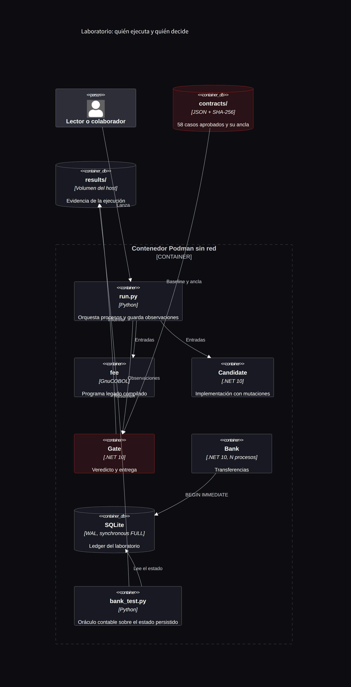

*Figura 26.1 · El laboratorio dentro de un contenedor Podman sin red: quién ejecuta qué y quién decide.*

#### Antes de compilar nada

Hay comprobaciones que no necesitan ni GnuCOBOL ni .NET, y conviene hacerlas primero. `tools/verify_offline.py` comprueba el ancla de la baseline, recalcula los 58 resultados esperados con una tercera implementación de la política escrita, informa de qué fuentes son idénticos byte a byte a los de la ejecución de referencia y vuelve a pasar el oráculo contable sobre las bases persistidas.

**Listado 26.3 · Verificación offline (salida abreviada)** — *Ejecutado*

```text
[1] baseline anchor ............ OK
[2] independent policy ......... 58/58 cases agree
[3] provenance against the reference run (29 Oct 2026, native Linux):
    Bank/Program.cs                  identical
    Candidate/Program.cs             identical
    Gate/Program.cs                  identical
    legacy/fee.cob                   identical
    run.py                           identical
    walkthrough.py                   changed since reference run
[4] ledger oracle on reference databases:
    acceptance.db            PASS                                     as expected
    negative-control.db      REJECTED balancedPostings,twoPostingsPerCommit,projectionAgrees as expected

VERIFY: PASS (offline checks only; run.py and bank_test.py still require GnuCOBOL and .NET 10)
```

Si la implementación independiente discrepara de un caso, pararía ahí. Significaría que el contrato o mi lectura del contrato están mal, y ninguna cantidad de C# arreglaría eso.

> **No necesitas confiar en una captura de pantalla. Puedes cambiar una línea, repetir el recorrido y ver qué propiedad deja de cumplirse.**

### Capítulo 27 · Hacer que el error se vea

> [!IMPORTANT]
> **Tesis del capítulo.** Tres defectos sembrados, cuatro tipos de evidencia incompleta, una coincidencia engañosa y una entrega sin mandato. Cada uno produce un veredicto distinto, y cada veredicto deja un fichero que otra persona puede abrir.

#### Una implementación correcta dentro del alcance

Primero ejecutamos el programa COBOL y el candidato C# sobre las mismas entradas. Cada salida se contrasta con el resultado esperado fijado en el contrato. Este tercer elemento es importante: la coincidencia entre dos programas no excluye que ambos estén equivocados.

El gate no se limita a contar filas iguales. Comprueba que existan los casos esperados y que las observaciones tengan las identidades correspondientes. La falta de un caso o de una salida produce INCONCLUSIVE. Una discrepancia observada produce FAIL. Un conjunto incompleto no puede ganar por haber omitido precisamente el ejemplo que fallaba.

La baseline se comprueba frente a un digest. En la demo, ese digest permanece en un archivo local y sirve para detectar modificaciones respecto de la referencia utilizada. No demuestra aprobación humana ni resistencia frente a alguien que pueda modificar ambas piezas. Su función pedagógica es mostrar el enlace; la arquitectura de producción debe proteger el anclaje.

El corazón del gate cabe en unas líneas. Cada observación se compara con la expectativa aprobada, nunca solo con la otra implementación; la ausencia y la contradicción producen veredictos distintos; y la autorización se evalúa aparte.

**Listado 27.1 · Gate/Program.cs: tres veredictos y una autorización separada** — *Ejecutado*

```csharp
foreach(var key in new[]{"legacy","candidate"})
{
    if(!row.TryGetProperty(key,out var value) || value.ValueKind!=JsonValueKind.String)
    {missing=true;findings.Add(id+": missing "+key);continue;}
    if(value.GetString()!=c.GetProperty("expected").GetString())
    {failed=true;findings.Add(id+": "+key+" violates contract");}
}
// ...
verdict=failed ? "FAIL" : missing ? "INCONCLUSIVE" : "PASS";
// ...
var release=verdict=="PASS" && authority ? "SIMULATED_ALLOW" : "BLOCK";
```

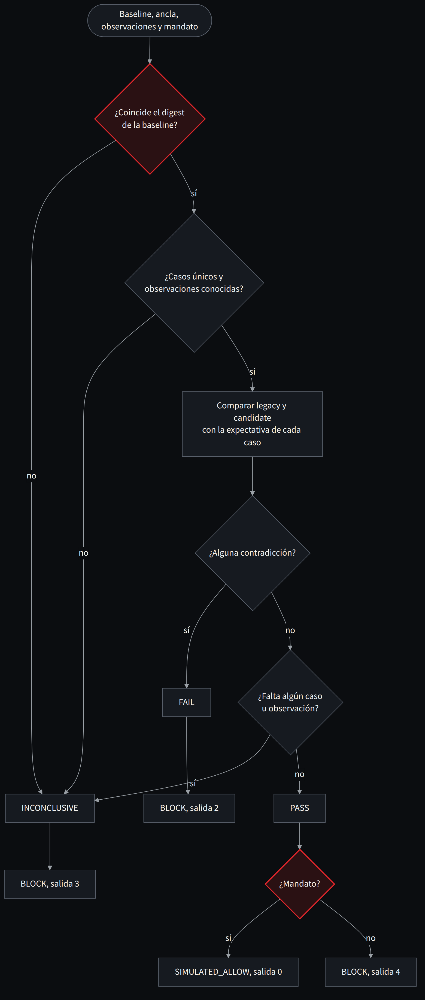

*Figura 27.1 · La lógica de decisión de Gate/Program.cs: la contradicción pesa más que la ausencia, y la autorización se evalúa aparte.*

#### Tres mutaciones del candidato

La primera mutación cambia el redondeo al par. El caso de 25 céntimos permite detectar la diferencia. El código puede parecer razonable a una revisión rápida, porque usa una operación estándar de .NET. El contrato hace visible por qué esa operación no corresponde a esta regla.

La segunda eleva el umbral de revisión de 1 000 000 a 1 200 000 céntimos. El valor inmediatamente superior al umbral correcto y el caso situado entre ambos límites exponen el defecto. Probar únicamente importes muy pequeños o muy grandes dejaría pasar la modificación.

La tercera omite el rechazo de clientes inactivos. Aquí importa el orden de decisión. No queremos que el programa calcule una comisión y apruebe una operación que debía rechazarse antes. El verificador compara la salida completa, incluyendo estado e importe.

Estos controles están sembrados de forma deliberada y son conocidos por quien ha construido el laboratorio. Sirven para demostrar el mecanismo de detección. No deben describirse como defectos descubiertos en un producto real ni como una evaluación ciega de productividad.

Las tres mutaciones viven en el mismo candidato y se activan por argumento. La del redondeo es la más instructiva, porque a primera vista no parece un error:

**Listado 27.2 · Candidate/Program.cs: los puntos donde se siembran los defectos** — *Ejecutado*

```csharp
    if (line[13]=='N' && mode!="approve-inactive")
    { Console.WriteLine("REJECT|00000000"); continue; }
    var fee=decimal.Round(amount*(decimal)rate/10000m,0,
        mode=="round-even" ? MidpointRounding.ToEven : MidpointRounding.AwayFromZero);
    var threshold=mode=="wrong-threshold" ? 1200000 : 1000000;
```

#### La igualdad también puede engañar

Otro control modifica las dos observaciones para que coincidan en un resultado incorrecto. Una comparación exclusiva COBOL–C# lo aceptaría. Nuestro gate lo rechaza porque contrasta ambas observaciones con la expectativa normativa del caso.

Este control no demuestra que el capturador sea incorruptible. Al contrario, hace visible su importancia. En producción necesitamos saber quién obtuvo la observación, qué ejecutable lanzó y qué transformaciones aplicó. Si el constructor puede fabricar toda la evidencia, una baseline correcta no basta.

Finalmente retiramos el mandato sintético. Los resultados funcionales siguen siendo correctos, pero la entrega queda bloqueada. El lector puede observar dos afirmaciones simultáneas: el candidato cumple las comprobaciones y no tiene permiso para entregarse bajo esa configuración.

Estas son dos salidas reales del gate en la ejecución de referencia. La primera bloquea el redondeo al par en el caso C003. La segunda es la coincidencia engañosa: los dos programas dicen lo mismo, y los dos se equivocan.

**Listado 27.3 · reference-results/round-even-gate.json y equal-but-wrong-gate.json** — *Ejecutado*

```json
{ "verdict": "FAIL", "authority": "DEMO_ONLY", "release": "BLOCK",
  "findings": [ "C003: candidate violates contract" ], "exitCode": 2 }

{ "verdict": "FAIL", "authority": "DEMO_ONLY", "release": "BLOCK",
  "findings": [ "C003: legacy violates contract", "C003: candidate violates contract" ],
  "exitCode": 2 }
```

Y esta es la entrega correcta pero no autorizada: comportamiento PASS, autoridad denegada, entrega bloqueada, código de salida 4.

**Listado 27.4 · reference-results/no-mandate-gate.json** — *Ejecutado*

```json
{ "verdict": "PASS", "authority": "DENY", "release": "BLOCK", "findings": [], "exitCode": 4 }
```

#### Qué podemos concluir

Los resultados acreditan que el laboratorio detecta los defectos y ausencias incluidos, con las versiones ejecutadas. No prueban equivalencia universal, seguridad de un pipeline empresarial ni capacidad autónoma de modernización. Tampoco miden cuánto trabajo ahorró la IA.

Es una conclusión más pequeña que una promesa de migración automática. También es una conclusión que otra persona puede intentar reproducir y refutar.

#### Rómpelo tú

El laboratorio está hecho para que lo contradigas. Cuatro experimentos de cinco minutos, con su resultado esperado:

| Cambio | Resultado esperado | Qué enseña |
|---|---|---|
| Cambiar `1000000` por `999999` en el candidato | FAIL en C008 | El umbral exacto es un caso, no un detalle |
| Eliminar la comprobación `rate>10000` | FAIL en C055 | La validación también es comportamiento |
| Añadir un caso a `cases.json` sin actualizar el ancla | `run.py` se niega a empezar | La baseline tiene identidad |
| Renombrar una variable del candidato | PASS | El gate juzga comportamiento, no estilo |

> **Es una conclusión más pequeña que una promesa de migración automática. También es una conclusión que otra persona puede reproducir y refutar.**

### Capítulo 28 · Transferencias, bloqueos y fallos en local

> [!IMPORTANT]
> **Tesis del capítulo.** La equivalencia funcional aislada no dice nada sobre concurrencia. El módulo bancario lleva el razonamiento de los capítulos 17 y 18 a procesos reales que compiten por un saldo, se caen después del débito y reenvían peticiones cuya respuesta perdieron.

#### El laboratorio que acompaña esta decisión

El módulo bancario ejecuta procesos .NET separados sobre una base SQLite real con WAL y confirmación FULL. Comprueba carreras por saldo, reenvíos concurrentes, reutilización conflictiva de claves, rollback, caída de proceso después del débito y commit con respuesta perdida. Fuerza una espera de bloqueo, verifica reintentos limitados y reconcilia saldos, asientos y filas outbox. Una mutación deliberada del historial comprueba que el oráculo la rechaza.

SQLite serializa las escrituras y no representa el bloqueo por fila de SQL Server o PostgreSQL [29]. Por eso este módulo permite aprender sobre atomicidad e idempotencia en local; no acredita un deadlock de filas, un cluster bancario, tolerancia a caída de máquina ni capacidad equivalente al mainframe.

Las pequeñas medidas con uno, dos, cuatro y ocho procesos sirven para observar cómo cambian latencia y contención en esta máquina. Son ensayos locales de circuito cerrado, con calentamiento y duración insuficientes para dimensionar producción. El código conserva los resultados para hacer explícito ese límite.

**Evidencia ampliada: de SQLite a PostgreSQL y SQL Server (30 de octubre de 2026).** El laboratorio conserva intacta la referencia SQLite y prueba dos implementaciones adicionales de .NET 10 sobre motores transaccionales reales en contenedores Podman. En PostgreSQL, [E1b](https://github.com/jmfloreszazo/de-la-caja-negra-a-la-evidencia/actions/runs/41034420329) completó ocho escenarios de carga lógica —1, 2, 4 y 8 trabajadores, con distribución uniforme y cuenta caliente—, 960 transferencias confirmadas por cada candidato y estados persistidos equivalentes. En SQL Server 2022 Developer, [E1c](https://github.com/jmfloreszazo/de-la-caja-negra-a-la-evidencia/actions/runs/41042317263) reprodujo la misma matriz con otros 960 movimientos confirmados por cada candidato, comparación de las cuatro tablas y siete invariantes contables independientes en todos los casos. Los [resultados originales de SQL Server](https://github.com/jmfloreszazo/de-la-caja-negra-a-la-evidencia/blob/main/evidence/runs/e1c-sqlserver-worker-parity.json) incluyen la configuración, los casos y los hashes de los ejecutables.

**Lo que cambia no es el contrato, sino el protocolo de concurrencia.** SQLite serializa escritores, PostgreSQL admite bloqueos explícitos por fila y SQL Server combina `UPDLOCK` con `sp_getapplock` en esta implementación. En pruebas separadas sobre SQL Server, [la ejecución transaccional](https://github.com/jmfloreszazo/de-la-caja-negra-a-la-evidencia/actions/runs/41041573996) observó una víctima real de deadlock (`1205`) con reintento de toda la transacción, bloqueos agotados (`1222`), tiempo de espera del cliente distinto (`-2`), idempotencia, rechazo de una clave duplicada y un control negativo de *write skew*: `SNAPSHOT` rompió la regla de mantener un operador activo, mientras `SERIALIZABLE` la preservó. El oráculo independiente detectó un asiento suprimido deliberadamente y validó su restauración.

**Límite obligatorio.** Los 960 movimientos de cada matriz se ejecutaron bajo modelos de procesos diferentes: los trabajadores SQLite permanecen vivos y el candidato SQL Server inicia un proceso .NET por transferencia. Por ello no hay una comparación válida de throughput, p99 o eficiencia entre motores; tampoco se han demostrado recuperación ante corte eléctrico, alta disponibilidad, latencia WAN, equivalencia CICS/Db2 ni capacidad MIPS de mainframe. Aquí la evidencia acredita **comportamiento contable bajo los escenarios ensayados**, no la capacidad de la arquitectura destino.

#### El contrato está en el esquema

Antes que el código, el esquema. Las restricciones de la base son la primera línea del oráculo: un saldo no puede ser negativo, una operación tiene una identidad única, cada asiento pertenece a una operación y cada operación confirmada tiene su fila outbox.

**Listado 28.1 · Esquema creado por Bank/Program.cs** — *Ejecutado*

```sql
CREATE TABLE accounts(id INTEGER PRIMARY KEY,balance INTEGER NOT NULL CHECK(balance>=0));
CREATE TABLE operations(id TEXT PRIMARY KEY,src INTEGER NOT NULL,dst INTEGER NOT NULL,
                        amount INTEGER NOT NULL CHECK(amount>0),status TEXT NOT NULL);
CREATE TABLE postings(op TEXT REFERENCES operations(id),account INTEGER REFERENCES accounts(id),
                      delta INTEGER NOT NULL CHECK(delta<>0),PRIMARY KEY(op,account));
CREATE TABLE outbox(op TEXT PRIMARY KEY REFERENCES operations(id),event TEXT NOT NULL);
```

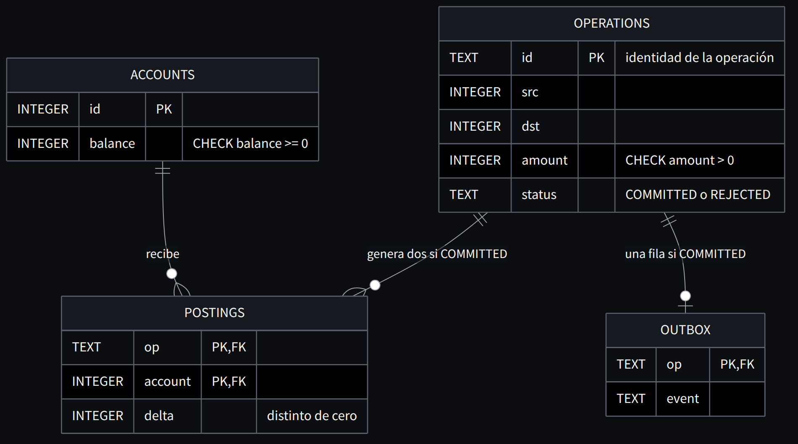

*Figura 28.1 · El esquema del módulo bancario: las restricciones son la primera línea del oráculo.*

#### Idempotencia: el mismo mandato, una sola vez

Dentro de la misma transacción que ejecutará el movimiento, el servicio busca la identidad de la operación. Si existe y el contenido coincide, devuelve la decisión anterior. Si existe con otro contenido, es un conflicto.

**Listado 28.2 · Bank/Program.cs: reenvío frente a conflicto de identidad** — *Ejecutado*

```csharp
   var existing=db.Rows($"SELECT src,dst,amount,status FROM operations WHERE id='{id}'");
   if(existing.Count>0) {
    var e=existing[0];
    var same=e["src"]==src.ToString()&&e["dst"]==dst.ToString()&&e["amount"]==amount.ToString();
    db.Exec("COMMIT");begun=false;
    return new(same?"DUPLICATE_"+e["status"]:"ID_CONFLICT",retries,clock.Elapsed.TotalMilliseconds);
   }
```

Una nota de oficio: el laboratorio construye SQL interpolando valores porque llama a la biblioteca nativa sin capa intermedia, y lo hace después de validar la identidad con una expresión regular estricta y de tipar los números. En un servicio real usaría parámetros siempre. La regla de negocio que demuestra es la misma.

#### Fallos sembrados donde más duelen

**Listado 28.3 · Bank/Program.cs: tres fallos inyectados y el reintento acotado** — *Ejecutado*

```csharp
   if(approved) {
    if(fault=="crash-after-debit")Environment.Exit(91);
    if(fault=="throw-after-debit")throw new InvalidOperationException("Injected failure after debit");
    db.Exec($"UPDATE accounts SET balance=balance+{amount} WHERE id={dst}");
   }
   // ... operación, asientos y outbox ...
   db.Exec("COMMIT");begun=false;
   if(fault=="lost-response")Environment.Exit(92);
   return new(status,retries,clock.Elapsed.TotalMilliseconds);
  } catch(SqlFailure e) when(e.Code==5||e.Code==6) {
   if(begun)db.Exec("ROLLBACK");retries++;
   Thread.Sleep(Math.Min(50,2*(attempt+1))+Random.Shared.Next(1,8));
  }
```

El proceso que muere después del débito y antes del commit no deja cargo parcial, porque el débito nunca se confirmó. El proceso que muere después del commit sin responder deja una decisión durable: el reenvío con la misma identidad la recupera como `DUPLICATE_COMMITTED` en lugar de cobrar dos veces. Y el bloqueo mantenido por otro proceso produce esperas y reintentos acotados; al agotar doce intentos, el servicio informa `RETRY_EXHAUSTED` y no toca los saldos.

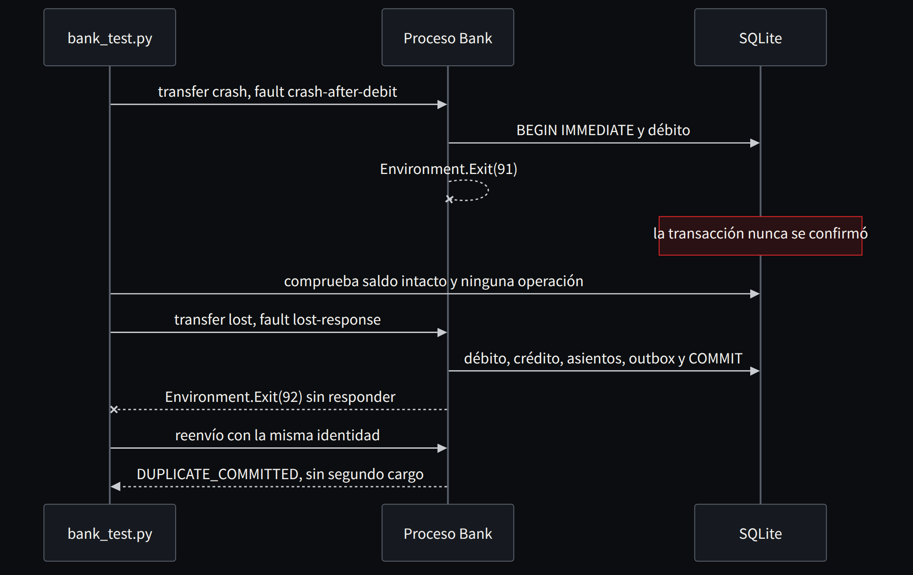

*Figura 28.2 · Dos fallos sembrados en el laboratorio: caída antes del commit y respuesta perdida después del commit.*

#### El oráculo no le pregunta al servicio

El verificador es un proceso Python distinto que abre la base y comprueba invariantes sobre los datos persistidos. No consulta la respuesta del servicio, porque un servicio puede contestar «OK» y haber dejado otra cosa detrás.

**Listado 28.4 · bank_test.py: invariantes contables sobre el estado persistido** — *Ejecutado*

```python
tests={
 'nonnegative':s('SELECT MIN(balance) FROM accounts')>=0,
 'conserved':s('SELECT SUM(balance) FROM accounts')==s('SELECT COUNT(*)*100000 FROM accounts'),
 'balancedPostings':s('SELECT COUNT(*) FROM (SELECT op FROM postings GROUP BY op '
                      'HAVING SUM(delta)<>0 OR COUNT(*)<>2)')==0,
 'projectionAgrees':s('SELECT COUNT(*) FROM accounts a WHERE balance<>100000+COALESCE('
                      '(SELECT SUM(delta) FROM postings p WHERE p.account=a.id),0)')==0,
 # ... twoPostingsPerCommit y outboxAtomic
}
```

Conservar el total es necesario y no suficiente: un movimiento cargado a la cuenta equivocada también conserva el total. Por eso el oráculo exige además dos asientos balanceados por operación y que cada saldo se pueda reconstruir desde su historial. El control negativo borra un asiento de una copia de la base, y el oráculo debe rechazarla. Lo hace.

#### Medidas locales, y por qué no son capacidad

| Patrón | Procesos | Operaciones | Op/s incl. arranque | p50 ms | p95 ms | p99 ms | Reintentos |
|---|---|---|---|---|---|---|---|
| uniforme | 1 | 32 | 221,9 | 1,52 | 1,99 | 2,03 | 0 |
| uniforme | 2 | 64 | 348,4 | 1,27 | 1,82 | 10,51 | 0 |
| uniforme | 4 | 128 | 509,4 | 0,93 | 1,90 | 41,70 | 1 |
| uniforme | 8 | 256 | 693,3 | 0,77 | 27,22 | 124,90 | 4 |
| caliente | 1 | 32 | 259,9 | 1,17 | 1,61 | 1,79 | 0 |
| caliente | 2 | 64 | 351,3 | 1,13 | 3,82 | 11,77 | 0 |
| caliente | 4 | 128 | 495,6 | 0,81 | 2,04 | 42,08 | 0 |
| caliente | 8 | 256 | 624,4 | 0,85 | 28,40 | 109,78 | 5 |

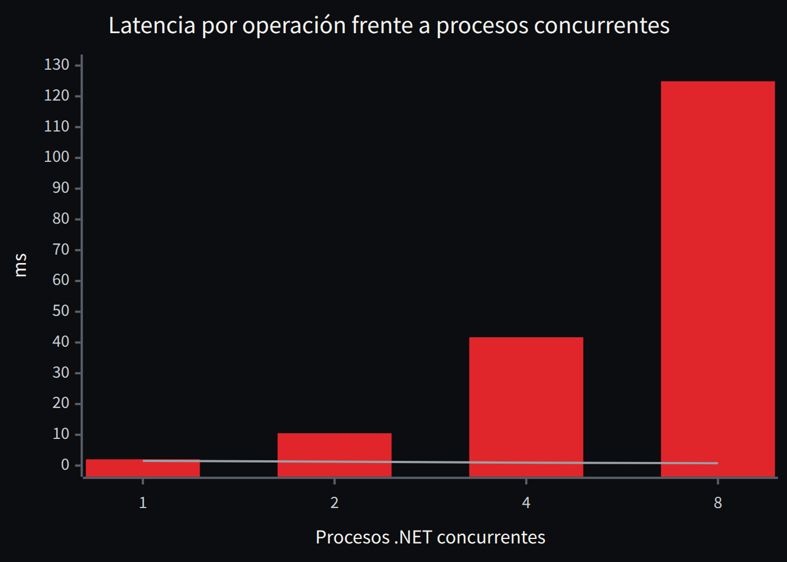

*Figura 28.3 · Ejecución de referencia: la mediana baja y la cola se dispara al añadir procesos que compiten por un único escritor.*

La tabla enseña una cosa verdadera y nada más: al añadir procesos que compiten por un recurso serializado, la mediana mejora y la cola se dispara. Es el mismo fenómeno que aparecerá con una cuenta caliente o con un log saturado. Pero son 32 operaciones por proceso, en circuito cerrado, incluyendo el arranque de cada proceso .NET, sobre un motor que serializa escrituras, en una sola máquina. No hay calentamiento ni duración suficiente, no hay baseline del mainframe y no hay Azure. Esta tabla no puede aprobar capacidad, y el código lo deja escrito en el propio resumen de resultados.

> **El servicio puede contestar OK y dejar otra cosa detrás. El oráculo mira lo que queda.**

### Capítulo 29 · Incorporar agentes sin permitir que escriban el aprobado

> [!IMPORTANT]
> **Tesis del capítulo.** El siguiente paso es poner un agente a construir el candidato. Puede consultar, ejecutar y corregir; no puede tocar los casos reservados ni el evaluador. Y cada cambio de modelo, prompt o presupuesto es una condición experimental distinta.

#### El siguiente paso tiene dos modos

Separaría la demostración determinista de un experimento con agentes. En el primer modo, conservamos implementaciones, entradas y expectativas fijadas para explicar el proceso. En el segundo, un agente recibe una tarea de construcción y debe producir un candidato bajo restricciones registradas.

El agente puede consultar fuentes y el contrato público, ejecutar sus tests y corregir el programa. No puede cambiar los casos reservados ni el evaluador de aceptación. Un verificador externo ejecuta el candidato en un entorno controlado. El informe devuelve información suficiente para corregir, conforme al protocolo del experimento.

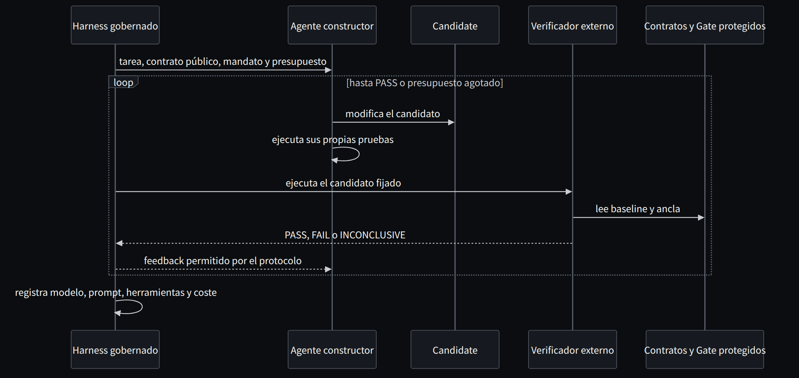

*Figura 29.1 · Un agente constructor dentro de un harness gobernado: corrige contra un verificador externo que no controla.*

Si cambiamos modelos, presupuestos, prompts o herramientas, lo registramos como una condición experimental distinta. Decir que «lo hizo la IA» no permite explicar qué combinación produjo el resultado ni repetir el proceso.

Un agente de comprensión podría proponer reglas a partir del COBOL. Esa propuesta todavía necesita contraste. El agente de construcción podría traducirlas a C#. El gate comprueba el comportamiento observado. La aprobación humana establece qué regla se acepta y cuándo una diferencia respecto del legado es intencional.

#### REA entra cuando el problema lo necesita

Para el fuente pequeño del laboratorio no necesitamos un decompilador. Incluir REA por obligación estética añadiría complejidad sin aclarar la prueba. Su integración tiene sentido cuando la capacidad investigada reside en un artefacto que sus herramientas ayudan a examinar.

Una extensión coherente consistiría en tomar un ejecutable autorizado, fijar su hash y pedir a un agente que investigue una función concreta mediante REA. Los hallazgos alimentarían hipótesis y pruebas. La reconstrucción se evaluaría después contra un oráculo adecuado. El resultado documentaría qué se observó directamente y qué se dedujo.

Para fuentes COBOL de mayor tamaño, evaluaría primero el parser y el dialecto. Un MCP puede exponer el inventario, las relaciones y las ejecuciones de un adaptador especializado. El protocolo facilita el acceso a herramientas; no garantiza su corrección ni concede autoridad para usarlas.

#### Los errores correlacionados siguen siendo posibles

Dos agentes pueden repetir la misma interpretación equivocada. Cambiar de modelo tampoco garantiza independencia. Si ambos reciben una especificación incorrecta y el evaluador deriva de esa misma especificación sin revisión, el circuito puede confirmar su propio error.

La defensa requiere diversidad de evidencia: comportamiento observado, reglas aprobadas, propiedades conocidas y controles adversariales. En una evaluación seria también conviene separar quién construye la solución de quien prepara los casos ocultos y adjudica los resultados.

Anthropic distingue entre flujos definidos por código y agentes que deciden dinámicamente sus pasos y herramientas [11]. Esa distinción ayuda a describir con precisión lo que hemos construido. Nuestro laboratorio es un flujo determinista. El experimento futuro puede incorporar autonomía, pero esa autonomía debe demostrar que añade valor frente a una ruta más simple.

En «Agentes al vuelo frente a un harness gobernado» comparé agentes de línea de comandos más allá de la demo y llegué a una conclusión incómoda: la detección de defectos, la fiabilidad y el control de calidad tienen un coste, y ese coste no desaparece; se paga midiendo o se paga en producción [41]. En una modernización COBOL, el harness gobernado es el que fija el mandato del capítulo [9](#capítulo-9--de-la-autoridad-del-agente-a-la-autoridad-de-la-regla), protege el gate del capítulo [10](#capítulo-10--todm-y-el-problema-de-aceptar-lo-que-construimos) y registra cada intento para el estudio del capítulo [34](#capítulo-34--medir-lo-que-todavía-no-sabemos).

La forma concreta de ese harness la construí en «Del modelo que responde al agente que trabaja», con C#, .NET 10 y Microsoft Foundry: el harness gobierna la planificación, el estado, las herramientas y las aprobaciones, y CodeAct ejecuta de forma compacta las tareas intensivas en datos y llamadas a herramientas [43]. Y en «MCP, A2A y AHP» expliqué por qué esas tres siglas resuelven problemas distintos en capas distintas y por qué un agente debería vivir en un contenedor [46]. Es la misma razón por la que el laboratorio se ejecuta en un contenedor sin red, y por la que el experimento E4 debería encerrar al agente constructor en uno.

> **Decir que «lo hizo la IA» no permite explicar qué combinación produjo el resultado ni repetir el proceso.**

## Parte VII · De la evidencia a la organización

Un laboratorio convence a un equipo técnico. Una organización necesita convivencia, un SDLC que trabaje a favor, un plan con puntos de salida, una forma de medir lo que todavía no sabe y el valor de decir «aquí no migraría».

### Capítulo 30 · Del laboratorio a un sistema que sigue operando

> [!IMPORTANT]
> **Tesis del capítulo.** Durante la convivencia, cada capacidad tiene un único dueño de la escritura; volver atrás puede exigir transformar datos; y cualquier cambio de reglas, compiladores o modelos obliga a renovar la evidencia de aceptación.

#### La convivencia tiene un dueño de la escritura

Un cálculo sin persistencia es una buena entrada al problema. Una aplicación empresarial exige decidir cómo conviven las dos implementaciones mientras se verifica la nueva.

En una ejecución en sombra, el sistema de referencia mantiene la operación y la nueva implementación recibe entradas comparables para evaluar su respuesta. Hay que evitar que esa sombra duplique efectos externos. Una notificación, un cargo o una actualización no deben ejecutarse dos veces porque queramos comparar resultados.

La captura debe definir el estado observado. Si una implementación lee los datos antes de una actualización y la otra después, una diferencia puede deberse al momento de lectura. La evidencia debe permitir distinguir un defecto semántico de una divergencia introducida por el propio experimento.

La propiedad de la escritura necesita ser explícita por capacidad y fase. La estrategia puede incluir enrutamiento gradual, reconciliación y mecanismos de idempotencia, según el sistema. No introduciría escritura simultánea en dos modelos de datos como un detalle secundario de integración.

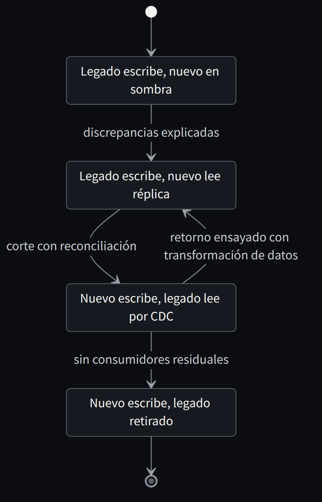

*Figura 30.1 · Fases de convivencia: en cada una hay un único dueño de la escritura, y volver atrás puede exigir transformar datos.*

#### Volver atrás también puede transformar datos

Un rollback de código no garantiza que el sistema anterior comprenda los datos escritos por la versión nueva. Tampoco retira un mensaje ya consumido o deshace una interacción externa. El plan de retorno debe describir las consecuencias que pueden revertirse y las que requieren compensación o reparación.

Antes de ampliar tráfico, comprobaría el mecanismo de corte, la reconciliación y la recuperación. Si la ventana de retorno depende de un volumen máximo de cambios, ese límite forma parte de la decisión de entrega. Una opción que desaparece después de unas horas no debería describirse como disponible indefinidamente.

Los oráculos operativos amplían los funcionales. Nos interesan el tiempo de proceso, el uso de recursos, la recuperación y la consistencia de datos. Sus umbrales se fijan de acuerdo con el servicio. No elegiría un porcentaje universal de equivalencia para aprobar cualquier migración.

Una discrepancia pequeña en frecuencia puede afectar a la operación más importante. Por eso la clasificación de riesgos y las reglas críticas pesan más que una media global. Cero diferencias observadas tampoco prueba ausencia de diferencias en toda la población.

#### La deriva exige volver a evaluar

Después del corte cambian reglas, datos, compiladores y dependencias. También puede cambiar el modelo que ayuda a mantener el sistema. G7 conecta esos cambios con la evidencia de aceptación que debe renovarse.

Si una tasa pasa de dos decimales a cuatro, no basta con volver a ejecutar el conjunto antiguo y celebrar que sigue verde. El contrato ha cambiado. Necesitamos nuevos límites, nuevas expectativas y posiblemente otra representación.

La modernización habrá mejorado de verdad la capacidad de evolución cuando podamos hacer ese cambio sin perder el vínculo entre intención, implementación y aceptación. Esa continuidad es uno de los resultados que me interesa perseguir con TODM.

> **Un rollback de código no retira un mensaje ya consumido ni deshace una interacción externa.**

### Capítulo 31 · El SDLC como parte del motor de migración

> [!IMPORTANT]
> **Tesis del capítulo.** Las buenas prácticas del SDLC juegan a nuestro favor cuando convierten incertidumbres en comprobaciones repetibles. Sería un error apagarlas justo cuando la IA nos permite generar código más rápido que nunca.

Una de las ironías de modernizar COBOL es que la organización puede disponer hoy de una disciplina de ingeniería mucho más rica que la que existía cuando se escribió el sistema. Sería un error apagar esa ventaja justo porque queremos que la IA genere código rápido. La infraestructura del SDLC moderno permite convertir la velocidad de los agentes en evidencias repetibles.

#### Empezar antes de tener el sistema completo

Las buenas prácticas del SDLC juegan a nuestro favor cuando convierten incertidumbres en comprobaciones repetibles. Un contrato de entrada permite ejecutar el mismo caso contra dos implementaciones. Un ADR conserva por qué elegimos aislamiento o partición. Una prueba de regresión evita reintroducir una diferencia que ya habíamos resuelto.

Incorporaría objetivos de rendimiento y recuperación desde el descubrimiento. El marco Well-Architected de Microsoft recomienda establecer criterios medibles y probar de manera continua en condiciones representativas [28]. Para TODM, eso se traduce en oráculos de capacidad y recuperación además de los funcionales.

No fijaría los objetivos del proyecto copiando cifras del ejemplo. El dueño del servicio debe establecer el trabajo necesario, los tiempos, los estados permitidos durante un fallo y el presupuesto. Esos criterios necesitan aprobación y una versión, igual que una regla de comisión.

#### Una cadena de evidencias durante el desarrollo

| Momento | Práctica | Evidencia útil para migración |
|---|---|---|
| Descubrimiento | Inventario y caracterización | Qué hace el sistema y dónde dudamos |
| Diseño | ADR de transacción y concurrencia | Qué garantías conserva cada frontera |
| Construcción | Tests, análisis y revisión | Defectos locales y cambios de contrato |
| Integración | Pruebas diferenciales y de historias | Equivalencia y conflictos concurrentes |
| Rendimiento | Carga, estrés y duración | Capacidad bajo condiciones fijadas |
| Resiliencia | Fallos y recuperación | Estado confirmado y tiempo de retorno |
| Entrega | Artefactos inmutables y autorización | Exactamente qué se verificó y entrega |
| Operación | Telemetría y reconciliación | Deriva, colas y reglas que deben revisarse |

Una prueba rápida puede ejecutarse con cada cambio. Las pruebas largas o costosas pueden ejecutarse por hitos y sobre infraestructura controlada. La frecuencia debe responder al riesgo de regresión y al coste. Ejecutar una carga ruidosa durante treinta segundos en cualquier runner no produce una puerta de capacidad fiable.

El repositorio debe versionar fuentes y especificaciones, controlar permisos y separar las ramas de propuesta de las baselines aprobadas. Los pipelines ejecutan parsing, linters, SAST, SBOM, pruebas de caracterización, tests de contrato, mutación, concurrencia, carga y verificación de artefactos. Los agentes pueden abrir PR y explicar diferencias, pero no deben poder rebajar los thresholds ni editar el verificador confiable para conseguir una build verde. Firmas, hashes y control de cambios son útiles para atribuir de manera razonable qué artefactos se evaluaron; no sustituyen una identidad humana verificable ni el juicio de negocio.

La observabilidad deja de ser un producto de operaciones y entra en el oráculo. Definiría trazas correladas para una transacción de negocio, métricas de latencia y bloqueo, cardinalidad controlada, reconciliación de saldos, errores de validación, lag de CDC y estado del outbox. Un defecto de modernización puede no manifestarse como excepción; puede ser una desviación estadística de importes, un aumento de reintentos o una cola que no termina antes de abrir el banco.

#### La ficha de evidencia de cada pull request

Cada PR debería incluir una **ficha de evidencia**: cambio propuesto, reglas afectadas, fixtures añadidos, resultados de oráculos, cobertura, efectos de rendimiento, dependencias y criterio de rollback. La revisión humana debe centrarse en las diferencias materiales y en la integridad del proceso, no en aprobar miles de líneas generadas a ciegas.

Así es la plantilla que pondría en el repositorio. La escribe el autor del cambio —persona o agente— y la valida el pipeline, no la buena fe.

**Listado 31.1 · Plantilla de ficha de evidencia para un PR de modernización** — *Ilustrativo*

```markdown
## Ficha de evidencia
- Capacidad: fee-calculation · Mandato: MND-2026-114
- Reglas afectadas: R-FEE-003 (redondeo), sin cambios de baseline
- Baseline: contracts/cases.json @ 976d7127… (ancla verificada por CI, no por el autor)
- Candidato: sha256 del binario publicado por el build, no del local
- Oráculos: G5 funcional PASS 58/58 · controles G3 10/10 · bank invariants 6/6
- Rendimiento: sin cambios en la ruta crítica / ensayo de capacidad no requerido
- Divergencias autorizadas respecto del legado: ninguna
- Retorno: revertir el PR; sin migración de datos
- Preguntas abiertas: comportamiento con opciones de compilación de producción (EV-0142)
```

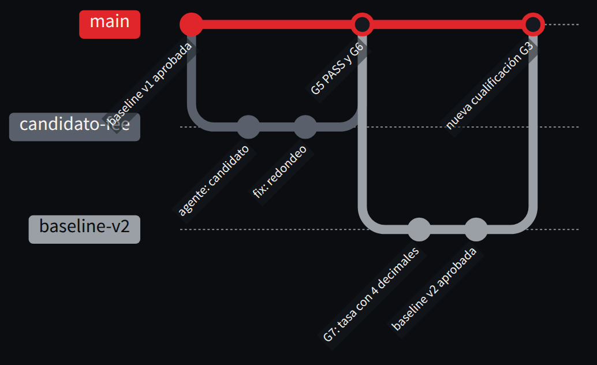

*Figura 31.1 · La baseline vive en su propia rama protegida: el candidato se integra cuando pasa G5 y G6, y un cambio de regla abre una revisión G7.*

Y así la integración continua que la respalda. Es la plantilla incluida en el laboratorio; está preparada para copiarse a `.github/workflows/`, pero no se ha activado en ningún repositorio.

**Listado 31.2 · ci/github-actions.yml del laboratorio** — *Plantilla · no activada*

```yaml
name: COBOL and transactional evidence
on: [push, pull_request, workflow_dispatch]
permissions:
  contents: read
jobs:
  acceptance:
    runs-on: ubuntu-latest
    timeout-minutes: 15
    steps:
      - uses: actions/checkout@v4
      - uses: actions/setup-dotnet@v4
        with:
          dotnet-version: '10.0.x'
      - run: sudo apt-get update && sudo apt-get install -y gnucobol3 libsqlite3-0
      - run: python3 tools/verify_offline.py
      - run: python3 walkthrough.py --auto --bank
      - uses: actions/upload-artifact@v4
        if: always()
        with:
          name: execution-evidence
          path: results/
```

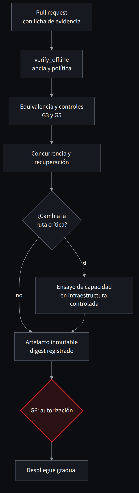

*Figura 31.2 · El pipeline como motor de migración: cada etapa deja evidencia y la autorización consume el artefacto exacto.*

Fíjate en `permissions: contents: read` y en `if: always()`. El primero impide que el pipeline modifique el repositorio que evalúa. El segundo conserva la evidencia también cuando el gate bloquea, que es precisamente cuando más se necesita.

#### Hacer que la optimización rinda cuentas

Cuando cambiamos un índice, el tamaño de lote, el aislamiento o el número de workers, la mejora debe pasar por dos preguntas: cuánto mejora la métrica y qué garantía conserva. Una caída de latencia conseguida desactivando confirmación durable no es una optimización equivalente si el contrato exigía esa durabilidad.

Versionaría el generador, la mezcla, los datos, las configuraciones y los criterios de aprobación. Conservaría resultados crudos, no solo la gráfica final. El expediente debe permitir distinguir una mejora de código de un cambio de infraestructura o de una base de datos ya caliente.

Los agentes pueden preparar pruebas, resumir discrepancias y proponer optimizaciones. El gate debe utilizar la evidencia observada y mantener fuera del alcance de escritura del constructor el criterio protegido. La autorización de entrega incluye también las condiciones bajo las que se ha medido la capacidad.

> **Los agentes pueden abrir PR y explicar diferencias. No deben poder rebajar los umbrales ni editar el verificador para conseguir una build verde.**

### Capítulo 32 · Una historia de migración: la cuenta que parecía fácil

> [!IMPORTANT]
> **Tesis del capítulo.** Un programa que compila en .NET 10 no es una cuenta migrada. Tres pruebas —dos retiradas simultáneas, una transferencia y un cierre nocturno— bastan para descubrir tres responsabilidades que no estaban en el mapa de programas.

Imaginemos un banco ficticio con un programa `ACCTUPD` escrito en COBOL. Procesa cargos e ingresos, consulta una tabla de límites, registra movimientos y participa en un proceso de cierre nocturno. La primera demo muestra un fragmento pequeño: entrada, validación de saldo, nueva cantidad y escritura. Un LLM produce C# comprensible. La dirección celebra que el programa ya compila en .NET 10. El equipo técnico pide entonces tres pruebas más.

Primera prueba: dos retiradas simultáneas. El servicio sin control de concurrencia aprueba ambas. La solución no es añadir un `lock` en un controlador web: ese lock solo protege un proceso y el banco tendrá varios nodos. Introducimos una transacción y versionado o bloqueo a nivel de base, con clave idempotente. Los actores pueden reducir conflictos por identidad, pero el commit sigue siendo la frontera decisiva.

Segunda prueba: una transferencia. Hay dos cuentas y dos escrituras. Un error entre ambas demuestra que la secuenciación en memoria no basta. Pasamos a un ledger con operación atómica dentro de una base, o definimos formalmente un protocolo de compensación cuando el movimiento cruza sistemas donde la atomicidad local no es posible. El negocio decide qué estados intermedios son observables y cuáles no.

Tercera prueba: cierre nocturno. Una versión distribuida intenta calcular un millón de cuentas con un actor por cuenta y demasiadas escrituras pequeñas. El tiempo de commit domina el perfil. Reorganizamos el trabajo por particiones estables, batch de escrituras, controles idempotentes y checkpoint. El código final se parece menos al COBOL original. El comportamiento y los invariantes se parecen más al sistema que realmente necesitamos.

En este punto ya no estamos traduciendo una rutina. Hemos identificado tres responsabilidades distintas: **aceptación online**, **integridad contable** y **procesamiento por lotes**. Separarlas permite desplegar y medir cada una con criterios propios. Esta descomposición no estaba necesariamente en el mapa de programas legado. Es una decisión de arquitectura basada en responsabilidades, no en nombres de ficheros.


*Figura 32.1 · Tres pruebas, tres responsabilidades que no estaban en el mapa de programas.*

> **El código final se parece menos al COBOL original. El comportamiento se parece más al sistema que realmente necesitamos.**

### Capítulo 33 · Plan de modernización: primero una prueba de capacidad, después una apuesta

> [!IMPORTANT]
> **Tesis del capítulo.** Una dirección no necesita promesas de que la IA lo convertirá todo. Necesita decisiones por etapas, inversión acotada y criterios explícitos para detenerse.

Una dirección no necesita promesas de que «la IA convertirá todo». Necesita decisiones por etapas, inversión acotada y criterios para detenerse. Propondría un **Discovery** que mida inventario, criticidad, dependencias, semántica de datos y capacidad observable. Después un **Pilot** con una costura seleccionada por riesgo y relevancia, no por facilidad para quedar bien en una demo. Después un **Parallel Run** con oráculos funcionales, operacionales y de rendimiento. Solo entonces un despliegue gradual y un retiro controlado del componente anterior.

Cada etapa cierra con tres preguntas. ¿Qué propiedad hemos demostrado? ¿Qué incertidumbre sigue abierta? ¿Qué riesgo asume la siguiente etapa? Un piloto puede concluir que mantener COBOL es mejor. También puede concluir que la migración es viable, pero necesita cambiar el modelo de datos. Un resultado negativo temprano es valioso: evita millones comprometidos sobre una hipótesis equivocada.

La gobernanza debe impedir el falso avance. No contaría líneas convertidas como progreso de negocio. Mediría capacidades liberadas de dependencias, reglas cubiertas, fallos encontrados, tiempo de cambio, coste por operación, deuda retirada y reducción real de riesgo. Para la IA incluiría porcentaje de propuestas aceptadas sin alteración, defectos detectados por oráculos independientes, coste de agentes y deriva de especificación. Ninguna métrica única resume una modernización.

Hay también una obligación de diseño organizacional: los especialistas COBOL no son un obstáculo que eliminar; son parte de la autoridad de dominio. Sus conocimientos deben transferirse al contrato de evidencia y al equipo que operará el nuevo sistema. El objetivo no es sustituir personas por agentes. Es evitar que el negocio dependa indefinidamente de conocimiento tácito imposible de auditar.

Es la inquietud que más se repitió en la Microsoft Frontier Transformation Week, donde participé como MVP y moderador: pasar de pilotos a resultados exige madurez, liderazgo, gobernanza e identidad, no más demos [47]. Una modernización COBOL es un caso extremo de esa misma distancia, porque el piloto puede salir bien y el cierre de mes no.

#### Cuatro etapas con salida

| Etapa | Qué demuestra | Evidencia de salida | Puede concluir |
|---|---|---|---|
| Discovery | Qué hay, qué hace y cuánto trabajo soporta | Inventario con hashes, huella de carga, mapa transaccional | Que no merece la pena seguir |
| Piloto | Que una costura relevante se puede reconstruir y aceptar | Baseline aprobada, gate cualificado, candidato PASS | Que hay que cambiar el modelo de datos antes |
| Ejecución en paralelo | Equivalencia funcional, operacional y de capacidad con tráfico real | Informes G5, reconciliación, ensayo del peor día | Que la plataforma elegida no llega |
| Despliegue gradual y retiro | Que el legado ya no se necesita para esa capacidad | Ownership transferido, telemetría sin llamadas residuales | Que la capacidad está retirada |

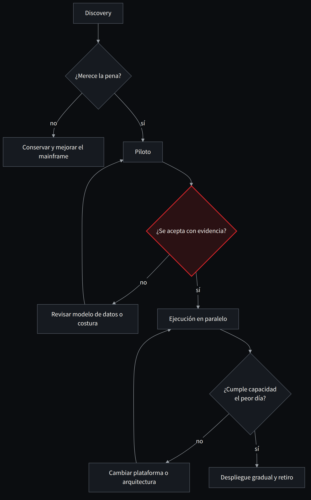

*Figura 33.1 · Un plan con salidas: cada etapa puede concluir que no hay que seguir, y eso también es un resultado.*

> **Un resultado negativo temprano es valioso: evita comprometer millones sobre una hipótesis equivocada.**

### Capítulo 34 · Medir lo que todavía no sabemos

> [!IMPORTANT]
> **Tesis del capítulo.** El laboratorio muestra un mecanismo; no demuestra que TODM reduzca defectos frente a otras formas de trabajar. Esa pregunta exige un protocolo, una unidad de análisis honesta y la disposición a aceptar resultados negativos.

#### Un resultado reproducible no es un estudio comparativo

El laboratorio muestra un mecanismo. No establece que TODM reduzca defectos frente a cualquier otra forma de trabajar. Tampoco establece el ahorro de horas que produciría incorporar agentes a una modernización.

El protocolo público de TODM distingue tres condiciones para estudiar la construcción con agentes: tests acoplados a la implementación, oráculo independiente y oráculo independiente con cualificación por mutaciones. Propone mantener comparables tareas y presupuestos, registrar costes y analizar a nivel de tarea [12]. Esa separación permite formular preguntas que una demo por sí sola no responde.

¿Reduce el oráculo independiente los defectos aceptados? ¿Qué añade su cualificación? ¿Cuántos bloqueos incorrectos produce? ¿Cuánto esfuerzo exige aclarar y aprobar reglas? ¿Qué intentos de modificar el evaluador impiden los permisos reales? Esas preguntas necesitan datos y un diseño previo.

El propio repositorio de TODM lo plantea como un reto abierto: invita a reproducir, falsear, comparar o transferir el método, y acepta los resultados negativos o inconclusos como contribución [2]. Un libro que defiende la evidencia necesita esa puerta abierta.

#### La unidad de análisis importa

Si ejecutamos una misma tarea varias veces, tenemos repeticiones de esa tarea. Si inyectamos diez mutaciones en un programa, tenemos diez variantes relacionadas. No deberíamos presentarlas como proyectos independientes para aumentar artificialmente la muestra.

Los resultados deben conservar el agrupamiento: tarea, variante, herramienta, modelo, ejecución y condición. También deben incluir las ejecuciones fallidas y las que quedaron inconclusas. Excluirlas porque ensucian la comparación altera la pregunta que estamos respondiendo.

La regla de parada se fija antes de observar resultados cuando pretendemos una inferencia confirmatoria. Un piloto pequeño puede ser suficiente para encontrar fallos del protocolo o demostrar viabilidad. Que nos permita aprender no lo convierte automáticamente en evidencia generalizable de superioridad.

#### Lo que cuesta construir confianza

Mediría el tiempo humano dedicado a preparar datos, aclarar reglas, revisar contratos y resolver discrepancias. Añadiría el consumo del modelo, la ejecución de herramientas, los reintentos y el coste de mantener las pruebas.

También mediría lo que cambia después de entregar: defectos que escapan, tiempo de diagnóstico, recuperación y facilidad para modificar una regla. Si una inversión en oráculos reduce el tiempo de reconstruir por qué se aceptó una versión, ese beneficio merece observarse. Debe medirse, no suponerse.

La arquitectura tampoco queda exenta de evaluación. Un sistema de permisos puede estar bien descrito y mal configurado. Necesitamos intentar modificaciones no autorizadas y observar que el entorno las impide. Una negativa del agente en lenguaje natural no demuestra que carezca del permiso.

#### Una conclusión que puede cambiar

Me interesa una metodología capaz de recibir resultados negativos. Si un oráculo resulta demasiado costoso para el riesgo que cubre, habrá que simplificarlo. Si una representación confunde a los revisores de negocio, habrá que cambiarla. Si un agente apenas mejora el trabajo de un flujo determinista, quizá no necesitemos ese agente.

El valor del libro no depende de que todas las hipótesis salgan a favor de TODM. Depende de que el lector pueda distinguir una propuesta de una observación y una observación de una conclusión suficientemente respaldada.

> **El valor del libro no depende de que todas las hipótesis salgan a favor de TODM.**

### Capítulo 35 · Cuándo NO migraría

> [!IMPORTANT]
> **Tesis del capítulo.** Conservar el mainframe, mejorarlo o combinarlo con sistemas nuevos son decisiones legítimas si los datos lo justifican. Una arquitectura híbrida bien gobernada puede ser más moderna que una reescritura total imprudente.

Hay sistemas que cumplen su función, tienen carga estable, coste asumible, soporte suficiente y garantías bien conocidas. Si la modernización no aporta valor funcional, reducción comprobable de riesgo o una economía razonable, la mejor decisión puede ser seguir en mainframe y mejorar observabilidad, automatización, documentación y exposición de capacidades. Una arquitectura híbrida bien gobernada puede ser más moderna que una reescritura total imprudente.

No migraría un ledger crítico sin acceso a perfiles operativos y sin un entorno donde ejecutar pruebas de equivalencia y recuperación. No haría un cutover irreversible mientras convivan escritores no inventariados. No aceptaría un SLA porque un benchmark sintético obtuvo un TPS llamativo. No separaría por microservicios un proceso cuya atomicidad no podemos recuperar. No utilizaría actores para simular una transacción entre dominios y llamarla segura. Y no confiaría la aceptación de una baseline a la misma IA que generó el candidato.

No se trata de conservadurismo tecnológico. Es una disciplina de decisiones reversibles. La modernización buena es la que permite aprender sin poner de rehén al sistema que paga nóminas, liquida operaciones o protege pólizas.

#### Sin dogmatismo

| Tiene sentido migrar una capacidad cuando | No lo tiene cuando |
|---|---|
| Hay un objetivo de negocio medible que el sistema actual impide | El único argumento es la antigüedad del lenguaje |
| Se puede construir un oráculo de comportamiento y de capacidad | No se puede definir qué es «correcto» de forma verificable |
| Existe acceso a perfiles operativos y a un entorno de pruebas | No hay huella de carga ni forma de ensayar la recuperación |
| La propiedad de los datos se puede transferir con un protocolo | Conviven escritores no inventariados |
| La atomicidad necesaria se conserva en el destino | Habría que fragmentar una transacción que el negocio necesita atómica |
| El coste de verificar es asumible frente al beneficio | La verificación cuesta más que el problema que resuelve |

> **No se trata de conservadurismo tecnológico. Es una disciplina de decisiones reversibles.**

### Capítulo 36 · Cien riesgos para elegir patrones con criterio

> [!IMPORTANT]
> **Tesis del capítulo.** No existe un catálogo canónico y verificable de los cien problemas de COBOL ordenados por frecuencia. Sí podemos tener un registro de trabajo donde cada riesgo lleve una opción de aplicación, una capacidad de infraestructura y la prueba que podría refutarlas.

He buscado un catálogo canónico de los cien problemas principales de COBOL y no he encontrado una referencia verificable con ese alcance y una clasificación por frecuencia. Sí hay fuentes útiles para construir un capítulo riguroso: IBM documenta problemas concretos de migración de compilador, AWS reúne patrones de mainframe y desacoplamiento, y Azure ofrece catálogos de patrones y arquitecturas OLTP [30–34]. No son una lista común de cien problemas ni prometen cubrir cualquier sistema.

Por eso presento un catálogo propio de cien riesgos de modernización. La numeración sirve para identificarlos y relacionarlos con evidencias; no expresa frecuencia, gravedad ni una prioridad universal. Parte del catálogo trata semántica COBOL, otra parte trata servicios mainframe y el resto reúne problemas de sistemas empresariales que también aparecen al modernizar otras tecnologías.

Cada entrada propone una combinación candidata de aplicación e infraestructura y una comprobación que podría refutarla. No afirma que la solución esté implementada, validada o sea adecuada para todos los casos. El assessment debe registrar aplicabilidad, responsable, regla original, decisión de destino y evidencia de aceptación antes de cerrar una entrada.

La documentación de IBM resulta especialmente instructiva: incluso recompilar para una versión nueva de COBOL puede hacer visibles datos numéricos inválidos, tamaños incompatibles o valores sin inicializar. No necesitamos cambiar de lenguaje para descubrir una dependencia semántica [30]. Una arquitectura nueva no corrige automáticamente esas condiciones.

#### Cómo utilizar el catálogo

Empezaría con tres ejemplos. Ante un fichero con packed decimal conservaría bytes y copybook, implementaría el codec y probaría límites antes de normalizar el almacenamiento. Ante dos débitos concurrentes fijaría la unidad transaccional y una prueba de sobregiro antes de decidir si intervienen actores. Ante una ventana batch incumplida analizaría el camino crítico y el sesgo antes de añadir workers. El patrón viene después de la propiedad que queremos conservar.

Las propuestas de plataforma expresan capacidades, no equivalencias automáticas entre productos. Un broker local puede implementar orden por clave; una opción Azure puede usar sesiones si su contrato encaja. Una base de datos local y un servicio gestionado pueden proteger una transacción, pero deben compararse con las políticas reales de aislamiento, persistencia y recuperación.

Un actor, CQRS o event sourcing tampoco debe convertirse en destino obligatorio. CQRS puede separar una proyección de lectura del núcleo de escritura; la proyección necesita una política de vigencia y reconciliación. Event sourcing puede aportar un historial de cambios como fuente de verdad, pero exige evolución de eventos, replay y validación. El ledger append only es una decisión de dominio más concreta: puede existir en SQL sin adoptar event sourcing para toda la aplicación.

El laboratorio incluye el catálogo en inglés, en JSON y Markdown (`risk-catalog/`), con el estado inicial de evaluación y su relación con los controles sintéticos; el anexo [E](#anexo-e--catálogo-de-cien-riesgos) lo reproduce en español. Ninguno de los cien riesgos figura como resuelto en producción. Así podemos utilizarlo como registro de trabajo y ampliar cada entrada cuando dispongamos de un caso real.

El anexo [E](#anexo-e--catálogo-de-cien-riesgos) reproduce el catálogo completo, agrupado en diez familias: datos y representaciones, cálculo monetario y tiempo, flujo y estado de programas, ficheros y datasets, acceso a bases de datos, transacciones y mensajería financiera, batch y planificación, integración y coexistencia, rendimiento y capacidad, y SDLC, recuperación y gobierno. De los cien, once están tocados parcialmente por algún control sintético del laboratorio; ninguno figura como resuelto en producción.

#### Resolver una entrada exige más que reconocer un patrón

Para cerrar R048 no basta con decir que el código adquiere locks en orden: hay que ejecutar las historias relevantes en el motor de destino, observar víctimas y reintentos y reconciliar efectos. Para cerrar R094 necesitamos restaurar y recuperar bajo las condiciones que acepta el servicio. Para cerrar R099 debemos demostrar que la plataforma impide entregar un artefacto diferente, incluso si el constructor lo intenta.

Esta disciplina convierte el catálogo en una conexión práctica entre arqueología, arquitectura y SDLC. Podemos empezar conservando COBOL, reemplazar una capacidad o cambiar infraestructura. En cada ruta queda la misma pregunta: qué evidencia demuestra que la nueva combinación conserva el compromiso que hemos decidido aceptar.

> **El patrón viene después de la propiedad que queremos conservar.**

### Capítulo 37 · El nuevo contrato de modernización

> [!IMPORTANT]
> **Tesis del capítulo.** Antes de mover una capacidad COBOL, cualquier responsable técnico debería poder firmar siete cláusulas, y cada una debería poder demostrarse con un artefacto concreto.

Para cerrar, propongo un contrato sencillo que debería poder firmar cualquier responsable técnico antes de mover una capacidad COBOL. **Primero**: tenemos evidencia identificable de lo que hace el sistema. **Segundo**: sus invariantes y excepciones están registrados en una baseline aprobada. **Tercero**: sabemos qué responsabilidades antiguas necesitan un mecanismo nuevo y por qué. **Cuarto**: las implementaciones se someten a oráculos independientes, incluyendo concurrencia y fallos. **Quinto**: el entorno seleccionado supera una prueba de carga realista, con coste y capacidad documentados. **Sexto**: existe una transición controlada de ownership de datos, soporte y recuperación. **Séptimo**: sabemos qué parte del legado retiramos y cómo verificaremos que ya no se necesita.

La ingeniería asistida por IA cambia radicalmente la velocidad a la que podemos investigar, proponer y construir. REA muestra el valor de la evidencia en ingeniería inversa; quienes piden prudencia advierten contra la pérdida del conocimiento del negocio; TODM propone separar autoridad y aceptación; los patrones arquitectónicos permiten reconstituir garantías en entornos diferentes. El resultado es una disciplina, no una herramienta mágica.

Hay una frase que resume mi posición: **la modernización 1:1 puede ser un puente, pero nunca deberíamos confundir el puente con la ciudad a la que queremos llegar**. Si después de cambiar el lenguaje seguimos desplegando igual, bloqueando igual, acumulando dependencias igual y sin saber demostrar qué hace el sistema, no lo hemos modernizado. Solo hemos cambiado el idioma de sus problemas.

#### El contrato, con su evidencia

| Cláusula | Artefacto que la demuestra | Dónde aparece en el libro |
|---|---|---|
| Evidencia identificable de lo que hace el sistema | Inventario con hashes y EvidenceItems | Capítulos [6](#capítulo-6--rea-y-la-arqueología-que-deja-rastro) y [7](#capítulo-7--legacy-archaeology-asistida-por-agentes) |
| Invariantes y excepciones en una baseline aprobada | Baseline versionada con ancla protegida | Capítulos [10](#capítulo-10--todm-y-el-problema-de-aceptar-lo-que-construimos) y [12](#capítulo-12--cobol-y-c-deben-acordar-el-significado) |
| Responsabilidades antiguas con mecanismo nuevo justificado | Matriz de sustitución y ADR | Capítulo [13](#capítulo-13--antes-de-elegir-un-patrón-identifica-el-contrato) y anexo [D](#anexo-d--decisiones-de-arquitectura) |
| Oráculos independientes, también para concurrencia y fallos | Gate cualificado y oráculo contable | Capítulos [17](#capítulo-17--de-los-locks-del-mainframe-al-control-explícito-de-concurrencia), [27](#capítulo-27--hacer-que-el-error-se-vea) y [28](#capítulo-28--transferencias-bloqueos-y-fallos-en-local) |
| Prueba de carga realista con coste documentado | Contrato de rendimiento rellenado y aprobado | Capítulos [22](#capítulo-22--los-mips-no-caben-en-una-conversión-de-vcpu) a [25](#capítulo-25--azure-o-una-máquina-enorme-en-el-cliente) |
| Transición controlada de datos, soporte y recuperación | Registro de ownership y plan de retorno ensayado | Capítulos [16](#capítulo-16--la-propiedad-de-los-datos) y [30](#capítulo-30--del-laboratorio-a-un-sistema-que-sigue-operando) |
| Retiro verificado del legado | Telemetría sin dependencias residuales | Capítulos [14](#capítulo-14--strangler-fig-cambiar-el-borde-antes-que-el-corazón) y [33](#capítulo-33--plan-de-modernización-primero-una-prueba-de-capacidad-después-una-apuesta) |

> **Si después de cambiar el lenguaje seguimos desplegando igual, bloqueando igual y sin saber demostrar qué hace el sistema, no lo hemos modernizado. Solo hemos cambiado el idioma de sus problemas.**

## Epílogo

No necesito elegir entre proteger el legado y explorar nuevas herramientas. Necesito decidir qué merece conservarse, qué debe cambiar y cómo voy a saber si el cambio ha cumplido su propósito.

COBOL nos obliga a mantener esa conversación cerca del negocio. REA y otras herramientas de análisis pueden ayudarnos a recuperar evidencia. Los agentes pueden reducir parte del trabajo de investigación y construcción. TODM propone una forma de relacionar ese trabajo con criterios de aceptación y autoridad explícita.

Ninguna pieza resuelve el problema completo. El parser no aprueba la política. El modelo no legitima su mandato. El hash no demuestra corrección. El test no autoriza por sí solo una entrega. La arquitectura tiene que conectar esas responsabilidades y conservar sus límites.

Cuando el laboratorio bloquea una implementación que redondea mal, vemos algo concreto. Sabemos qué entrada la contradice, qué regla se incumple y qué archivo contiene la evidencia. Cuando bloquea un resultado correcto sin mandato, vemos otra propiedad: la capacidad de construir y la autoridad para entregar permanecen separadas.

Ese es el tipo de progreso que me interesa. Cada paso deja algo que podemos revisar y repetir. Cada nueva capacidad amplía también lo que debemos comprobar. El entusiasmo tiene un lugar en el proceso; la decisión final necesita evidencia.

> Antes de pedirle a un agente que reescriba tu COBOL, construye el oráculo que le diga cuándo se equivoca.

## Anexos

Material de consulta: cómo ejecutar el laboratorio, qué contrato implementa, qué produjo la ejecución de referencia, qué decisiones documentaría, el catálogo completo de riesgos, el glosario y las fuentes.

### Anexo A · Un laboratorio que pueda contradecirnos

> [!NOTE]
> En este repositorio el laboratorio está en la carpeta [`lab/`](../lab/README.md). Los comandos de este texto se ejecutan desde ella.

#### Qué pretende demostrar

El laboratorio no está hecho para convencer, sino para que se pueda contradecir. Sostiene tres afirmaciones, y cada una puede caerse si alguien encuentra el contraejemplo.

La primera: un programa COBOL ejecutable y una implementación .NET 10 pueden compararse contra una **tercera expectativa aprobada**, de modo que dos programas que coinciden en un error también fallan. La segunda: un gate que distingue **PASS, FAIL e INCONCLUSIVE**, y que separa lo correcto de lo autorizado, bloquea cada defecto deliberado y cada ausencia de evidencia del conjunto. La tercera: **la equivalencia funcional aislada no dice nada sobre concurrencia**; el módulo de transferencias muestra lo que tiene que cumplirse cuando dos procesos compiten por un saldo, un cliente reenvía o un proceso muere después del débito.

#### Qué necesitas

La ruta recomendada solo necesita **Podman**. En Linux se instala desde el gestor de paquetes; en macOS y Windows, con Podman Desktop o `podman machine`. Podman funciona sin demonio y sin privilegios de administrador, de modo que los ficheros que el contenedor escribe en `results/` pertenecen a tu usuario.

La ruta nativa necesita Ubuntu 24.04 o WSL2 con el SDK de .NET 10, GnuCOBOL 3, Python 3 y la biblioteca nativa de SQLite. El módulo bancario carga `libsqlite3.so.0` mediante P/Invoke, así que en Windows debe ejecutarse en WSL2 o en el contenedor.

Para las comprobaciones offline basta con Python 3.

#### Ejecución con Podman

**Listado A.1 · Arranque con Podman** — *Ejecutado en diseño · receta no construida aquí*

```bash
# Linux, macOS o WSL
bash scripts/run-podman.sh          # recorrido guiado, con pausas
bash scripts/run-podman.sh --auto   # todo, incluido el módulo bancario

# Windows PowerShell
pwsh scripts/run-podman.ps1
pwsh scripts/run-podman.ps1 -Auto

# A mano
podman build -t cobol-modernization-lab -f Containerfile .
podman run --rm -it --network=none -v "$PWD/results:/work/results:Z" cobol-modernization-lab
```

La construcción necesita red una vez: la imagen base, los paquetes y la restauración de .NET. El laboratorio en sí se ejecuta con `--network=none`: sin modelo, sin clave y sin llamadas remotas. La opción `:Z` reetiqueta el volumen en sistemas con SELinux y es inocua en los demás. La etiqueta de la imagen base es mutable; fija un digest antes de medir nada que quieras reproducir.

La ejecución de referencia es nativa en Linux. La receta de Podman la construye y ejecuta el job `podman` de la integración continua; si en tu máquina se comporta de otra forma, ese informe de reproducción es justo la evidencia que el laboratorio pide.

#### Ejecución nativa

```bash
sudo apt-get update
sudo apt-get install -y gnucobol3 python3 libsqlite3-0 gcc
python3 walkthrough.py                 # guiado
python3 walkthrough.py --auto --bank   # todo
```

Las variables `DOTNET` y `COBC` permiten usar otros ejecutables.

#### El recorrido, paso a paso

| Paso | Comando | Qué deberías ver |
|---|---|---|
| 0 | `python3 tools/verify_offline.py` | `VERIFY: PASS`: ancla correcta, 58/58 casos coinciden con la implementación independiente, control negativo rechazado |
| 1 | `walkthrough.py`, paso 1 | El fuente `fee.cob` con su `REDEFINES` |
| 2 | `python3 cobol_local.py legacy/fee.cob --input 0000002500200Y` | El comando `cobc -x -free` y la salida `APPROVE\|00000001` |
| 3 | `walkthrough.py`, paso 3 | El candidato C# y sus modos de mutación |
| 4 | `python3 run.py` | Diez controles con los veredictos del capítulo [27](#capítulo-27--hacer-que-el-error-se-vea) y código de salida 0 |
| 5 | `walkthrough.py`, paso 5 | La tabla de veredictos y entregas |
| 6 | `python3 bank_test.py` | `status: PASS`, nueve controles y seis invariantes verdaderas |
| 7 | `python3 tools/coordinated_omission_demo.py` | p99 de 1 ms en circuito cerrado frente a 451 ms en circuito abierto |

Los códigos de salida del gate son parte del contrato: 0 para el permiso sintético, 2 para FAIL, 3 para INCONCLUSIVE y 4 para comportamiento correcto sin mandato. `run.py` termina con 0 cuando todos los controles, incluidos los bloqueos esperados, se comportan como deben.

#### El calentamiento opcional

`examples/commission-three-way/` contiene el primer laboratorio, más pequeño: una comisión con punto decimal implícito (`PIC 9(8)V99`), una baseline CSV aprobada, un oráculo Python que compara baseline contra COBOL, baseline contra .NET y COBOL contra .NET, un mutante de redondeo que debe salir con código 2 y una carrera en memoria donde `SemaphoreSlim` protege dos retiradas dentro de un proceso y nada más. Se ejecuta con `bash examples/commission-three-way/run.sh`. No forma parte de la ejecución de referencia; su baseline es coherente con la política escrita y el mutante difiere en cuatro de los ocho casos.

#### Lo que no acredita

No hay integración de REA, ni agente autónomo, ni cluster de actores, ni motor SQL de producción, ni bloqueo por fila, ni deadlock SQL, ni commit en dos fases, ni failover, ni prueba de pérdida eléctrica, ni despliegue en Azure, ni publicador real de la outbox. No existe una baseline medida de un mainframe. No se demuestra eficacia industrial ni independencia entre personas: los componentes son procesos distintos, pero se construyeron en el mismo trabajo.

El hash de la baseline y su ancla viven en el mismo paquete escribible. En producción deben quedar fuera del alcance del constructor y vincularse a una aprobación real. El mandato es sintético.

#### Hacia dónde crece

El fichero `docs/EXPERIMENT_PROTOCOL.md` describe cuatro experimentos diseñados y no ejecutados. E1 porta el módulo bancario a un motor con bloqueo por fila y añade víctimas de deadlock, write skew y agotamiento del pool. E2 implementa el mismo contrato con actores de Orleans que coordinan y un ledger que confirma, bajo distribuciones uniformes, sesgadas y con una cuenta que recibe la mitad del tráfico. E3 compara Azure, un servidor local con su segunda unidad y una configuración híbrida con el mismo contrato de rendimiento. E4 pone a un agente a construir el candidato con escritura limitada a `Candidate/` y compara pruebas escritas por el agente, oráculo independiente y oráculo cualificado por mutaciones.

### Anexo B · Contrato del laboratorio

| Elemento | Regla fijada |
|---|---|
| Entrada | Catorce caracteres sin separadores |
| Importe | Ocho dígitos ASCII con céntimos no negativos |
| Tasa | Cinco dígitos ASCII de puntos básicos entre 0 y 10 000 |
| Estado | Y activo o N inactivo |
| Prioridad | Validar formato y rango antes de decidir |
| Inactivo | REJECT y comisión cero |
| Activo por encima de 1 000 000 céntimos | REVIEW |
| Activo en el umbral o por debajo | APPROVE |
| Comisión de activo | Importe por tasa dividido por 10 000 y redondeado al entero más próximo con empate alejándose de cero |
| Salida | Estado seguido de barra vertical y ocho dígitos de comisión |
| Evidencia ausente o referencia no válida | INCONCLUSIVE y bloqueo |
| Discrepancia con expectativa | FAIL y bloqueo |
| Comportamiento correcto sin mandato | PASS funcional y bloqueo de entrega |

El alcance de las pruebas inválidas se limita a registros de catorce caracteres. La lectura nativa COBOL tiene reglas de anchura propias. Un adaptador de producción debe rechazar longitudes incorrectas antes de introducir registros en el programa. El recorrido guiado aplica esa validación para las entradas interactivas.

El servicio de comisión no incluye CICS, Db2, JCL, IBM i, transacciones distribuidas, EBCDIC ni valores negativos. El módulo bancario añade persistencia y concurrencia locales. Ninguno incorpora IAM real ni identidad humana verificada. El COMP-3 interno no prueba interoperabilidad de ficheros entre plataformas.

### Anexo C · Ejecución de referencia

Ejecución local verificada el 29 de octubre de 2026. El SDK .NET utilizado fue 10.0.403 y el compilador cobc (GnuCOBOL) 3.1.2.0. Los 58 casos completaron la comparación COBOL y C#. Los diez controles de aceptación produjeron los veredictos esperados.

| Control | Veredicto observado | Entrega observada |
|---|---|---|
| none | PASS | SIMULATED_ALLOW |
| round-even | FAIL | BLOCK |
| wrong-threshold | FAIL | BLOCK |
| approve-inactive | FAIL | BLOCK |
| missing-evidence | INCONCLUSIVE | BLOCK |
| missing-case | INCONCLUSIVE | BLOCK |
| duplicate-case | INCONCLUSIVE | BLOCK |
| invalid-anchor | INCONCLUSIVE | BLOCK |
| no-mandate | PASS | BLOCK |
| equal-but-wrong | FAIL | BLOCK |

El módulo transaccional terminó con PASS. Sus controles comprobaron carrera por saldo, duplicados, conflicto de identidad, rollback, caída de proceso, respuesta perdida después de commit, espera de bloqueo, agotamiento de reintentos y rechazo de un historial corrompido deliberadamente. Las seis invariantes de reconciliación fueron verdaderas.

La biblioteca SQLite usada por el proceso C# fue 3.45.1 y la del verificador Python 3.53.1. La diferencia de versión se registra para no atribuir a ambos procesos un entorno idéntico.

Los resultados completos y los hashes de fuentes están en `reference-results/summary.json` y `reference-results/bank/summary.json`, que el laboratorio conserva sin modificar. Las medidas locales no disponen de una baseline mainframe ni de una ejecución en Azure. Su resultado no puede utilizarse para aprobar capacidad empresarial.

Para repetir el proceso, sigue el anexo [A](#anexo-a--un-laboratorio-que-pueda-contradecirnos): `bash scripts/run-podman.sh --auto` con Podman, o `python3 walkthrough.py --auto --bank` en el entorno nativo descrito. Una ejecución nueva escribe su propio expediente en `results/`.

#### Verificación offline

`tools/verify_offline.py` comprueba lo que se puede comprobar sin compiladores. Su resultado: el ancla de la baseline coincide; una tercera implementación de la política en Python reproduce los 58 resultados esperados; todos los fuentes centrales —`fee.cob`, `Candidate`, `Gate`, `Bank`, `run.py`, `bank_test.py` y `cases.json`— son idénticos byte a byte a los registrados en la ejecución de referencia; y el oráculo contable acepta las nueve bases persistidas válidas y rechaza el control negativo por asientos desequilibrados, operaciones sin dos asientos y saldos que no se reconstruyen desde el historial. `walkthrough.py` y `cobol_local.py` solo difieren de la ejecución de referencia en los textos que muestran.

### Anexo D · Decisiones de arquitectura

#### Decisiones para una modernización

**ADR-001: Golden master no es la única verdad.** Se contrastará con reglas aprobadas e invariantes; una diferencia intencional tendrá decisión explícita de negocio.

**ADR-002: Una cuenta no es necesariamente una frontera ACID.** El actor coordina una identidad; el ledger define la fuente de verdad y el commit de operaciones relacionadas.

**ADR-003: Evitar doble escritura no coordinada.** La convivencia se apoya en un único escritor, outbox, CDC controlado y reconciliación.

**ADR-004: No mover funcionalidad por equivalencia de programas.** Las costuras se diseñan alrededor de capacidades de negocio y ownership de datos.

**ADR-005: El benchmark incluye fallos.** No existe aceptación de capacidad sin durabilidad, consistencia, carga sesgada y recuperación ensayadas.

**ADR-006: La IA no aprueba sus propios tests.** La baseline y los verificadores confiables tienen propietarios y permisos diferentes del agente constructor.

**ADR-007: Un traductor 1:1 puede ser temporal.** Se conserva una excepción documentada con alcance, fecha de revisión y criterios de salida.

#### Decisiones del laboratorio

**Conservar dos referencias.** La ejecución COBOL aporta comportamiento observado; los casos aprobables aportan expectativa normativa. Una discrepancia entre ellas debe resolverse, no ocultarse.

**Separar procesos.** Candidato y gate se ejecutan como programas distintos. Esto permite comprender la separación y preparar una futura frontera de permisos. En el paquete local no hay aislamiento de seguridad entre sus autores.

**Usar una política pequeña.** La comisión y el umbral permiten comprobar errores concretos. El caso no intenta representar un core bancario.

**Mantener la reproducción sin un modelo remoto.** La ejecución determinista facilita repetir resultados. La construcción autónoma con agentes requiere un experimento separado.

**Registrar el entorno.** El resumen conserva versiones de herramientas y hashes de los fuentes. Una nueva ejecución debe generar su propio expediente.

**No publicar a producción.** SIMULATED_ALLOW es una etiqueta del laboratorio. No despliega, no concede privilegios y no representa una firma humana.

### Anexo E · Catálogo de cien riesgos

La numeración identifica cada riesgo; no expresa frecuencia, gravedad ni prioridad. Cada fila propone una opción de aplicación, una capacidad de infraestructura y la evidencia que podría refutarlas. El laboratorio incluye la versión en inglés, en JSON y Markdown, con los campos de responsable y evidencia vacíos para usarla en un assessment real.

#### Datos y representaciones

Ámbito principal de esta familia: COBOL y formatos. Las medidas de infraestructura requieren el contrato del motor o servicio elegido.

| Identificador y riesgo | Opción de aplicación | Opción de infraestructura | Evidencia a exigir |
|---|---|---|---|
| R001 Datos no numéricos en campos numéricos | Validación de frontera y cuarentena | Conservar originales y rechazos | Inyectar bytes inválidos y comprobar rechazo |
| R002 Packed decimal y signo incompatibles | Codec COMP 3 explícito | Staging binario con esquema versionado | Comparar bytes signo escala y extremos |
| R003 Signo zoned decimal mal interpretado | Adaptador de representación DISPLAY | Conversión trazable por dataset | Probar signos y variantes del origen |
| R004 Memoria compartida mediante REDEFINES | Modelo de layout y unión discriminada si procede | Versionar copybook y codec | Comprobar vistas del mismo bloque |
| R005 OCCURS DEPENDING ON pierde longitud | Colección con cardinalidad validada | Almacenamiento de longitud y versión | Probar cero máximo y longitud inválida |
| R006 Parámetros BY REFERENCE pierden aliasing | Adaptador de llamadas y propiedad explícita | Inventario de contratos binarios | Observar mutación compartida entre llamadas |
| R007 Espacios de relleno cambian comparaciones | Tipo de campo con política explícita | Conservar valor crudo durante transición | Comparar blancos longitud y cadenas vacías |
| R008 Orden EBCDIC cambia al ordenar Unicode | Comparador y collation definidos | Staging con CCSID identificado | Comparar secuencias de claves y empates |
| R009 Longitud de bytes confundida con caracteres | Separar buffer binario de texto | Metadatos de encoding por interfaz | Probar acentos longitudes y truncamiento |
| R010 Opciones de compilador cambian resultados | Perfil semántico por toolchain | Compilación reproducible y versiones fijadas | Ejecutar corpus con opciones documentadas |

#### Cálculo monetario y tiempo

Ámbito principal de esta familia: Semántica de negocio. Las medidas de infraestructura requieren el contrato del motor o servicio elegido.

| Identificador y riesgo | Opción de aplicación | Opción de infraestructura | Evidencia a exigir |
|---|---|---|---|
| R011 Rango PICTURE excede tipo de destino | Tipo de dominio con rango explícito | Esquema con precisión y restricciones | Probar mínimo máximo y desbordamiento |
| R012 Redondeo usa una regla diferente | Política de redondeo por operación | Versionar reglas aprobadas | Probar empates y valores adyacentes |
| R013 Redondear parciales altera el total | Pipeline de cálculo con etapas definidas | Guardar traza de cálculo permitida | Comparar parciales y agregado final |
| R014 Importes negativos tienen otra semántica | Tipos para reverso cargo y abono | Restricciones por tipo de movimiento | Probar negativos cero y reversos |
| R015 Monedas mezcladas en un mismo saldo | Money con moneda y escala | Particiones e índices por moneda cuando proceda | Rechazar agregados entre monedas distintas |
| R016 Fecha de negocio usa fecha del servidor | Reloj de negocio inyectado | Calendario y zona versionados | Repetir cierres con reloj controlado |
| R017 Fechas abreviadas tienen pivotes ocultos | Adaptador de calendario explícito | Conservar fecha original y regla | Probar cambio de siglo y bisiestos |
| R018 Cero espacios y NULL se confunden | Modelo explícito de ausencia | Migración reversible y restricciones | Comprobar los tres valores por separado |
| R019 Tabla de tasas cambia durante un lote | Snapshot de reglas por ejecución | Configuración con vigencia y versión | Repetir lote con la misma regla |
| R020 División por cero altera el flujo | Resultado tipado y política de excepción | Registrar errores sin perder entrada | Probar divisor cero y estado posterior |

#### Flujo y estado de programas

Ámbito principal de esta familia: COBOL y diseño. Las medidas de infraestructura requieren el contrato del motor o servicio elegido.

| Identificador y riesgo | Opción de aplicación | Opción de infraestructura | Evidencia a exigir |
|---|---|---|---|
| R021 GO TO oculta caminos de negocio | Grafo de control y refactorización gradual | Herramientas estáticas con procedencia | Cubrir ramas antes y después del cambio |
| R022 PERFORM o párrafos dependen de fallthrough | Extracción de funciones con fronteras explícitas | Baseline de rutas ejecutadas | Comparar orden y efectos de ejecución |
| R023 Variable reutilizada mezcla conceptos | Contextos tipados y nombres de dominio | Trazabilidad de lecturas y escrituras | Ejecutar secuencias que reutilizan almacenamiento |
| R024 CALL dinámico no aparece en dependencias | Registro de dispatch y adaptadores | Inventario de módulos y versiones cargadas | Probar cada destino y destino desconocido |
| R025 WORKING STORAGE conserva estado entre llamadas | Estado explícito por sesión o entidad | Afinidad temporal solo cuando esté justificada | Comparar dos invocaciones en secuencia |
| R026 Rutina no reentrante recibe peticiones paralelas | Contexto por invocación o serialización acotada | Aislar workers del runtime heredado | Forzar llamadas concurrentes al mismo módulo |
| R027 Valor sin inicializar parece estable | Inicialización y contrato de valores válidos | Diagnósticos del compilador en descubrimiento | Repetir con distinto estado inicial |
| R028 Código aparentemente muerto tiene consumidores | Análisis de alcanzabilidad y retirada gradual | Telemetría de uso y ventana de observación | Cubrir rutas raras antes de eliminar |
| R029 Código de retorno se vuelve excepción genérica | Mapa explícito de errores y decisiones | Métricas por clase de resultado | Comparar retorno efecto y recuperación |
| R030 Regla duplicada evoluciona de forma distinta | Módulo de dominio o tabla versionada | Propiedad y despliegue coordinado de reglas | Contrastar todos los consumidores de la regla |

#### Ficheros y datasets

Ámbito principal de esta familia: Entorno mainframe. Las medidas de infraestructura requieren el contrato del motor o servicio elegido.

| Identificador y riesgo | Opción de aplicación | Opción de infraestructura | Evidencia a exigir |
|---|---|---|---|
| R031 Acceso VSAM KSDS pierde semántica de clave | Repositorio con clave y recorridos explícitos | Índices y almacenamiento según acceso | Comparar clave ausente duplicada y rangos |
| R032 RBA o posición física se usa como identidad | Identificador estable y tabla de correspondencia | Conservar mapping durante migración | Verificar referencias después de reordenar |
| R033 Registros variables pierden metadatos de longitud | Codec de registros con framing | Manifiesto de formato y bloques | Probar límites registros vacíos y truncados |
| R034 Reinicio secuencial repite registros confirmados | Checkpoint más procesamiento idempotente | Checkpoint durable junto al progreso acordado | Caer y reanudar en límites de commit |
| R035 Dos jobs escriben el mismo fichero | Propietario de escritura con fencing | Lease verificado por el destino | Simular dueño antiguo tras relevo |
| R036 Consumidor lee fichero todavía incompleto | Publicación con manifiesto de completitud | Objetos inmutables y marcador final | Interrumpir subida y prohibir consumo parcial |
| R037 Dataset completo se carga en memoria | Streaming y lotes acotados | Límites de memoria y almacenamiento temporal | Procesar volumen superior al working set |
| R038 SORT MERGE cambia orden o estabilidad | Ordenación externa y contrato de desempate | Disco temporal dimensionado y recuperable | Comparar claves repetidas y totales |
| R039 Lectura secuencial se convierte en azarosa | Acceso por bloques o rango estable | Índices y layout según el recorrido | Comparar orden completitud y coste I O |
| R040 Spool o informe pierde formato contractual | Servicio de render con plantilla versionada | Archivo de salidas con retención definida | Comparar contenido paginación y consumidores |

#### Acceso a bases de datos

Ámbito principal de esta familia: Datos y concurrencia. Las medidas de infraestructura requieren el contrato del motor o servicio elegido.

| Identificador y riesgo | Opción de aplicación | Opción de infraestructura | Evidencia a exigir |
|---|---|---|---|
| R041 Unidad CICS Db2 se fragmenta en llamadas | Frontera de unidad de trabajo explícita | Un motor transaccional cuando sea viable | Caer entre escrituras y revisar atomicidad |
| R042 Un cursor se transforma en consultas N más uno | Operaciones de conjunto y batching | Índices y presupuesto de viajes | Medir consultas por operación y p99 |
| R043 Consulta de saldo carece de índice selectivo | Modelo de acceso y query tuning | Índices basados en planes medidos | Contrastar planes con volumen representativo |
| R044 NULL y espacios alteran predicados SQL | Capa de traducción semántica | Esquema de destino con reglas explícitas | Comparar filtros joins y agregados |
| R045 Leer comprobar y actualizar permite carreras | Actualización condicionada o control de versión | Restricciones y transacción en el motor | Lanzar débitos incompatibles en paralelo |
| R046 Predicado global sufre write skew | Aislamiento o bloqueo que cubra la invariante | Diseñar índices y fronteras de consistencia | Probar historiales concurrentes sobre varias filas |
| R047 Transacción espera red o intervención humana | Reducir sección crítica y mover preparación | Timeouts y observabilidad de transacciones | Forzar dependencia lenta y medir bloqueos |
| R048 Orden variable de locks genera deadlocks | Orden consistente y reintento completo limitado | Recoger gráficos y víctimas del motor | Forzar ciclo y comprobar recuperación |
| R049 Espera de bloqueo consume todo el presupuesto | Deadline y admisión limitada | Timeouts alineados entre capas | Sostener un lock y verificar salida acotada |
| R050 Réplica de lectura muestra saldo desactualizado | Lectura de confirmación con consistencia requerida | Enrutamiento de lectura según criticidad | Leer después de confirmar y durante retraso |

#### Transacciones y mensajería financiera

Ámbito principal de esta familia: Garantías de negocio. Las medidas de infraestructura requieren el contrato del motor o servicio elegido.

| Identificador y riesgo | Opción de aplicación | Opción de infraestructura | Evidencia a exigir |
|---|---|---|---|
| R051 Commit ocurre pero se pierde respuesta | Identidad de operación y consulta de resultado | Registro durable de decisiones | Reenviar después de confirmar sin respuesta |
| R052 Clave idempotente se reutiliza con otro mandato | Comparar identidad y contenido del mandato | Unicidad y retención de decisiones | Rechazar mismo ID con importe diferente |
| R053 Cambio y evento se guardan por separado | Transactional outbox | Guardar intención en la misma transacción | Caer entre commit y publicación |
| R054 Evento entregado de nuevo repite efecto | Inbox o consumidor idempotente | Persistir deduplicación junto al efecto | Repetir entrega y contar efectos confirmados |
| R055 Commit incluye recursos de gestores distintos | Conservar coordinación compatible o redefinir frontera | Coordinador y participantes recuperables | Probar estados preparados y recuperación |
| R056 Compensación sustituye atomicidad sin aprobación | Elegir transacción o saga según contrato | Workflow durable y reconciliación | Observar estados intermedios permitidos |
| R057 Reserva expira sin liberar disponible | Máquina de estados de reserva | Persistencia temporizadores y reconciliación | Caer al vencer confirmar y liberar |
| R058 Concurrencia permite sobregiro | Invariante en el motor y débito condicionado | Transacción y restricción de saldo | Competir por un saldo insuficiente para ambos |
| R059 Propietario obsoleto sigue escribiendo | Fencing con época validada en destino | Autoridad de escritura y token monotónico | Reactivar dueño anterior y rechazar escrituras |
| R060 Saldo y asientos dejan de corresponder | Ledger inmutable y proyección reconciliable | Historial durable e índices por operación | Recalcular saldos y balance por movimiento |

#### Batch y planificación

Ámbito principal de esta familia: Operación mainframe. Las medidas de infraestructura requieren el contrato del motor o servicio elegido.

| Identificador y riesgo | Opción de aplicación | Opción de infraestructura | Evidencia a exigir |
|---|---|---|---|
| R061 JCL oculta dependencias entre jobs | DAG con entradas y salidas declaradas | Scheduler con historial durable | Reproducir orden y precondiciones |
| R062 Return codes deciden ramas no documentadas | Workflow con decisiones explícitas | Registro de códigos y transiciones | Probar cada rama y salida inesperada |
| R063 Restart batch vuelve a aplicar movimientos | Chunk idempotente con checkpoint | Persistir progreso y versión del dataset | Reiniciar antes y después de cada commit |
| R064 Generaciones GDG se confunden al moverlas | Identidad de dataset por generación | Objetos versionados y manifiesto de lote | Reprocesar una generación sin mezclar otra |
| R065 Ventana batch depende de un paso serial | Optimizar camino crítico antes de escalar | Recursos reservados por fase | Medir DAG completo y fecha límite |
| R066 Una partición de lote concentra el trabajo | Particionamiento por coste y work stealing seguro | Métricas por partición y límites de workers | Inyectar sesgo y medir duración máxima |
| R067 Tamaño de commit maximiza locks o reejecución | Chunk con atomicidad definida | Log y checkpoints dimensionados | Medir tiempo de lock y trabajo perdido |
| R068 Batch consume recursos del tráfico interactivo | Bulkheads y prioridades explícitas | Pools cuotas y capacidad separada | Ejecutar mezcla batch y online |
| R069 Calendario de cierre difiere entre plataformas | Calendario de negocio versionado | Servicio o configuración con vigencia | Probar festivos zona y cambio de día |
| R070 Cancelar un job deja trabajo no rastreable | Cancelación cooperativa y reanudación | Estado durable y drenaje de workers | Cancelar durante cada etapa y reconciliar |

#### Integración y coexistencia

Ámbito principal de esta familia: Contratos y sistemas. Las medidas de infraestructura requieren el contrato del motor o servicio elegido.

| Identificador y riesgo | Opción de aplicación | Opción de infraestructura | Evidencia a exigir |
|---|---|---|---|
| R071 COMMAREA se expone como DTO sin contrato | Anti corruption layer con esquema versionado | Gateway y límites de payload | Comparar layout rangos y respuestas |
| R072 Mensaje supera límite del transporte | Referencia a payload con integridad | Objeto durable con acceso temporal | Probar expiración tamaño e integridad |
| R073 Encoding se convierte dos veces | Codec único en una frontera definida | Metadatos de conversión y origen | Round trip de caracteres representativos |
| R074 Confirmación MQ se desacopla del negocio | Protocolo de recepción y efecto idempotente | Gestor transaccional o inbox según alcance | Caer antes y después del reconocimiento |
| R075 Operaciones de una entidad llegan desordenadas | Secuencia de negocio y consumidor por clave | Sesiones o particiones más estado durable | Enviar fuera de orden y detectar huecos |
| R076 Mensaje venenoso bloquea una entidad entera | Cuarentena con política de resolución | DLQ métricas y reanudación controlada | Verificar continuidad sin saltar reglas críticas |
| R077 Reintentos en varias capas amplifican carga | Un presupuesto de retry con jitter | Límites de admisión y circuit breaker | Cortar dependencia y medir amplificación |
| R078 Dependencia externa lenta retiene todo el pool | Bulkhead y timeout por dependencia | Pools aislados y capacidad de reserva | Saturar un destino y observar los demás |
| R079 Pantalla mantiene estado conversacional oculto | Estado de sesión o workflow explícito | Persistencia y caducidad según contrato | Reanudar sesión tras cambio de instancia |
| R080 Identidad técnica sustituye permisos de negocio | Contexto de autorización y mínimo privilegio | Identidad de workload y políticas verificadas | Probar accesos permitidos y denegados |

#### Rendimiento y capacidad

Ámbito principal de esta familia: Aplicación e infraestructura. Las medidas de infraestructura requieren el contrato del motor o servicio elegido.

| Identificador y riesgo | Opción de aplicación | Opción de infraestructura | Evidencia a exigir |
|---|---|---|---|
| R081 MIPS se convierte directamente a vCPU | Modelo de demanda por transacción | Candidatos de hardware ensayados | Replay de mezcla con durabilidad equivalente |
| R082 Asignaciones por registro disparan el GC | Streaming y reducción medida de asignaciones | Presupuesto de memoria y telemetría GC | Medir pausas con el volumen objetivo |
| R083 Esperas síncronas agotan el ThreadPool | Async de extremo a extremo cuando aplique | Instrumentar cola y hilos disponibles | Forzar I O lento y observar latencia |
| R084 Más workers aumentan conflictos y CPU | Concurrencia limitada por recurso | Pools y límites medidos | Barrido de concurrencia con errores y p99 |
| R085 Cola sin límite oculta una caída de servicio | Backpressure y rechazo explícito | Cola durable con capacidad y alarmas | Sostener tasa mayor al consumo y drenar |
| R086 Disco rápido queda limitado por la VM | Modelo de I O completo | Verificar límites de VM disco y red | Medir IOPS ancho de banda y colas |
| R087 Log o réplica síncrona domina el commit | Reducir trabajo y agrupar solo si es válido | Almacenamiento y réplica con contrato durable | Medir commits con réplica y fallo |
| R088 Actor caliente impone un techo serial | Reducir sección crítica o revisar agregado | Distribuir otras claves y observar colas | Concentrar carga en una sola identidad |
| R089 Prueba solo con caché caliente engaña | Diseño de prueba fría y caliente | Dataset y memoria representativos | Medir arranque calentamiento y steady state |
| R090 Microservicios multiplican viajes de red | Operaciones de grano adecuado y localidad | Ubicar cómputo y datos según latencia | Contar viajes y medir con red real |

#### SDLC recuperación y gobierno

Ámbito principal de esta familia: Ingeniería y operación. Las medidas de infraestructura requieren el contrato del motor o servicio elegido.

| Identificador y riesgo | Opción de aplicación | Opción de infraestructura | Evidencia a exigir |
|---|---|---|---|
| R091 No se sabe qué versión está en producción | Inventario y manifiesto de artefactos | Build y despliegue trazables | Reconciliar binarios configuraciones y hashes |
| R092 Cambio de runtime altera el comportamiento | Dependencias fijadas y regresión diferencial | Imágenes verificadas y plan de actualización | Repetir corpus al cambiar toolchain |
| R093 Incidente no se puede reconstruir | Trazas correlacionadas y eventos de negocio | Telemetría durable con minimización de datos | Seguir una operación entre todos los componentes |
| R094 Alta disponibilidad carece de recuperación probada | Diseño de fallo y reconciliación | Réplicas backups y restauración ensayados | Medir RTO RPO y consistencia bajo carga |
| R095 Nuevo esquema impide ejecutar la versión anterior | Expand contract y compatibilidad de lectores | Migración versionada de esquema | Ensayar convivencia y lectura cruzada |
| R096 Rollback de código no revierte datos ni eventos | Plan de retorno con reparación o compensación | Snapshots y registro de decisiones aplicadas | Ensayar retorno después de escrituras reales |
| R097 Apagado corta operaciones en curso | Graceful shutdown y drenaje con plazo | Sondas y terminación coordinada | Terminar worker durante un commit |
| R098 Credenciales compartidas amplían el impacto | Identidad por servicio y autorización explícita | Secret store o identidad administrada según entorno | Rotar revocar y comprobar denegación efectiva |
| R099 Se entrega otro artefacto distinto al verificado | Aprobación vinculada a digest y alcance | Repositorio protegido y promoción inmutable | Sustituir artefacto y bloquear entrega |
| R100 Todos los tests heredan la misma suposición falsa | Oráculo independiente y cualificación | Baseline protegida y verificador controlado | Sembrar fallo común y comprobar rechazo |

### Anexo F · Glosario operativo

| Término | Significado en este libro |
|---|---|
| ACID | Atomicidad, consistencia, aislamiento y durabilidad, dentro de la frontera que soporte el sistema transaccional concreto |
| ACL | Capa anticorrupción: traduce formatos y semántica del legado para que no contaminen el modelo nuevo |
| Actor | Entidad lógica con identidad que procesa mensajes por turnos; en Orleans, un grain |
| ADR | Registro de una decisión de arquitectura, con contexto, alternativas y consecuencias |
| Baseline | Conjunto aprobado y versionado de comportamientos esperados contra el que se juzga un candidato |
| Batch | Trabajo por lotes, a menudo con dependencias, ventanas, checkpoints y reinicios |
| CDC | Captura de cambios de datos desde un sistema origen |
| CICS | Plataforma de procesamiento de transacciones en entornos IBM |
| COMP-3 | Representación decimal empaquetada: dos dígitos por byte y signo en el último nibble |
| Copybook | Fragmento COBOL reutilizable, habitualmente una definición de datos compartida |
| Deadlock | Ciclo de esperas entre transacciones que impide progresar; el motor elige una víctima |
| Fencing | Técnica que permite al almacén rechazar escrituras de un propietario cuya época ya no es vigente |
| Golden master | Observación de referencia del comportamiento existente, útil pero no infalible |
| Idempotencia | Repetir un comando identificable sin repetir su efecto de negocio |
| INCONCLUSIVE | Veredicto que indica que la evidencia no permite concluir; bloquea la entrega por defecto |
| JCL | Lenguaje de control de trabajos que organiza la ejecución batch en z/OS |
| Ledger | Registro contable autoritativo, con trazabilidad de movimientos |
| Mandato | Autorización acotada en alcance, tiempo, presupuesto y acciones para un agente o persona |
| MIPS / MSU | Métricas de capacidad y consumo de contextos mainframe; no equivalen a vCPU |
| Omisión coordinada | Error de medida en el que el generador deja de ofrecer carga mientras el sistema se detiene |
| Oracle Gate | Decisión automatizable que contrasta una obligación con evidencia independiente |
| Oráculo | Mecanismo que responde si un resultado es correcto: ejemplos aprobados, propiedades, tablas de decisión o comparación |
| Outbox | Evento pendiente escrito en la misma transacción que el cambio de estado |
| REA | Reverse Engineer Anything: servidor MCP y CLI que conecta agentes con herramientas de análisis y un contrato de evidencia |
| REDEFINES | Cláusula COBOL que describe la misma región de memoria con otra estructura |
| RPO / RTO | Pérdida de datos y tiempo de recuperación máximos acordados |
| Saga | Coordinación de un proceso distribuido mediante pasos y compensaciones, cuando el negocio lo admite |
| Strangler Fig | Sustitución incremental de capacidades del legado detrás de una fachada |
| Syncpoint | Punto en que CICS confirma o deshace la unidad de trabajo sobre recursos recuperables |
| TODM | Test Oracle-Driven Methodology: aceptación gobernada mediante oráculos independientes y gates G0–G7 |
| VSAM | Familia de métodos de acceso a ficheros en sistemas IBM |
| WLM | Gestión de carga y prioridades en z/OS |

### Anexo G · Fuentes y alcance de la investigación

[1] José María Flores Zazo. *De Leviatán al Autopilot*. jmfloreszazo.com, 27 de octubre de 2026. <https://jmfloreszazo.com/de-leviatan-al-autopilot/>

[2] José María Flores Zazo. *TODM — Test Oracle-Driven Methodology*. Repositorio público con artículo de investigación y demostración sintética Python/.NET 10; versión 1.4.0. Consulta de 29 de octubre de 2026. <https://github.com/jmfloreszazo/TODM>

[3] morluto. *REA — Reverse Engineer Anything*. README y documentación enlazada, consulta de 28 de octubre de 2026. Las capacidades evolucionan; deben fijarse por versión al ejecutar un proyecto. <https://github.com/morluto/rea>

[4] ProLeap. *ANTLR4 based parser for COBOL*. README, consulta de 28 de octubre de 2026. <https://github.com/uwol/proleap-cobol-parser>

[5] Microsoft. *Rehost mainframe applications to Azure with Raincode compilers*. Azure Architecture Center. Consulta de 28 de octubre de 2026. <https://learn.microsoft.com/en-us/azure/architecture/reference-architectures/app-modernization/raincode-reference-architecture>

[6] IBM. *Validating applications using watsonx Code Assistant for Z chat* y documentación de Validation Assistant. Consulta de 28 de octubre de 2026. <https://www.ibm.com/docs/en/watsonx/watsonx-code-assistant-4z/2.x?topic=uzvawcazc2-validating-applications-using-watsonx-code-assistant-z-chat>

[7] AWS. *Transformation of mainframe applications*. Documentación de AWS Transform, consulta de 28 de octubre de 2026. <https://docs.aws.amazon.com/transform/latest/userguide/transform-app-mainframe-workflow.html>

[8] Microsoft. *Math.Round Method*. Documentación de las convenciones de redondeo, consulta de 28 de octubre de 2026. <https://learn.microsoft.com/dotnet/api/system.math.round>

[9] IBM. *SIZE ERROR phrases*. Enterprise COBOL for z/OS 6.3. Consulta de 28 de octubre de 2026. <https://www.ibm.com/docs/en/cobol-zos/6.3.0?topic=operations-size-error-phrases>

[10] GnuCOBOL. *GnuCOBOL Manual*. Compilación y formato libre. Consulta de 28 de octubre de 2026. <https://gnucobol.sourceforge.io/doc/gnucobol.html>

[11] Anthropic. *Building effective agents*. Publicado el 19 de diciembre de 2024; consultado el 28 de octubre de 2026. <https://www.anthropic.com/research/building-effective-agents>

[12] José María Flores Zazo. *TODM comparative research — preregistration template*. Protocolo público no ejecutado, consulta de 28 de octubre de 2026. <https://github.com/jmfloreszazo/TODM/blob/61354abc03e73fbf258b6e8d66e35678da134ef8/docs/COMPARATIVE_PROTOCOL.md>

[13] Microsoft. *What is new in .NET 10*. Referencia del runtime elegido para el laboratorio; consulta de 28 de octubre de 2026. <https://learn.microsoft.com/en-us/dotnet/core/whats-new/dotnet-10/overview>

[14] IBM. *IBM Z Large Systems Performance Reference*. Consulta de 29 de octubre de 2026. <https://www.ibm.com/support/pages/node/6910157>

[15] IBM. *Summary of performance monitoring tools*. CICS TS. Consulta de 29 de octubre de 2026. <https://www.ibm.com/docs/en/cics-ts/6.x?topic=workloads-summary-performance-monitoring-tools>

[16] IBM. *Syncpointing*. CICS TS 5.5. Consulta de 29 de octubre de 2026. <https://www.ibm.com/docs/en/cics-ts/5.5.0?topic=design-syncpointing>

[17] PostgreSQL. *Explicit Locking*. Versión 17. Consulta de 29 de octubre de 2026. <https://www.postgresql.org/docs/17/explicit-locking.html>

[18] PostgreSQL. *Transaction Isolation*. Versión 16. Consulta de 29 de octubre de 2026. <https://www.postgresql.org/docs/16/transaction-iso.html>

[19] Microsoft. *Transaction locking and row versioning guide*. Consulta de 29 de octubre de 2026. <https://learn.microsoft.com/en-us/sql/relational-databases/sql-server-transaction-locking-and-row-versioning-guide>

[20] IBM. *Two-phase commit process*. Db2 13. Consulta de 29 de octubre de 2026. <https://www.ibm.com/docs/en/db2-for-zos/13.0.0?topic=consistency-two-phase-commit-process>

[21] Microsoft. *Implement the Transactional Outbox pattern with Dataverse*. Se utiliza para el contrato de entrega al menos una vez, sin integrar Dataverse en el laboratorio. Consulta de 29 de octubre de 2026. <https://learn.microsoft.com/en-us/power-platform/architecture/reference-architectures/transactional-outbox-pattern>

[22] Microsoft. *Sequential Convoy pattern*. Consulta de 29 de octubre de 2026. <https://learn.microsoft.com/en-us/azure/architecture/patterns/sequential-convoy>

[23] Microsoft. *BoundedChannelOptions*. API aplicable a .NET 10. Consulta de 29 de octubre de 2026. <https://learn.microsoft.com/en-us/dotnet/api/system.threading.channels.boundedchanneloptions?view=net-10.0>

[24] Microsoft. *Request scheduling in Orleans*. Consulta de 29 de octubre de 2026. <https://learn.microsoft.com/en-us/dotnet/orleans/grains/request-scheduling>

[25] Microsoft. *Transactions in Orleans*. Consulta de 29 de octubre de 2026. <https://learn.microsoft.com/en-us/dotnet/orleans/grains/transactions>

[26] Dapr. *Actors overview*. Consulta de 29 de octubre de 2026. <https://docs.dapr.io/developing-applications/building-blocks/actors/actors-overview/>

[27] Microsoft. *Virtual machine and disk performance*. Consulta de 29 de octubre de 2026. <https://learn.microsoft.com/en-us/azure/virtual-machines/disks-performance>

[28] Microsoft. *Architecture strategies for performance testing*. Consulta de 29 de octubre de 2026. <https://learn.microsoft.com/en-us/azure/well-architected/performance-efficiency/performance-test>

[29] SQLite. *Isolation in SQLite*. Consulta de 29 de octubre de 2026. <https://www.sqlite.org/isolation.html>

[30] IBM. *Migration recommendations to Enterprise COBOL V6*. Problemas documentados y diagnóstico. Consulta de 29 de octubre de 2026. <https://www.ibm.com/docs/en/cobol-zos/6.3.0?topic=strategies-migration-recommendations-enterprise-cobol-v6>

[31] AWS. *Mainframes — AWS Prescriptive Guidance Patterns*. Catálogo por dominio, sin ranking común de cien problemas. Consulta de 29 de octubre de 2026. <https://docs.aws.amazon.com/prescriptive-guidance/latest/patterns/mainframe-pattern-list.html>

[32] AWS. *Mainframe modernization — Decoupling patterns for migrating application code*. Consulta de 29 de octubre de 2026. <https://docs.aws.amazon.com/prescriptive-guidance/latest/modernization-mainframe-decoupling-patterns/introduction.html>

[33] Microsoft. *Cloud Design Patterns*. Consulta de 29 de octubre de 2026. <https://learn.microsoft.com/en-us/azure/architecture/patterns/>

[34] Microsoft. *Migrate IBM z/OS OLTP workloads to Azure*. Referencia de arquitectura, no acreditación de una migración particular. Consulta de 29 de octubre de 2026. <https://learn.microsoft.com/en-us/azure/architecture/example-scenario/mainframe/ibm-zos-online-transaction-processing-azure>

[35] José María Flores Zazo. *Más allá del hype: ver un vídeo en YouTube está muy bien, pero la realidad es otra*. jmfloreszazo.com, 14 de octubre de 2026. Análisis de REA, del caso VB6 y del caso de decompilación con oráculo. <https://jmfloreszazo.com/mas-alla-del-hype-ver-un-video-en-youtube-esta-muy-bien-pero-la-realidad-es-otra/>

[36] Martin Fowler. *Strangler Fig Application*. <https://martinfowler.com/bliki/StranglerFigApplication.html>

[37] IBM. *Concurrency and locking controls*. Db2 for z/OS 13. <https://www.ibm.com/docs/en/db2-for-zos/13.0.0?topic=concurrency-controls-locking>

[38] Microsoft. *Anti-corruption Layer pattern*. Azure Architecture Center. Consulta de 29 de octubre de 2026. <https://learn.microsoft.com/azure/architecture/patterns/anti-corruption-layer>

[39] Gil Tene. *wrk2 — a constant throughput, correct latency recording variant of wrk*. README con la explicación de la omisión coordinada y la medida desde el instante de envío planificado. Consulta de 29 de octubre de 2026. <https://github.com/giltene/wrk2>

[40] José María Flores Zazo. *Auditar agentes de Copilot en VS Code: git es la única versión que importa (y auditar no es lo mismo que prevenir)*. jmfloreszazo.com, 29 de julio de 2026. <https://jmfloreszazo.com/auditar-agentes-de-copilot-en-vs-code-git-es-la-unica-version-que-importa-y-auditar-no-es-lo-mismo-que-prevenir/>

[41] José María Flores Zazo. *Agentes al vuelo frente a un harness gobernado*. jmfloreszazo.com, 18 de octubre de 2026. <https://jmfloreszazo.com/agentes-al-vuelo-frente-a-un-harness-gobernado/>

[42] Maurice Heumann. *500+ Billion Tokens Later*. Publicado el 9 de octubre de 2026. Fuente primaria del caso de decompilación con agentes. <https://momo5502.com/posts/2026-10-09-game-decompilation/>

[43] José María Flores Zazo. *Del modelo que responde al agente que trabaja: Agent Harness y CodeAct con C#*. jmfloreszazo.com, 28 de julio de 2026. <https://jmfloreszazo.com/del-modelo-que-responde-al-agente-que-trabaja-agent-harness-y-codeact-con-c/>

[44] José María Flores Zazo. *Agent Host Protocol (AHP): por qué el host, y no tu editor, es el dueño del estado de la sesión*. jmfloreszazo.com, 24 de julio de 2026. <https://jmfloreszazo.com/agent-host-protocol-ahp-por-que-el-host-y-no-tu-editor-es-el-dueno-del-estado-de-la-sesion/>

[45] José María Flores Zazo. *Benchmark: dos Hosted Agents, mismo Foundry, .NET 10 LTS vs Python 3.12*. jmfloreszazo.com, 22 de julio de 2026. <https://jmfloreszazo.com/benchmark-dos-hosted-agents-mismo-foundry-net-10-lts-vs-python-3-12/>

[46] José María Flores Zazo. *MCP, A2A y AHP: tres protocolos y por qué tu agente debería vivir en un contenedor*. jmfloreszazo.com, 20 de julio de 2026. <https://jmfloreszazo.com/mcp-a2a-y-ahp-tres-protocolos-y-por-que-tu-agente-deberia-vivir-en-un-contenedor/>

[47] José María Flores Zazo. *Después de Frontier Week: de la expectativa al impacto*. jmfloreszazo.com, 20 de septiembre de 2026. <https://jmfloreszazo.com/despues-de-frontier-week-de-la-expectativa-al-impacto/>
