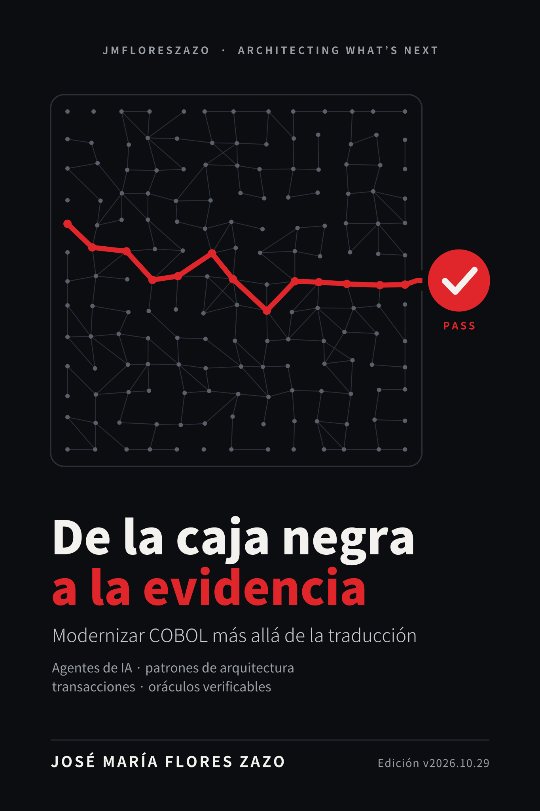

# De la caja negra a la evidencia

**Español** · [English](../en/README.md)

**Modernizar COBOL más allá de la traducción: agentes de IA, patrones de arquitectura, transacciones y oráculos verificables.**

José María Flores Zazo · Edición v2026.10.29 · [El libro entero en una página](../es.md) · [Catálogo de diagramas](diagramas.md) · [Volver al repositorio](../../README.es.md)

## Índice

- [Convenciones](00a-convenciones.md)
- [Prólogo](00b-prologo.md)
- [Cómo leer este libro](00c-como-leer-este-libro.md)
- **[Parte I · Antes de traducir](parte-1-antes-de-traducir/README.md)**
  - [Capítulo 1 · El mainframe no es una caja rápida](parte-1-antes-de-traducir/01-el-mainframe-no-es-una-caja-rapida.md)
  - [Capítulo 2 · El sistema que estamos intentando conservar](parte-1-antes-de-traducir/02-el-sistema-que-estamos-intentando-conservar.md)
  - [Capítulo 3 · Por qué la conversión uno a uno no es modernización](parte-1-antes-de-traducir/03-por-que-la-conversion-uno-a-uno-no-es-modernizacion.md)
  - [Capítulo 4 · Lo que comparto con otros autores y dónde discrepo](parte-1-antes-de-traducir/04-lo-que-comparto-con-otros-autores-y-donde-discrepo.md)
  - [Capítulo 5 · Modernizar exige elegir qué problema resolvemos](parte-1-antes-de-traducir/05-modernizar-exige-elegir-que-problema-resolvemos.md)
- **[Parte II · Arqueología, conocimiento y autoridad](parte-2-arqueologia-y-autoridad/README.md)**
  - [Capítulo 6 · REA y la arqueología que deja rastro](parte-2-arqueologia-y-autoridad/06-rea-y-la-arqueologia-que-deja-rastro.md)
  - [Capítulo 7 · Legacy Archaeology asistida por agentes](parte-2-arqueologia-y-autoridad/07-legacy-archaeology-asistida-por-agentes.md)
  - [Capítulo 8 · El conocimiento del agente y el expediente del sistema](parte-2-arqueologia-y-autoridad/08-el-conocimiento-del-agente-y-el-expediente-del-sistema.md)
  - [Capítulo 9 · De la autoridad del agente a la autoridad de la regla](parte-2-arqueologia-y-autoridad/09-de-la-autoridad-del-agente-a-la-autoridad-de-la-regla.md)
- **[Parte III · Oráculos: el derecho a aceptar](parte-3-oraculos/README.md)**
  - [Capítulo 10 · TODM y el problema de aceptar lo que construimos](parte-3-oraculos/10-todm-y-el-problema-de-aceptar-lo-que-construimos.md)
  - [Capítulo 11 · La arquitectura de una modernización verificable](parte-3-oraculos/11-la-arquitectura-de-una-modernizacion-verificable.md)
  - [Capítulo 12 · COBOL y C# deben acordar el significado](parte-3-oraculos/12-cobol-y-c-deben-acordar-el-significado.md)
- **[Parte IV · Patrones que sustituyen responsabilidades, no sintaxis](parte-4-patrones/README.md)**
  - [Capítulo 13 · Antes de elegir un patrón, identifica el contrato](parte-4-patrones/13-antes-de-elegir-un-patron-identifica-el-contrato.md)
  - [Capítulo 14 · Strangler Fig: cambiar el borde antes que el corazón](parte-4-patrones/14-strangler-fig-cambiar-el-borde-antes-que-el-corazon.md)
  - [Capítulo 15 · Anti-Corruption Layer: traducir significados, no tipos](parte-4-patrones/15-anti-corruption-layer-traducir-significados-no-tipos.md)
  - [Capítulo 16 · La propiedad de los datos](parte-4-patrones/16-la-propiedad-de-los-datos.md)
  - [Capítulo 17 · De los locks del mainframe al control explícito de concurrencia](parte-4-patrones/17-de-los-locks-del-mainframe-al-control-explicito-de.md)
  - [Capítulo 18 · Distribuir sin romper la contabilidad](parte-4-patrones/18-distribuir-sin-romper-la-contabilidad.md)
  - [Capítulo 19 · Actores: una gran herramienta, un mal sustituto universal](parte-4-patrones/19-actores-una-gran-herramienta-un-mal-sustituto-universal.md)
  - [Capítulo 20 · Batch y paralelismo: acelerar sin cambiar el resultado](parte-4-patrones/20-batch-y-paralelismo-acelerar-sin-cambiar-el-resultado.md)
  - [Capítulo 21 · Event sourcing, CQRS y sagas: cuándo ayudan y cuándo estorban](parte-4-patrones/21-event-sourcing-cqrs-y-sagas-cuando-ayudan-y-cuando-estorban.md)
- **[Parte V · Capacidad: MIPS, concurrencia y plataforma](parte-5-capacidad/README.md)**
  - [Capítulo 22 · Los MIPS no caben en una conversión de vCPU](parte-5-capacidad/22-los-mips-no-caben-en-una-conversion-de-vcpu.md)
  - [Capítulo 23 · Concurrencia que aprovecha la máquina](parte-5-capacidad/23-concurrencia-que-aprovecha-la-maquina.md)
  - [Capítulo 24 · El benchmark que vale: carga, contención, fallo y coste](parte-5-capacidad/24-el-benchmark-que-vale-carga-contencion-fallo-y-coste.md)
  - [Capítulo 25 · Azure o una máquina enorme en el cliente](parte-5-capacidad/25-azure-o-una-maquina-enorme-en-el-cliente.md)
- **[Parte VI · El laboratorio: de la demo a la evidencia](parte-6-laboratorio/README.md)**
  - [Capítulo 26 · Un laboratorio local que se puede entender](parte-6-laboratorio/26-un-laboratorio-local-que-se-puede-entender.md)
  - [Capítulo 27 · Hacer que el error se vea](parte-6-laboratorio/27-hacer-que-el-error-se-vea.md)
  - [Capítulo 28 · Transferencias, bloqueos y fallos en local](parte-6-laboratorio/28-transferencias-bloqueos-y-fallos-en-local.md)
  - [Capítulo 29 · Incorporar agentes sin permitir que escriban el aprobado](parte-6-laboratorio/29-incorporar-agentes-sin-permitir-que-escriban-el-aprobado.md)
- **[Parte VII · De la evidencia a la organización](parte-7-organizacion/README.md)**
  - [Capítulo 30 · Del laboratorio a un sistema que sigue operando](parte-7-organizacion/30-del-laboratorio-a-un-sistema-que-sigue-operando.md)
  - [Capítulo 31 · El SDLC como parte del motor de migración](parte-7-organizacion/31-el-sdlc-como-parte-del-motor-de-migracion.md)
  - [Capítulo 32 · Una historia de migración: la cuenta que parecía fácil](parte-7-organizacion/32-una-historia-de-migracion-la-cuenta-que-parecia-facil.md)
  - [Capítulo 33 · Plan de modernización: primero una prueba de capacidad, después una apuesta](parte-7-organizacion/33-plan-de-modernizacion-primero-una-prueba-de-capacidad.md)
  - [Capítulo 34 · Medir lo que todavía no sabemos](parte-7-organizacion/34-medir-lo-que-todavia-no-sabemos.md)
  - [Capítulo 35 · Cuándo NO migraría](parte-7-organizacion/35-cuando-no-migraria.md)
  - [Capítulo 36 · Cien riesgos para elegir patrones con criterio](parte-7-organizacion/36-cien-riesgos-para-elegir-patrones-con-criterio.md)
  - [Capítulo 37 · El nuevo contrato de modernización](parte-7-organizacion/37-el-nuevo-contrato-de-modernizacion.md)
- [Epílogo](epilogo.md)
- **[Anexos](anexos/README.md)**
  - [Anexo A · Un laboratorio que pueda contradecirnos](anexos/anexo-a-un-laboratorio-que-pueda-contradecirnos.md)
  - [Anexo B · Contrato del laboratorio](anexos/anexo-b-contrato-del-laboratorio.md)
  - [Anexo C · Ejecución de referencia](anexos/anexo-c-ejecucion-de-referencia.md)
  - [Anexo D · Decisiones de arquitectura](anexos/anexo-d-decisiones-de-arquitectura.md)
  - [Anexo E · Catálogo de cien riesgos](anexos/anexo-e-catalogo-de-cien-riesgos.md)
  - [Anexo F · Glosario operativo](anexos/anexo-f-glosario-operativo.md)
  - [Anexo G · Fuentes y alcance de la investigación](anexos/anexo-g-fuentes-y-alcance-de-la-investigacion.md)
