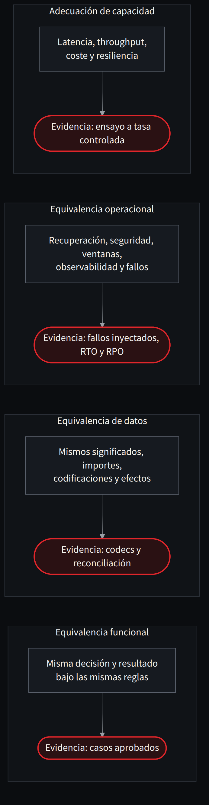

**Español** · [English](../../en/part-1-before-translating/01-the-mainframe-is-not-a-fast-box.md)

[← Parte I · Antes de traducir](README.md) · [Índice](../README.md) · [Capítulo 2 · El sistema que estamos intentando conservar →](02-el-sistema-que-estamos-intentando-conservar.md)

# Capítulo 1 · El mainframe no es una caja rápida

> [!IMPORTANT]
> **Tesis del capítulo.** Un mainframe es una plataforma de ejecución, datos, operación y control. Si solo medimos su procesador, todavía no sabemos qué estamos intentando sustituir.

Hay una conversación que he escuchado con demasiada frecuencia en proyectos de modernización: «tenemos X MIPS; ¿cuántas máquinas virtuales necesitamos en Azure?». A primera vista parece una pregunta de capacidad. En realidad suele revelar que todavía no entendemos el sistema que queremos sustituir. El mainframe es una plataforma de ejecución, datos, operaciones y control. Reducirla a una cifra de procesador equivale a medir un aeropuerto contando únicamente el empuje de sus motores.

COBOL es el lenguaje visible. Detrás pueden estar CICS para procesamiento transaccional, IMS o Db2 para datos, VSAM para ficheros indexados, JCL para organizar trabajos, JES para la ejecución por lotes, RACF para seguridad, WLM para prioridades, y sistemas de recuperación, colas, journaling y observabilidad que llevan décadas evolucionando. No todos los sistemas reúnen todos esos componentes. Precisamente por eso la primera tarea es inventariar lo que existe, no dibujar la solución cloud que nos gustaría vender.

Una aplicación CICS no equivale a un programa COBOL con un endpoint HTTP delante. Puede apoyarse en unidades de trabajo que comprometen conjuntamente modificaciones sobre recursos recuperables. El `SYNCPOINT` delimita esa frontera de commit o rollback [16]. Las aplicaciones con Db2 también dependen de niveles de aislamiento, bloqueos, planes de acceso y particularidades del procesamiento concurrente [37]. Si un agente traduce un `READ UPDATE` y olvida las garantías que acompañaban al acceso, el programa nuevo compilará. Puede incluso superar los primeros cien tests. Lo que habremos perdido es la propiedad por la que el banco confiaba en el programa antiguo.

La plataforma también incluye organización del trabajo. Un proceso batch no es necesariamente «un bucle grande». Puede estar encadenado a ventanas de cierre, estados de checkpoint, ordenaciones, reconciliaciones, dependencias y mecanismos de recuperación. Hay trabajos que deben finalizar antes de que abra una oficina y otros que deben convivir con la operativa en línea. Migrarlos a un cron en Kubernetes sin mapear esas dependencias constituye una conversión de comandos, no una modernización.

La distinción importa porque un programa puede ser simple y su ejecución compleja. Calcular intereses puede ocupar pocas líneas. Hacerlo para millones de cuentas, exactamente una vez por periodo, con calendarios de negocio, reinicios y conciliación, es un sistema completo. Y conservarlo exige diseñar tanto los invariantes económicos como la operación que los protege.

## Cuatro capas de equivalencia

Propongo separar cuatro obligaciones: **equivalencia funcional** (misma decisión y resultado bajo las mismas reglas); **equivalencia de datos** (mismos significados, importes, codificaciones y efectos persistentes); **equivalencia operacional** (recuperación, seguridad, ventanas, observabilidad y fallos); y **adecuación de capacidad** (cumplimiento de objetivos de latencia, throughput, coste y resiliencia). Son gates distintos. Aprobar uno no implica aprobar los demás.

Es posible que la nueva solución sea funcionalmente equivalente y tenga peor rendimiento. También puede procesar tres veces más operaciones y perder un céntimo por un redondeo distinto. En ninguno de los dos casos hemos terminado.

*Figura 1.1 · Cuatro obligaciones distintas. Aprobar una no aprueba las demás.*

Traducido a una reunión de seguimiento: cuando alguien diga «ya es equivalente», la pregunta correcta es *¿en cuál de las cuatro capas, con qué evidencia y con qué alcance?*

> **Medir un mainframe por sus MIPS es como medir un aeropuerto contando el empuje de sus motores.**

---

[← Parte I · Antes de traducir](README.md) · [Índice](../README.md) · [Capítulo 2 · El sistema que estamos intentando conservar →](02-el-sistema-que-estamos-intentando-conservar.md)
