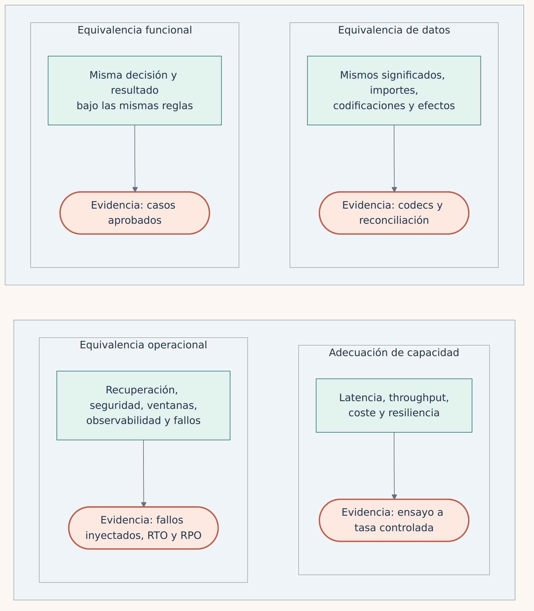

**Español** · [English](../../en/part-1-before-translating/01-the-mainframe-is-not-a-fast-box.md)

[← Parte I · Antes de traducir](README.md) · [Índice](../README.md) · [Capítulo 2 · El sistema que estamos intentando conservar →](02-el-sistema-que-estamos-intentando-conservar.md)

# Capítulo 1 · El mainframe no es una caja rápida

> [!IMPORTANT]
> **Tesis del capítulo.** Un mainframe es una plataforma de ejecución, datos, operación y control. Si solo medimos su procesador, todavía no sabemos qué estamos intentando sustituir.

Hay una conversación que he escuchado con demasiada frecuencia en proyectos de modernización: «tenemos X MIPS; ¿cuántas máquinas virtuales necesitamos en Azure?». A primera vista parece una pregunta de capacidad. En realidad suele revelar que todavía no entendemos el sistema que queremos sustituir. El mainframe es una plataforma de ejecución, datos, operaciones y control. Reducirla a una cifra de procesador equivale a medir un aeropuerto contando únicamente el empuje de sus motores.

COBOL es el lenguaje visible. Detrás pueden estar CICS para procesamiento transaccional, IMS o Db2 para datos, VSAM para ficheros indexados, JCL para organizar trabajos, JES para la ejecución por lotes, RACF para seguridad, WLM para prioridades, y sistemas de recuperación, colas, journaling y observabilidad que llevan décadas evolucionando. No todos los sistemas reúnen todos esos componentes. Precisamente por eso la primera tarea es inventariar lo que existe, no dibujar la solución cloud que nos gustaría vender.

Una aplicación CICS no equivale a un programa COBOL con un endpoint HTTP delante. Puede apoyarse en unidades de trabajo que comprometen conjuntamente modificaciones sobre recursos recuperables. El `SYNCPOINT` delimita esa frontera de commit o rollback [16]. Las aplicaciones con Db2 también dependen de niveles de aislamiento, bloqueos, planes de acceso y particularidades del procesamiento concurrente [37]. Si un agente traduce un `READ UPDATE` y olvida las garantías que acompañaban al acceso, el programa nuevo compilará. Puede incluso superar los primeros cien tests. Lo que habremos perdido es la propiedad por la que el banco confiaba en el programa antiguo.

La plataforma también incluye organización del trabajo. Un proceso batch no es necesariamente «un bucle grande». Puede estar encadenado a ventanas de cierre, estados de checkpoint, ordenaciones, reconciliaciones, dependencias y mecanismos de recuperación. Hay trabajos que deben finalizar antes de que abra una oficina y otros que deben convivir con la operativa en línea. Migrarlos a un cron en Kubernetes sin mapear esas dependencias constituye una conversión de comandos, no una modernización.

La distinción importa porque un programa puede ser simple y su ejecución compleja. Calcular intereses puede ocupar pocas líneas. Hacerlo para millones de cuentas, exactamente una vez por periodo, con calendarios de negocio, reinicios y conciliación, es un sistema completo. Y conservarlo exige diseñar tanto los invariantes económicos como la operación que los protege.

## Cuatro capas de equivalencia

Propongo separar cuatro obligaciones: **equivalencia funcional** (misma decisión y resultado bajo las mismas reglas); **equivalencia de datos** (mismos significados, importes, codificaciones y efectos persistentes); **equivalencia operacional** (recuperación, seguridad, ventanas, observabilidad y fallos); y **adecuación de capacidad** (cumplimiento de objetivos de latencia, throughput, coste y resiliencia). Son gates distintos. Aprobar uno no implica aprobar los demás.

Es posible que la nueva solución sea funcionalmente equivalente y tenga peor rendimiento. También puede procesar tres veces más operaciones y perder un céntimo por un redondeo distinto. En ninguno de los dos casos hemos terminado.

*Figura 1.1 · Cuatro obligaciones distintas. Aprobar una no aprueba las demás.*

Traducido a una reunión de seguimiento: cuando alguien diga «ya es equivalente», la pregunta correcta es *¿en cuál de las cuatro capas, con qué evidencia y con qué alcance?*

> **Medir un mainframe por sus MIPS es como medir un aeropuerto contando el empuje de sus motores.**

## Identificar la capa propietaria de cada garantía

Un assessment necesita una dirección de plataforma, no solo el nombre de una aplicación: máquina/modelo, partición, sistema operativo/versión, runtime/monitor, gestor de recursos y configuración. Una partición Linux sobre IBM Z no adquiere semántica z/OS, CICS o Db2 for z/OS por utilizar ese procesador. Tampoco un contenedor constituye el límite de recuperación de todo lo que invoca. Hay que registrar la topología instalada antes de elegir qué conservar, trasladar o rediseñar.

El [catálogo de fuentes](../../../research/platform-contracts/catalog.json) registra diez contratos acotados, su versión y una prueba propuesta para refutarlos. Distingue comportamiento documentado, ejecución en la plataforma original y verificación del reemplazo. Aquí solo hay evidencia del primero. Las familias sin revisar siguen visibles como desconocidas; un campo vacío no significa ausencia de una función.

| Capa / contrato | Alcance documentado | Qué investigar en el reemplazo |
|---|---|---|
| Partición y despacho | El entitlement de CPU compartida de PR/SM depende de pesos de particiones y del conjunto compartido [52] | CPU asignada frente a consumida, competencia, topología y latencia de cola; un límite CPU de contenedor no es equivalente semántico |
| I/O por canales | IBM describe CSS ejecutando I/O asíncronamente respecto al trabajo del procesador central [51] | Espera/servicio de toda la ruta de almacenamiento; async del lenguaje no reproduce por sí solo un subsistema de canales |
| Memoria virtual y real | z/OS puede paginar o posponer trabajo cuando falta memoria real [53] | Conjunto residente, buffers, paginación y presión de asignación; direccionamiento y capacidad RAM son medidas distintas |
| Política de cargas | WLM utiliza objetivos de servicio e importancia [54] | Presupuestos y esperas de tráfico interactivo frente a batch; una cola prioritaria aislada no aporta evidencia suficiente |
| Funciones de procesador | zIIP ejecuta trabajo elegible [55] | Elegibilidad, consumo real e inventario de licencias; contar trabajo útil en lugar de convertir motores a vCPU |
| Monitor transaccional | Una tarea CICS puede abarcar varias unidades de trabajo [49] | Syncpoints, participantes y efectos externos reales; sesión/tarea/transacción requieren inventarios separados |
| Gestor de datos | Aislamiento/bloqueos y data sharing de Db2 for z/OS dependen de opciones y topología [56], [57] | Historias concurrentes, planes, seguridad del predicado y recuperación; nombres conocidos de aislamiento o réplicas escribibles no demuestran equivalencia |

Las fuentes describen productos y versiones documentales concretos, no todas las instalaciones. El catálogo registra consulta por índice cuando no se pudo acceder directamente a documentación IBM; las fechas de publicación quedan desconocidas cuando no se proporcionan. La versión documental no declara soporte o disponibilidad actuales. Estas filas no permiten deducir frecuencia CPU, conversión MIPS, capacidad de hardware ni resultados de una carga bancaria.

## Seguir una instrucción por sus límites de recuperación

Consideremos una **traza propuesta para el assessment**, sin duraciones medidas: sucursal/navegador → adaptador de canal → servicio transaccional → base de datos autoritativa → decisión duradera → respuesta. Registrar la identidad de operación y distinguirla de sesión, tarea, unidad de trabajo y span de traza. El [capítulo de canales](../parte-4-patrones/21a-canales-atm-y-core.md) desarrolla el límite ATM/dispositivo; la siguiente traza trata una actualización recuperable de cuentas.

| Punto de observación | Captura con acceso aprobado | Fallo o ambigüedad que investigar |
|---|---|---|
| Sucursal y adaptador | Envío/recepción del cliente, presupuesto de red, identidad de entrada y mapping | Timeout antes de aceptación frente a respuesta perdida tras commit; conservar la identidad original |
| Despacho y ejecución | Espera por clase de servicio, límites tarea/UOW y consumo CPU | Que haya CPU disponible no demuestra que una petición en cola cumpliese su plazo |
| Lectura y bloqueo | Plan de acceso, lecturas lógicas/físicas, acierto de buffers, espera de locks y predicado afectado | Una lectura en caché puede ser rápida mientras otra actualización viola la regla; examinar historias concurrentes |
| Actualización y durabilidad | Filas/registros cambiados, participantes recuperables, confirmación de log/syncpoint y publicación | Caer antes/después del límite; determinar qué efectos están confirmados, deshechos o sin resolver |
| Respuesta y recuperación | Decisión autoritativa, resultado del cliente, identidad de reintento y conciliación | Un ACK perdido conserva incertidumbre para el cliente; una conexión nueva no debe crear silenciosamente otro cargo |

Los intervalos necesitan extremos definidos. Usar duraciones monotónicas dentro de cada observador y conservar desfase/incertidumbre de relojes antes de comparar timestamps entre máquinas. Una medida de respuesta transaccional del host no incluye automáticamente pantalla, WAN o dispositivo. El [capítulo de infraestructura](../parte-5-capacidad/25a-infraestructura-mainframe-local-azure-y-redes-bancarias.md) desarrolla la comparación de red/capacidad; no sumar duraciones solapadas como si fueran independientes.

Dos **diseños de assessment**, no benchmarks, concretan las preguntas. Para el candidato de lectura, preregistrar 32 clientes concurrentes consultando un fixture inmutable de 1.000.000 de cuentas; comparar conjuntos de trabajo calientes/fríos, planes, lecturas reales y colas de respuesta. Informar el comportamiento de caché conseguido; reiniciar un proceso no prueba que la caché de almacenamiento esté fría. Para el candidato de escritura, preregistrar 16 clientes emitiendo 1.000 transferencias únicas de 100 unidades menores entre 100 cuentas con 10.000 cada una; después, otra ejecución concentrada en dos cuentas calientes. Conciliar aceptadas/denegadas/inciertas, asientos, deduplicación y durabilidad ante fallo antes/después del commit. Las cifras definen entradas hipotéticas, no throughput observado. Ambos escenarios necesitan objetivos aprobados, pruebas de restauración y persistencia/seguridad comparables.

## Pedir al operador y DBA evidencia capaz de cambiar el diseño

Solicitar únicamente extractos autorizados y minimizados. El resultado útil es un manifiesto con intervalo de captura, versión/configuración, unidades, responsable, sensibilidad y motivo de datos ausentes; dumps productivos, credenciales y registros de clientes no pertenecen a este repositorio público.

| Pregunta | Evidencia que solicitar | Decisión que puede cambiar |
|---|---|---|
| ¿Qué entornos ejecutan esta capacidad? | Inventario máquina/partición/SO, versiones de monitores/motores y definiciones activas | Conservar motor, sustituir adaptador o redibujar el límite funcional |
| ¿Qué trabajo compite en el pico? | SMF/RMF y registros de clases cuando correspondan; CP/zIIP, esperas y plazos batch | Admisión, aislamiento, planificación y ubicación de capacidad |
| ¿Qué ruta de datos domina? | Accounting/estadísticas Db2, planes, buffers, locks/deadlocks y tiempos de log/almacenamiento | Consultas/índices, tamaño transaccional, concurrencia o almacenamiento |
| ¿Qué más confirma o cambia estado? | Inventario datasets/colas/recursos, syncpoints, grafo de jobs, generaciones y efectos externos | Transacción local frente a coordinación o conciliación explícita |
| ¿Qué debe preservar la recuperación? | Historia de efectos confirmados, ensayo backup/restauración, topología de réplica y RPO/RTO | Dominios de fallo, fencing del propietario y procedimiento operativo |
| ¿Quién aprueba comportamiento y excepciones? | Política versionada, responsable y resultados esperados independientes | Aceptación de negocio; observar el origen no basta |

En un assessment real, los campos sin responder siguen como `NEEDS_CUSTOMER_DATA`. Un ensayo SQL Linux puede validar una invariante candidata; no mide canales IBM, acredita una opción de recuperación MCP ni certifica la instalación antigua. El [capítulo de patrones](../parte-4-patrones/13-antes-de-elegir-un-patron-identifica-el-contrato.md) utiliza tres ejemplos de plataforma para mostrar por qué importa atribuir cada garantía.

---

[← Parte I · Antes de traducir](README.md) · [Índice](../README.md) · [Capítulo 2 · El sistema que estamos intentando conservar →](02-el-sistema-que-estamos-intentando-conservar.md)
