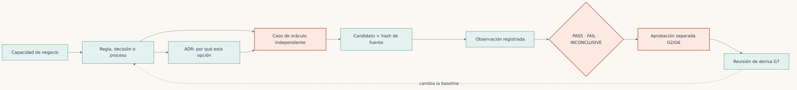

**Español** · [English](../../en/part-3-oracles/10a-todm-toolbox-models-and-adrs.md)

[← Capítulo 10 · TODM y la aceptación](10-todm-y-el-problema-de-aceptar-lo-que-construimos.md) · [Índice](../README.md) · [Capítulo 11 · Arquitectura verificable →](11-la-arquitectura-de-una-modernizacion-verificable.md)

# Capítulo 10 bis · Aplicar TODM: modelos, herramientas y ADR

> [!IMPORTANT]
> **Tesis del capítulo.** Documentar las decisiones para que otra persona pueda inspeccionarlas, ejecutarlas y cuestionarlas. Un diagrama explica una afirmación; un oráculo cualificado la comprueba; una aprobación responsable la autoriza. Ninguno sustituye a los otros dos.

## La fuente de verdad es una baseline gobernada, no un formato

En una migración COBOL quiero que el equipo futuro sepa qué significa una capacidad, por qué existe una frontera arquitectónica y qué observaciones justifican cambiarla. El código por sí solo no responde a las tres preguntas. Tampoco una colección de diagramas se vuelve autoritativa por guardarse junto al código.

Una baseline útil identifica capacidad, vocabulario, reglas, excepciones, obligaciones operacionales, evidencia de origen, responsable, versión y ámbito de aprobación. Una observación del legado demuestra qué ocurrió, no concede automáticamente permiso para conservar un defecto. El modelo propuesto por un agente sigue siendo una propuesta aunque su sintaxis valide. Si política y comportamiento observado discrepan, hay que registrar el conflicto y obtener la decisión de negocio antes de tratar cualquiera de ellos como verdad aceptada.

La baseline debe identificar los bytes exactos del modelo y la versión del evaluador. Su hash detecta cambios frente a una referencia conservada independientemente; un manifiesto editable junto a modelos editables no autentica al responsable. Por eso el [adaptador TODM](../../../lab/todm_validation/README.md) distingue evaluación técnica, aprobación de baseline G2 y autorización de entrega G6. Los experimentos pueden superar sus controles técnicos mientras esas aprobaciones siguen sin estar disponibles.

## Dar a cada artefacto una función concreta

| Artefacto | Pregunta que responde | Qué no demuestra por sí solo |
|---|---|---|
| Vocabulario y reglas de estilo SBVR | Qué significan «disponible», «contabilizado» y «aceptado» | Que un parser implemente toda la semántica SBVR |
| Tabla de decisión DMN | Qué resultado corresponde a unas entradas y precedencia de reglas | Transacciones, finalización de procesos o aprobación de negocio |
| Modelo de proceso BPMN | Qué actividades, decisiones y fronteras forman el proceso | Que un dibujo XML sea un workflow ejecutado o una transacción durable |
| Modelo de casos CMMN | Qué trabajo discrecional y evidencia completan un caso prolongado | Una traza fija para cualquier caso posible |
| Restricciones de estilo OCL o invariantes matemáticas | Qué estados o relaciones están prohibidos | Cobertura de toda excepción y fallo del entorno |
| ADR | Por qué se eligió una opción arquitectónica y con qué compromisos | El contrato observable de negocio o permiso para desplegar |
| Golden Master y trazas operacionales | Qué hizo realmente el sistema existente | Que ese comportamiento sea la regla que debemos conservar |

Hay que usar el conjunto mínimo que haga revisable la capacidad. Una comisión puede necesitar vocabulario, tabla de decisión y ejemplos. Una reclamación de pagos quizá requiera además proceso, modelo de casos y reconciliación de efectos externos. Añadir los cinco estándares por defecto crea trabajo de mantenimiento sin aportar necesariamente más evidencia.

## Las herramientas del repositorio y sus límites

El [kit de modelos de decisión](../../../lab/decision_models/README.md) proporciona perfiles ejecutables deliberadamente acotados para tablas de decisión y trazas de procesos, además de ejemplos de trazabilidad de baseline y ADR. Su README define esquema, operadores y comandos admitidos. No son motores completos DMN/FEEL o BPMN. En particular, un comprobador de trazas lineales no debe certificar tokens BPMN concurrentes, compensación, entrega de mensajes o recuperación transaccional.

El [adaptador de evidencia TODM](../../../lab/todm_validation/README.md) hace otro trabajo. Vincula un inventario explícito de artefactos con sus bytes conservados, examina observaciones específicas de cada experimento, emite registros G0–G7 y separa la autoridad de entrega. Sus controles negativos cuestionan evidencia ausente, bytes alterados, invariantes falsas y campos de aprobación no confiables. No deduce la verdad del dominio de una etiqueta `PASS`.

El [harness constructor aislado](../../../lab/e4_agents/README.md) limita la ejecución del candidato y compara sus pruebas con controles reservados y mutantes conocidos. El [operador Azure](../../../infra/experiments/README.md) gestiona exportación de fuentes, ejecución, recogida de evidencia y apagado consciente del coste. El [colector CLI de solo lectura](../../../scripts/azure/capture-book-evidence.ps1) registra el estado desplegado. Ninguna de estas herramientas concede a otra autoridad para aprobar reglas de negocio.

## De una capacidad COBOL a una obligación ejecutable

Empezaría por una operación de negocio identificada, no por la frontera de un fichero fuente. En el cálculo de comisiones hay que definir unidades del importe y de la tasa, actividad, entradas inválidas, redondeo en el punto medio y umbral de revisión. En una transferencia también identidad de operación, reglas de débito concurrente, conservación del ledger, atomicidad del outbox y significado de un reconocimiento ambiguo.

Separaría tres inventarios:

1. **Propuestas normativas:** vocabulario, tablas, obligaciones de proceso y restricciones pendientes de revisión.
2. **Caracterización:** ejemplos y trazas autorizados del sistema existente, con entorno e incertidumbre.
3. **Decisiones:** reglas y opciones arquitectónicas aceptadas, con responsables y ámbito preciso.

Antes de permitir cambios de implementación al constructor, hay que convertir una obligación aprobada en resultados esperados independientes. Se mantienen casos frontera: umbral exacto, justo por encima, punto medio de redondeo, representación inválida, cuenta inactiva y reintento tras respuesta incierta. En trazas de proceso se incluyen orden válido y pasos ausentes, duplicados o desordenados. En ledgers se inspecciona el estado persistido por separado: la respuesta exitosa del candidato no demuestra atomicidad.

Una tabla DMN puede decidir si una solicitud necesita revisión. BPMN puede explicar dónde ocurre esa revisión. El diseño transaccional todavía debe decir si el dinero está reservado, contabilizado o intacto mientras espera. Esa frontera corresponde a un ADR y a pruebas ejecutables de fallos, no a una suposición sobre el diagrama.

### Una decisión y un proceso ejecutables pequeños

Desde la raíz del repositorio se valida el ejemplo y se evalúa su caso de punto medio:

```bash
python3 lab/decision_models/toolkit.py validate lab/decision_models/examples/fee-decision.json
python3 lab/decision_models/toolkit.py evaluate lab/decision_models/examples/fee-decision.json --input lab/decision_models/examples/fee-input.json
```

La salida registrada incluye `status: PASS`, `feeCents: 1`,
`resultCode: APPROVE` y `productionApproved: false`. La aritmética exacta y una
política explícita de redondeo importan más que una tabla visualmente convincente.
`FIRST` usa el orden declarado; `UNIQUE` rechaza una entrada que coincide con
varias reglas. Son perfiles JSON limitados inspirados en DMN, no DMN XML ni un motor FEEL.

Se comprueba la traza secuencial y después se presenta deliberadamente su variante inválida:

```bash
python3 lab/decision_models/toolkit.py check-trace lab/decision_models/examples/fee-process.json --input lab/decision_models/examples/fee-trace.json
python3 lab/decision_models/toolkit.py check-trace lab/decision_models/examples/fee-process.json --input lab/decision_models/examples/fee-trace-invalid.json
```

El primer comando termina con 0; el control negativo, con 1. Es un rechazo
esperado, no una razón para quitar el control de la documentación. El comprobador
no implementa pasarelas paralelas, semántica de tokens ni intercambio BPMN XML.
Sus transiciones limitadas hacen comprobable solo la traza declarada.

Por último se verifican los hashes de modelos y ADR de la baseline, o se exporta
el perfil de decisión como JSON determinista:

```bash
python3 lab/decision_models/toolkit.py check-baseline lab/decision_models/examples/baseline.json --root lab/decision_models
python3 lab/decision_models/toolkit.py export lab/decision_models/examples/fee-decision.json
```

La baseline vincula los bytes del ADR de ejemplo; no autentica aprobación. La
exportación es JSON del perfil local, no canonicalización RFC 8785 ni intercambio
certificado. El [registro de ejemplos ejecutados](../../../lab/decision_models/examples/demo-run.json)
y 21 pruebas unitarias separan comportamiento admitido de ampliaciones futuras.

## Los ADR conservan razones que los modelos no expresan

Un ADR es un registro breve y versionado de una decisión arquitectónica. Se conservan estado, contexto, alternativas, decisión, consecuencias, obligaciones de validación y enlaces a registros sustituidos. Debe identificarse quién responde de aceptar el compromiso; no hay que inventar fecha de aprobación o nombre para completar la plantilla.

En una migración COBOL son útiles ADR sobre ledger autoritativo, representación decimal, frontera de codificación, clave de idempotencia, límite transaccional, cierre de escritores en origen, restricciones de corte y vuelta atrás, modelo de consistencia y topología de despliegue. Cada decisión se vincula a una capacidad y a evidencia. Un ADR que elige outbox está incompleto si no define las obligaciones ante duplicados y de reconciliación.

Una cadena práctica de trazabilidad va de la capacidad de negocio a la revisión de deriva, con la aprobación como paso separado después del veredicto:



*Figura 10 bis.1 · La cadena de trazabilidad: la aprobación es un paso separado tras el veredicto, y la deriva devuelve a la regla.*

Cambiar un elemento no aprueba silenciosamente el siguiente. Si un ADR pasa de contabilización síncrona a procesamiento diferido, se revisan modelo de proceso, contrato de consistencia, presupuesto de latencia, oráculo y plan de migración. La baseline anterior se conserva y se explica qué la sustituye. El [anexo de decisiones arquitectónicas](../anexos/anexo-d-decisiones-de-arquitectura.md) aporta el contexto del libro; las plantillas del kit convierten esa disciplina en artefactos reutilizables de proyecto.

## Ejecutar la evidencia sin concederse aprobación

Desde la raíz de un paquete portable capturado se utiliza una ruta de salida nueva:

```bash
python3 adapter/lab/todm_validation/validate.py --manifest manifest.json --root . --output validation-new.json
python3 adapter/lab/todm_validation/qualify_bundle.py --root . --output qualification-new
```

La salida de cualificación está dentro de la raíz porque sus mutaciones controladas se referencian respecto de ella. Esa salida nueva se conserva separada de las observaciones originales. Para los ejemplos de modelos se consulta el README del kit; hay que usar su CLI y esquema reales, no considerar los listados del capítulo una especificación sustitutiva.

Se revisan cuatro cosas en orden: si las entradas están completas y vinculadas al fuente previsto, qué observó el oráculo independiente, si la cualificación detectó las amenazas declaradas y quién tiene autoridad para aprobar baseline y entrega. Un `PASS` técnico responde solo a lo implementado por ese evaluador. `INCONCLUSIVE` y `BLOCK` deben seguir visibles cuando el resultado llega a las personas.

## Qué aportó la demostración de Azure

La [campaña TODM ejecutada](../../../evidence/runs/todm-azure-2026-11-08.json) comprobó en Azure 134 archivos del snapshot y 108 vinculaciones de artefactos. Sus controles técnicos E1–E4 pasaron con ocho controles negativos sobre entradas reales y doce casos sintéticos de mandatos; la metodología quedó inconclusa y la entrega bloqueada. Primero rechazó la ausencia de bytes originales de ejecución E3. Recuperar los binarios coincidentes del árbol de compilación conservado reparó el inventario sin reescribir el paquete fallido.

Es una demostración útil del proceso, no una prueba de eficacia industrial. No autenticamos una aprobación real de negocio, implementamos todos los estándares de modelado ni comparamos resultados organizativos entre migraciones. Las [salidas CLI de Azure](../../../evidence/runs/azure-cli-2026-11-08/capture.json) muestran además estado de recursos, no rendimiento ni corrección semántica.

## Adaptar las herramientas sin debilitar la afirmación

Para adaptar un perfil se declara primero la característica semántica que falta. Se añade su esquema y comportamiento del evaluador, y después casos independientes positivos, negativos e incompletos. Se conservan fixtures anteriores y compatibilidad, o se declara una nueva versión del perfil. No se interpreta silenciosamente un operador desconocido como falso, se omite una tarea extraña ni se eleva un modelo sintácticamente válido a baseline aprobada.

Si el proyecto necesita ejecución DMN o BPMN completa, se selecciona un motor conforme para la versión y características requeridas, se registra la selección en un ADR y se cualifica su configuración exacta. Se siguen verificando resultados de negocio fuera de la implementación. Las referencias a SBVR, CMMN y OCL no afirman que este repositorio implemente esos motores.

El [anexo final sobre otros lenguajes](../anexos/anexo-h-mas-alla-de-cobol.md) separa método reutilizable de prueba específica de cada lenguaje. La inversión durable no es un formato de diagrama ni un lenguaje: es una cadena mantenida desde la regla con autoridad hasta el resultado observable.

---

[← Capítulo 10 · TODM y la aceptación](10-todm-y-el-problema-de-aceptar-lo-que-construimos.md) · [Índice](../README.md) · [Capítulo 11 · Arquitectura verificable →](11-la-arquitectura-de-una-modernizacion-verificable.md)
