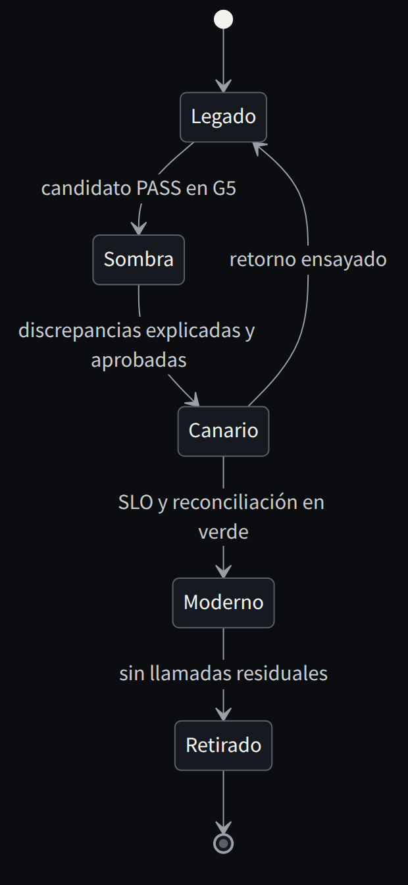
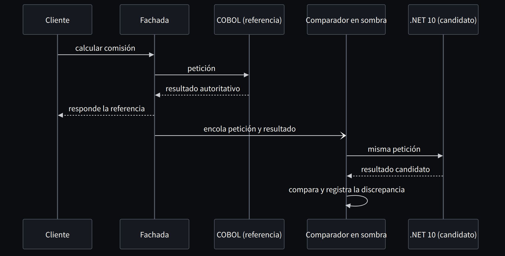

**Español** · [English](../../en/part-4-patterns/14-strangler-fig-change-the-edge-before-the-heart.md)

[← Capítulo 13 · Antes de elegir un patrón, identifica el contrato](13-antes-de-elegir-un-patron-identifica-el-contrato.md) · [Índice](../README.md) · [Capítulo 15 · Anti-Corruption Layer: traducir significados, no tipos →](15-anti-corruption-layer-traducir-significados-no-tipos.md)

# Capítulo 14 · Strangler Fig: cambiar el borde antes que el corazón

> [!IMPORTANT]
> **Tesis del capítulo.** Interceptar una capacidad, derivarla gradualmente y retirar el tramo antiguo cuando el nuevo ha demostrado responder bien. La sencillez del dibujo oculta los dos retos reales: elegir la costura y controlar los datos compartidos.

El patrón Strangler Fig [36] es la alternativa que más veces permite modernizar sin exigir un gran corte final. Su idea es sencilla: interceptar una capacidad, derivarla progresivamente hacia una implementación nueva y retirar el tramo antiguo cuando la nueva ha demostrado que responde correctamente. Pero la sencillez del dibujo oculta dos retos: establecer fronteras y controlar los datos compartidos.

En COBOL, la frontera puede ser una transacción CICS, una llamada de programa, una integración por fichero, un API ya expuesto o un paso de la cadena batch. Mi preferencia es una **costura de negocio**: «cotizar póliza», «calcular interés», «registrar cargo», no «migrar programa ABC123». Los nombres de los programas son un mapa histórico de implementación; no siempre representan capacidades del dominio.

El primer despliegue puede limitarse a *shadow mode*: la transacción sigue ejecutándose en COBOL y la nueva implementación recibe una copia segura de la petición. Comparamos decisiones y efectos simulados, sin duplicar escrituras productivas. Más adelante pasamos a lecturas controladas o a un pequeño porcentaje de operaciones. Debe existir un plan de reversibilidad, pero no podemos prometer un rollback instantáneo cuando ya hemos dividido propiedad de datos y generado efectos externos. El rollback es una capacidad diseñada y ensayada, no una frase en una diapositiva.



*Figura 14.1 · Ciclo de vida de una costura Strangler Fig: cada transición exige evidencia, y el retorno está ensayado.*

Un equipo puede caer en la trampa del «strangler eterno»: el sistema nuevo vive permanentemente del antiguo mediante decenas de llamadas sin delimitar responsabilidades. El remedio es publicar por cada costura un contrato de retiro: dueño de datos, observabilidad, pruebas, ruta de rollback, fecha objetivo y dependencias que desaparecerán. Modernizar también significa **eliminar**.

## La fachada que decide quién responde

La pieza que hace posible todo lo anterior es una fachada con una política de enrutamiento por capacidad. En modo sombra responde siempre el sistema de referencia y el candidato se evalúa fuera del camino crítico.

**Listado 14.1 · Fachada de convivencia con modo sombra para una capacidad sin efectos laterales** — *Ilustrativo*

```csharp
public enum Route { Legacy, Shadow, Modern }

public sealed class FeeFacade(ILegacyFee legacy, IModernFee modern,
                              IRoutingPolicy policy, IShadowComparer shadow)
{
    public async Task<FeeResult> CalculateAsync(FeeRequest request, CancellationToken ct)
    {
        switch (policy.RouteFor(request))
        {
            case Route.Modern:
                return await modern.CalculateAsync(request, ct);

            case Route.Shadow:
                var authoritative = await legacy.CalculateAsync(request, ct);
                shadow.Enqueue(request, authoritative);   // el candidato se evalúa aparte
                return authoritative;                     // responde la referencia

            default:
                return await legacy.CalculateAsync(request, ct);
        }
    }
}
```



*Figura 14.2 · Modo sombra para una capacidad sin efectos laterales: responde siempre la referencia.*

Este fragmento solo es seguro porque la comisión es un cálculo puro. Si la capacidad escribe, notifica o cobra, la sombra no puede ejecutar efectos reales: necesita un almacén no autoritativo, efectos simulados y una captura que fije el estado leído por ambos lados. El capítulo [30](../parte-7-organizacion/30-del-laboratorio-a-un-sistema-que-sigue-operando.md) vuelve sobre esa convivencia y sobre lo que significa volver atrás cuando ya se han escrito datos.

> **Modernizar también significa eliminar. Un strangler sin contrato de retiro es un strangler eterno.**

---

[← Capítulo 13 · Antes de elegir un patrón, identifica el contrato](13-antes-de-elegir-un-patron-identifica-el-contrato.md) · [Índice](../README.md) · [Capítulo 15 · Anti-Corruption Layer: traducir significados, no tipos →](15-anti-corruption-layer-traducir-significados-no-tipos.md)
