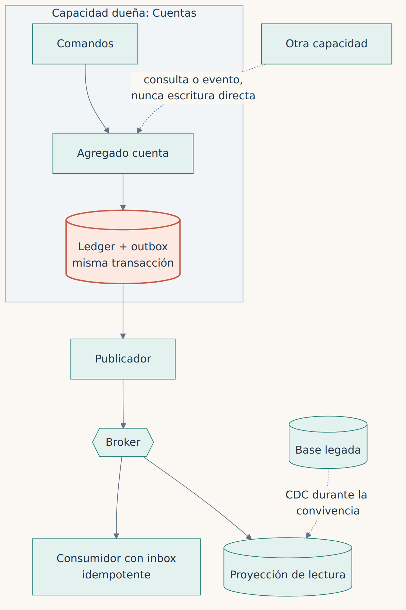

**Español** · [English](../../en/part-4-patterns/16-data-ownership.md)

[← Capítulo 15 · Anti-Corruption Layer: traducir significados, no tipos](15-anti-corruption-layer-traducir-significados-no-tipos.md) · [Índice](../README.md) · [Capítulo 17 · De los locks del mainframe al control explícito de concurrencia →](17-de-los-locks-del-mainframe-al-control-explicito-de.md)

# Capítulo 16 · La propiedad de los datos

> [!IMPORTANT]
> **Tesis del capítulo.** Si todas las cajas escriben en las mismas tablas, seguimos teniendo un monolito de datos. Cada agregado necesita un único dueño de la escritura, y la convivencia necesita un protocolo, no buena voluntad.

Una arquitectura de microservicios puede dibujar cajas independientes, pero si todas escriben las mismas tablas continúa existiendo un monolito de datos. En sistemas COBOL maduros es habitual que varios programas y jobs toquen el mismo conjunto de registros. Antes de mover la lógica debemos identificar escritores, lectores, bloqueos y reconciliaciones. El inventario dinámico importa tanto como las búsquedas estáticas: una tabla aparentemente de lectura puede tener un mantenimiento batch que solo se ejecuta el último día del trimestre.

## Identificar a quién pertenece cada cambio

Propongo un **registro de ownership** para cada agregado. Una capacidad es dueña de aceptar comandos y determinar el nuevo estado; otros consumidores reciben consultas o eventos. Durante la transición quizá haya que sostener un espejo temporal o CDC, pero no aceptaría dos escritores maestros sin un protocolo explícito de resolución de conflictos. La doble escritura independiente de base antigua y nueva falla precisamente entre ambas escrituras; el éxito de un lado no garantiza el del otro.

*Figura 16.1 · Un único dueño de la escritura por agregado; los demás consultan o reciben eventos.*

La publicación posterior al COMMIT es otra responsabilidad: su mecanismo de **Outbox e Inbox** se desarrolla en el [capítulo 18](18-distribuir-sin-romper-la-contabilidad.md). Aquí la decisión es anterior al patrón: quién posee la escritura, cómo se cercará al propietario anterior y qué consultas pueden tolerar retrasos.

## Una convivencia que se pueda deshacer

Una cuenta recibe apuntes nocturnos desde COBOL y movimientos online desde una API nueva. Si los dos lados confirman dinero por separado, hemos creado dos autoridades. Antes del corte exigiría un inventario de escritores, una forma de impedir nuevas escrituras en el origen, conciliación y un procedimiento de retorno probado.

CDC es útil para coexistencia y observación, no una prueba automática de que la nueva base es correcta. Se debe preservar orden por clave, detectar retraso, reconstruir estados a partir de snapshots consistentes y medir la diferencia entre origen y destino. Si la transición depende de lecturas de una réplica eventualmente consistente, los contratos deben reconocerlo.

> **La doble escritura independiente falla precisamente entre las dos escrituras.**

---

[← Capítulo 15 · Anti-Corruption Layer: traducir significados, no tipos](15-anti-corruption-layer-traducir-significados-no-tipos.md) · [Índice](../README.md) · [Capítulo 17 · De los locks del mainframe al control explícito de concurrencia →](17-de-los-locks-del-mainframe-al-control-explicito-de.md)
