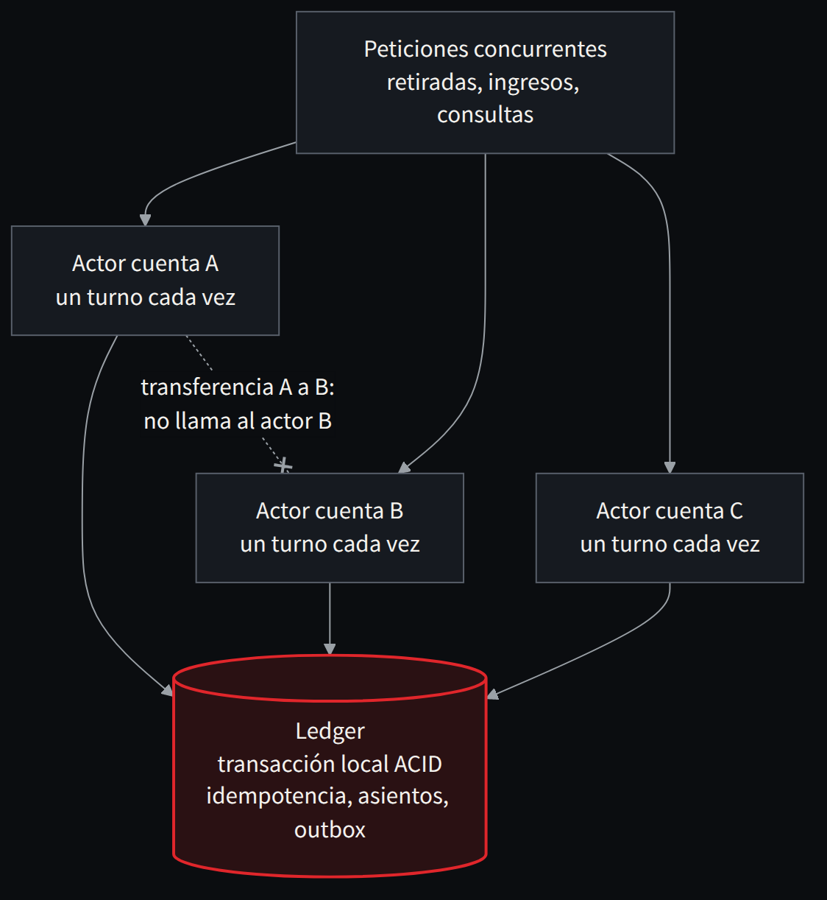
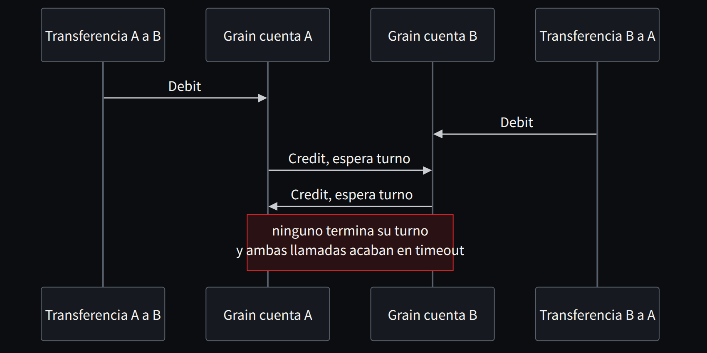

**Español** · [English](../../en/part-4-patterns/19-actors-a-great-tool-a-poor-universal-substitute.md)

[← Capítulo 18 · Distribuir sin romper la contabilidad](18-distribuir-sin-romper-la-contabilidad.md) · [Índice](../README.md) · [Capítulo 20 · Batch y paralelismo: acelerar sin cambiar el resultado →](20-batch-y-paralelismo-acelerar-sin-cambiar-el-resultado.md)

# Capítulo 19 · Actores: una gran herramienta, un mal sustituto universal

> [!IMPORTANT]
> **Tesis del capítulo.** El patrón de actores encaja muy bien para coordinar entidades con identidad —cuentas, pólizas, expedientes— y paralelizar entre ellas. No sustituye al ledger, no hace atómica una transferencia entre dos actores y no acelera una cuenta caliente.

## Cuándo encajan

Los actores resultan útiles cuando tenemos muchas entidades con identidad, estado y comportamiento, y cuando gran parte de sus operaciones pueden resolverse localmente. Una póliza, un préstamo o un expediente pueden encajar. También una cuenta, si definimos con precisión qué operaciones afectan solo a esa cuenta y cuáles necesitan un coordinador.

La unidad que migraría sería una capacidad de negocio. No convertiría cada programa COBOL, párrafo o registro en actor automáticamente. Una llamada técnica heredada puede mezclar varias responsabilidades; distribuirla sin descubrirlas convierte el acoplamiento de memoria en acoplamiento de red.

Conservaría al principio una interfaz que permita comparar legado y nueva implementación. Por ejemplo, un actor de póliza puede coordinar solicitudes y llamar todavía a una rutina COBOL para calcular una prima. Cuando una implementación nueva supera el contrato correspondiente, podemos cambiar el cálculo manteniendo la identidad y el control del proceso.

El patrón de actores encaja especialmente bien cuando podemos identificar una entidad con identidad estable —cuenta, póliza, contrato— y queremos coordinar sus operaciones sin bloquear a todas las entidades a la vez. Un actor recibe mensajes y evoluciona su estado; millones de identidades distintas pueden repartir su trabajo entre nodos. Dapr Actors [26] y Microsoft Orleans [24] ofrecen implementaciones de actores virtuales. En .NET 10, Orleans merece una evaluación preferente cuando la solución es fundamentalmente C#; Dapr puede ser interesante si el entorno es políglota o combina otros building blocks.

La tentación consiste en crear `AccountActor` y dar por resuelta la banca. No es así. La unidad de aislamiento es el actor, no necesariamente el conjunto de una transacción que involucre dos cuentas. Tampoco podemos confundir una activación en memoria con un registro contable duradero. Orleans dispone de un modelo optativo de transacciones ACID sobre estado persistido bajo condiciones y proveedores específicos [25]; no significa que toda escritura a una base externa o todo mensaje quede integrado automáticamente.

Separaría al menos tres responsabilidades: un **actor o coordinador por identidad** para limitar conflictos y simplificar lógica secuencial; un **servicio contable** con una frontera ACID comprobada para movimientos; y **proyecciones** para consultas y analítica. La fuente de verdad del dinero debe estar claramente definida, y preferiblemente en un ledger auditable. Si el actor usa una copia caché del saldo, tiene que invalidarla o reconciliarla tras el commit.



*Figura 19.1 · Actores por cuenta: paralelismo entre identidades, orden dentro de cada una. La durabilidad y la atomicidad las garantiza el ledger.*

## Lo que aporta el runtime y lo que sigue pendiente

Orleans organiza por defecto la ejecución de una activación de grain con solicitudes completas sin intercalarlas. Su documentación explica que habilitar reentrancia permite intercalar turnos y exige razonar sobre el estado a través de los `await` [24]. También muestra que las llamadas cíclicas pueden provocar esperas que terminan en timeout. Por tanto, el modelo de actores reduce una parte del problema concurrente; no elimina todos los bloqueos.

Orleans dispone de transacciones ACID sobre estado transaccional de grains y exige configurar participantes y almacenamiento específicos [25]. Esa garantía no incorpora por declaración cualquier escritura SQL o llamada a un broker realizada en medio del método. El conjunto de participantes de una transacción debe estar identificado.

Dapr ofrece actores virtuales con identidad, estado y ejecución por turnos [26]. La persistencia y las garantías de la operación dependen de su configuración y de la API utilizada. Para una transferencia entre actores no asumiría una transacción ACID global implícita: tendría que diseñar y probar el mecanismo que la implementa.

El modelo de actores tiene una limitación física: una cuenta caliente. Si un único cliente corporativo concentra cientos de miles de operaciones, serializarlas todas en un solo actor puede convertirse en el cuello de botella del sistema. Las opciones son estudiar el orden realmente necesario, separar subcuentas o particiones cuando el dominio lo permita, agrupar operaciones o desplazar el control a una base transaccional. **No fragmentaría un invariante financiero solo para subir el benchmark**.

Un error frecuente es declarar reentrante un actor para ganar paralelismo sin analizar el estado entre `await`. Orleans procesa las peticiones de un grain de forma no reentrante por defecto; la reentrancia permite intercalado y cambia las condiciones de razonamiento [24]. Los tests deben incluir precisamente esa intercalación.

## Un actor que ordena y un ledger que decide

Así es como lo plantearía en Orleans: el grain serializa las peticiones de su cuenta y delega la decisión en una transacción local del ledger. El grain no guarda el saldo como fuente de verdad.

**Listado 19.1 · Orleans: el actor coordina, el ledger confirma** — *Ilustrativo*

```csharp
public interface IAccountGrain : IGrainWithStringKey
{
    Task<DebitDecision> DebitAsync(DebitCommand command);
}

// No [Reentrant]: each request completes before the next starts.
public sealed class AccountGrain(ILedger ledger) : Grain, IAccountGrain
{
    public Task<DebitDecision> DebitAsync(DebitCommand command) =>
        // The actor orders requests; the ledger decides and commits.
        ledger.DebitAsync(this.GetPrimaryKeyString(),
                          command.OperationId, command.Amount);
}

[GenerateSerializer]
public sealed record DebitCommand([property: Id(0)] Guid OperationId,
                                  [property: Id(1)] decimal Amount);

[GenerateSerializer]
public sealed record DebitDecision([property: Id(0)] Guid OperationId,
                                   [property: Id(1)] string Status);
```

Lo que este fragmento evita es tan importante como lo que hace. No llama desde el actor de la cuenta A al actor de la cuenta B para «completar» la transferencia: dos transferencias cruzadas en sentidos opuestos, con actores no reentrantes, pueden esperar la una a la otra hasta el timeout, como advierte la propia documentación de Orleans [24]. La transferencia que cruza dos cuentas pasa por la frontera contable.



*Figura 19.2 · Lo que hay que evitar: dos transferencias cruzadas entre actores no reentrantes esperan la una a la otra hasta el timeout.*

## La transferencia que cruza dos actores

Consideraría tres opciones. Una frontera SQL mantiene el débito y el crédito en una transacción local y los actores coordinan el acceso. Una transacción de Orleans utiliza su estado transaccional para los participantes que cubre. Un protocolo de reservas o saga representa explícitamente pasos y estados intermedios aceptados por el negocio.

La primera puede simplificar reconciliación y aprovechar un motor que ya conocemos. La segunda integra coordinación dentro del modelo de grains y exige evaluar almacenamiento, conflictos y recuperación. La tercera puede encajar con participantes heterogéneos, a cambio de una semántica distinta que no debemos ocultar.

| Situación | Papel posible de actores | Comprobación imprescindible |
|---|---|---|
| Cambios de una póliza | Serializar por identidad | Idempotencia y persistencia |
| Cálculo batch independiente | Coordinar particiones o usar workers | Coste frente a procesamiento por lotes |
| Transferencia entre cuentas | Coordinar participantes | Atomicidad o protocolo aceptado |
| Consulta agregada de millones de entidades | Alimentar una proyección | Vigencia y reconciliación de la lectura |
| Una entidad concentra casi toda la carga | Conservar orden local | Techo por clave y colas |
| Migración gradual | Fachada estable sobre legado y destino | Una autoridad de escritura por fase |

## Actores frente a particiones

La diferencia no es estética. Si el trabajo se puede agrupar por cuenta pero cada operación es un comando corto, un actor aporta una unidad natural de coordinación. Si debemos cerrar intereses de diez millones de cuentas en una ventana determinada, los actores individuales podrían añadir overhead innecesario. Allí puede rendir mejor un batch particionado que carga bloques, calcula en memoria y confirma checkpoints. La arquitectura moderna no debe sustituir una especialización eficaz por otra igualmente rígida.

## Cómo demostrar su utilidad

Compararía una solución sencilla con base de datos, una solución con actores y la carga observada del legado. Mantendría las mismas reglas, datos y garantías de confirmación. Mediría throughput, p99, número de conflictos, consumo, recuperación y coste operativo.

Añadiría fallos de activación, mensajes duplicados, respuesta perdida y pérdida de un nodo. También probaría que una llamada externa que vuelve tarde no aplica un cambio obsoleto. La prueba debe observar el estado persistido y la historia, además de la respuesta del actor.

El laboratorio bancario ejecuta transacciones SQL locales y ahora dispone de un silo Orleans real, alojado en un único proceso .NET 10. Sigue sin existir un clúster Orleans multinodo ni una prueba Dapr; la comparación solo cubre un contrato contable sintético en un runner local.

### E2: de la coordinación teórica a la evidencia

El [laboratorio E2](../../lab/e2_orleans/README.md) mantiene la misma transacción PostgreSQL para las rutas directa y con grain. La [prueba funcional original](https://github.com/jmfloreszazo/de-la-caja-negra-a-la-evidencia/actions/runs/41053628769) superó 15 casos por ruta, con idempotencia, sobregiro concurrente y un oráculo contable independiente de siete invariantes. La [prueba de cargas sintéticas](https://github.com/jmfloreszazo/de-la-caja-negra-a-la-evidencia/actions/runs/41055928136) confirmó 600 transferencias entre seis escenarios con 1.000 cuentas: tráfico uniforme, 50 cuentas calientes de 1.000 (5 %) y una cuenta con el 50 % de las solicitudes. Los estados contables coincidieron entre rutas.

La prueba de [terminación abrupta del proceso](https://github.com/jmfloreszazo/de-la-caja-negra-a-la-evidencia/actions/runs/41056976342) terminó el host con `SIGKILL` antes y después del commit, tanto por la ruta directa como por Orleans. Sin commit no quedó operación; después del commit persistieron exactamente una operación, dos asientos y un evento outbox, y el reintento fue idempotente. El oráculo también rechazó una escritura SQL parcial deliberada. No se probó reasignación entre silos ni pérdida física de infraestructura.

La comparación no demuestra que Orleans aumente el rendimiento. De hecho, en la ejecución de 100 operaciones por perfil, Orleans tuvo un p95 mayor que el acceso directo en los tres perfiles. Son muestras pequeñas y locales, sin evidencia suficiente para inferir capacidad sostenida, p99 productivo o equivalencia MIPS de un mainframe. El valor de los actores deberá justificarse por cargas reales, fallos y costes, no por asumir que serializar por cuenta equivale a escalar.

> **No fragmentaría un invariante financiero solo para subir el benchmark.**

---

[← Capítulo 18 · Distribuir sin romper la contabilidad](18-distribuir-sin-romper-la-contabilidad.md) · [Índice](../README.md) · [Capítulo 20 · Batch y paralelismo: acelerar sin cambiar el resultado →](20-batch-y-paralelismo-acelerar-sin-cambiar-el-resultado.md)
