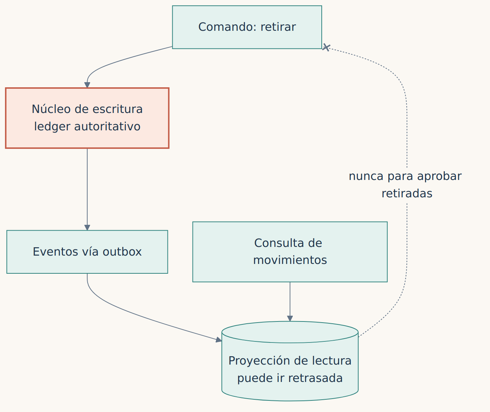

**Español** · [English](../../en/part-4-patterns/21-event-sourcing-cqrs-and-sagas-when-they-help-and-when-they.md)

[← Capítulo 20 · Batch y paralelismo: acelerar sin cambiar el resultado](20-batch-y-paralelismo-acelerar-sin-cambiar-el-resultado.md) · [Índice](../README.md) · [Capítulo complementario · Canales, efectivo ATM y core →](21a-canales-atm-y-core.md)

# Capítulo 21 · Event sourcing, CQRS y sagas: cuándo ayudan y cuándo estorban

> [!IMPORTANT]
> **Tesis del capítulo.** Son patrones excelentes con condiciones de uso precisas. Un ledger de doble entrada no es un flujo de eventos arbitrario, una proyección eventual no debe aprobar retiradas y una compensación no borra lo que un tercero ya ha visto.

## Event sourcing no es contabilidad

Event sourcing tiene un atractivo evidente para sistemas financieros: conservar una sucesión de cambios que permite reconstruir estado. Pero no es sinónimo de contabilidad. Un ledger de doble entrada impone invariantes que un conjunto de eventos arbitrarios no garantiza. Convertir cada operación en evento puede incrementar volumen, complejidad de versiones y necesidad de reprocesamiento. Lo consideraría cuando el dominio necesita historia completa como fuente de verdad, el equipo sabe gestionar esquemas y el coste de reconstrucción está resuelto. No lo impondría a una tabla COBOL por modernidad.

## CQRS no concede autoridad a una proyección

CQRS separa escrituras de lecturas cuando sus necesidades divergen. Es útil para consultas intensivas, búsqueda y reporting. Pero sus proyecciones pueden ir retrasadas. Si una aplicación decide aprobar una retirada consultando una proyección eventual, puede violar reglas que exige evaluar sobre el estado autoritativo. Usaría CQRS para acelerar vistas, no para sustituir sin análisis la decisión de saldo disponible.

*Figura 21.1 · CQRS sin trampas: la proyección sirve para mirar; la decisión sobre el saldo se toma en el núcleo de escritura.*

## Sagas: solo si el negocio admite el estado intermedio

Una saga puede coordinar contratación, documentación o reservas que admiten compensación. No la usaría para ocultar que hemos fragmentado una transferencia antes atómica. La mecánica de compensaciones y publicación fiable pertenece al [capítulo 18](18-distribuir-sin-romper-la-contabilidad.md). Aquí la decisión es si cada estado intermedio tiene significado y aceptación de negocio. Si no los tiene, ese patrón no es la solución.

La regla es exigente y sencilla: **el patrón elegido debe preservar el nivel de consistencia que el negocio necesita, no el nivel que nos resulta más cómodo implementar**.

> **Una proyección eventual sirve para mirar. No sirve para decidir sobre el dinero.**

---

[← Capítulo 20 · Batch y paralelismo: acelerar sin cambiar el resultado](20-batch-y-paralelismo-acelerar-sin-cambiar-el-resultado.md) · [Índice](../README.md) · [Capítulo complementario · Canales, efectivo ATM y core →](21a-canales-atm-y-core.md)
