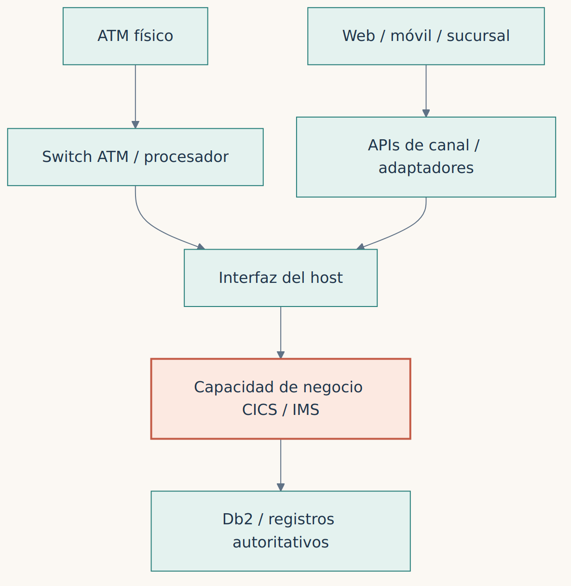
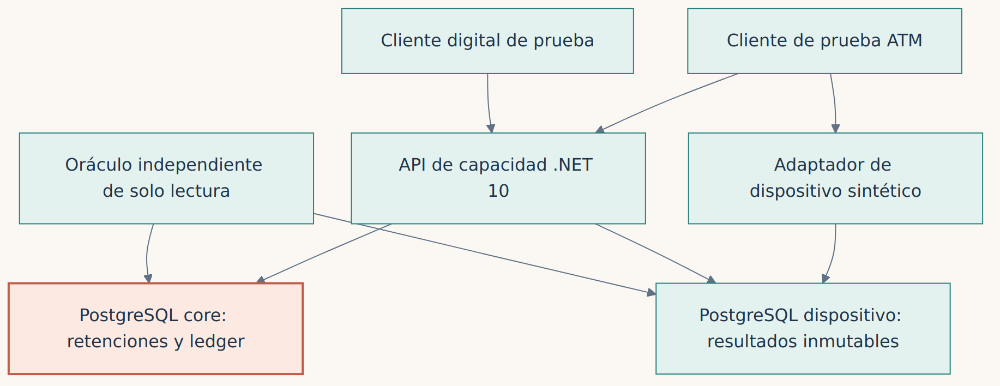
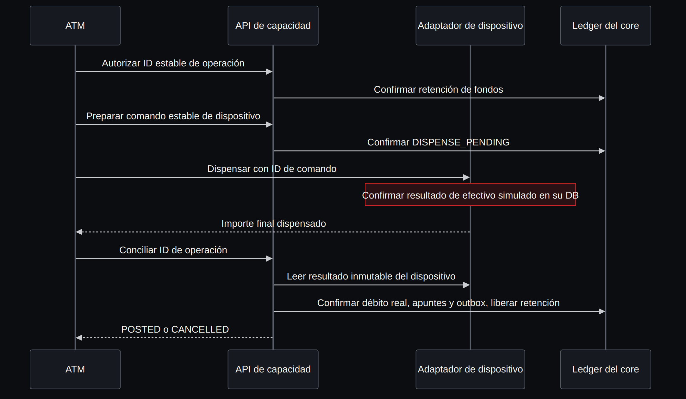
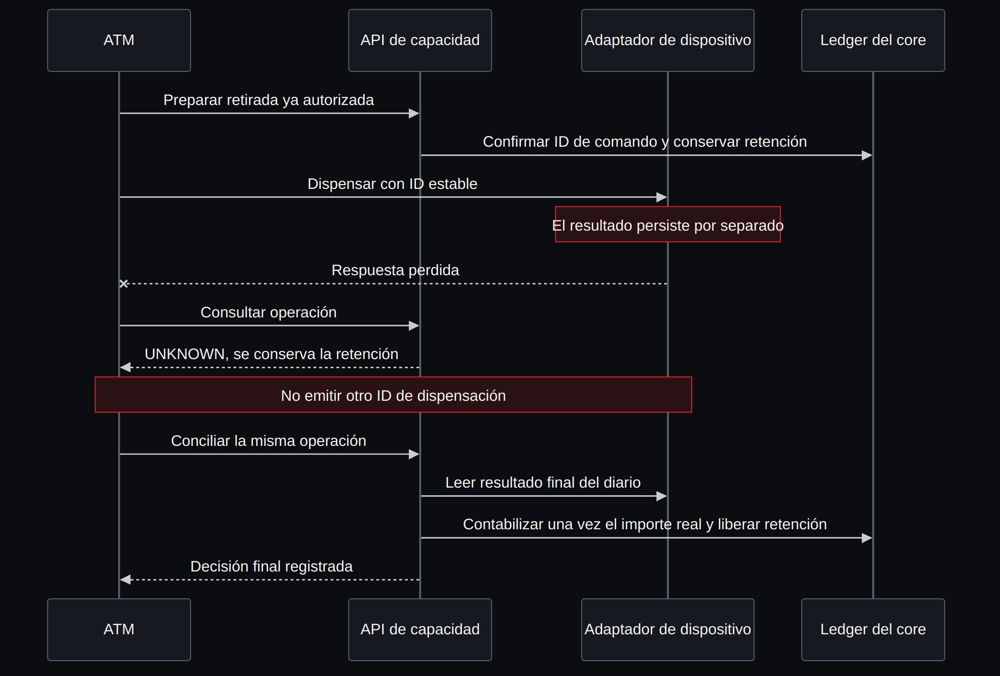
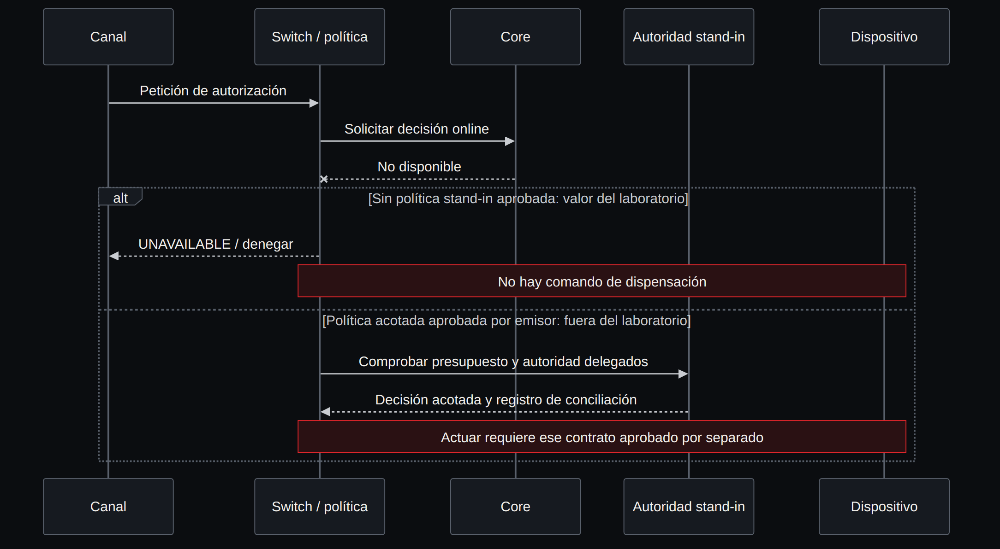
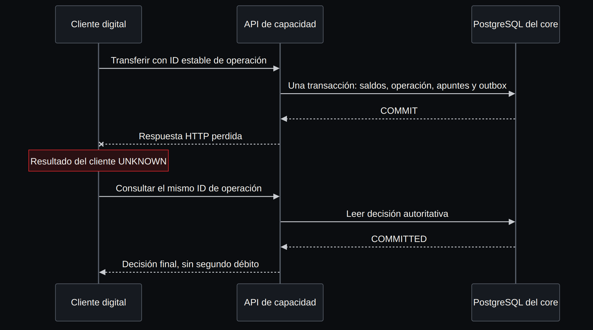

**Español** · [English](../../en/part-4-patterns/21a-channels-atm-and-the-core.md)

[← Capítulo 21 · Event sourcing, CQRS y sagas](21-event-sourcing-cqrs-y-sagas-cuando-ayudan-y-cuando-estorban.md) · [Índice](../README.md) · [Parte V · Capacidad →](../parte-5-capacidad/README.md)

# Capítulo complementario · Canales, efectivo ATM y core

> [!IMPORTANT]
> **Tesis del capítulo.** Un canal bancario inicia una instrucción; un servicio autoritativo decide qué fondos puede utilizar; un dispositivo puede producir un efecto físico irreversible. La migración debe preservar los contratos entre esas responsabilidades. Un COMMIT SQL correcto no demuestra que los billetes hayan llegado al cliente.

## 1. Localizar la autoridad antes de dibujar el reemplazo

Un ATM físico recoge la entrada del cliente y controla dispositivos. Un controlador o switch ATM conecta terminales y enruta mensajes. Un procesador de tarjetas puede prestar servicios de emisor o adquirente; el emisor autoriza el uso de la cuenta de su cliente y el adquirente atiende el lado de aceptación. Esas funciones pueden pertenecer a organizaciones y máquinas distintas. El ledger de cuentas, las retenciones, la decisión antifraude, el ciclo de vida de la tarjeta y la liquidación de red necesitan responsables identificados; llamar a todo «el core» oculta el trabajo de integración.

El Bank of Z educativo de IBM muestra una interfaz de navegador, APIs REST mediante z/OS Connect, procesamiento CICS/IMS, datos Db2/IMS e integración MQ [48]. Ilustra la separación de responsabilidades, no la topología de todos los bancos. Las peticiones CICS pueden originarse en terminales, navegadores, APIs o mensajes; su transacción abarca por defecto una unidad de trabajo, pero SYNCPOINT puede dividir una tarea en varias [49]. Por tanto, la sesión del navegador, la tarea CICS, la unidad de trabajo, la autorización de red y la retirada física necesitan identificadores y reglas de recuperación separados.

*Figura C.1 · Topología inicial ilustrativa: canales y switch acceden a servicios host; el despliegue y la autoridad deben verificarse por instalación.*

El diagrama omite deliberadamente protocolos certificados de dispositivo y red. No permite inferir que todo ATM habla ISO 8583 directamente, que CICS/IMS siempre comparten Db2 o que el host aloja el switch. Las variantes NDC/DDC, los perfiles de red ISO 8583, la integración ISO 20022 y los contratos propietarios del host requieren las especificaciones reales del proveedor y el alcance de homologación. Un UUID sintético de operación no es un STAN, RRN, identificador de autorización de red ni identificador del journal físico.

| Variante de arquitectura | Qué conserva la autoridad | Pregunta de migración y evidencia necesaria |
|---|---|---|
| Core host; web/móvil y switch ATM externos | Capacidad host identificada y sus recursos recuperables | Preservar los límites reales del adaptador, autorización y contabilización; comparar resultados y recuperación de origen |
| Canales modernos invocan REST de z/OS Connect | Servicio CICS/IMS existente, según la ruta instalada | Versionar mappings JSON/servicio y errores de negocio; medir los saltos añadidos sin afirmar que hay un core nuevo |
| Procesamiento emisor externalizado con stand-in delegado | Autoridad delegada aprobada por el emisor y exposición acotada | Conciliar límites replicados, antigüedad y consumo concurrente; obtener aprobación contractual antes de decidir offline |
| Sucursal 3270 o API teller moderna | Transacción/servicio de negocio, no la pantalla | Recuperar contexto pseudoconversacional, permisos y custodia de efectivo; perder la pantalla no autoriza repetir |
| Cuentas, tarjetas, préstamos, fraude y pagos en hosts distintos | Un responsable por capacidad y efecto financiero | Seguir instrucciones entre dominios; definir compensación y conciliación fuera de una unidad de trabajo |
| Core de cuentas nuevo con batch/históricos/productos residuales en host | Nuevo propietario de escritura y responsabilidades host retenidas explícitamente | Retirar adaptadores, credenciales, calendarios, informes y licencias tras resolver sus últimas dependencias y obligaciones de conservación |

Son alternativas de diseño. Este repositorio no ha estudiado instalaciones ni ejecutado las seis arquitecturas.

## 2. Declarar el contrato de retirada antes de elegir un patrón

El [contrato del laboratorio sintético](../../../lab/channels/CONTRACT.md) usa céntimos enteros y políticas inventadas. La cuenta del cliente empieza con 10.000. Autorizar una retirada de 6.000 reserva 6.000 sin contabilizarlos; el disponible pasa a 4.000. La preparación vincula de forma duradera una operación con una orden de dispositivo. Solo un resultado final del dispositivo permite al candidato contabilizar el importe positivo real o cancelar un cero final. La contabilización carga al cliente y abona una cuenta sintética de control de efectivo; este ledger didáctico cerrado no es la política de contabilidad general de un banco.

*Figura C.2 · Destino sintético propuesto: core y dispensador tienen almacenes SQL separados; el oráculo independiente lee ambos.*

Ambas bases de datos se ejecutan en un mismo host de CI. Su separación solo demuestra que una transacción del core no puede deshacer el registro confirmado del dispositivo emulado. El emulador realiza el decremento de inventario y el registro final del journal en una única transacción SQL local. Los billetes reales, sensores, cajetines de retractado y recogida por el cliente no adquieren esa atomicidad por utilizar una base de datos.

| Situación registrada | Acción financiera del candidato | Evidencia necesaria / resultado al cliente |
|---|---|---|
| Autorización aceptada, sin orden preparada | Mantener la retención hasta preparación o caducidad | Sin afirmar entrega de efectivo |
| Orden preparada, sin registro final del dispositivo | Mantener la retención; no emitir un identificador de orden nuevo | UNKNOWN, con investigación/conciliación |
| Importe final del dispositivo igual al solicitado | Contabilizar una vez el importe real; liberar retención | Una decisión financiera y sus asientos/outbox |
| Solicitados 6.000; importe final del dispositivo 4.000 | Contabilizar una vez 4.000; liberar el resto de la reserva | Separar solicitado y entregado; política sintética de efectivo parcial |
| Importe final del dispositivo cero | Cancelar y liberar; sin contabilización financiera | Un cero final es evidencia; un registro ausente no |
| Caduca autorización sin orden preparada | Marcar EXPIRED y liberar | Sin preparación tardía bajo esa autorización |
| Una orden preparada alcanza la caducidad | Mantener UNKNOWN y la retención | Caducar no demuestra ausencia de entrega física |
| COMMIT financiero correcto; respuesta HTTP perdida | Consultar o reintentar el mismo identificador de operación | UNKNOWN del cliente hasta leer la decisión duradera |

Un emisor real debe aprobar entrega parcial, duración de retenciones, reversos, advice tardío, disputas y reparación operativa. POSTED significa aquí la decisión contable local; no significa clearing, presentación o liquidación interbancaria de una red de tarjetas. Son contratos adicionales.

## 3. Seguir el efecto entre éxito e incertidumbre

*Figura C.3 · Camino feliz bajo la política sintética declarada: autorizar, preparar una orden, registrar resultado del dispositivo y contabilizar efectivo real.*

La preparación y la contabilización financiera son transacciones separadas del core. El dispositivo actúa entre ambas. Una excepción C# o un rollback del core tras la entrega no devuelve el dinero al cajero. Una compensación es otra acción de negocio autorizada con su propia traza; no borra la recepción de efectivo por el cliente.

*Figura C.4 · Respuesta del dispositivo perdida: conservar UNKNOWN y la retención, recuperar el resultado del journal original y conciliar una vez.*

Un identificador estable de orden solo sirve si el contrato del dispositivo/proveedor realmente lo deduplica y conserva un journal autoritativo tras los fallos. El adaptador sintético proporciona esa propiedad mediante SQL. Para un terminal real hacen falta pruebas de billetes entregados, parciales, rechazados y retractados, y del significado de un resultado final del journal. La evidencia contradictoria o ausente exige procedimiento operativo, plazo de conciliación y registro de exposición. La implementación actual no automatiza esa reparación.

*Figura C.5 · Core inaccesible: este laboratorio deniega nuevo efectivo; el stand-in aprobado por el emisor es otra política todavía sin implementar.*

Stand-in es una decisión delegada, no un reintento exitoso contra un core caído. Como ejemplo comercial, CSFi describe EZswitch autorizando mediante fichero de saldo positivo y/o límites de tarjeta cuando su host está inaccesible [50]. Esa descripción establece que existe la alternativa; no autoriza nuestro laboratorio ni fija la exposición segura de ningún banco. El laboratorio no tiene presupuesto delegado y no debe dispensar sin autorización online preparada. Los saldos positivos replicados no evitan por sí solos el gasto concurrente en otro lugar.

*Figura C.6 · Transferencia digital con respuesta perdida tras COMMIT: la consulta de estado resuelve la instrucción original sin otro cargo.*

Un BFF web/móvil puede adaptar la presentación y agregar consultas informativas. La autorización de negocio sigue usando la cuenta autoritativa y las retenciones activas; una proyección eventual del saldo no puede aprobar gasto. El outbox registra un evento financiero atómicamente con la decisión, pero una notificación push, SMS o recibo aislado no prueba la contabilización. Reabrir la aplicación debe recuperar el identificador y la decisión originales, no inventar otra instrucción.

## 4. Elegir patrones contra el contrato del canal

| Problema | Candidato y beneficio | Coste, límite de fallo y control |
|---|---|---|
| Evolucionar UI conservando comportamiento host | Gateway/BFF y adaptador semántico | Saltos y divergencia del mapping; preservar errores de origen, identidad y aprobación de negocio |
| Efectivo entregado fuera de la transacción del ledger | Máquina de estados duradera, retenciones y conciliación de journal independiente | UNKNOWN puede persistir; evidencia inmutable, responsable operativo y plazos de disputa |
| Gasto concurrente móvil y ATM | Un ledger autoritativo con disponible verificado bajo locks | Contención de cuentas calientes; probar ambos canales contra la misma reserva |
| Respuesta HTTP perdida | Identidad duradera y endpoint de estado | La conservación de identidad es un contrato; rechazar reutilización incompatible y no prolongar caducidad al reintentar |
| Lecturas informativas lentas | CQRS con frescura/watermark | Datos desactualizados; separar visualización de aprobación financiera y definir lectura de las propias escrituras |
| Procesador, fraude y ledger confirman independientemente | Orquestación duradera con compensaciones explícitas | Sin rollback global; identificar cada efecto irreversible y responsable de conciliación |
| Host inaccesible | Denegar o aplicar stand-in acotado aprobado por separado | Disponibilidad frente a exposición crediticia/fraude; probar agotamiento de presupuesto, límites antiguos y recuperación |
| Cambiar ruta de canal o core | Strangler con un propietario de escritura por dominio financiero | Coste de coexistencia y homologación; shadow de lectura, fencing en origen y seguimiento de operaciones en vuelo |

**Decisión de este incremento.** Utilizar máquina de estados duradera explícita, un ledger SQL y un journal separado de dispositivo. Evitar actores, broker o protocolo ficticio antes de poder refutar este contrato. Se descarta el cargo inmediato al autorizar para este ejemplo porque necesitaría otra política aprobada de reversos ante efectivo nulo/parcial. La elección sigue siendo un ADR didáctico, no una recomendación para un banco sin identificar.

## 5. Hacer que el laboratorio pueda refutarse a sí mismo

La [guía de reproducción en inglés](../../../lab/channels/README.md) especifica .NET 10, Podman, dos instancias PostgreSQL, identidades desechables fijas y conservación de evidencia original. Su matriz inicial incluye efectivo completo/parcial/nulo, ausencia de evidencia del dispositivo, respuestas perdidas, terminación externa de procesos, duplicados/conflictos, caducidad y gasto concurrente móvil/ATM. Una afirmación sobre pérdida HTTP requiere una API nativa; imprimir una excepción por consola no ejercita ese límite.

| Grupo de oráculo independiente | Evidencia examinada | Contradicción que debe rechazar |
|---|---|---|
| Proyección | Fondos iniciales, todos los asientos y saldos resultantes | Saldo negativo o sin explicación |
| Conservación | Ambas cuentas de clientes y cuenta sintética de control de efectivo | Cambia el total del mundo cerrado |
| Identidad y finalidad | Instrucción original ofrecida, intención almacenada y decisión | Intención cambiada con el mismo ID o finalidad inválida |
| Asientos pareados | Cada decisión financiera y ambos asientos | Cargo/abono ausente, extra o de importe incorrecto |
| Outbox financiero | Decisión y evento en el snapshot del core | Evento financiero ausente, duplicado o incorrecto |
| Retenciones y disponible | Estado de autorización, reservas y saldo | Retención pendiente liberada o gasto excesivo entre canales |
| Conciliación del dispositivo | Journal separado, orden, importe real e inventario | Contabilizar efectivo sin soporte o perder el efecto del dispositivo tras rollback del core |

La conservación aislada es insuficiente: un cargo excesivo con abono equivalente sigue cuadrando. Por ello, los controles negativos alteran copias de observaciones SQL para introducir efectivo contabilizado de más conservando el total, y una falsa decisión final sin asientos/outbox. El oráculo independiente debe rechazarlos conservando las observaciones originales sin modificar. Ni el acuerdo candidato/oráculo ni los fixtures sintéticos aportan aprobación de negocio: el gate de autorización productiva sigue bloqueado hasta disponer del contrato de origen y responsables aprobadores.

El estado de ejecución y la procedencia CI exacta corresponden al checkpoint de evidencia del laboratorio. Este capítulo describe el diseño declarado; no convierte un escenario sin ejecutar en prueba superada. La matriz restante del issue #30 incluye particiones de red por salto, correlación de protocolo real, stand-in delegado, conmutación de rutas y medición de latencia/capacidad.

## 6. Migrar al propietario y después retirar la ruta

Migrar primero el canal puede sustituir la presentación web/móvil conservando el host de cuentas como autoridad. Migrar primero una capacidad puede sustituir el servicio de cuentas conservando el adaptador del canal. Las cohortes de producto o sucursal acotan exposición, pero requieren propiedad coherente cuando el cliente utiliza otro canal. Empezar por procesamiento emisor o switch ATM cambia límites externos homologados; empezar por una fachada los conserva temporalmente. Empezar por CDC puede alimentar lecturas, pero no transfiere autoridad de escritura. Un big bang reduce la coexistencia a costa de ampliar el problema de corte y recuperación.

El corte necesita manifiesto de cohorte, época de propietario de escritura impuesta en origen, drenaje de autorizaciones en vuelo, watermark de conciliación y tratamiento de mensajes tardíos de dispositivo/red. El shadow de lectura nunca debe enviar otra autorización o dispensación. Una feature flag por sí sola no cerca al escritor antiguo. Devolver tráfico a la ruta anterior tras nuevas entregas de efectivo requiere datos conciliados y transferencia de propiedad; volver a cambiar la flag no revierte la entrega. Son mecanismos pendientes obligatorios, no ejercitados por el primer laboratorio de canales. El [capítulo de coexistencia](../parte-7-organizacion/30-del-laboratorio-a-un-sistema-que-sigue-operando.md) desarrolla el problema de propiedad.

| Canal / límite | Regla y autoridad de datos | Patrón, riesgo y oráculo | Evidencia para retirar |
|---|---|---|---|
| ATM a dispositivo/switch | Efectivo entregado y autorización aprobada por emisor; contrato de protocolo pendiente | Orden estable y journal; efectivo irreversible; comparación del importe real | Sin efectivo incierto pendiente; rutas homologadas y dependencias de terminal retiradas |
| Web/móvil a API de cuentas | Disponible autoritativo e ID duradero de operación | BFF/adaptador, SQL/outbox; respuesta perdida; verificaciones de estado/ledger/retención | Clientes recuperan decisiones; endpoint antiguo cercado y sin uso |
| Teller/3270 o API | Autoridad del empleado, custodia y UOW de origen | Recuperación semántica de sesión; riesgo de repetición; recibo y conciliación de caja | Sesiones drenadas, dispositivos/operadores migrados, controles aceptados |
| Emisor/red de tarjetas | Autorización, clearing y liquidación con responsable cada uno | Delegación acotada; mensajes tardíos/duplicados; conciliación de red | Aprobación de esquema/proveedor, ventana tardía y dependencias batch/informes cerradas |
| API de socios/open banking | Consentimiento/identidad y autoridad de negocio de cuentas | Gateway y contrato versionado; consentimiento revocado/lecturas antiguas; auditoría de autorización | Certificados/rutas/consumidores retirados según conservación aprobada |

Efectivo UNKNOWN pendiente, importes journal/ledger distintos, mensajes tardíos sin procesar, un segundo escritor sin fencing o falta de homologación necesaria justifican aplazar un corte real. El equipo externo y la aprobación del emisor no bloquean integrar este ejemplo acotado: son validaciones posteriores explícitas. Para hacerlas realistas, sustituir la atomicidad supuesta del emulador por resultados instrumentados del dispositivo, reglas aprobadas, fallos reales de transporte y procedimientos de conciliación; conservar fallos y evidencia bruta antes de concluir.

## 7. Advice tardío, reversos y efectivo: una correlación no es una autorización

Consideremos una retirada autorizada por 100,00 unidades monetarias: el dispositivo acredita que entregó **60,00**, pero el switch todavía conserva un advice con el importe solicitado de 100,00. El ledger registra 60,00 y aparece después una solicitud de reverso íntegro. Es incorrecto inferir automáticamente «cargo 100» o «abono 100»: hace falta identificar qué dinero fue físicamente accesible, qué cargo se confirmó, qué mensaje es una solicitud y quién puede resolver la discrepancia. Una petición de reverso no equivale a un reverso asentado.

El [dossier de investigación ES](../../../docs/research/channel-late-advice.es.md) ([EN](../../../docs/research/channel-late-advice.en.md)) contrasta este riesgo con las guías públicas de disputas ATM y reglas de stand-in. El [oráculo forense de canales](../../../lab/channels/advice_gate.py) añade una prueba **sintética, puramente local** que compara cuatro instrucciones y sus observaciones sin modificar ninguna base de datos:

| Caso sintético | Resultado correcto del oráculo | Lo que nunca permite |
| --- | --- | --- |
| Dispensación de 60 sobre autorización de 100; advice idéntico repetido | `MATCHED_PARTIAL_CASH` | Duplicar asientos o dispensación |
| Dispensador sin resultado definitivo; mensaje de red de importe 80 | `UNKNOWN_REQUIRES_DEVICE_EVIDENCE` | Convertir advice en prueba física o en cargo |
| Diario físico confirma cero, con solicitud de reverso tardía | `FINAL_ZERO_CASH` | Suponer contabilizado el reverso solicitado |
| El core no responde y no existe delegación de autorización | `STAND_IN_DENIED` | Crear un autorizador alternativo por su cuenta |

Para correlacionar no basta con STAN o RRN: hay que conservar el **ID duradero de operación**, autorización, terminal, contexto de red y encarnación de origen. Un STAN puede reutilizarse; dos mensajes con el mismo identificador de transmisión y diferente contenido son una contradicción, no un reintento idempotente. Un reverso solicitado después de una entrega parcial exige revisión explícita y oráculos que permitan detectar un abono falso.

No se introduce una nueva implementación de ISO 8583 ni un emulador de cajero certificado. El nuevo control utiliza datos inventados; **no comprueba autenticidad de journal físico, políticas del emisor, reconciliación de esquemas ni operaciones bancarias reales**. Complementa las diez pruebas nativas anteriores de .NET 10/PostgreSQL, pero no reutiliza sus resultados como evidencia de protocolos de tarjeta. Incluso si sus casos Python pasan, no autoriza de forma automática dispensar, contabilizar o revertir y conserva **TODM G2 INCONCLUSIVE / G6 BLOCK**.

---

[← Capítulo 21 · Event sourcing, CQRS y sagas](21-event-sourcing-cqrs-y-sagas-cuando-ayudan-y-cuando-estorban.md) · [Índice](../README.md) · [Parte V · Capacidad →](../parte-5-capacidad/README.md)
