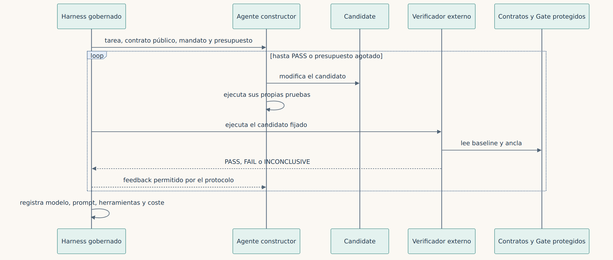

**Español** · [English](../../en/part-6-lab/29-bringing-in-agents-without-letting-them-write-the-approval.md)

[← Capítulo 28 · Transferencias, bloqueos y fallos en local](28-transferencias-bloqueos-y-fallos-en-local.md) · [Índice](../README.md) · [Parte VII · De la evidencia a la organización →](../parte-7-organizacion/README.md)

# Capítulo 29 · Incorporar agentes sin permitir que escriban el aprobado

> [!IMPORTANT]
> **Tesis del capítulo.** El siguiente paso es poner un agente a construir el candidato. Puede consultar, ejecutar y corregir; no puede tocar los casos reservados ni el evaluador. Y cada cambio de modelo, prompt o presupuesto es una condición experimental distinta.

## El siguiente paso tiene dos modos

Separaría la demostración determinista de un experimento con agentes. En el primer modo, conservamos implementaciones, entradas y expectativas fijadas para explicar el proceso. En el segundo, un agente recibe una tarea de construcción y debe producir un candidato bajo restricciones registradas.

El agente puede consultar fuentes y el contrato público, ejecutar sus tests y corregir el programa. No puede cambiar los casos reservados ni el evaluador de aceptación. Un verificador externo ejecuta el candidato en un entorno controlado. El informe devuelve información suficiente para corregir, conforme al protocolo del experimento.

*Figura 29.1 · Un agente constructor dentro de un harness gobernado: corrige contra un verificador externo que no controla.*

Si cambiamos modelos, presupuestos, prompts o herramientas, lo registramos como una condición experimental distinta. Decir que «lo hizo la IA» no permite explicar qué combinación produjo el resultado ni repetir el proceso.

Un agente investigador puede proponer reglas desde políticas, entrevistas y observaciones autorizadas; el COBOL es una fuente auxiliar cuando sea necesario. El constructor puede **programar desde cero** la capacidad en C# sin copiar la estructura del legado. TODM compara el resultado con oráculos independientes y reglas aprobadas; Golden Master conserva por separado el comportamiento observado. La autoridad del negocio decide qué mantener, corregir o retirar.

## Un piloto constructor ejecutado, no una tasa de éxito poblacional

El [piloto del 8 de noviembre de 2026](../../../evidence/runs/e4-live-builder-2026-11-08.json)
hizo una solicitud real a un despliegue existente de Azure Foundry de
`gpt-5.6-terra`, versión `2026-07-09`. La solicitud contenía solo el contrato
público sintético de comisiones, no la implementación COBOL, los casos
reservados ni el verificador. El modelo devolvió un programa C# completo y
16 vectores de prueba escritos por él.

El supervisor compiló y ejecutó ese fuente en WSL/Docker local, no en la VM
experimental de Azure. El candidato no tenía red ni credenciales, se ejecutó
como usuario no privilegiado con el sistema de archivos raíz de solo lectura
y recursos limitados, y no podía montar el repositorio ni el evaluador. Los
hashes originales protegidos permanecieron intactos.

El programa generado pasó sus 16 pruebas y los 58 casos congelados del gate
independiente. Sus pruebas también aceptaron la referencia correcta y
rechazaron los tres mutantes conocidos: redondeo al par, umbral de revisión
incorrecto y aprobación de cuentas inactivas. Una cualificación separada
volvió a verificar el gate independiente y tres escrituras protegidas
denegadas. Estos controles son variantes relacionadas de una tarea,
**no cuatro proyectos independientes**.

La respuesta registró **269 tokens de entrada y 2.279 de completado: 2.548 en
total**. El límite declarado antes de ejecutar era de tres solicitudes y
4.000 tokens de completado por solicitud; no hizo falta pedir una corrección.
Una segunda evaluación local reprodujo la misma respuesta sin volver a llamar
al modelo. Los [comandos de reproducción](../../../lab/e4_agents/README.md#live-azure-builder-pilot)
conservan prompts, respuesta, consumo, fuente generado, vectores de prueba,
identidad de imagen, configuración de contenedores y veredictos independientes.
Reproducir una respuesta guardada verifica evidencia determinista; volver a
preguntar al modelo no tiene por qué producir código idéntico.

Es un **flujo dirigido por un modelo con supervisor fijo**, no una demostración
de un agente autónomo que elige herramientas. El veredicto sigue siendo
`DEMO_ONLY / SIMULATED_ALLOW`. No se midieron duración de revisión humana,
factura ni coste por cambio aceptado. Una tarea sintética resuelta no completa
E4 ni demuestra que una condición de pruebas sea superior a otra.

### El mismo candidato, evaluado después en Azure

La [reproducción separada en Azure](../../../evidence/runs/azure-e1-e4-2026-11-08.json)
ejecutó ese candidato sin cambios y el evaluador independiente con Podman sin
privilegios en la VM privada del laboratorio. Volvió a superar 16 pruebas propias
y 58 casos congelados; se rechazaron tres mutantes y se denegaron tres escrituras
protegidas. El consumo original sigue siendo 2.548 tokens: la reproducción hizo
**cero llamadas nuevas al modelo**. El fallo inicial de permisos de directorio y
la repetición corregida, ambos archivados, muestran por qué la frontera debe
probarse en el anfitrión de destino y no deducirse de la configuración local.
Esto añade evidencia de ejecución, no aprobación humana ni otra tarea independiente
para las estadísticas comparativas.

## REA entra cuando el problema lo necesita

Para el fuente pequeño del laboratorio no necesitamos un decompilador. Incluir REA por obligación estética añadiría complejidad sin aclarar la prueba. Su integración tiene sentido cuando la capacidad investigada reside en un artefacto que sus herramientas ayudan a examinar.

Una extensión coherente consistiría en tomar un ejecutable autorizado, fijar su hash y pedir a un agente que investigue una función concreta mediante REA. Los hallazgos alimentarían hipótesis y pruebas. La reconstrucción se evaluaría después contra un oráculo adecuado. El resultado documentaría qué se observó directamente y qué se dedujo.

Para sistemas COBOL de mayor tamaño, empezaría por las **capacidades, contratos externos, excepciones y garantías operativas**. Sólo ante una duda técnica concreta evaluaría parsers de dialecto o herramientas de dependencias. MCP puede exponer los hallazgos, pero el análisis sintáctico no es un requisito para reprogramar el sistema ni autoriza una regla de negocio.

## Los errores correlacionados siguen siendo posibles

Dos agentes pueden repetir la misma interpretación equivocada. Cambiar de modelo tampoco garantiza independencia. Si ambos reciben una especificación incorrecta y el evaluador deriva de esa misma especificación sin revisión, el circuito puede confirmar su propio error.

La defensa requiere diversidad de evidencia: comportamiento observado, reglas aprobadas, propiedades conocidas y controles adversariales. En una evaluación seria también conviene separar quién construye la solución de quien prepara los casos ocultos y adjudica los resultados.

Anthropic distingue entre flujos definidos por código y agentes que deciden dinámicamente sus pasos y herramientas [11]. Esa distinción ayuda a describir con precisión lo que hemos construido. Nuestro laboratorio es un flujo determinista. El experimento futuro puede incorporar autonomía, pero esa autonomía debe demostrar que añade valor frente a una ruta más simple.

En «Agentes al vuelo frente a un harness gobernado» comparé agentes de línea de comandos más allá de la demo y llegué a una conclusión incómoda: la detección de defectos, la fiabilidad y el control de calidad tienen un coste, y ese coste no desaparece; se paga midiendo o se paga en producción [41]. En una modernización COBOL, el harness gobernado es el que fija el mandato del capítulo [9](../parte-2-arqueologia-y-autoridad/09-de-la-autoridad-del-agente-a-la-autoridad-de-la-regla.md), protege el gate del capítulo [10](../parte-3-oraculos/10-todm-y-el-problema-de-aceptar-lo-que-construimos.md) y registra cada intento para el estudio del capítulo [34](../parte-7-organizacion/34-medir-lo-que-todavia-no-sabemos.md).

La forma concreta de ese harness la construí en «Del modelo que responde al agente que trabaja», con C#, .NET 10 y Microsoft Foundry: el harness gobierna la planificación, el estado, las herramientas y las aprobaciones, y CodeAct ejecuta de forma compacta las tareas intensivas en datos y llamadas a herramientas [43]. Y en «MCP, A2A y AHP» expliqué por qué esas tres siglas resuelven problemas distintos en capas distintas y por qué un agente debería vivir en un contenedor [46]. Es la misma razón por la que el laboratorio se ejecuta en un contenedor sin red, y por la que el experimento E4 debería encerrar al agente constructor en uno.

> **Decir que «lo hizo la IA» no permite explicar qué combinación produjo el resultado ni repetir el proceso.**

---

[← Capítulo 28 · Transferencias, bloqueos y fallos en local](28-transferencias-bloqueos-y-fallos-en-local.md) · [Índice](../README.md) · [Parte VII · De la evidencia a la organización →](../parte-7-organizacion/README.md)
