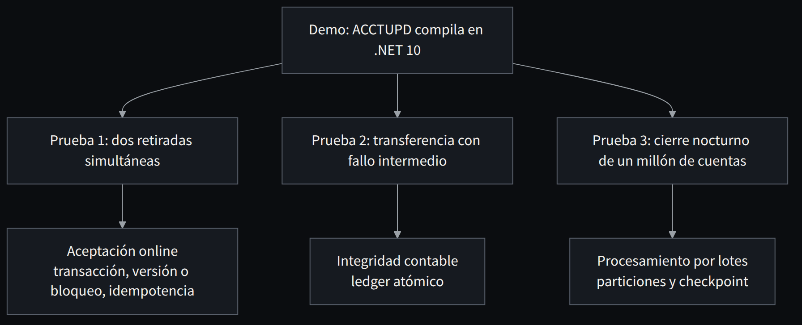

**Español** · [English](../../en/part-7-organization/32-a-migration-story-the-account-that-looked-easy.md)

[← Capítulo 31 · El SDLC como parte del motor de migración](31-el-sdlc-como-parte-del-motor-de-migracion.md) · [Índice](../README.md) · [Capítulo 33 · Plan de modernización: primero una prueba de capacidad, después una apuesta →](33-plan-de-modernizacion-primero-una-prueba-de-capacidad.md)

# Capítulo 32 · Una historia de migración: la cuenta que parecía fácil

> [!IMPORTANT]
> **Tesis del capítulo.** Un programa que compila en .NET 10 no es una cuenta migrada. Tres pruebas —dos retiradas simultáneas, una transferencia y un cierre nocturno— bastan para descubrir tres responsabilidades que no estaban en el mapa de programas.

Imaginemos un banco ficticio con un programa `ACCTUPD` escrito en COBOL. Procesa cargos e ingresos, consulta una tabla de límites, registra movimientos y participa en un proceso de cierre nocturno. La primera demo muestra un fragmento pequeño: entrada, validación de saldo, nueva cantidad y escritura. Un LLM produce C# comprensible. La dirección celebra que el programa ya compila en .NET 10. El equipo técnico pide entonces tres pruebas más.

Primera prueba: dos retiradas simultáneas. El servicio sin control de concurrencia aprueba ambas. La solución no es añadir un `lock` en un controlador web: ese lock solo protege un proceso y el banco tendrá varios nodos. Introducimos una transacción y versionado o bloqueo a nivel de base, con clave idempotente. Los actores pueden reducir conflictos por identidad, pero el commit sigue siendo la frontera decisiva.

Segunda prueba: una transferencia. Hay dos cuentas y dos escrituras. Un error entre ambas demuestra que la secuenciación en memoria no basta. Pasamos a un ledger con operación atómica dentro de una base, o definimos formalmente un protocolo de compensación cuando el movimiento cruza sistemas donde la atomicidad local no es posible. El negocio decide qué estados intermedios son observables y cuáles no.

Tercera prueba: cierre nocturno. Una versión distribuida intenta calcular un millón de cuentas con un actor por cuenta y demasiadas escrituras pequeñas. El tiempo de commit domina el perfil. Reorganizamos el trabajo por particiones estables, batch de escrituras, controles idempotentes y checkpoint. El código final se parece menos al COBOL original. El comportamiento y los invariantes se parecen más al sistema que realmente necesitamos.

En este punto ya no estamos traduciendo una rutina. Hemos identificado tres responsabilidades distintas: **aceptación online**, **integridad contable** y **procesamiento por lotes**. Separarlas permite desplegar y medir cada una con criterios propios. Esta descomposición no estaba necesariamente en el mapa de programas legado. Es una decisión de arquitectura basada en responsabilidades, no en nombres de ficheros.

*Figura 32.1 · Tres pruebas, tres responsabilidades que no estaban en el mapa de programas.*

> **El código final se parece menos al COBOL original. El comportamiento se parece más al sistema que realmente necesitamos.**

---

[← Capítulo 31 · El SDLC como parte del motor de migración](31-el-sdlc-como-parte-del-motor-de-migracion.md) · [Índice](../README.md) · [Capítulo 33 · Plan de modernización: primero una prueba de capacidad, después una apuesta →](33-plan-de-modernizacion-primero-una-prueba-de-capacidad.md)
