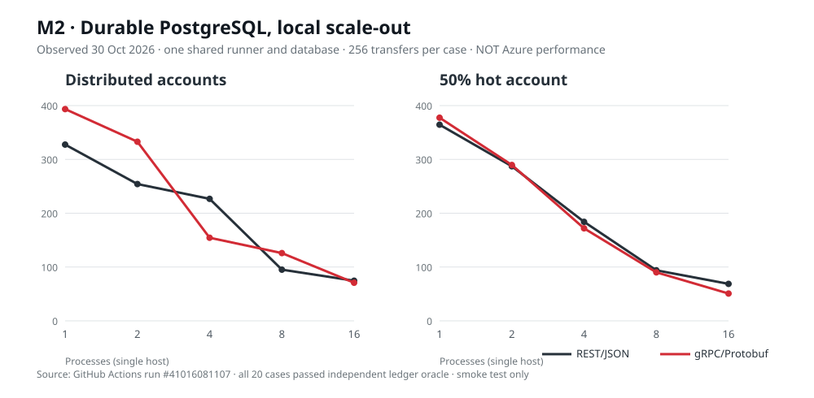

# M2 · Escalado horizontal local con ledger PostgreSQL real

**Ejecutado y verificado el 30 de octubre de 2026.** [English](M2.md)

<underline>El resultado contraintuitivo también es evidencia:</underline> **aumentar de 1 a 16 procesos en el mismo runner empeoró el rendimiento**. Esto no refuta el escalado horizontal en Azure: muestra la sobrecarga y contención cuando ni la CPU de la máquina ni el ledger aumentan con el número de procesos.



## Transferencias realmente confirmadas por segundo (20 casos)

| Réplicas | Uniforme REST | Uniforme gRPC | Cuenta caliente REST | Cuenta caliente gRPC |
|---:|---:|---:|---:|---:|
| 1 | 327,59 | 393,55 | 364,49 | 377,49 |
| 2 | 254,24 | 332,82 | 287,2 | 289,68 |
| 4 | 226,77 | 154,45 | 184,06 | 171,88 |
| 8 | 95,11 | 125,86 | 93,92 | 90,14 |
| 16 | 74,62 | 70,73 | 68,7 | 50,76 |

## Latencia p99 medida, milisegundos

| Réplicas | Uniforme REST | Uniforme gRPC | Cuenta caliente REST | Cuenta caliente gRPC |
|---:|---:|---:|---:|---:|
| 1 | 358,058 | 246,554 | 244,529 | 248,724 |
| 2 | 352,036 | 310,186 | 364,508 | 331,248 |
| 4 | 573,697 | 1010,5 | 612,033 | 690,342 |
| 8 | 1152,908 | 1158,944 | 1065,188 | 1121,307 |
| 16 | 1940,251 | 2025,398 | 1912,24 | 2106,017 |

**Condiciones:** 256 operaciones únicas por caso, concurrencia 16, REST/JSON o gRPC/Protobuf sobre HTTP/2 sin TLS, una base PostgreSQL 16.13 compartida, 1–16 servicios .NET 10 en el mismo runner. La variante «hot» concentra el 50 % de las solicitudes en una cuenta. La variante uniforme utiliza varias cuentas de la población sintética, no reproduce una distribución bancaria de producción.

**El oráculo independiente:** en cada caso verificó 256 operaciones confirmadas, 512 asientos, 256 eventos outbox, conservación y conciliación contable. Una manipulación intencionada de un asiento fue rechazada y restaurada. Ningún caso terminó con una divergencia aceptada.

**Interpretación:** no se deduce que gRPC sea siempre más rápido. Aumentar procesos compite por la CPU del runner y por una sola base de datos. El flujo de cliente es *closed-loop*; puede ocultar latencia bajo carga abierta y el número de operaciones es bajo. Hay ruido de JIT/cachés, orden de escenarios y falta de repetición estadística. Por tanto las cifras **no son un resultado de E3, una comparativa Azure/local ni un cálculo MIPS**.

## Procedencia reproducible

- [CI original #41016081107](https://github.com/jmfloreszazo/de-la-caja-negra-a-la-evidencia/actions/runs/41016081107), commit `c9152d50c9ca713eda0627341233221b9c1180a3`, job `123932598591`.
- [JSON versionado de los 20 casos](m2-local-observations.json), extraído de la salida estructurada de la CI.
- [ZIP original: informes completos por caso, logs y resumen](https://github.com/jmfloreszazo/de-la-caja-negra-a-la-evidencia/actions/runs/41016081107/artifacts/12959965944).
- [Código del experimento](../../lab/durable_rpc/) y [oráculo SQL independiente](../../lab/e1_pg/oracle.py).

```bash
python3 scripts/check_m2_observations.py
GITHUB_TOKEN=... python3 scripts/check_m2_observations.py --online
```

**Próxima puerta:** ejecutar réplicas sobre nodos realmente independientes y medir escala 1/2/4/8/16 con un generador abierto, TLS/mTLS, reparto gRPC por RPC y saturación del ledger, además de la pérdida de instancia y coste por millón de commits. Sigue en [issue #12](https://github.com/jmfloreszazo/de-la-caja-negra-a-la-evidencia/issues/12).
